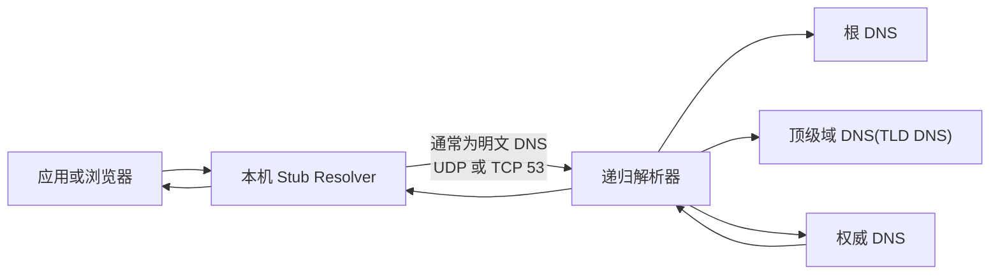
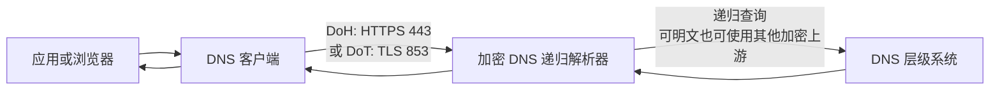
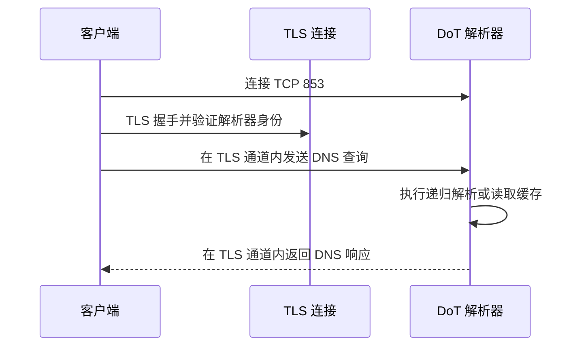
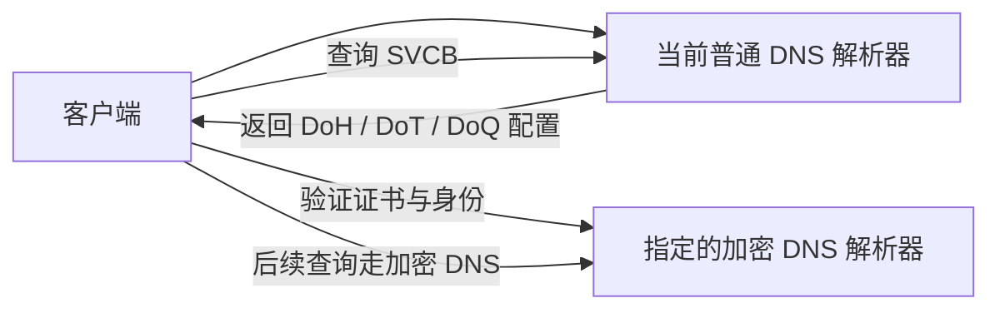

[toc]

## DNS解析方案

| 协议 | 是否加密 | 默认端口 | 当前推荐度 |
| ---- | -------- | -------- | ---------- |
| DNS  | ❌        | 53       | ★          |
| DoT  | ✅        | 853      | ★★★        |
| DoH  | ✅        | 443      | ★★★★★      |
| DoQ  | ✅        | 853(UDP) | ★★★★★      |

| 特性               | 传统 DNS   | DoT          | DoH            | DoQ           |
| ------------------ | ---------- | ------------ | -------------- | ------------- |
| 全称               | DNS        | DNS over TLS | DNS over HTTPS | DNS over QUIC |
| 默认端口           | UDP/TCP 53 | TCP 853      | HTTPS 443      | UDP 853       |
| 加密               | ❌          | ✅ TLS        | ✅ HTTPS/TLS    | ✅ QUIC/TLS    |
| ISP可看到查询内容  | ✅          | ❌            | ❌              | ❌             |
| ISP可识别是DNS流量 | ✅          | ✅            | 很难           |               |
| 穿透网络限制能力   | 弱         | 一般         | 强             | 最强          |
| 性能               | 快         | 略慢         | 较好           | 最佳          |
| 多路复用           | ❌          | ❌            | HTTP/2、HTTP/3 | 原生支持      |
| 丢包恢复           | 无         | TCP重传      | TCP重传        | QUIC重传      |

## DoH 与 DoT 系统介绍

DoH（DNS over HTTPS）和 DoT（DNS over TLS）都是“加密 DNS”方案，目标是把传统明文 DNS 查询加密起来，减少被本地网络、公共 Wi-Fi、运营商链路或中间人监听、篡改和劫持的风险。

- DoH 的标准是 RFC 8484，它把每一次 DNS 查询和响应映射为一次 HTTPS 交换；
- DoT 的标准是 RFC 7858，它使用 TLS 为 DNS 提供传输层加密。([IETF Datatracker](https://datatracker.ietf.org/doc/html/rfc8484))

它们解决的是“客户端到递归解析器”这一段的隐私与完整性问题，而不是让整个 DNS 体系完全隐身。

> 递归解析器仍然能看到你的查询内容，权威 DNS 仍可能看到解析器发出的部分查询，网站服务器也能从后续连接中看到你的访问行为。IETF 的 DNS 隐私分析文档 RFC 9076 专门指出，DNS 隐私问题涉及查询名、客户端身份、链路监听、服务器侧数据收集与推断等多个层面，不能只靠单一加密传输协议完全解决。([IETF Datatracker](https://datatracker.ietf.org/doc/rfc9076/))

------

## 先理解传统 DNS

传统 DNS 解析大致是这样：

常见角色如下：

| 角色                            | 作用                              | 新手理解                                |
| ------------------------------- | --------------------------------- | --------------------------------------- |
| 应用或浏览器                    | 发起访问请求                      | 你输入 `example.com` 的地方             |
| Stub Resolver                   | 操作系统或应用内的本地 DNS 客户端 | 负责把查询交给上游解析器                |
| 递归解析器                      | 帮你查完整个 DNS 链路             | 常见于运营商、公司网关、公共 DNS 服务商 |
| 根 DNS / **TLD DNS** / 权威 DNS | DNS 层级系统中的不同层            | 最终告诉递归解析器域名对应什么记录      |
| DNS 缓存                        | 减少重复查询                      | TTL 未过期时直接复用结果                |

传统 DNS 最大的问题是：客户端到递归解析器之间通常是明文 UDP/TCP 53。旁路监听者能看到你查了什么域名，路径上的攻击者也可能篡改响应，例如把域名解析到错误 IP。

------

## DoH 和 DoT 的核心思想

DoH 和 DoT 都是把 DNS 查询“装进加密通道”里：

可以把它理解为：

| 传统 DNS                     | 加密 DNS                               |
| ---------------------------- | -------------------------------------- |
| 明信片：路上谁都可能看见内容 | 信封：路上只能看到你寄给谁，内容被加密 |
| 容易被本地网络监听           | 本地网络难以直接看到查询内容           |
| 容易被链路中间人篡改         | TLS 认证通过时可防止中间人篡改         |
| 解析器仍然是信任中心         | 解析器仍然是信任中心                   |

关键点是：DoH/DoT 保护的是“你到解析器”的通道，不是让解析器本身看不见你查了什么。

------

## DoH 是什么

DoH 是 DNS over HTTPS。它把 DNS 查询封装在 HTTPS 请求中，使用标准 HTTPS 机制进行加密、认证、复用和传输。

RFC 8484 规定 DoH 客户端可以用 HTTP GET 或 POST 发送 DNS 查询；DoH 服务端必须支持 GET 和 POST；DNS 消息通常使用 `application/dns-message` 媒体类型，内容仍是 DNS wire format。([IETF Datatracker](https://datatracker.ietf.org/doc/html/rfc8484))

DoH 的典型请求路径类似 `/dns-query`，但具体路径由服务端定义。对外看起来，它使用的是 HTTPS，通常走 443 端口，因此在很多网络中更容易穿透，也更容易与普通 Web 流量混在一起。

DoH 常见部署方式有两类：

| 部署方式       | 特点                                    | 适用场景                        |
| -------------- | --------------------------------------- | ------------------------------- |
| 浏览器内置 DoH | 只影响浏览器自身解析                    | 普通用户快速提升浏览器 DNS 隐私 |
| 系统级 DoH     | 影响整个操作系统或大部分应用            | 希望统一管理所有应用 DNS        |
| 本地代理转 DoH | 本机或路由器运行代理，再转发到 DoH 上游 | 家庭网关、开发者、软路由        |
| 企业托管 DoH   | 企业指定解析器、策略和日志规范          | 公司网络、零信任接入、合规场景  |

------

## DoT 是什么

DoT 是 DNS over TLS。它不走 HTTP，而是在 DNS 与 TCP 之间加入 TLS 加密层。RFC 7858 规定，支持 DoT 的 DNS 服务器默认应监听 TCP 853 端口；客户端默认也应连接服务器的 853 端口，且该端口不应混用明文 DNS。([IETF Datatracker](https://datatracker.ietf.org/doc/html/rfc7858))

DoT 的结构更“DNS 原生”：仍然是 DNS 协议，只是套上 TLS。它的流量特征也更清晰：网络管理员可以很容易识别 TCP 853 是加密 DNS，因此 DoT 更适合需要显式管控 DNS 出口的环境，例如家庭网关、企业网关、运营商或安全设备。

------

## DoH 与 DoT 对比

| 维度           | DoH                                       | DoT                              |
| -------------- | ----------------------------------------- | -------------------------------- |
| 全称           | DNS over HTTPS                            | DNS over TLS                     |
| 主要标准       | RFC 8484                                  | RFC 7858，RFC 8310               |
| 默认端口       | 443                                       | 853                              |
| 底层协议       | HTTPS，通常基于 HTTP/2 或 HTTP/3          | TLS over TCP                     |
| DNS 消息形式   | 封装在 HTTP GET 或 POST 中                | 直接在 TLS 通道中承载 DNS        |
| 是否容易被识别 | 更像普通 HTTPS 流量                       | 很容易通过 853 端口识别          |
| 是否容易被阻断 | 相对不容易精确阻断                        | 更容易被防火墙允许或阻断         |
| 配置粒度       | 浏览器、应用、系统均可实现                | 更常见于系统、路由器、递归解析器 |
| 企业可管控性   | 可能绕过企业 DNS 策略，需要统一配置       | 更容易制定网络层策略             |
| 性能特点       | 可复用 HTTPS 基础设施，支持 HTTP 多路复用 | 协议更简单，DNS 语义更直接       |
| 典型优点       | 穿透性好，生态普及，浏览器支持成熟        | 清晰、可审计、适合网络级统一管理 |
| 典型缺点       | 可能造成“每个应用用自己的 DNS”            | 853 端口可能被某些网络阻断       |

简单选择建议：

| 使用者                  | 更推荐                           | 原因                                                         |
| ----------------------- | -------------------------------- | ------------------------------------------------------------ |
| 普通个人用户            | 系统级 DoH 或 DoT 均可           | 重点是选择可信解析器并避免配置混乱                           |
| 只关心浏览器隐私        | 浏览器 DoH                       | 开启简单，影响范围小                                         |
| Android 用户            | DoT 常见                         | Android 的“私人 DNS”通常使用 DoT 主机名模式，Cloudflare 文档也说明 Android 9/10 的 Private DNS 使用 DNS over TLS。([Cloudflare Docs](https://developers.cloudflare.com/1.1.1.1/setup/android/)) |
| 家庭网关 / 软路由       | DoT 或本地代理转 DoH             | 便于集中缓存、过滤和管理                                     |
| 企业网络                | 受管 DoH/DoT，不建议员工自由指定 | 避免绕过内网域名、审计、安全策略                             |
| 强审查或公共 Wi-Fi 环境 | DoH 可能更容易可用               | 443 端口通常更难被粗暴封锁                                   |

------

## 它们能防什么，不能防什么

| 威胁或问题                    | DoH / DoT 是否解决 | 说明                                                   |
| ----------------------------- | ------------------ | ------------------------------------------------------ |
| 公共 Wi-Fi 旁听 DNS 查询      | 基本能             | 查询内容在客户端到解析器之间被加密                     |
| 运营商或本地网关篡改 DNS 响应 | 基本能             | 前提是 TLS 证书验证成功                                |
| DNS 劫持到假 IP               | 能降低风险         | 仍要避免使用不可信解析器                               |
| 解析器记录你的查询            | 不能               | 解析器仍然能看到查询内容和来源 IP                      |
| 网站知道你访问了它            | 不能               | DNS 加密不隐藏后续 HTTPS 连接                          |
| IP 地址暴露                   | 不能               | 访问目标服务器时仍会暴露源 IP，除非配合 VPN、Tor 等    |
| SNI / 流量特征泄露            | 不能完全解决       | 未使用 ECH 等机制时，TLS 元数据仍可能泄露部分信息      |
| 恶意域名拦截                  | 取决于解析器策略   | 有些解析器提供过滤，有些不提供                         |
| DNSSEC 验证                   | 不是同一件事       | DoH/DoT 保护传输，DNSSEC 验证 DNS 数据真实性；二者互补 |

Google Public DNS 的 DoT 文档也强调，DoT 提升的是客户端与解析器之间的隐私和安全，并且是对 DNSSEC 的补充，而不是替代 DNSSEC。([Google for Developers](https://developers.google.com/speed/public-dns/docs/dns-over-tls))

------

## 严格模式与机会主义模式

DoT 相关的 RFC 8310 区分了两类使用配置：

| 模式                  | 含义                                             | 风险                                  |
| --------------------- | ------------------------------------------------ | ------------------------------------- |
| Strict Privacy        | 必须建立加密连接，并且必须成功认证 DNS 服务器    | 如果加密或认证失败，就不提供 DNS 服务 |
| Opportunistic Privacy | 尽量使用加密，但可能在失败时退回较弱模式甚至明文 | 可用性更好，但安全性不稳定            |

RFC 8310 明确说明，Strict Privacy 要求加密连接和成功认证 DNS 服务器；Opportunistic Privacy 在最好情况下等同严格模式，但最差情况下可能等同明文，因此保护效果取决于实际连接结果。([IETF Datatracker](https://datatracker.ietf.org/doc/html/rfc8310))

实用建议是：

| 场景              | 建议                                                         |
| ----------------- | ------------------------------------------------------------ |
| 个人隐私优先      | 选择严格模式，失败时提示用户                                 |
| 企业或家庭网关    | 优先严格模式，并准备备用可信解析器                           |
| 移动设备频繁切网  | 可接受临时降级，但应明确知道何时降级                         |
| 公共 Wi-Fi 登录页 | 可能需要临时关闭严格加密 DNS，否则 Captive Portal 可能无法打开 |

------

## 解析器身份认证为什么重要

加密本身只说明“通道被加密”，不自动说明“对方就是你想连接的解析器”。所以客户端还需要验证解析器的证书。

DoH 依赖 HTTPS 的常规证书验证。DoT 也需要知道解析器的认证域名，使用证书中的 subjectAltName 等信息进行校验。RFC 8310 指出，客户端在严格隐私模式下必须知道可用于认证的信息，并且在无法完成验证时应中止连接。([IETF Datatracker](https://datatracker.ietf.org/doc/html/rfc8310))

这就是为什么很多 DoT 配置要求你填写“主机名”而不是只填 IP。例如：

| 不推荐         | 推荐                                           |
| -------------- | ---------------------------------------------- |
| 只填 `1.1.1.1` | 填解析器提供的认证主机名                       |
| 证书不校验     | 校验证书链和主机名                             |
| 任意公共 DNS   | 选择有明确隐私政策、稳定服务和安全能力的解析器 |

------

## DDR：自动发现加密 DNS

早期加密 DNS 的一个问题是：客户端通常只通过 DHCP 或网络配置拿到一个普通 DNS IP，不知道它是否也支持 DoH、DoT 或 DoQ。

DDR（Discovery of Designated Resolvers）用于让客户端发现“当前解析器指定的加密 DNS 配置”。RFC 9462 定义了通过 DNS 记录发现解析器加密配置的机制，可在只知道未加密解析器 IP 的情况下迁移到加密 DNS。该机制使用 SVCB 记录表达支持的协议、端口、DoH 路径等信息。([RFC 编辑器](https://www.rfc-editor.org/rfc/rfc9462.html))

简化理解：

但 DDR 不是魔法。RFC 9462 也指出，如果客户端通过未加密 DNS 收到发现结果，路径攻击者可能丢弃 SVCB 查询或响应，从而阻止客户端升级到加密 DNS。客户端仍需要验证发现到的解析器身份，不能盲目信任。([RFC 编辑器](https://www.rfc-editor.org/rfc/rfc9462.html))

------

## ODoH 与 DoQ：现代扩展

虽然你的主题是 DoH 和 DoT，但学习现代加密 DNS 时应知道两个相关协议。

| 协议 | 全称                     | 解决的问题                                        | 状态     |
| ---- | ------------------------ | ------------------------------------------------- | -------- |
| ODoH | Oblivious DNS over HTTPS | 让解析器看不到客户端 IP，让代理看不到 DNS 内容    | RFC 9230 |
| DoQ  | DNS over QUIC            | 用 QUIC 承载 DNS，改善 TCP 队头阻塞和丢包恢复问题 | RFC 9250 |

ODoH 通过代理转发加密的 DoH 消息，使单一服务器实体不能同时知道“客户端 IP”和“DNS 查询内容”。([IETF Datatracker](https://datatracker.ietf.org/doc/rfc9230/)) DoQ 使用 QUIC 提供 DNS 传输机密性，隐私属性类似 DoT，同时利用 QUIC 改善 TCP 队头阻塞和丢包恢复问题。([IETF Datatracker](https://datatracker.ietf.org/doc/rfc9250/))

新手可以这样记：

| 协议 | 类比                                       |
| ---- | ------------------------------------------ |
| DoT  | DNS 加 TLS                                 |
| DoH  | DNS 加 HTTPS                               |
| ODoH | DNS 加 HTTPS，再通过中间代理隐藏客户端身份 |
| DoQ  | DNS 加 QUIC，面向更现代的传输性能          |

------

## DoH / DoT 与浏览器、系统、路由器的关系

一个容易混淆的问题是：到底是谁在用加密 DNS？

| 层级                  | 影响范围           | 优点                       | 缺点                               |
| --------------------- | ------------------ | -------------------------- | ---------------------------------- |
| 浏览器 DoH            | 通常只影响该浏览器 | 简单，部署快               | 其他应用不受保护，可能绕过系统 DNS |
| 操作系统 DoH/DoT      | 影响大部分应用     | 配置统一                   | 不同应用仍可能自带 DNS             |
| 路由器 / 网关 DoH/DoT | 影响全家设备       | 集中缓存、过滤、审计       | 移动设备离开网络后不生效           |
| 本地 DNS 代理         | 灵活度最高         | 可组合广告过滤、缓存、分流 | 配置复杂，需要维护                 |

Firefox 的 DoH 支持已经非常成熟；Mozilla 支持文档说明，启用 DoH 时 Firefox 默认会把查询发往受信任合作方，并通过 Trusted Recursive Resolver 政策约束合作方的数据处理。([Mozilla 支持](https://support.mozilla.org/en-US/kb/firefox-dns-over-https)) Chrome 的 Secure DNS 设计则是在当前 DNS 提供商支持时自动升级到 DoH，也允许用户手动选择指定提供商。([blog.google](https://blog.chromium.org/2020/05/a-safer-and-more-private-browsing-DoH.html)) Windows 也提供 DoH 客户端支持，并可管理已知 DoH 服务器列表。([Microsoft Learn](https://learn.microsoft.com/en-us/windows-server/networking/dns/doh-client-support))

------

## 选择解析器时看什么

不要只看“支持 DoH/DoT”四个字。真正重要的是解析器整体可信度。

| 评估项             | 为什么重要                                | 建议                                                         |
| ------------------ | ----------------------------------------- | ------------------------------------------------------------ |
| 隐私政策           | 解析器能看到你的查询                      | 看是否记录 IP、查询名、保留多久、是否出售或共享数据          |
| DNSSEC 验证        | 防止 DNS 数据被伪造                       | 优先选择支持 DNSSEC 验证的解析器                             |
| QNAME Minimisation | 减少向上游权威 DNS 泄露完整查询名         | 优先选择支持的解析器；RFC 9156 将其作为改进 DNS 隐私的技术。([IETF Datatracker](https://datatracker.ietf.org/doc/rfc9156/)) |
| ECS 策略           | EDNS Client Subnet 可能泄露客户端网络位置 | 隐私优先时选择不发送或最小化 ECS 的解析器                    |
| 过滤能力           | 是否拦截恶意域名、成人内容、广告          | 根据需求选择，不要误以为所有公共 DNS 都过滤                  |
| Anycast 与节点覆盖 | 影响延迟和可用性                          | 选择在你所在地区表现稳定的服务                               |
| 司法辖区           | 影响合规和数据请求                        | 对隐私敏感时需要考虑                                         |
| 故障透明度         | 解析错误会影响所有上网体验                | 看状态页、SLA、历史稳定性                                    |

------

## 最佳实践

| 场景                | 推荐做法                                                     |
| ------------------- | ------------------------------------------------------------ |
| 普通个人电脑        | 优先使用系统级加密 DNS，选择一个可信解析器，避免浏览器和系统使用不同解析器 |
| 手机                | 使用系统提供的 Private DNS / 加密 DNS 功能；移动网络和 Wi-Fi 都应测试可用性 |
| 家庭网络            | 在路由器或本地服务器上部署统一 DNS 代理，再由代理使用 DoT/DoH 上游 |
| 企业网络            | 不建议放任浏览器自行选择公共 DoH；应通过策略指定企业认可的 DoH/DoT 解析器 |
| 开发者              | 注意 split-horizon DNS、内网域名、VPN DNS 与浏览器 DoH 的冲突 |
| 隐私优先用户        | 选择严格模式，禁用明文回退，配合可信解析器、DNSSEC、QNAME Minimisation |
| 可用性优先用户      | 配置多个可信备用解析器，但不要退回不可信明文 DNS             |
| 家长控制 / 安全过滤 | 使用提供明确过滤策略的解析器，并在路由器或系统层统一配置     |
| 旅行 / 酒店 Wi-Fi   | Captive Portal 登录前可能要临时关闭严格加密 DNS，登录后再开启 |

特别注意：不要同时在浏览器、系统、VPN、路由器、杀毒软件里各自配置不同 DNS，否则排错会非常困难。你可能以为自己在用某个加密解析器，实际查询却被另一个组件接管。

------

## 常见误区

| 误区                          | 正确认识                                                     |
| ----------------------------- | ------------------------------------------------------------ |
| 开了 DoH/DoT 就匿名了         | 不匿名。解析器仍可能看到查询，目标网站仍能看到连接           |
| DoH 一定比 DoT 安全           | 安全性主要取决于 TLS 验证、解析器可信度和回退策略            |
| DoT 一定比 DoH 慢             | 不一定。性能取决于解析器位置、缓存、连接复用和网络质量       |
| 公共 DNS 一定比运营商 DNS 好  | 不一定。公共 DNS 可能更隐私，也可能更远、更慢或不符合本地 CDN 优化 |
| 浏览器开了 DoH 就保护所有应用 | 通常不是。浏览器 DoH 多数只保护浏览器自身                    |
| 加密 DNS 能阻止所有 DNS 污染  | 能降低本地链路篡改风险，但若解析器本身返回过滤结果，仍会受其策略影响 |
| DNSSEC 可以替代 DoH/DoT       | 不能。DNSSEC 验证数据真实性，DoH/DoT 保护传输隐私，二者解决的问题不同 |

------

## 排错思路

| 现象                                | 可能原因                                   | 排查方向                                        |
| ----------------------------------- | ------------------------------------------ | ----------------------------------------------- |
| 开启后无法上网                      | 解析器不可达、853/443 被阻断、证书验证失败 | 换网络、换解析器、检查时间和证书                |
| 公司内网域名打不开                  | 浏览器 DoH 绕过了企业 DNS                  | 关闭浏览器独立 DoH，使用企业指定 DNS            |
| VPN 连接后解析异常                  | VPN DNS 与系统 DoH/DoT 冲突                | 让 VPN 接管 DNS，或配置分流规则                 |
| 某些网站变慢                        | 解析器地理位置导致 CDN 调度不佳            | 测试本地运营商 DNS、公共 DNS、支持 ECS 的解析器 |
| 家长控制失效                        | 应用绕过了路由器 DNS                       | 在终端或防火墙层统一策略                        |
| 公共 Wi-Fi 登录页打不开             | Captive Portal 依赖 DNS 劫持或本地解析     | 登录前临时关闭严格加密 DNS                      |
| 明明设置了 DNS 但抓包看到别的解析器 | 浏览器、系统、代理、VPN 中有更高优先级配置 | 逐层关闭测试，确认实际查询路径                  |

------

## 推荐学习路线

| 阶段     | 学什么                                               | 目标                      |
| -------- | ---------------------------------------------------- | ------------------------- |
| 入门     | DNS 基本解析流程、A/AAAA/CNAME、递归解析器、缓存 TTL | 知道 DNS 在上网中负责什么 |
| 基础安全 | 明文 DNS 风险、DNS 劫持、DNSSEC、DoH、DoT            | 理解每种技术解决的问题    |
| 实操     | 在浏览器、系统、Android、路由器上配置加密 DNS        | 能正确开启和验证          |
| 进阶     | 严格模式、回退策略、QNAME Minimisation、ECS、DDR     | 能做隐私与可用性权衡      |
| 运维     | 本地递归解析器、缓存、过滤、日志、企业策略           | 能稳定部署和排错          |
| 前沿     | ODoH、DoQ、ECH、DDR/DNR                              | 理解现代隐私 DNS 生态     |

------

## 简短结论

DoH 和 DoT 都是现代网络中非常实用的 DNS 隐私增强技术。DoH 更像“把 DNS 放进 HTTPS”，穿透性和浏览器生态更强；DoT 更像“给 DNS 原生套 TLS”，边界清晰、便于网络层管理。对个人用户来说，重点不是纠结哪一个绝对更好，而是选择可信解析器、启用严格验证、避免配置冲突，并理解它们只保护 DNS 传输链路，不等于匿名上网。