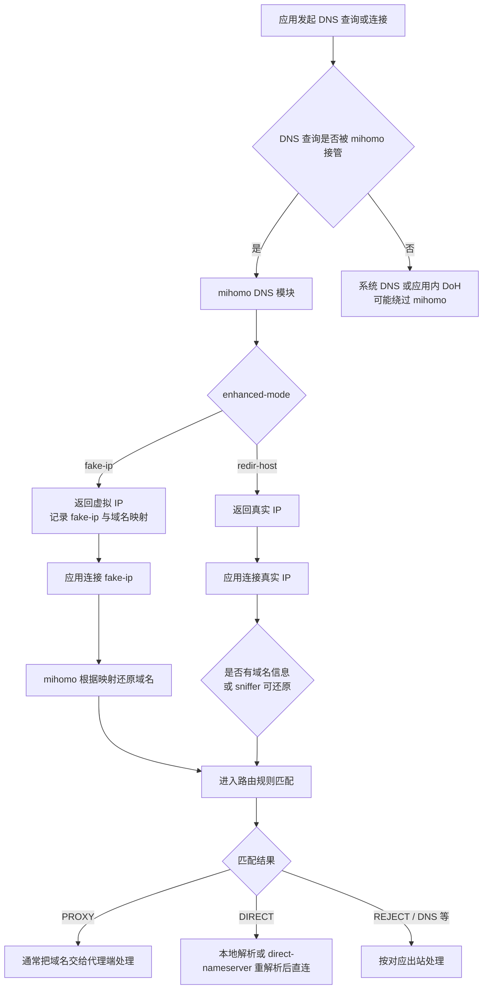
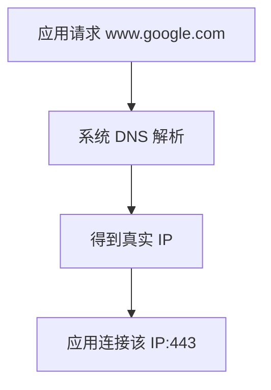
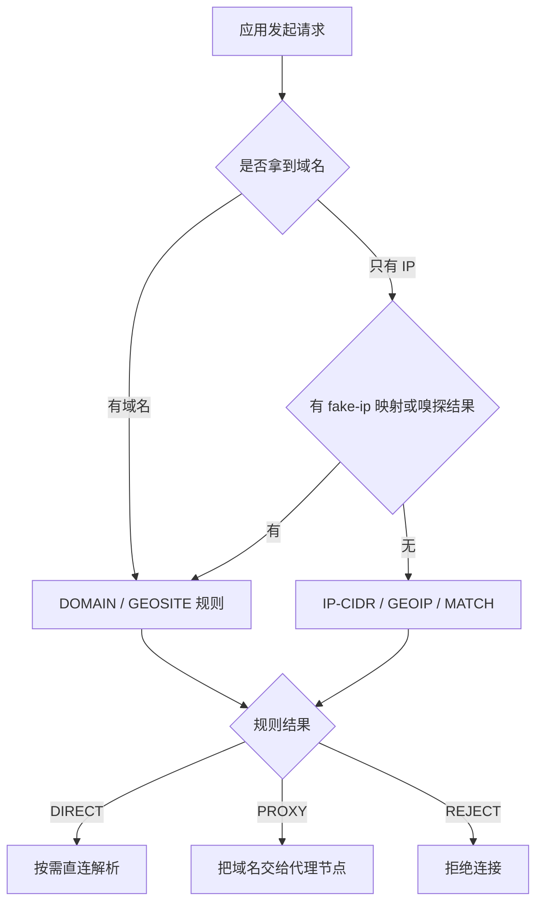

[toc]


## 先建立整体认识

mihomo 的 DNS 层不是“把域名交给某个 DNS 服务器解析”这么简单。它同时承担了几个职责：接管客户端 DNS 查询、维护 fake-ip 映射、决定上游 DNS、配合路由规则判断 DIRECT / PROXY、为直连流量重新解析、为代理节点解析域名，以及在透明代理场景下尽量恢复域名信息。

可以把它理解成一个“DNS + 路由前置判断 + 连接元数据管理”的子系统。



官方文档也把 DNS 处理流程单独列出：域名规则命中代理时可以直接把域名发送给代理；域名或 IP 规则需要解析时，会进入 `nameserver-policy`、`nameserver`、`fallback`、`fallback-filter`、`direct-nameserver` 等分支。文档还特别说明，`direct-nameserver` 的重新解析在 v1.19.10 后同样应用于 UDP 连接，但对 TUN 入站仅限 fake-ip 模式。([Metacubex Wiki](https://wiki.metacubex.one/config/dns/diagram/))

------

## 核心组件速览

| 配置项                    | 作用                  | 新手理解                             | 实务建议                                                     |
| ------------------------- | --------------------- | ------------------------------------ | ------------------------------------------------------------ |
| `enable`                  | 是否启用 mihomo DNS   | 不启用就交给系统 DNS                 | TUN / 透明代理基本应开启                                     |
| `listen`                  | DNS 服务监听地址      | 让系统或局域网设备把 DNS 发给 mihomo | 本机常用 `127.0.0.1:1053`，网关常用 `0.0.0.0:53`，TUN 常配合 `dns-hijack` |
| `enhanced-mode`           | DNS 增强模式          | 决定返回 fake-ip 还是真实 IP         | TUN 通常优先 `fake-ip`，兼容性问题再局部过滤                 |
| `fake-ip-range`           | fake-ip 地址池        | 虚拟 IP 的地址段                     | 常用 `198.18.0.1/16`，不要和真实内网冲突                     |
| `fake-ip-filter`          | 不返回 fake-ip 的域名 | 某些域名必须拿真实 IP                | LAN、mDNS、NTP、游戏、投屏、IoT 常需要过滤                   |
| `nameserver`              | 默认解析服务器        | 普通解析入口                         | 可以是 DoH / DoT / UDP / TCP 等                              |
| `nameserver-policy`       | 按域名指定 DNS        | DNS 分流规则                         | 国内域名用国内 DNS，特殊域名单独指定                         |
| `fallback`                | 后备 DNS              | 常用于污染规避                       | 老式配置常用，现代配置可减少依赖                             |
| `fallback-filter`         | 筛选 fallback 结果    | 判断 nameserver 结果是否可信         | 适合 nameserver 国内、fallback 国外的模式                    |
| `default-nameserver`      | 解析 DNS 服务器域名   | 解决 DoH 域名本身怎么解析的问题      | 必须是 IP，可为加密 DNS，避免“鸡生蛋”                        |
| `proxy-server-nameserver` | 解析代理节点域名      | 专门给节点地址用                     | 强烈建议单独配，避免节点解析受普通分流干扰                   |
| `direct-nameserver`       | DIRECT 出口重解析     | 直连流量最终用哪个 DNS 解析          | 现代防泄漏配置的重要项                                       |
| `respect-rules`           | DNS 连接遵守路由规则  | DNS 请求本身也走分流                 | 使用时必须理解循环风险，且需配置 `proxy-server-nameserver`   |

当前官方文档中，`listen` 支持 UDP 和 TCP；`enhanced-mode` 可选 `fake-ip` / `redir-host`，默认是 `redir-host`；`ipv6: false` 时会对 AAAA 返回空解析；`use-hosts` 和 `use-system-hosts` 默认启用。([Metacubex Wiki](https://wiki.metacubex.one/config/dns/))

------

## DNS 类型：上游不只是 53 端口

mihomo 支持多种 DNS 上游写法：

| 类型   | 示例                                 | 特点                                |
| ------ | ------------------------------------ | ----------------------------------- |
| UDP    | `223.5.5.5` 或 `udp://223.5.5.5`     | 传统 DNS，快但明文                  |
| TCP    | `tcp://8.8.8.8`                      | 明文但更稳定                        |
| DoT    | `tls://1.1.1.1`                      | DNS over TLS，加密                  |
| DoH    | `https://dns.alidns.com/dns-query`   | DNS over HTTPS，常用                |
| DoQ    | `quic://dns.adguard.com:784`         | DNS over QUIC                       |
| system | `system` 或 `system://`              | 使用系统 DNS                        |
| dhcp   | `dhcp://en0`                         | 从指定接口获取 DNS                  |
| rcode  | `rcode://success`、`rcode://refused` | 返回指定 DNS 响应码，常用于特殊策略 |

这些类型来自官方 DNS 类型文档。([Metacubex Wiki](https://wiki.metacubex.one/config/dns/type/))

新手容易犯的错误是：`nameserver` 写了 DoH 域名，但没有可靠的 `default-nameserver`。例如 `https://dns.google/dns-query` 本身需要解析 `dns.google`，这时 mihomo 要先知道用哪个 DNS 去解析 DNS 服务器的域名。官方文档明确说 `default-nameserver` 用于解析 DNS 服务器的域名，并且必须是 IP，可为加密 DNS。([Metacubex Wiki](https://wiki.metacubex.one/config/dns/))

------

## fake-ip 与 redir-host 的本质区别

| 对比项         | fake-ip                              | redir-host                                         |
| -------------- | ------------------------------------ | -------------------------------------------------- |
| DNS 返回给应用 | 虚拟 IP                              | 真实 IP                                            |
| 域名信息保留   | 强                                   | 弱，取决于入站和嗅探                               |
| 路由规则体验   | 更适合 DOMAIN / GEOSITE              | 更依赖真实解析和 sniffer                           |
| 防 DNS 污染    | 更好                                 | 取决于上游解析结果                                 |
| 兼容性         | 个别应用可能不兼容                   | 通常更兼容                                         |
| TUN 场景       | 推荐优先使用                         | 可用，但域名路由能力可能下降                       |
| 常见问题       | 游戏、投屏、IoT、NTP、局域网发现异常 | 国外域名可能提前被本地解析，规则误判或污染风险更高 |

### fake-ip 是怎么工作的

fake-ip 模式下，应用查询 `example.com`，mihomo 不一定马上去上游 DNS 解析真实 IP，而是返回一个虚拟 IP，比如 `198.18.0.10`。应用随后连接这个虚拟 IP，mihomo 根据内部映射表知道它其实是 `example.com`，于是可以继续按域名规则处理。

这带来两个好处：一是避免应用拿到被污染的真实 IP；二是在 TUN / 透明代理中，即使应用只连接 IP，mihomo 仍能还原域名。

但 fake-ip 不是越多越好。某些服务真的需要真实 IP，例如局域网设备发现、NTP、部分游戏、银行客户端、IoT、投屏、运营商认证页等。这些域名应该加入 `fake-ip-filter`，让它们走真实解析。官方文档说明 `fake-ip-filter` 中的地址不会下发 fake-ip 映射，`fake-ip-filter-mode` 支持 `blacklist`、`whitelist`、`rule`，其中 `rule` 模式可以使用类似路由规则的自上而下匹配逻辑。([Metacubex Wiki](https://wiki.metacubex.one/config/dns/))

### redir-host 是怎么工作的

redir-host 模式下，DNS 查询会返回真实 IP。应用拿真实 IP 建连，mihomo 拦截连接后，如果还知道域名，就能按域名规则；如果不知道域名，就只能按 IP、GEOIP、端口、进程、入站等信息判断。

这也是为什么 redir-host 常常需要搭配 sniffer。sniffer 可以从 HTTP Host、TLS SNI、QUIC 信息中尝试还原域名；官方文档说明 sniffer 支持 HTTP / TLS / QUIC，并且有 `force-dns-mapping`、`parse-pure-ip`、`override-destination` 等选项。([Metacubex Wiki](https://wiki.metacubex.one/config/sniff/))

------

## fake-ip-filter 的现代用法

传统写法是黑名单：

```yaml
dns:
  enhanced-mode: fake-ip
  fake-ip-range: 198.18.0.1/16
  fake-ip-filter-mode: blacklist
  fake-ip-filter:
    - '*.lan'
    - '*.local'
    - '*.arpa'
    - 'time.*.com'
    - 'ntp.*.com'
    - 'localhost.ptlogin2.qq.com'
    - '+.msftconnecttest.com'
    - '+.msftncsi.com'
```

更现代的写法是 `fake-ip-filter-mode: rule`，可以像路由规则一样决定哪些域名返回 fake-ip，哪些返回 real-ip：

```yaml
dns:
  enhanced-mode: fake-ip
  fake-ip-filter-mode: rule
  fake-ip-filter:
    - DOMAIN-SUFFIX,lan,real-ip
    - DOMAIN-SUFFIX,local,real-ip
    - DOMAIN-SUFFIX,arpa,real-ip
    - DOMAIN-KEYWORD,ntp,real-ip
    - GEOSITE,cn,real-ip
    - GEOSITE,gfw,fake-ip
    - MATCH,fake-ip
```

这里的思路是：对明显需要真实 IP 的域名返回 real-ip，对需要代理或容易污染的域名返回 fake-ip，最后用 `MATCH` 兜底。官方文档中的 `rule` 模式示例也说明它支持 `GEOSITE`、`RuleSet`、`DOMAIN*`、`MATCH`，并按自上而下逻辑匹配。([Metacubex Wiki](https://wiki.metacubex.one/config/dns/))

需要注意：配置文件里的域名通配符和路由规则里的 `DOMAIN-WILDCARD` 不是同一种语法。官方语法文档说明，`*.baidu.com` 只匹配一级子域名，`+.baidu.com` 类似 `DOMAIN-SUFFIX`，可匹配多级子域和根域名；使用通配符时建议加引号。([Metacubex Wiki](https://wiki.metacubex.one/handbook/syntax/))

------

## nameserver、fallback、nameserver-policy 的关系

这三者最容易混。

| 组件                | 什么时候用         | 优先级理解                                        |
| ------------------- | ------------------ | ------------------------------------------------- |
| `nameserver-policy` | 域名命中特定策略时 | 优先于普通 `nameserver` / `fallback`              |
| `nameserver`        | 没有命中 policy 时 | 默认解析入口                                      |
| `fallback`          | 配置了后备解析时   | 与 nameserver 配合，结果再经 fallback-filter 判断 |
| `fallback-filter`   | 判断结果是否可信   | 命中污染条件时采用 fallback 或只用 fallback       |

官方文档说明，`nameserver-policy` 用来指定域名查询的解析服务器，可以使用 geosite，并优先于 `nameserver` / `fallback` 查询；`fallback` 通常使用境外 DNS 保证结果可信，配置 `fallback` 后默认启用 `fallback-filter`，`geoip-code` 默认为 `CN`。([Metacubex Wiki](https://wiki.metacubex.one/config/dns/))

一个经典老式配置是：

```yaml
dns:
  nameserver:
    - https://dns.alidns.com/dns-query
    - https://doh.pub/dns-query

  fallback:
    - https://1.1.1.1/dns-query
    - https://8.8.8.8/dns-query

  fallback-filter:
    geoip: true
    geoip-code: CN
    geosite:
      - gfw
    ipcidr:
      - 240.0.0.0/4
    domain:
      - '+.google.com'
      - '+.facebook.com'
      - '+.youtube.com'
```

这套逻辑是：默认先用国内 DNS，同时准备 fallback；如果国内 DNS 返回了非 CN IP，或者域名属于明确容易污染的集合，就采用 fallback 结果。适合“国内 DNS 快，国外 DNS 可信”的思路。

更现代、更可控的思路是：用 `nameserver-policy` 明确划分哪些域名用国内 DNS，哪些域名用可信 DNS，而不是把所有域名都扔给 nameserver / fallback 自动判断。

------

## proxy-server-nameserver：代理节点域名要单独处理

代理节点也可能是域名，例如：

```yaml
proxies:
  - name: hk-01
    type: hysteria2
    server: node.example.com
```

mihomo 必须先解析 `node.example.com`，才能连上代理节点。如果解析代理节点本身也要走代理，就会出现“还没连上代理，却要通过代理解析代理”的循环问题。

所以官方提供了 `proxy-server-nameserver`：它仅用于解析代理节点的域名；如果不填，则会跟随 `nameserver-policy`、`nameserver`、`fallback`。`proxy-server-nameserver-policy` 的格式与 `nameserver-policy` 相同，但只有在 `proxy-server-nameserver` 非空时才生效。([Metacubex Wiki](https://wiki.metacubex.one/config/dns/))

实务建议：

| 节点地址类型         | 建议                                                 |
| -------------------- | ---------------------------------------------------- |
| 节点是 IP            | 不需要解析，最简单                                   |
| 节点是普通域名       | 配 `proxy-server-nameserver`，优先稳定可达           |
| 节点域名可能被污染   | 用可信 DoH / DoT，或改用节点 IP                      |
| 节点域名需要国内解析 | 用国内 DNS，避免解析到海外 CDN 异常地址              |
| 使用 `respect-rules` | 必须认真配置 `proxy-server-nameserver`，否则容易循环 |

------

## direct-nameserver：现代 DNS 分流的关键

`direct-nameserver` 用于 DIRECT 出口的域名解析。也就是说，当某个连接最终决定直连时，mihomo 可以不用前面规则匹配过程中得到的解析结果，而是用 `direct-nameserver` 重新解析后再直连。

这非常重要，因为“路由判断阶段的解析”和“最终直连阶段的解析”不是同一个问题：

| 阶段         | 目的                       | 推荐 DNS                      |
| ------------ | -------------------------- | ----------------------------- |
| 规则判断阶段 | 判断该走 PROXY 还是 DIRECT | 可按策略、fake-ip、规则集处理 |
| PROXY 出口   | 通常把域名交给代理远端     | 本地不一定需要真实 IP         |
| DIRECT 出口  | 本机真实连接目标 IP        | 应使用适合直连网络的 DNS      |
| 节点解析     | 连接代理服务器             | 应使用稳定、不会循环的 DNS    |

官方文档说明，`direct-nameserver` 是用于 direct 出口域名解析的 DNS；`direct-nameserver-follow-policy` 控制它是否遵循 `nameserver-policy`，默认不遵守，且只有在 `direct-nameserver` 非空时生效。([Metacubex Wiki](https://wiki.metacubex.one/config/dns/))

推荐思路：

```yaml
dns:
  direct-nameserver:
    - https://dns.alidns.com/dns-query
    - https://doh.pub/dns-query
  direct-nameserver-follow-policy: false
```

这样国内直连域名最终由国内 DNS 解析，避免拿到不适合直连的海外结果。

------

## respect-rules 与 `#RULES`：DNS 请求本身怎么出站

默认情况下，DNS 上游连接怎么出去，不一定严格遵守你的 `rules`。`respect-rules: true` 会让 DNS 连接遵守路由规则；官方文档明确提示它需要配置 `proxy-server-nameserver`，并且强烈不建议和 `prefer-h3` 一起使用。([Metacubex Wiki](https://wiki.metacubex.one/config/dns/))

另外，上游 DNS 地址后面可以加附加参数。官方文档说明，`#RULES` 表示按路由规则连接，等同于 `respect-rules`；也支持指定代理或接口、`h3`、`skip-cert-verify`、`ecs`、`ecs-override`、`disable-ipv4`、`disable-ipv6` 等。([Metacubex Wiki](https://wiki.metacubex.one/config/dns/))

示例：

```yaml
dns:
  nameserver:
    - https://1.1.1.1/dns-query#PROXY
    - https://8.8.8.8/dns-query#PROXY
```

含义是：这些 DNS 查询通过名为 `PROXY` 的出站或代理组发起。这样能减少本地网络看到境外 DNS 查询的机会，但前提是 `PROXY` 已经能正常建立连接，且节点域名解析不会陷入循环。

------

## 路由规则为什么会触发 DNS

很多人以为“我只是写了 rules，为什么 mihomo 还要解析域名？”原因通常是 IP 类规则。

例如：

```yaml
rules:
  - GEOIP,CN,DIRECT
  - MATCH,PROXY
```

当请求目标是域名时，要判断它是不是 `GEOIP,CN`，mihomo 就需要先把域名解析成 IP，再查 IP 所属国家或地区。官方规则文档说明，规则自上而下匹配，顶部规则优先；并且当域名开始匹配目标 IP 类规则时，mihomo 会触发 DNS 解析来检查目标 IP 是否匹配，可以使用 `no-resolve` 跳过解析。([Metacubex Wiki](https://wiki.metacubex.one/config/rules/))

因此，想减少不必要的本地解析，可以这样写：

```yaml
rules:
  - DOMAIN-SUFFIX,google.com,PROXY
  - GEOSITE,gfw,PROXY
  - GEOIP,CN,DIRECT,no-resolve
  - MATCH,PROXY
```

但要理解 `no-resolve` 的代价：如果没有更早的域名规则命中，那么这个 GEOIP 规则不会主动解析域名来判断。它适合“我不希望为了 GEOIP 判断而触发 DNS”的场景。

------

## TUN、dns-hijack 与浏览器 DoH

TUN 入站常见配置：

```yaml
tun:
  enable: true
  stack: mixed
  auto-route: true
  auto-redirect: true
  auto-detect-interface: true
  dns-hijack:
    - any:53
    - tcp://any:53
```

官方 TUN 示例也包含 `dns-hijack: any:53` 和 `tcp://any:53`。([Metacubex Wiki](https://wiki.metacubex.one/config/inbound/tun/))

它的作用是拦截系统或应用发往 53 端口的 DNS 查询，让它们进入 mihomo DNS。但这不能自动拦截所有“应用内置 DoH”。例如浏览器开启了 Secure DNS，直接访问 `https://dns.google/dns-query`，这看起来就是普通 HTTPS 流量，不是 53 端口 DNS。要处理这种情况，需要关闭浏览器内置 DoH，或用规则阻断 / 代理这些 DoH 域名。

------

## hosts 与系统 hosts

mihomo 支持自己的 `hosts`：

```yaml
hosts:
  '*.clash.dev': 127.0.0.1
  'alpha.clash.dev': '::1'
  test.com: [1.1.1.1, 2.2.2.2]
  baidu.com: google.com
```

官方文档说明，`hosts` 的键支持域名通配，值支持字符串或数组，域名重定向不支持数组；完整域名优先级高于通配符，例如 `foo.example.com > *.example.com > .example.com`。([Metacubex Wiki](https://wiki.metacubex.one/config/dns/hosts/))

实务建议：

| 场景                   | 建议                                          |
| ---------------------- | --------------------------------------------- |
| 固定内网域名           | 写入 `hosts` 或本地 DNS                       |
| 临时测试域名           | 写 `hosts` 最方便                             |
| 大规模广告拦截         | 不建议堆在 `hosts`，用规则集或专门 DNS 更清晰 |
| 域名重定向到另一个域名 | 注意不支持数组                                |
| 和系统 hosts 冲突      | 检查 `use-hosts` / `use-system-hosts`         |

------

## 一份适合新手的现代 fake-ip 配置骨架

这不是唯一标准答案，但适合作为理解模板：

```yaml
dns:
  enable: true
  listen: 0.0.0.0:1053
  ipv6: false
  cache-algorithm: arc

  enhanced-mode: fake-ip
  fake-ip-range: 198.18.0.1/16
  fake-ip-filter-mode: blacklist
  fake-ip-filter:
    - '*.lan'
    - '*.local'
    - '*.arpa'
    - 'time.*.com'
    - 'ntp.*.com'
    - '+.msftconnecttest.com'
    - '+.msftncsi.com'
    - 'localhost.ptlogin2.qq.com'

  use-hosts: true
  use-system-hosts: true

  default-nameserver:
    - 223.5.5.5
    - 119.29.29.29

  proxy-server-nameserver:
    - https://dns.alidns.com/dns-query
    - https://doh.pub/dns-query

  direct-nameserver:
    - https://dns.alidns.com/dns-query
    - https://doh.pub/dns-query
  direct-nameserver-follow-policy: false

  nameserver-policy:
    'geosite:cn,private':
      - https://dns.alidns.com/dns-query
      - https://doh.pub/dns-query

  nameserver:
    - https://1.1.1.1/dns-query#PROXY
    - https://8.8.8.8/dns-query#PROXY
```

配套路由示例：

```yaml
rules:
  - GEOSITE,private,DIRECT
  - GEOSITE,cn,DIRECT
  - GEOSITE,gfw,PROXY
  - GEOIP,private,DIRECT,no-resolve
  - GEOIP,CN,DIRECT,no-resolve
  - MATCH,PROXY
```

这套配置的意图是：

| 目标                          | 配置体现                   |
| ----------------------------- | -------------------------- |
| 默认保留域名信息              | `enhanced-mode: fake-ip`   |
| 局域网和特殊服务不 fake-ip    | `fake-ip-filter`           |
| 代理节点解析独立              | `proxy-server-nameserver`  |
| 直连流量用国内 DNS 重解析     | `direct-nameserver`        |
| 国内域名明确用国内 DNS        | `nameserver-policy`        |
| 默认境外 DNS 通过代理访问     | `nameserver` 后加 `#PROXY` |
| 避免 GEOIP 规则无意义触发 DNS | `no-resolve`               |

------

## 一份兼容性优先的 redir-host 配置骨架

适合游戏、智能家居、投屏、企业内网、某些银行客户端较多的环境：

```yaml
dns:
  enable: true
  listen: 0.0.0.0:1053
  ipv6: false
  enhanced-mode: redir-host

  default-nameserver:
    - 223.5.5.5
    - 119.29.29.29

  proxy-server-nameserver:
    - https://dns.alidns.com/dns-query
    - https://doh.pub/dns-query

  direct-nameserver:
    - https://dns.alidns.com/dns-query
    - https://doh.pub/dns-query

  nameserver:
    - https://dns.alidns.com/dns-query
    - https://doh.pub/dns-query

  fallback:
    - https://1.1.1.1/dns-query
    - https://8.8.8.8/dns-query

  fallback-filter:
    geoip: true
    geoip-code: CN
    geosite:
      - gfw
```

建议同时打开 sniffer：

```yaml
sniffer:
  enable: true
  force-dns-mapping: true
  parse-pure-ip: true
  override-destination: false
  sniff:
    HTTP:
      ports: [80, 8080-8880]
      override-destination: true
    TLS:
      ports: [443, 8443]
    QUIC:
      ports: [443, 8443]
```

redir-host 的优点是兼容性更好，但域名信息更容易丢失。sniffer 可以缓解这个问题，但不能保证所有流量都能嗅探成功，比如 ECH、无 SNI、非标准协议、部分 QUIC 场景。

------

## 防 DNS 泄漏的关键不是“全写国外 DNS”

DNS 泄漏至少有几种含义：

| 类型                | 表现                                | 解决方向                                        |
| ------------------- | ----------------------------------- | ----------------------------------------------- |
| 系统 DNS 泄漏       | 系统仍向路由器 / 运营商 DNS 发查询  | 设置系统 DNS 指向 mihomo，或用 TUN `dns-hijack` |
| 应用内 DoH 泄漏     | 浏览器自己访问 DoH                  | 关闭浏览器 Secure DNS，或用规则处理 DoH 域名    |
| mihomo 上游直连泄漏 | mihomo 自己直连境外 DNS             | 用 `#PROXY`、`respect-rules` 或合理 DNS 分流    |
| ECS 泄漏            | DNS 查询携带客户端子网              | 不使用 ECS，或用 `ecs-override` 明确覆盖        |
| 节点域名解析泄漏    | 代理节点域名被本地 DNS 解析         | 配置 `proxy-server-nameserver` 或使用节点 IP    |
| 直连解析不一致      | DIRECT 连接用了不适合本地的解析结果 | 配置 `direct-nameserver`                        |

官方文档支持 `ecs` 和 `ecs-override` 附加参数，也支持丢弃 A / AAAA 响应的 `disable-ipv4` / `disable-ipv6`。这些很强大，但不要为了“看起来高级”随便使用；ECS 可能把你的网络位置提示给上游 DNS，`disable-ipv6` 也可能破坏只提供 IPv6 的服务。([Metacubex Wiki](https://wiki.metacubex.one/config/dns/))

------

## 为什么 DNS 必须交给 mihomo 管理

规则代理的前提是“知道目标是谁”。如果应用先用系统 DNS 解析出 IP，再把连接交给 mihomo，mihomo 只看到 `142.250.x.x:443`，`DOMAIN-SUFFIX,google.com,Google` 这类规则永远不会命中，分流只能退化成靠 `IP-CIDR` / `GEOIP` / `MATCH` 去猜。



由 mihomo 接管 DNS 之后，它同时承担四件事：

- 保留域名语义，让域名规则可用
- 用 fake-ip 映射把后续连接还原成域名
- 给直连与代理选择不同的解析器（`direct-nameserver`、`nameserver-policy`）
- 在 TUN 场景下接管 53 端口查询（`dns-hijack`）

### DNS 是分流前置模块，不是单纯解析器



命中代理时通常把域名直接交给节点，由节点侧解析；命中直连时才需要本地解析出 IP，配置了 `direct-nameserver` 还会在直连出口重新解析一次。

### “不能只用一个 DNS”落到配置上

早期写法用 `fallback` + `fallback-filter` 防污染，现在更推荐按域名显式指派解析器：

```yaml
dns:
  enhanced-mode: fake-ip
  nameserver:
    - https://doh.pub/dns-query
    - https://dns.alidns.com/dns-query
  proxy-server-nameserver:
    - https://doh.pub/dns-query
  nameserver-policy:
    "geosite:cn,private": [https://doh.pub/dns-query, https://dns.alidns.com/dns-query]
    "geosite:geolocation-!cn": [https://1.1.1.1/dns-query, https://8.8.8.8/dns-query]
```

`fallback-filter` 仍然有效，但其中的 `geosite` 子字段已废弃，不要再照抄旧模板；域名维度的分流交给 `nameserver-policy` 更可控。([虚空终端](https://wiki.metacubex.one/config/dns/))

## 常见问题排查表

| 现象                         | 常见原因                                      | 排查方向                                                     |
| ---------------------------- | --------------------------------------------- | ------------------------------------------------------------ |
| 测试网站显示本地 DNS         | 系统 DNS 没进 mihomo，或浏览器 DoH 绕过       | 检查 `dns-hijack`、系统 DNS、浏览器 Secure DNS               |
| 开 fake-ip 后某 App 无法联网 | App 不接受虚拟 IP 或依赖真实 IP               | 加入 `fake-ip-filter`，或用 `fake-ip-filter-mode: rule`      |
| 局域网设备发现失败           | `.local`、`.lan`、mDNS、SSDP 被 fake-ip       | 过滤局域网域名，私有网段 DIRECT                              |
| 日志里 DNS 走了 PROXY        | 使用了 `#PROXY`、`#RULES` 或 `respect-rules`  | 这不一定是泄漏，可能正是预期行为                             |
| 代理节点无法连接             | 节点域名解析失败或循环                        | 单独配置 `proxy-server-nameserver`                           |
| 明明 MATCH PROXY 仍有解析    | IP 类规则、UDP 出站、direct-nameserver 重解析 | 检查规则顺序、`no-resolve`、v1.19.10 后 UDP 行为             |
| GEOIP 规则导致慢             | 域名要先解析才能判断 GEOIP                    | DOMAIN / GEOSITE 放前面，GEOIP 加 `no-resolve`               |
| DoH 连接失败                 | DoH 域名本身解析失败，或 HTTP/3 不兼容        | 检查 `default-nameserver`，关闭 `prefer-h3` 测试             |
| fake-ip 映射重启后变化       | 未持久化 fake-ip 表                           | 可启用 `profile.store-fake-ip`，官方说明它会存储 fake-ip 映射表以便下次启动复用。([Metacubex Wiki](https://wiki.metacubex.one/en/config/general/)) |
| 配置明明正确但不生效         | YAML 缩进、大小写、Tab 错误                   | mihomo 使用 YAML，大小写敏感，缩进不能用 tab。([Metacubex Wiki](https://wiki.metacubex.one/handbook/syntax/)) |

------

## 学习顺序建议

先理解 `fake-ip` 与 `redir-host`，再理解 `nameserver`、`nameserver-policy`、`fallback` 的关系，然后学习 `proxy-server-nameserver` 和 `direct-nameserver`。最后再碰 `respect-rules`、`#RULES`、ECS、`disable-ipv4`、`disable-ipv6` 这些高级功能。

新手最稳的路线是：

| 阶段   | 目标                       | 推荐做法                                                     |
| ------ | -------------------------- | ------------------------------------------------------------ |
| 入门   | 先让所有流量正常代理       | TUN + fake-ip + 基础 rules                                   |
| 稳定   | 解决局域网、游戏、NTP 异常 | 完善 `fake-ip-filter`                                        |
| 分流   | 国内直连、国外代理         | 使用 GEOSITE / GEOIP / rule-providers                        |
| 防泄漏 | DNS 查询也按预期出站       | 配 `proxy-server-nameserver`、`direct-nameserver`、必要时 `#PROXY` |
| 优化   | 减少不必要解析和延迟       | GEOIP 加 `no-resolve`，减少复杂 fallback                     |
| 高级   | 多网络、多接口、多客户端   | 使用 `nameserver-policy`、sniffer、rule-set、TUN 路由控制    |

一句话总结：mihomo 的 DNS 层真正难的地方，不在“用哪个 DNS 服务器”，而在“什么时候需要解析、为谁解析、解析结果是否用于路由判断、最终连接是否还要重解析，以及 DNS 查询本身从哪里出去”。把这几个问题拆开看，配置就会清晰很多。