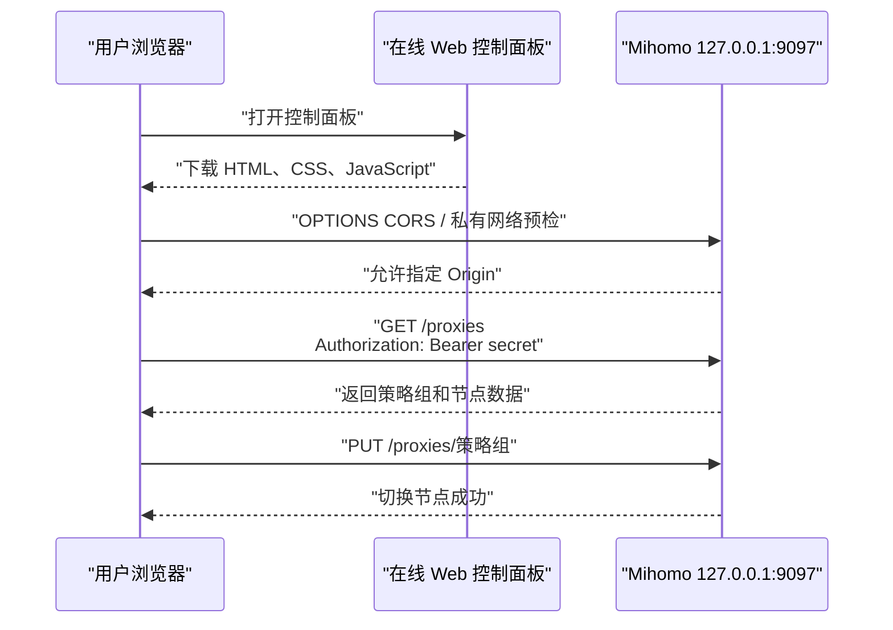
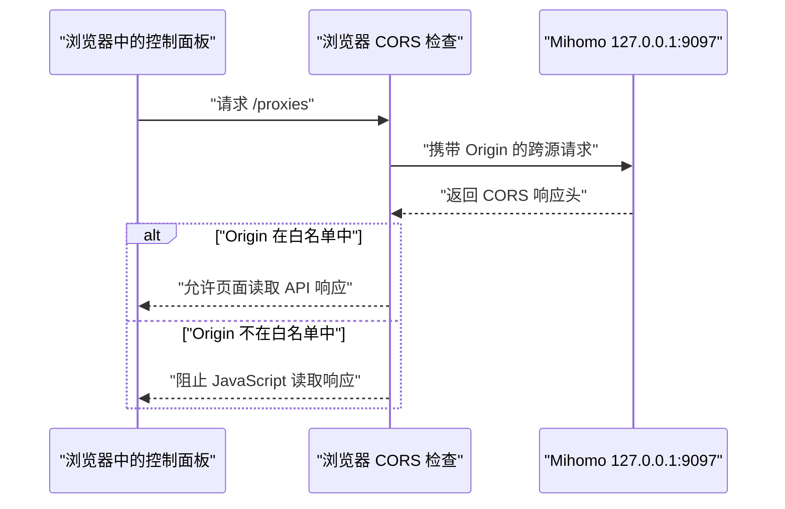
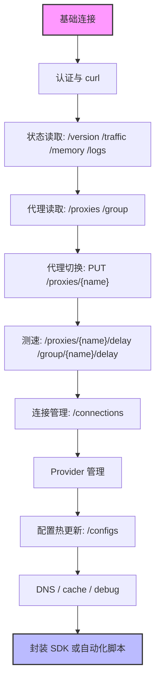
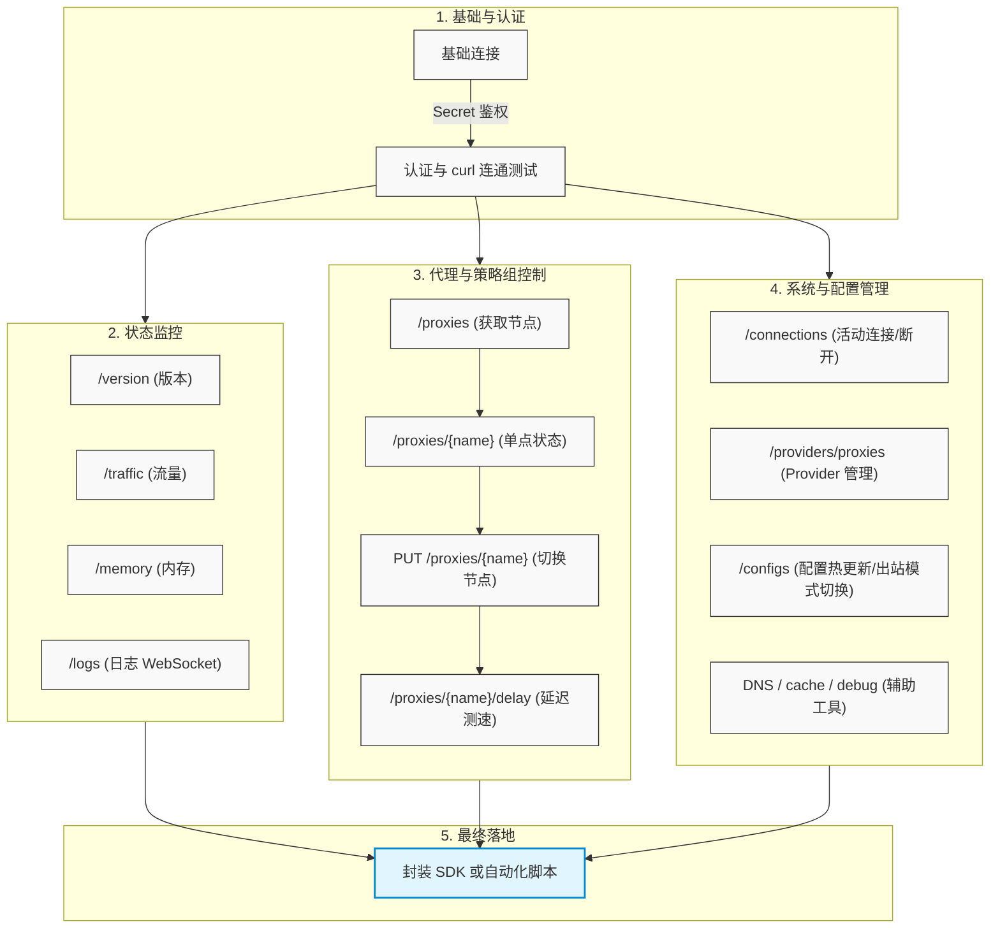

[toc]


Mihomo 官方文档把 API 分为日志、流量、内存、版本、缓存、配置、更新、策略组、代理、Proxy Provider、规则、Rule Provider、连接、DNS 查询和 Debug 等模块。([虚空终端](https://wiki.metacubex.one/en/api/))

------

# 1. 先理解 Mihomo API 是什么

Mihomo API 本质上是 **External Controller**：你在 Mihomo 配置里开放一个 HTTP/HTTPS/Unix Socket/Named Pipe 控制入口，然后通过 RESTful API 或 WebSocket 来读取运行状态、切换节点、测速、更新 provider、查看连接、关闭连接、重载配置等。

官方配置文档明确说明 `external-controller` 用于通过 RESTful API 控制 Clash/mihomo 内核。([虚空终端](https://wiki.metacubex.one/en/config/general/))

典型用途：

1. 做自己的控制面板。
2. 写自动切换节点脚本。
3. 监控实时流量、连接、内存。
4. 自动更新订阅、规则集、GEO 数据。
5. 远程管理路由器或服务器上的 mihomo。
6. Debug 内核运行状态。

------

# 2. 最小可用配置

在 `config.yaml` 中加入：

```yaml
external-controller: 127.0.0.1:9090
secret: "your-secret"
```

如果需要跨设备访问，例如局域网其他机器访问：

```yaml
external-controller: 0.0.0.0:9090
secret: "your-strong-secret"
```

官方文档说明 `external-controller` 可以从 `127.0.0.1` 改为 `0.0.0.0` 来监听所有 IP，同时 API 访问密钥由 `secret` 设置。([虚空终端](https://wiki.metacubex.one/en/config/general/))

强烈建议：
**只要监听 `0.0.0.0`，就必须设置强 secret，并尽量用防火墙限制访问来源。**

------

# 3. 认证方式

> 下面以shell(bash)中的curl为例调用api,这种情况下在行末尾使用`\`回车键来表示**续行符**
>
> 如果是powershell,则`\`要替换为反引号`` ` ``;如果是cmd,则使用脱字符`^`

大多数 HTTP API 请求使用 Bearer Token：

```bash
secret="1212"
curl -H "Authorization: Bearer $secret" \
  http://127.0.0.1:9090/version
```

官方请求示例使用：

```bash
Authorization: Bearer ${secret}
```

其中 `${secret}` 来自配置文件中的 API 密钥，`${controller-api}` 是 API 监听地址。([虚空终端](https://wiki.metacubex.one/en/api/))

在内网学习阶段,可以将密钥设置简单点,例如

```bash
secret=1
curl -H "Authorization: Bearer $secret" http://127.0.0.1:9090/version
# 输出示例
{"meta":true,"version":"v1.19.25"}
```


------

# 4. 安全模型必须先学

Mihomo API 权限非常高，能切换代理、关闭连接、重载配置、更新内核、查看连接信息。学习时要优先记住这些安全规则：

## 4.1 推荐安全配置

```yaml
external-controller: 127.0.0.1:9090
secret: "a-long-random-secret"
```

本机脚本、面板都通过 `127.0.0.1` 访问。

## 4.2 局域网访问配置

```yaml
external-controller: 0.0.0.0:9090
secret: "a-long-random-secret"

external-controller-cors:
  allow-origins:
    - "http://your-dashboard.example"
  allow-private-network: true
```

官方文档列出了 `external-controller-cors`，可配置 `allow-origins` 和 `allow-private-network`；字段语义与 PNA 预检细节见本文 4.4 节。([虚空终端](https://wiki.metacubex.one/en/config/general/))

## 4.3 Unix Socket / Named Pipe 风险

官方文档说明，Unix Socket API 和 Windows Named Pipe API 访问时 **不会验证 secret**，因此启用时要自行保证安全。([虚空终端](https://wiki.metacubex.one/en/config/general/))

例如：

```yaml
external-controller-unix: mihomo.sock
```

或：

```yaml
external-controller-pipe: \\.\pipe\mihomo
```

不要把 socket 暴露给不可信用户或容器。

------

## 4.4 external-controller-cors 与 PNA

浏览器面板要访问本机 API，除了鉴权还要过 CORS 与 Private Network Access 两道检查。

### Web 控制界面为什么需要 CORS

配置中的关键部分是：

```yaml
external-controller-cors:
  allow-private-network: true
  allow-origins:
  - tauri://localhost
  - http://tauri.localhost
  - https://yacd.metacubex.one
  - https://metacubex.github.io
  - https://board.zash.run.place
```

假设你打开：

```text
https://yacd.metacubex.one
```

控制面板的 JavaScript 会请求：

```text
http://127.0.0.1:9097/proxies
```

这两个地址显然不是同源：

| 项目 | 控制面板             | Mihomo API  |
| ---- | -------------------- | ----------- |
| 协议 | `https`              | `http`      |
| 主机 | `yacd.metacubex.one` | `127.0.0.1` |
| 端口 | `443`                | `9097`      |

所以浏览器会执行 CORS 检查。

请求大致如下：

```http
GET /proxies HTTP/1.1
Host: 127.0.0.1:9097
Origin: https://yacd.metacubex.one
Authorization: Bearer 1
```

由于带有 `Authorization`，浏览器通常还会先发**预检请求**：

```http
OPTIONS /proxies HTTP/1.1
Host: 127.0.0.1:9097
Origin: https://yacd.metacubex.one
Access-Control-Request-Method: GET
Access-Control-Request-Headers: authorization
```

Mihomo 检查：

```text
https://yacd.metacubex.one
```

是否在 `allow-origins` 中。命中白名单后，才向浏览器返回允许跨源访问的响应头。

完整流程是：





重点是：

> 在线控制面板的页面来自互联网，但控制请求是由你本机浏览器发给本机 `127.0.0.1:9097` 的。

控制面板服务器本身通常不是直接连接你的 Mihomo。**它只是把前端代码下载到浏览器中，由浏览器访问本机 API**。

------

### `allow-origins` 各项的用意

### `tauri://localhost`

```yaml
- tauri://localhost
```

这是 Tauri 桌面应用可能使用的自定义协议来源。

Clash Verge 是基于 Tauri 构建的桌面应用，界面本质上是 Web 前端运行在桌面 WebView 中。对于 CORS 而言，该界面可能表现为：

```text
tauri://localhost
```

因此必须把它加入白名单，否则嵌入式界面调用 Mihomo HTTP API 时可能被浏览器内核阻止。

------

### `http://tauri.localhost`

```yaml
- http://tauri.localhost
```

这是 Tauri WebView 在某些运行模式或平台下使用的另一种本地来源形式。

它和：

```text
tauri://localhost
```

用途相似，都是为了允许 Clash Verge 自带的桌面界面调用 Mihomo API。

Clash Verge Rev 当前项目代码会将这两个来源默认写入外部控制 CORS 白名单。([GitHub](https://github.com/clash-verge-rev/clash-verge-rev/blob/dev/src-tauri/src/config/clash.rs))

------

`https://yacd.metacubex.one`

```yaml
- https://yacd.metacubex.one
```

允许该托管 Web 控制面板连接你的本地 Mihomo API。

只有页面的完整 Origin 精确等于：

```text
https://yacd.metacubex.one
```

才会匹配。

以下地址不会因为“长得差不多”就自动获得权限：

```text
http://yacd.metacubex.one
https://sub.yacd.metacubex.one
https://yacd.metacubex.one.example.org
```

------

`https://metacubex.github.io`

```yaml
- https://metacubex.github.io
```

允许部署在 MetaCubeX GitHub Pages 来源下的控制面板访问本地 API。

注意 Origin 不包含路径，所以即使实际页面位于：

```text
https://metacubex.github.io/metacubexd/
```

浏览器发送的 Origin 仍然是：

```text
https://metacubex.github.io
```

------

`https://board.zash.run.place`

```yaml
- https://board.zash.run.place
```

允许该托管控制面板访问本地 Mihomo 管理 API。

这三个 HTTPS 地址本质上都是：

> Clash Verge 预先信任的在线控制面板来源。

它们不是代理节点、订阅服务器或 DNS 服务器，也不会因为出现在这里就让所有网站流量经过它们。

------

### `allow-private-network: true`

这里的“private network”不是“允许局域网设备使用你的代理”。

它属于浏览器的 **私有网络访问（Private Network Access，PNA）** 安全机制。

```yaml
allow-private-network: true
```

这和`allow-lan`不是同一件事。

| 配置                    | 管什么                                         |
| ----------------------- | ---------------------------------------------- |
| `allow-lan`             | 局域网设备能否连接 Mihomo 代理端口             |
| `allow-private-network` | 浏览器网页能否跨网络地址空间访问本机或私网 API |

当一个**公网 HTTPS 页面**尝试访问：`http://127.0.0.1:9097`浏览器会认为它正在从“公网来源”访问“本机网络地址”。

例如:

```
公开 HTTPS 网站：
https://yacd.metacubex.one

访问本机私有地址：
http://127.0.0.1:9097
```

浏览器的 Private Network Access（PNA）以及后续 Local Network Access（LNA）机制，是为了限制任意**互联网网页扫描或控制用户的本地服务**。([Chrome for Developers](https://developer.chrome.com/blog/private-network-access-preflight))

浏览器会认为页面正在从较公开的网络环境访问更私有的网络地址。

PNA 的目的，是防止恶意网站借助用户浏览器攻击：(保护 localhost 和私网服务免受外部网站的恶意请求。)

- 本机服务
- 路由器管理页面
- NAS
- 打印机
- 局域网 IoT 设备
- 其他私网服务

采用 PNA 预检机制时，请求可能包含：

```http
Access-Control-Request-Private-Network: true
```

服务器需要明确返回：

```http
Access-Control-Allow-Private-Network: true
```

`allow-private-network: true` 的用意就是让 Mihomo 对这类本地网络访问给出允许信号。([Chrome for Developers](https://developer.chrome.com/blog/pna-permission-prompt-ot))

需要注意，浏览器对本地网络访问的限制仍在演进，不同版本和不同浏览器的具体行为可能不完全一致。因此，这项配置更多是为了兼容当前及未来的私有网络访问安全检查。

它不表示：

- 向局域网开放代理端口；
- 监听 `0.0.0.0`；
- 允许任何网站访问；
- 跳过 `secret`；
- 自动关闭浏览器安全策略。

它只是 CORS/PNA 响应许可的一部分，仍然受到 `allow-origins` 白名单限制。

下面这组值并不矛盾：

```
allow-lan: false
allow-private-network: true
```

它们表达的是：

> 不把代理服务提供给局域网其他设备，但允许经过 CORS 白名单授权的本机浏览器控制面板访问 localhost 控制 API。

------

# 5. API 学习路线

建议按这个顺序学：



------




# 6. 基础请求模板

设定几个变量：

```bash
API="http://127.0.0.1:9090"
SECRET="your-secret"
AUTH="Authorization: Bearer $SECRET"
```

测试版本：

```bash
curl -H "$AUTH" "$API/version"
```

测试配置：

```bash
curl -H "$AUTH" "$API/configs"
```

------

# 7. 核心 API 总览

## 7.1 实时日志：`/logs`

用途：实时查看 mihomo 日志。

官方说明：`/logs` 用于获取实时日志，支持 `GET` 和 `WS`，可用 `?level=info|warning|error|debug` 过滤日志级别。([虚空终端](https://wiki.metacubex.one/en/api/))

```bash
curl -H "$AUTH" "$API/logs?level=info"
```

WebSocket 示例：

```js
const ws = new WebSocket("ws://127.0.0.1:9090/logs?level=info", [], {
  headers: {
    Authorization: "Bearer your-secret"
  }
});
```

浏览器原生 WebSocket 不能直接自定义 `Authorization` 请求头，但可以用查询参数 `?token=<secret>` 鉴权；其他做法是通过反向代理注入认证头，或使用 dashboard 已支持的认证方式。

------

## 7.2 实时流量：`/traffic`

用途：获取上传/下载实时速率。

官方说明：`/traffic` 获取实时流量，`up`/`down` 的单位是字节/秒（`upTotal`/`downTotal` 为累计字节），支持 `GET` 和 `WS`。([虚空终端](https://wiki.metacubex.one/en/api/))

```bash
curl -H "$AUTH" "$API/traffic"
```

典型返回结构类似：

```json
{
  "up": 1024,
  "down": 2048
}
```

适合用于仪表盘折线图。

------

## 7.3 内存信息：`/memory`

用途：监控 mihomo 内存使用。

官方说明：`/memory` 获取实时内存使用，单位是字节（`inuse`/`oslimit`），支持 `GET` 和 `WS`。([虚空终端](https://wiki.metacubex.one/en/api/))

```bash
curl -H "$AUTH" "$API/memory"
```

------

## 7.4 版本信息：`/version`

用途：检查内核版本。

官方说明：`/version` 用于获取 Clash/mihomo 版本，方法为 `GET`。([虚空终端](https://wiki.metacubex.one/en/api/))

```bash
curl -H "$AUTH" "$API/version"
```

------

# 8. 配置管理 API

## 8.1 获取当前基础配置：`GET /configs`

官方说明：`/configs` 可获取基础配置。([虚空终端](https://wiki.metacubex.one/en/api/))

```bash
curl -H "$AUTH" "$API/configs"
```

常见字段包括：

```json
{
  "port": 7890,
  "socks-port": 7891,
  "mixed-port": 7890,
  "mode": "rule",
  "log-level": "info",
  "ipv6": true
}
```

------

## 8.2 修改部分运行配置：`PATCH /configs`

官方说明：`PATCH /configs` 可更新基础配置，例如文档示例为 `{"mixed-port": 7890}`。([虚空终端](https://wiki.metacubex.one/en/api/))

```bash
curl -X PATCH \
  -H "$AUTH" \
  -H "Content-Type: application/json" \
  "$API/configs" \
  -d '{"mode":"global"}'
```

常见用途：

```bash
# 切到 rule 模式
curl -X PATCH -H "$AUTH" -H "Content-Type: application/json" \
  "$API/configs" \
  -d '{"mode":"rule"}'

# 切到 global 模式
curl -X PATCH -H "$AUTH" -H "Content-Type: application/json" \
  "$API/configs" \
  -d '{"mode":"global"}'

# 切到 direct 模式
curl -X PATCH -H "$AUTH" -H "Content-Type: application/json" \
  "$API/configs" \
  -d '{"mode":"direct"}'
```

Mihomo 的运行模式包括 `rule`、`global`、`direct`：`rule` 按规则匹配，`global` 全局代理，`direct` 全局直连。([虚空终端](https://wiki.metacubex.one/en/config/general/))

------

## 8.3 重载配置：`PUT /configs?force=true`

官方说明：`PUT /configs` 用于重新加载基础配置，需要参数 `?force=true`。([虚空终端](https://wiki.metacubex.one/en/api/))

```bash
curl -X PUT \
  -H "$AUTH" \
  -H "Content-Type: application/json" \
  "$API/configs?force=true" \
  -d '{"path":"/path/to/config.yaml","payload":""}'
```

注意：如果传入的路径不在 mihomo 工作目录内，需要设置 `SAFE_PATHS` 环境变量，把该路径加入安全路径。官方文档特别提示了这一点。([虚空终端](https://wiki.metacubex.one/en/api/))

------

# 9. 代理与策略组 API

Mihomo 里最常用的 API 就是代理读取、策略组读取、节点切换、测速。

## 9.1 获取所有代理：`GET /proxies`

官方说明：`/proxies` 用于获取代理信息。([虚空终端](https://wiki.metacubex.one/en/api/))

```bash
curl -H "$AUTH" "$API/proxies"
```

通常会返回：

```json
{
  "proxies": {
    "GLOBAL": {
      "type": "Selector",
      "now": "Japan",
      "all": ["Japan", "Singapore", "DIRECT"]
    },
    "Japan": {
      "type": "Shadowsocks",
      "history": []
    }
  }
}
```

重点字段：

| 字段      | 说明             |
| --------- | ---------------- |
| `type`    | 代理或策略组类型 |
| `now`     | 当前选择的节点   |
| `all`     | 可选节点列表     |
| `history` | 延迟测试历史     |

------

## 9.2 获取指定代理/策略组：`GET /proxies/{name}`

官方说明：`/proxies/proxies_name` 可获取指定代理信息。([虚空终端](https://wiki.metacubex.one/en/api/))

```bash
curl -H "$AUTH" "$API/proxies/GLOBAL"
```

注意 URL 编码：

```bash
curl -H "$AUTH" "$API/proxies/%F0%9F%87%AF%F0%9F%87%B5%20Japan"
```

如果节点名包含空格、 emoji、中文，必须 URL encode。

------

## 9.3 切换策略组节点：`PUT /proxies/{group}`

官方说明：`PUT /proxies/proxies_name` 可选择指定代理，数据示例是 `{"name":"Japan"}`。([虚空终端](https://wiki.metacubex.one/en/api/))

```bash
curl -X PUT \
  -H "$AUTH" \
  -H "Content-Type: application/json" \
  "$API/proxies/GLOBAL" \
  -d '{"name":"Japan"}'
```

含义：把 `GLOBAL` 策略组切换到 `Japan`。

常见错误：

```json
{"error":"Proxy not found"}
```

原因通常是：

1. 策略组名写错。
2. 节点名写错。
3. 没有 URL encode。
4. 目标组不是 `select` 类型，不能手动选择。

------

## 9.4 指定节点测速：`GET /proxies/{name}/delay`

官方说明：`/proxies/proxies_name/delay` 用于测试指定代理并返回新的延迟信息，需要参数 `?url=xxx&timeout=5000`。([虚空终端](https://wiki.metacubex.one/en/api/))

```bash
curl -H "$AUTH" \
  "$API/proxies/Japan/delay?url=https://www.gstatic.com/generate_204&timeout=5000"
```

返回示例：

```json
{
  "delay": 120
}
```

常用测速 URL：

```text
https://www.gstatic.com/generate_204
https://www.google.com/generate_204
http://www.gstatic.com/generate_204
```

------

## 9.5 策略组测速：`GET /group/{group}/delay`

官方说明：`/group/group_name/delay` 会测试指定策略组中的节点/策略组，返回新的延迟信息，并清除自动策略组的固定选择。([虚空终端](https://wiki.metacubex.one/en/api/))

```bash
curl -H "$AUTH" \
  "$API/group/Proxy/delay?url=https://www.gstatic.com/generate_204&timeout=5000"
```

------

## 9.6 获取策略组：`GET /group`

官方说明：`/group` 获取策略组信息，`/group/group_name` 获取指定策略组信息，`/group/group_name/delay` 触发组测速；清除自动策略组的固定选择用 `DELETE /proxies/group_name`。([虚空终端](https://wiki.metacubex.one/en/api/))

```bash
curl -H "$AUTH" "$API/group"
```

------

# 10. Provider API

Provider 主要分两类：

1. `proxy-providers`：代理节点订阅。
2. `rule-providers`：规则集。

## 10.1 获取所有 Proxy Provider：`GET /providers/proxies`

官方说明：`/providers/proxies` 获取所有代理集信息。([虚空终端](https://wiki.metacubex.one/en/api/))

```bash
curl -H "$AUTH" "$API/providers/proxies"
```

------

## 10.2 获取指定 Proxy Provider：`GET /providers/proxies/{provider}`

官方说明：`/providers/proxies/providers_name` 可获取指定代理集信息。([虚空终端](https://wiki.metacubex.one/en/api/))

```bash
curl -H "$AUTH" "$API/providers/proxies/my-provider"
```

------

## 10.3 更新 Proxy Provider：`PUT /providers/proxies/{provider}`

官方说明：`PUT /providers/proxies/providers_name` 用于更新代理集。([虚空终端](https://wiki.metacubex.one/en/api/))

```bash
curl -X PUT \
  -H "$AUTH" \
  "$API/providers/proxies/my-provider"
```

适合写定时任务：

```bash
curl -X PUT -H "$AUTH" "$API/providers/proxies/my-provider"
```

返回 `204` 只代表请求被受理：是否真的换了内容，要回查 `updatedAt`、节点数与日志，详见 [mihomo@订阅和规则集的自动更新@interval与手动触发@状态核验](./mihomo@订阅和规则集的自动更新@interval与手动触发@状态核验.md)。

------

## 10.4 Provider 健康检查

官方说明：`/providers/proxies/providers_name/healthcheck` 可触发指定代理集健康检查，`/providers/proxies/providers_name/proxies_name/healthcheck` 可测试代理集中的指定代理。([虚空终端](https://wiki.metacubex.one/en/api/))

```bash
# 检查整个 provider
curl -H "$AUTH" "$API/providers/proxies/my-provider/healthcheck"

# 检查 provider 中的某个节点
curl -H "$AUTH" \
  "$API/providers/proxies/my-provider/Japan/healthcheck?url=https://www.gstatic.com/generate_204&timeout=5000"
```

------

# 11. 规则 API

## 11.1 获取规则：`GET /rules`

官方说明：`/rules` 用于获取规则信息。([虚空终端](https://wiki.metacubex.one/en/api/))

```bash
curl -H "$AUTH" "$API/rules"
```

用于：

1. 检查规则加载是否成功。
2. 做规则搜索 UI。
3. 分析某些域名为什么走代理或直连。

------

## 11.2 Rule Provider

官方说明：`/providers/rules` 获取所有规则集信息，`PUT /providers/rules/providers_name` 更新指定规则集。([虚空终端](https://wiki.metacubex.one/en/api/))

```bash
# 获取所有规则集
curl -H "$AUTH" "$API/providers/rules"

# 更新指定规则集
curl -X PUT -H "$AUTH" "$API/providers/rules/my-rules"
```

------

# 12. 连接管理 API

## 12.1 获取连接：`GET /connections`

官方说明：`/connections` 获取连接信息，支持 `GET` 和 `WS`，可使用 `?interval=milliseconds` 设置刷新间隔，默认 1000 ms。([虚空终端](https://wiki.metacubex.one/en/api/))

```bash
curl -H "$AUTH" "$API/connections"
```

常见返回字段：

```json
{
  "downloadTotal": 123456,
  "uploadTotal": 654321,
  "connections": [
    {
      "id": "xxx",
      "metadata": {
        "network": "tcp",
        "type": "HTTP",
        "host": "example.com",
        "destinationIP": "93.184.216.34",
        "destinationPort": "443"
      },
      "chains": ["Proxy", "Japan"]
    }
  ]
}
```

适合做：

1. 当前连接列表。
2. 域名/IP/端口分析。
3. 找异常大流量连接。
4. 按连接关闭。

------

## 12.2 关闭全部连接：`DELETE /connections`

官方说明：`DELETE /connections` 关闭所有连接。([虚空终端](https://wiki.metacubex.one/en/api/))

```bash
curl -X DELETE -H "$AUTH" "$API/connections"
```

------

## 12.3 关闭指定连接：`DELETE /connections/{id}`

官方说明：`DELETE /connections/:id` 关闭指定连接。([虚空终端](https://wiki.metacubex.one/en/api/))

```bash
curl -X DELETE -H "$AUTH" "$API/connections/connection-id"
```

------

# 13. DNS 与缓存 API

## 13.1 DNS 查询：`GET /dns/query`

官方说明：`/dns/query` 用于查询指定 name 和 type 的 DNS 数据，参数格式为 `?name=example.com&type=A`。([虚空终端](https://wiki.metacubex.one/en/api/))

```bash
curl -H "$AUTH" "$API/dns/query?name=example.com&type=A"
```

也可以查 AAAA：

```bash
curl -H "$AUTH" "$API/dns/query?name=example.com&type=AAAA"
```

------

## 13.2 清空 Fake-IP 缓存

官方说明：`POST /cache/fakeip/flush` 用于清除 fake IP 缓存。([虚空终端](https://wiki.metacubex.one/en/api/))

```bash
curl -X POST -H "$AUTH" "$API/cache/fakeip/flush"
```

------

## 13.3 清空 DNS 缓存

官方说明：`POST /cache/dns/flush` 用于清除 DNS 缓存。([虚空终端](https://wiki.metacubex.one/en/api/))

```bash
curl -X POST -H "$AUTH" "$API/cache/dns/flush"
```

------

# 14. 更新与重启 API

## 14.1 重启内核：`POST /restart`

官方说明：`/restart` 用于重启内核。([虚空终端](https://wiki.metacubex.one/en/api/))

```bash
curl -X POST \
  -H "$AUTH" \
  -H "Content-Type: application/json" \
  "$API/restart" \
  -d '{"path":"","payload":""}'
```

------

## 14.2 更新内核：`POST /upgrade`

官方说明：`/upgrade` 用于更新内核。([虚空终端](https://wiki.metacubex.one/en/api/))

```bash
curl -X POST \
  -H "$AUTH" \
  -H "Content-Type: application/json" \
  "$API/upgrade" \
  -d '{"path":"","payload":""}'
```

------

## 14.3 更新面板：`POST /upgrade/ui`

官方说明：`/upgrade/ui` 用于更新面板，并且需要设置 `external-ui`。([虚空终端](https://wiki.metacubex.one/en/api/))

```bash
curl -X POST -H "$AUTH" "$API/upgrade/ui"
```

Mihomo 配置中 `external-ui` 可指定静态网页资源目录，API 地址 `/ui` 会提供该面板。([虚空终端](https://wiki.metacubex.one/en/config/general/))

------

## 14.4 更新 GEO 数据：`POST /upgrade/geo` 或 `POST /configs/geo`

官方说明：`/upgrade/geo` 和 `/configs/geo` 都用于更新 GEO 数据。([虚空终端](https://wiki.metacubex.one/en/api/))

```bash
curl -X POST \
  -H "$AUTH" \
  -H "Content-Type: application/json" \
  "$API/upgrade/geo" \
  -d '{"path":"","payload":""}'
```

------

# 15. Debug API

Debug API 不建议初学者一开始就用。官方说明：`/debug` 需要内核以 `debug` 日志级别启动。`/debug/gc` 可主动触发 GC，`/debug/pprof` 可查看 pprof 调试信息。([虚空终端](https://wiki.metacubex.one/en/api/))

配置：

```yaml
log-level: debug
```

触发 GC：

```bash
curl -X PUT -H "$AUTH" "$API/debug/gc"
```

查看 pprof：

```text
http://127.0.0.1:9090/debug/pprof
```

官方还给出了用 Go pprof 查看 heap 和 allocs 的命令形式，例如：

```bash
go tool pprof -http=:8080 http://127.0.0.1:9090/debug/pprof/heap
```

([虚空终端](https://wiki.metacubex.one/en/api/))

------

# 16. 用 JavaScript 封装一个最小 Mihomo Client

```js
class MihomoClient {
  constructor(baseURL = "http://127.0.0.1:9090", secret = "") {
    this.baseURL = baseURL.replace(/\/$/, "");
    this.secret = secret;
  }

  async request(path, options = {}) {
    const headers = {
      ...(this.secret ? { Authorization: `Bearer ${this.secret}` } : {}),
      ...(options.body ? { "Content-Type": "application/json" } : {}),
      ...(options.headers || {})
    };

    const res = await fetch(`${this.baseURL}${path}`, {
      ...options,
      headers
    });

    if (!res.ok) {
      const text = await res.text();
      throw new Error(`Mihomo API error ${res.status}: ${text}`);
    }

    const contentType = res.headers.get("content-type") || "";
    if (contentType.includes("application/json")) {
      return res.json();
    }

    return res.text();
  }

  version() {
    return this.request("/version");
  }

  configs() {
    return this.request("/configs");
  }

  patchConfigs(data) {
    return this.request("/configs", {
      method: "PATCH",
      body: JSON.stringify(data)
    });
  }

  proxies() {
    return this.request("/proxies");
  }

  proxy(name) {
    return this.request(`/proxies/${encodeURIComponent(name)}`);
  }

  select(group, name) {
    return this.request(`/proxies/${encodeURIComponent(group)}`, {
      method: "PUT",
      body: JSON.stringify({ name })
    });
  }

  delay(name, url = "https://www.gstatic.com/generate_204", timeout = 5000) {
    const q = new URLSearchParams({ url, timeout: String(timeout) });
    return this.request(`/proxies/${encodeURIComponent(name)}/delay?${q}`);
  }

  connections() {
    return this.request("/connections");
  }

  closeAllConnections() {
    return this.request("/connections", { method: "DELETE" });
  }

  closeConnection(id) {
    return this.request(`/connections/${encodeURIComponent(id)}`, {
      method: "DELETE"
    });
  }

  updateProxyProvider(name) {
    return this.request(`/providers/proxies/${encodeURIComponent(name)}`, {
      method: "PUT"
    });
  }

  flushDns() {
    return this.request("/cache/dns/flush", { method: "POST" });
  }

  flushFakeIp() {
    return this.request("/cache/fakeip/flush", { method: "POST" });
  }
}
```

使用：

```js
const mihomo = new MihomoClient("http://127.0.0.1:9090", "your-secret");

console.log(await mihomo.version());

await mihomo.patchConfigs({ mode: "rule" });

const proxies = await mihomo.proxies();
console.log(proxies);

await mihomo.select("GLOBAL", "Japan");
```

------

# 17. 用 Python 封装一个最小 Mihomo Client

```python
import requests
from urllib.parse import quote


class MihomoClient:
    def __init__(self, base_url="http://127.0.0.1:9090", secret=""):
        self.base_url = base_url.rstrip("/")
        self.session = requests.Session()
        if secret:
            self.session.headers.update({
                "Authorization": f"Bearer {secret}"
            })

    def request(self, method, path, **kwargs):
        url = f"{self.base_url}{path}"
        response = self.session.request(method, url, timeout=15, **kwargs)
        response.raise_for_status()

        content_type = response.headers.get("content-type", "")
        if "application/json" in content_type:
            return response.json()
        return response.text

    def version(self):
        return self.request("GET", "/version")

    def configs(self):
        return self.request("GET", "/configs")

    def patch_configs(self, data):
        return self.request("PATCH", "/configs", json=data)

    def proxies(self):
        return self.request("GET", "/proxies")

    def proxy(self, name):
        return self.request("GET", f"/proxies/{quote(name, safe='')}")

    def select(self, group, name):
        return self.request(
            "PUT",
            f"/proxies/{quote(group, safe='')}",
            json={"name": name}
        )

    def delay(self, name, url="https://www.gstatic.com/generate_204", timeout=5000):
        path = f"/proxies/{quote(name, safe='')}/delay"
        return self.request("GET", path, params={"url": url, "timeout": timeout})

    def connections(self):
        return self.request("GET", "/connections")

    def close_all_connections(self):
        return self.request("DELETE", "/connections")

    def close_connection(self, connection_id):
        return self.request(
            "DELETE",
            f"/connections/{quote(connection_id, safe='')}"
        )

    def update_proxy_provider(self, name):
        return self.request(
            "PUT",
            f"/providers/proxies/{quote(name, safe='')}"
        )

    def flush_dns(self):
        return self.request("POST", "/cache/dns/flush")

    def flush_fakeip(self):
        return self.request("POST", "/cache/fakeip/flush")
```

使用：

```python
client = MihomoClient("http://127.0.0.1:9090", "your-secret")

print(client.version())

client.patch_configs({"mode": "rule"})

client.select("GLOBAL", "Japan")

print(client.delay("Japan"))
```

------

# 18. 常见实战任务

## 18.1 一键切换到最快节点

逻辑：

1. 读取某个策略组。
2. 获取它的 `all` 节点列表。
3. 逐个调用 `/proxies/{name}/delay`。
4. 选延迟最低的节点。
5. `PUT /proxies/{group}` 切换。

Python 示例：

```python
from math import inf

client = MihomoClient("http://127.0.0.1:9090", "your-secret")

group_name = "Proxy"
group = client.proxy(group_name)

candidates = group.get("all", [])
best_name = None
best_delay = inf

for name in candidates:
    try:
        result = client.delay(name)
        delay = result.get("delay", inf)

        if delay < best_delay:
            best_delay = delay
            best_name = name

    except Exception as exc:
        print(f"skip {name}: {exc}")

if best_name:
    client.select(group_name, best_name)
    print(f"selected {best_name}, delay={best_delay}ms")
else:
    print("no available proxy")
```

------

## 18.2 定时更新所有 Proxy Provider

```python
client = MihomoClient("http://127.0.0.1:9090", "your-secret")

providers = client.request("GET", "/providers/proxies")

for name in providers.get("providers", {}).keys():
    try:
        client.update_proxy_provider(name)
        print(f"updated provider: {name}")
    except Exception as exc:
        print(f"failed provider: {name}, error: {exc}")
```

------

## 18.3 找出当前访问某个域名的连接

```python
client = MihomoClient("http://127.0.0.1:9090", "your-secret")

data = client.connections()

for conn in data.get("connections", []):
    metadata = conn.get("metadata", {})
    host = metadata.get("host", "")
    destination_ip = metadata.get("destinationIP", "")
    chains = " -> ".join(conn.get("chains", []))

    if "youtube" in host.lower():
        print(conn["id"], host, destination_ip, chains)
```

------

## 18.4 关闭所有连接并刷新 DNS

```python
client.close_all_connections()
client.flush_dns()
client.flush_fakeip()
```

适合切换 DNS、规则或节点后清理旧连接。

------

# 19. Dashboard 与 API 的关系

MetaCubeXD 是 Mihomo 官方面板之一，README 中说明它支持实时流量监控、代理组管理与延迟测试、连接追踪与管理、规则查看、实时日志等功能，这些功能本质上就是基于 Mihomo External Controller API 实现的。([GitHub](https://github.com/metacubex/metacubexd))

它的快速开始也要求先启用：

```yaml
external-controller: 0.0.0.0:9090
```

([GitHub](https://github.com/metacubex/metacubexd))

你可以把 dashboard 当作学习 API 的“可视化参考实现”：
打开浏览器开发者工具，看它调用了哪些接口、参数怎么传、返回结构怎么用。

------

# 20. API 速查表

| 模块           | API                         | 方法     | 作用                 |
| -------------- | --------------------------- | -------- | -------------------- |
| 日志           | `/logs`                     | GET / WS | 实时日志             |
| 流量           | `/traffic`                  | GET / WS | 实时上下行速率       |
| 内存           | `/memory`                   | GET / WS | 实时内存             |
| 版本           | `/version`                  | GET      | 获取内核版本         |
| 配置           | `/configs`                  | GET      | 获取基础配置         |
| 配置           | `/configs`                  | PATCH    | 修改运行配置         |
| 配置           | `/configs?force=true`       | PUT      | 重载配置             |
| 缓存           | `/cache/fakeip/flush`       | POST     | 清 fake-ip 缓存      |
| 缓存           | `/cache/dns/flush`          | POST     | 清 DNS 缓存          |
| 策略组         | `/group`                    | GET      | 获取策略组           |
| 策略组         | `/group/{name}`             | GET      | 获取指定策略组       |
| 代理           | `/proxies/{group}`          | DELETE   | 清除自动策略固定选择 |
| 策略组         | `/group/{name}/delay`       | GET      | 策略组测速           |
| 代理           | `/proxies`                  | GET      | 获取所有代理         |
| 代理           | `/proxies/{name}`           | GET      | 获取指定代理         |
| 代理           | `/proxies/{group}`          | PUT      | 切换策略组节点       |
| 代理           | `/proxies/{name}/delay`     | GET      | 指定节点测速         |
| Proxy Provider | `/providers/proxies`        | GET      | 获取所有代理集       |
| Proxy Provider | `/providers/proxies/{name}` | GET      | 获取指定代理集       |
| Proxy Provider | `/providers/proxies/{name}` | PUT      | 更新代理集           |
| Rule           | `/rules`                    | GET      | 获取规则             |
| Rule Provider  | `/providers/rules`          | GET      | 获取所有规则集       |
| Rule Provider  | `/providers/rules/{name}`   | PUT      | 更新规则集           |
| 连接           | `/connections`              | GET / WS | 获取连接             |
| 连接           | `/connections`              | DELETE   | 关闭所有连接         |
| 连接           | `/connections/{id}`         | DELETE   | 关闭指定连接         |
| DNS            | `/dns/query`                | GET      | DNS 查询             |
| Debug          | `/debug/gc`                 | PUT      | 主动 GC              |
| Debug          | `/debug/pprof`              | GET      | pprof 调试           |

这些端点和方法来自官方 API 文档。([虚空终端](https://wiki.metacubex.one/en/api/))

------

# 21. 常见坑

## 21.1 401 Unauthorized

原因：

1. `secret` 配错。
2. 没有传 `Authorization: Bearer xxx`。
3. 多了空格或引号。
4. GUI/脚本访问了错误的 controller 地址。

检查：

```bash
curl -v -H "Authorization: Bearer your-secret" \
  http://127.0.0.1:9090/version
```

------

## 21.2 Connection refused

原因：

1. mihomo 没启动。
2. `external-controller` 没配置。
3. 端口不是 9090。
4. Docker 网络隔离。
5. GUI 客户端没有真正暴露 external controller。

检查监听：

```bash
ss -lntp | grep 9090
```

或：

```bash
netstat -ano | findstr 9090
```

------

## 21.3 局域网访问失败

检查：

```yaml
external-controller: 0.0.0.0:9090
secret: "your-secret"
```

还要检查：

1. 系统防火墙。
2. 路由器防火墙。
3. Docker 是否 host 网络。
4. Dashboard 是否填了正确后端地址。
5. CORS 配置。

------

## 21.4 节点名含中文、：

```bash
ss -lntp | grep 9090
```

或：

```bash
netstat -ano | findstr 9090
```

------

## 21.3 局域网访问失败

检查：

```yaml
external-controller: 0.0.0.0:9090
secret: "your-secret"
```

还要检查：

1. 系统防火墙。
2. 路由器防火墙。
3. Docker 是否 host 网络。
4. Dashboard 是否填了正确后端地址。
5. CORS 配置。

------

## 21.4 节点名含中文、空格、emoji 导致 404

必须 URL encode：

```js
encodeURIComponent(proxyName)
```

Python：

```python
quote(proxy_name, safe="")
```

------

## 21.5 WebSocket 鉴权麻烦

浏览器原生 WebSocket 不能像 `fetch` 那样随意加 `Authorization` header。常见解决方案：

1. 使用 Dashboard 自带连接逻辑。
2. 通过 Nginx/Caddy 反向代理注入认证头。
3. 自己写后端中转 WebSocket。
4. 在非浏览器环境使用支持自定义 header 的 WS 客户端。

------

# 22. 推荐练习项目

## 初级

1. 写脚本读取 `/version`。
2. 写脚本读取 `/configs`。
3. 切换 `mode`：`rule/global/direct`。
4. 读取 `/proxies` 并打印所有策略组。
5. 手动切换 `GLOBAL` 节点。

## 中级

1. 做一个命令行节点切换器。
2. 做一个测速并切换最快节点脚本。
3. 做一个 Provider 一键更新脚本。
4. 做一个连接列表查看器。
5. 做一个关闭指定域名连接的小工具。

## 高级

1. 做 Web Dashboard。
2. 做 Prometheus exporter。
3. 做自动故障切换服务。
4. 做规则命中分析工具。
5. 做 mihomo 远程控制服务，并加入认证、审计、权限控制。

