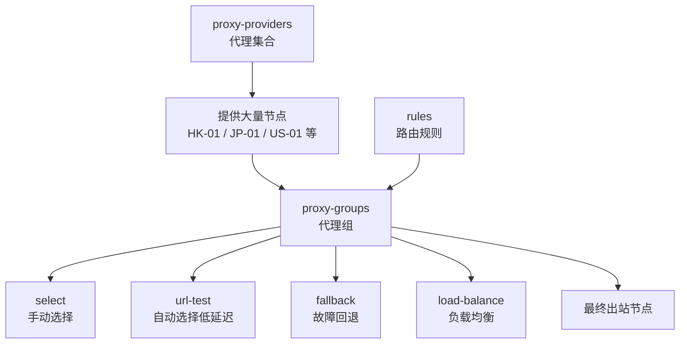
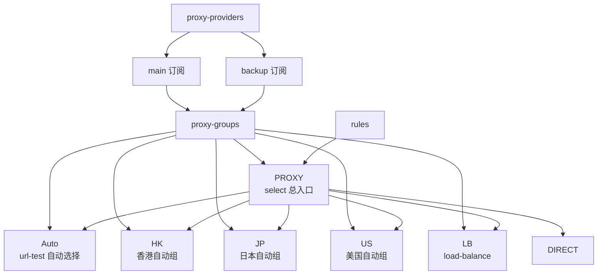

[toc]


## 概念对比

**`proxy-providers` 是“节点来源/节点仓库”，`proxy-groups` 是“节点使用策略/调度入口”。**

更直白地说：

| 配置块            | 角色                   | 类比                 |
| ----------------- | ---------------------- | -------------------- |
| `proxy-providers` | 提供一批代理节点       | 仓库、订阅源、节点池 |
| `proxy-groups`    | 决定这些节点怎么被使用 | 菜单、策略组、调度器 |

mihomo 官方文档中，`proxy-groups` 的 `proxies` 字段用于引入出站代理或其他代理组，`use` 字段用于引入代理集合；

而 `proxy-providers` 本身用于定义 provider 类型、订阅地址、文件路径、更新周期、健康检查、覆写规则等。([虚空终端](https://wiki.metacubex.one/config/proxy-groups/))

## 核心对比

| 对比项           | `proxy-groups` 代理组                                   | `proxy-providers` 代理集合                    |
| ---------------- | ------------------------------------------------------- | --------------------------------------------- |
| 配置位置         | `proxy-groups:`                                         | `proxy-providers:`                            |
| 核心作用         | 决定流量走哪个节点、哪个策略                            | 提供、更新、过滤、管理一批节点                |
| 是否直接参与路由 | 是，规则通常指向代理组                                  | 通常不直接作为规则出口使用                    |
| 是否有策略类型   | 有，如 `select`、`url-test`、`fallback`、`load-balance` | 有 provider 类型，如 `http`、`file`、`inline` |
| 是否能嵌套       | 可以通过 `proxies` 引入其他代理组                       | 不负责嵌套代理组                              |
| 是否能引入订阅   | 通过 `use` 引入 provider                                | 自身负责订阅、文件或内联节点                  |
| 是否能自动更新   | 代理组本身不下载订阅                                    | 可以通过 `interval` 定时更新                  |
| 是否能健康检查   | 可以；组级 `url` 也会向 `use` 引入的 provider 追加测速任务 | 可以通过 `health-check` 检查 provider 内节点  |
| 面板中是否常见   | 常见，用户通常操作代理组                                | 一般不直接操作，更多是后台节点来源            |
| 新手理解重点     | “我选择哪个出口策略”                                    | “我的节点从哪里来”                            |

## 它们的关系



实际使用时，`proxy-providers` 先把节点准备好，`proxy-groups` 再通过 `use` 把这些节点拿进来，最后 `rules` 把流量交给某个代理组。

## 代理集合负责“节点从哪里来”

`proxy-providers` 更像节点来源管理器。常见来源有三类：

| provider 类型 | 说明                           | 适合场景                       |
| ------------- | ------------------------------ | ------------------------------ |
| `http`        | 从远程订阅地址下载节点         | 最常见，机场订阅、远程节点列表 |
| `file`        | 从本地文件读取节点             | 自己维护节点文件               |
| `inline`      | 直接在主配置中写 provider 节点 | 少量节点、测试配置、特殊分组   |

官方文档列出 `proxy-providers` 的 `type` 可选 `http`、`file`、`inline`；`http` 类型需要配置 `url`，`path` 可用于指定保存路径，`interval` 是 provider 更新时间，单位为秒。([虚空终端](https://wiki.metacubex.one/config/proxy-providers/))

典型写法：

```yaml
proxy-providers:
  provider1:
    type: http
    url: "http://test.com"
    path: ./proxy_providers/provider1.yaml
    interval: 3600
    proxy: DIRECT
    size-limit: 0
    age-secret-key: "AGE-SECRET-KEY-1<YOUR_AGE_SECRET_KEY>"
    header:
      User-Agent:
      - "mihomo/1.18.3"
      Authorization:
      - 'token 1231231'
      # X-Age-Public-Key:
      # - 'age1<YOUR_AGE_PUBLIC_KEY>'
    health-check:
      enable: true
      url: https://www.gstatic.com/generate_204
      interval: 300
      timeout: 5000
      lazy: true
      expected-status: 204
    override:
      tfo: false
      mptcp: false
      udp: true
      udp-over-tcp: false
      down: "50 Mbps"
      up: "10 Mbps"
      skip-cert-verify: true
      dialer-proxy: proxy
      interface-name: tailscale0
      routing-mark: 233
      ip-version: ipv4-prefer
      additional-prefix: "provider1 prefix |"
      additional-suffix: "| provider1 suffix"
      proxy-name:
      - pattern: "IPLC-(.*?)倍"
        target: "iplc x $1"
    filter: "(?i)港|hk|hongkong|hong kong"
    exclude-filter: "xxx"
    exclude-type: "ss|http"
    payload:
      - name: "ss1"
        type: ss
        server: server
        port: 443
        cipher: chacha20-ietf-poly1305
        password: "password"
```

```yaml

# Mihomo 格式的节点或支持 *ray 的分享格式
proxy-providers:
  provider1:
    type: http # http 的 path 可空置，默认储存路径为 homedir 的 proxies 文件夹，文件名为 url 的 md5
    url: "url"
    interval: 3600
    path: ./provider1.yaml # 默认只允许存储在 mihomo 的 Home Dir，如果想存储到其他位置，请通过设置 SAFE_PATHS 环境变量指定额外的安全路径。该环境变量的语法同本操作系统的PATH环境变量解析规则（即Windows下以分号分割，其他系统下以冒号分割）
    proxy: DIRECT
    header:
      User-Agent:
      - "Clash/v1.18.0"
      - "mihomo/1.18.3"
      # Accept:
      # - 'application/vnd.github.v3.raw'
      # Authorization:
      # - 'token 1231231'
      # X-Age-Public-Key:
      # - 'age1<YOUR_AGE_PUBLIC_KEY>'
    health-check:
      enable: true
      interval: 600
      # lazy: true
      url: https://cp.cloudflare.com/generate_204
      # expected-status: 204 # 当健康检查返回状态码与期望值不符时，认为节点不可用
    override: # 覆写节点加载时的一些配置项
      skip-cert-verify: true
      udp: true
      # down: "50 Mbps"
      # up: "10 Mbps"
      # dialer-proxy: proxy
      # interface-name: tailscale0
      # routing-mark: 233
      # ip-version: ipv4-prefer
      # additional-prefix: "[provider1]"
      # additional-suffix: "test"
      # # 名字替换，支持正则表达式
      # proxy-name:
      #   - pattern: "test"
      #     target: "TEST"
      #   - pattern: "IPLC-(.*?)倍"
      #     target: "iplc x $1"

  provider2:
    type: inline
    dialer-proxy: proxy
    payload:
      - name: "ss1"
        type: ss
        server: server
        port: 443
        cipher: chacha20-ietf-poly1305
        password: "password"

  test:
    type: file
    path: /test.yaml
    health-check:
      enable: true
      interval: 36000
      url: https://cp.cloudflare.com/generate_204
```

这里的重点不是“选择哪个节点”，而是：

| 字段                        | 作用                                                       |
| --------------------------- | ---------------------------------------------------------- |
| `url`                       | 从哪里下载订阅                                             |
| `path`                      | 下载后保存到哪里                                           |
| `interval`                  | 多久更新一次订阅                                           |
| `proxy`                     | 用哪个出口去下载或更新订阅                                 |
| `health-check`              | 对 provider 内的节点做健康检查                             |
| `filter` / `exclude-filter` | 在 provider 层筛选或排除节点                               |
| `override`                  | 批量覆写节点属性，例如名称前缀、UDP、接口、dialer-proxy 等 |

provider 的健康检查字段包括 `health-check.enable`、`health-check.url`、`health-check.interval`、`health-check.timeout`、`health-check.lazy`、`health-check.expected-status`。([虚空终端](https://wiki.metacubex.one/config/proxy-providers/))

## 代理组负责“节点怎么用”

`proxy-groups` 是真正面向策略和路由的部分。它可以手动选节点，也可以自动测速，也可以做故障回退或负载均衡。

典型写法：

```yaml
proxy-groups:
  - name: PROXY
    type: select
    proxies:
      - Auto
      - HK
      - JP
      - US
      - DIRECT

  - name: Auto
    type: url-test
    use:
      - main
    url: https://www.gstatic.com/generate_204
    interval: 300
    tolerance: 50
    lazy: true
```

这里 `PROXY` 是一个手动选择组，`Auto` 是一个自动测速组。`Auto` 通过 `use: [main]` 引入名为 `main` 的 provider。官方文档说明，代理组的 `name` 和 `type` 是必填项，`proxies` 可以引入出站代理或其他代理组，`use` 可以引入代理集合。([虚空终端](https://wiki.metacubex.one/config/proxy-groups/))

## `proxies` 和 `use` 的区别

这是理解两者关系的关键。

| 字段      | 所属位置       | 引入对象                         | 示例                      | 适合             |
| --------- | -------------- | -------------------------------- | ------------------------- | ---------------- |
| `proxies` | `proxy-groups` | 具体节点名、内置策略、其他代理组 | `DIRECT`、`HK-01`、`Auto` | 手动组织固定结构 |
| `use`     | `proxy-groups` | `proxy-providers` 的名称         | `main`、`airport-a`       | 引入订阅节点池   |

示例：

```yaml
proxy-groups:
  - name: PROXY
    type: select
    proxies:
      - Auto
      - DIRECT
    use:
      - main
```

这表示 `PROXY` 组里同时包含：

| 来源      | 内容                                     |
| --------- | ---------------------------------------- |
| `proxies` | `Auto` 这个代理组、`DIRECT` 这个内置策略 |
| `use`     | `main` provider 中提供的所有节点         |

## 健康检查位置不同

代理组也有 `url`、`interval`、`lazy`、`timeout` 等健康检查相关字段。用 `use` 引入 provider 时，组上的 `url` 会向这些 provider 注册一条额外的测速任务（源码 `adapter/outboundgroup/parser.go` 的 `addTestUrlToProviders`）；provider 自身的 `health-check` 仍然独立生效，两处 `url` 相同时共用结果，provider 已设 `interval` 时组上的 `interval` 不覆盖它。`load-balance` / `url-test` 判断节点可用性用的就是组 `url` 对应的测速结果。([源码](https://github.com/MetaCubeX/mihomo/blob/Alpha/adapter/outboundgroup/parser.go))

所以，如果你的节点来自订阅 provider，推荐这样写：

```yaml
proxy-providers:
  main:
    type: http
    url: "你的订阅地址"
    path: ./providers/main.yaml
    interval: 86400
    health-check:
      enable: true
      url: https://www.gstatic.com/generate_204
      interval: 300
      timeout: 5000
      lazy: true
      expected-status: 204

proxy-groups:
  - name: Auto
    type: url-test
    use:
      - main
    url: https://www.gstatic.com/generate_204
    interval: 300
    tolerance: 50
```

也就是：

| 节点来源                      | 健康检查建议                         |
| ----------------------------- | ------------------------------------ |
| 手写在 `proxies:` 里的节点    | 可用代理组的 `url` / `interval` 检查 |
| 来自 `proxy-providers` 的节点 | 在 provider 的 `health-check` 中检查 |
| 混合来源                      | provider 和代理组都合理配置          |

## 谁负责筛选节点

两边都可以有筛选，但含义略有不同。

| 位置              | 字段                                       | 作用范围                            | 常见用途             |
| ----------------- | ------------------------------------------ | ----------------------------------- | -------------------- |
| `proxy-providers` | `filter`、`exclude-filter`、`exclude-type` | provider 自己提供的节点             | 从源头过滤节点       |
| `proxy-groups`    | `filter`、`exclude-filter`、`exclude-type` | 引入的 provider 或 include-all 节点 | 不同代理组按地区筛选 |

官方代理组文档说明，组内 `filter` 作用于引入的代理集合以及自动引入的出站代理；`exclude-type` 不支持正则表达式，而是用 `|` 分割并按节点类型排除。([虚空终端](https://wiki.metacubex.one/config/proxy-groups/))

推荐做法是：**provider 层做通用清洗，代理组层做业务分类。**

例如：

```yaml
proxy-providers:
  main:
    type: http
    url: "你的订阅地址"
    path: ./providers/main.yaml
    interval: 86400
    exclude-filter: "(?i)剩余|流量|官网|过期|expire|traffic"
    health-check:
      enable: true
      url: https://www.gstatic.com/generate_204
      interval: 300

proxy-groups:
  - name: HK
    type: url-test
    use:
      - main
    filter: "(?i)港|hk|hongkong|hong kong"
    url: https://www.gstatic.com/generate_204
    interval: 300

  - name: JP
    type: url-test
    use:
      - main
    filter: "(?i)日|jp|japan|tokyo|osaka"
    url: https://www.gstatic.com/generate_204
    interval: 300
```

这样可以避免每个代理组都重复排除“剩余流量、官网、过期”等无效节点。

## 是否能被规则直接使用

通常建议：**规则指向代理组，不直接指向 provider。**

例如：

```yaml
rules:
  - DOMAIN-SUFFIX,github.com,PROXY
  - DOMAIN-SUFFIX,youtube.com,PROXY
  - MATCH,Final
```

这里的 `PROXY` 和 `Final` 应该是 `proxy-groups` 中定义的代理组。`proxy-providers` 只是给这些代理组提供节点，不承担“路由出口策略”的角色。

更推荐的组织方式是：

```yaml
proxy-providers:
  main:
    type: http
    url: "你的订阅地址"
    path: ./providers/main.yaml
    interval: 86400

proxy-groups:
  - name: PROXY
    type: select
    proxies:
      - Auto
      - HK
      - JP
      - US
      - DIRECT

  - name: Auto
    type: url-test
    use:
      - main
    url: https://www.gstatic.com/generate_204
    interval: 300

  - name: HK
    type: url-test
    use:
      - main
    filter: "(?i)港|hk|hongkong|hong kong"
    url: https://www.gstatic.com/generate_204
    interval: 300

rules:
  - MATCH,PROXY
```

## 从配置生命周期看区别

| 阶段       | `proxy-providers` 做什么             | `proxy-groups` 做什么                                        |
| ---------- | ------------------------------------ | ------------------------------------------------------------ |
| 启动时     | 读取本地 provider 文件或拉取远程订阅 | 加载策略组结构                                               |
| 更新时     | 按 `interval` 更新订阅               | 使用更新后的节点池                                           |
| 健康检查时 | 检查 provider 内节点可用性           | 检查组内 `proxies` 引入的节点或执行组策略                    |
| 连接到来时 | 提供候选节点                         | 根据 `select`、`url-test`、`fallback`、`load-balance` 决定出口 |
| 用户操作时 | 一般不直接操作                       | 通常在面板里切换代理组                                       |

## 常见错误理解

| 错误理解                                  | 正确理解                                                  |
| ----------------------------------------- | --------------------------------------------------------- |
| `proxy-providers` 就是代理组              | 不是，它只是节点集合                                      |
| 有了 provider 就不需要 proxy-group        | 不对，规则通常仍应指向代理组                              |
| 代理组 `url` 会检查 provider 里的所有节点 | 会注册一条额外测速任务；组上的 `interval` 只在 provider 未设 `interval` 时生效 |
| `use` 和 `proxies` 完全一样               | 不一样，`use` 引入 provider，`proxies` 引入节点名或其他组 |
| provider 只适合订阅                       | 不只，`file` 和 `inline` 也可以作为 provider              |
| 所有筛选都应该写在代理组里                | 不一定，通用清洗更适合放 provider，地区分类更适合放代理组 |

## 推荐结构



实际配置上，建议采用这种分工：

| 层级        | 推荐命名                        | 作用                                     |
| ----------- | ------------------------------- | ---------------------------------------- |
| provider 层 | `main`、`backup`、`airport-a`   | 只负责节点来源、更新、健康检查、基础过滤 |
| 地区组      | `HK`、`JP`、`US`、`SG`          | 按地区筛选 provider 节点                 |
| 策略组      | `Auto`、`Stable`、`LoadBalance` | 自动选择、故障回退、负载均衡             |
| 总入口      | `PROXY`、`Final`                | 给规则引用，也方便用户手动切换           |

## 新手最佳实践

| 需求             | 推荐写法                                                     |
| ---------------- | ------------------------------------------------------------ |
| 只有几个手写节点 | 可以不用 `proxy-providers`，直接写 `proxies` 和 `proxy-groups` |
| 使用订阅链接     | 用 `proxy-providers` 管理订阅，再用 `proxy-groups` 引入      |
| 多个机场订阅     | 每个订阅一个 provider，然后在代理组里按需 `use`              |
| 想按地区分组     | 在代理组里用 `filter`                                        |
| 想排除无效节点   | 优先在 provider 中用 `exclude-filter` 做通用清洗             |
| 想让节点自动测速 | provider 中开启 `health-check`，代理组中用 `url-test`        |
| 想手动切换       | 建一个 `type: select` 的总入口组                             |
| 想负载均衡       | 建 `type: load-balance` 代理组，并通过 `use` 引入 provider   |

## 最小完整示例

```yaml
proxy-providers:
  main:
    type: http
    url: "你的订阅地址"
    path: ./providers/main.yaml
    interval: 86400
    exclude-filter: "(?i)剩余|流量|官网|过期|expire|traffic"
    health-check:
      enable: true
      url: https://www.gstatic.com/generate_204
      interval: 300
      timeout: 5000
      lazy: true
      expected-status: 204

proxy-groups:
  - name: PROXY
    type: select
    proxies:
      - Auto
      - HK
      - JP
      - DIRECT

  - name: Auto
    type: url-test
    use:
      - main
    url: https://www.gstatic.com/generate_204
    interval: 300
    tolerance: 50

  - name: HK
    type: url-test
    use:
      - main
    filter: "(?i)港|hk|hongkong|hong kong"
    url: https://www.gstatic.com/generate_204
    interval: 300
    tolerance: 50

  - name: JP
    type: url-test
    use:
      - main
    filter: "(?i)日|jp|japan|tokyo|osaka"
    url: https://www.gstatic.com/generate_204
    interval: 300
    tolerance: 50

rules:
  - MATCH,PROXY
```

## 总结

`proxy-providers` 解决的是“**节点从哪里来、怎么更新、怎么初步清洗**”；`proxy-groups` 解决的是“**这些节点怎么被选择、怎么被规则使用、怎么展示给用户操作**”。

最推荐的心智模型是：

```text
proxy-providers 提供节点
proxy-groups 组织和调度节点
rules 把流量交给代理组
```

新手配置 mihomo 时，不要把订阅、分组、规则全部混在一起理解。先把 provider 当作“节点池”，再把 proxy-group 当作“使用策略”，整个配置结构就会清晰很多。

`interval` 具体怎么排期、更新请求走不走代理、缓存文件落在哪里，以及如何核验现状与手动触发，见 [mihomo@订阅和规则集的自动更新@interval与手动触发@状态核验](./mihomo@订阅和规则集的自动更新@interval与手动触发@状态核验.md)。