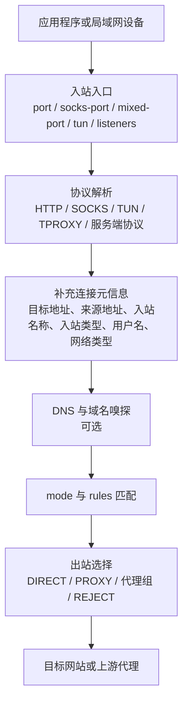

[toc]


## mihomo整体工作模型

在 mihomo 里，“入站”就是流量进入内核的位置；“出站”才是最终选择 `DIRECT`、某个代理节点、代理组或 `REJECT` 的位置。

官方文档的入站配置主要分为三类：代理端口、TUN、`listeners`；

而 `listeners` 下又包含 `http`、`socks`、`mixed`、`redirect`、`tproxy`、`tun`、ShadowSocks、VMess、VLESS、Trojan、TUIC、Hysteria2、Snell、tunnel 等类型。([MetaCubex](https://wiki.metacubex.one/))



可以把 mihomo 想成一个“流量调度器”：入站只负责“接住流量并识别它”，规则负责“判断这条流量该怎么走”，出站负责“实际连接目标或上游代理”。

`listeners` 的价值在于它能**创建多个具名入口**，并**为不同入口指定不同规则或固定出站**，这比单一的 `mixed-port` 更适合复杂场景。

官方 `listeners` 通用字段包括 `name`、`type`、`listen`、`port`、`rule`、`proxy`，其中 `rule` 可指定子规则，`proxy` 可让该入站直接交给指定出站或策略组。([MetaCubex](https://wiki.metacubex.one/en/config/inbound/listeners/))

## 入站和 listeners 的关系

| 概念        | 写法位置                                                     | 适合场景                                       | 特点                                                         |
| ----------- | ------------------------------------------------------------ | ---------------------------------------------- | ------------------------------------------------------------ |
| 代理端口    | 顶层 `port`、`socks-port`、`mixed-port`、`redir-port`、`tproxy-port` | 新手、本机代理、简单路由器透明代理             | 配置短，入口数量固定，适合“先跑起来”                         |
| 顶层 TUN    | 顶层 `tun:`                                                  | 接管系统流量、无需逐个应用设置代理             | 更接近 VPN 体验，适合桌面端、Android、网关                   |
| `listeners` | 顶层 `listeners:` 数组                                       | 多入口、多端口、多协议、按入口分流、服务端入站 | 每个入口可命名，可单独设置协议字段、`rule` 或 `proxy`        |
| 入口配置    | `ss-config`、`vmess-config`、`tuic-server` 等                | 兼容旧写法或快速暴露某些服务端入口             | 官方说明“入口配置与 Listener 等价”，流量会像 socks/mixed 等入口一样按 mode 处理。([MetaCubex](https://wiki.metacubex.one/config/inbound/)) |

新手可以先用 `mixed-port` 或顶层 `tun`；

当你需要“一个端口给浏览器、一个端口给局域网设备、一个端口固定走某个代理组、一个端口只跑子规则”时，就该使用 `listeners`。

## 常见入站类型速览

| 类型       | 配置入口                                                     | 支持的客户端或流量           | 典型用途                                    | 新手建议                       |
| ---------- | ------------------------------------------------------------ | ---------------------------- | ------------------------------------------- | ------------------------------ |
| HTTP       | `port` 或 `listeners.type: http`                             | HTTP/HTTPS 代理客户端        | 浏览器、命令行工具、支持 HTTP 代理的软件    | 适合明确支持 HTTP 代理的软件   |
| SOCKS      | `socks-port` 或 `listeners.type: socks`                      | SOCKS4/4a/5 客户端           | Telegram、curl、开发工具、支持 SOCKS 的软件 | 更通用，UDP 需关注 `udp`       |
| Mixed      | `mixed-port` 或 `listeners.type: mixed`                      | HTTP(S) 与 SOCKS5 混合       | 一个端口同时兼容多数代理客户端              | 本机代理最推荐                 |
| Redirect   | `redir-port` 或 `listeners.type: redir`                      | 被系统 NAT 重定向的 TCP 流量 | Linux/macOS 透明代理                        | 只能处理 TCP，UDP 不适合       |
| TProxy     | `tproxy-port` 或 `listeners.type: tproxy`                    | Linux 透明代理 TCP/UDP       | 路由器、网关、旁路由                        | Linux/Android 透明代理优先考虑 |
| TUN        | 顶层 `tun:` 或 `listeners.type: tun`                         | 系统三层 IP 流量             | 类 VPN 接管流量                             | 普通用户优先用顶层 `tun`       |
| 服务端协议 | `listeners.type: shadowsocks/vmess/vless/trojan/tuic/hysteria2/snell/...` | 远端客户端连接到本机 mihomo  | 把 mihomo 当服务端入口                      | 适合高级用户或自建服务         |
| Tunnel     | `listeners.type: tunnel` 或顶层 `tunnels`                    | 本地端口转发到指定目标       | DNS 转发、固定服务转发                      | 适合小型端口转发场景           |

官方代理端口文档说明：`mixed-port` 是一个同时支持 HTTP(S) 和 SOCKS5 的特殊端口；

`redir-port` 适用于 Linux/Android 和 macOS，且只能代理 TCP；

`tproxy-port` 适用于 Linux/Android，并可代理 TCP 与 UDP。([MetaCubex](https://wiki.metacubex.one/en/config/inbound/port/))

## 代理端口：最简单的入站

### HTTP、SOCKS、Mixed 的区别

| 入口         | 顶层字段           | listener 类型 | 是否适合新手 | 说明                                                   |
| ------------ | ------------------ | ------------- | ------------ | ------------------------------------------------------ |
| HTTP(S) 代理 | `port: 7890`       | `type: http`  | 可以         | 适合明确支持 HTTP 代理的软件                           |
| SOCKS 代理   | `socks-port: 7891` | `type: socks` | 可以         | 常见客户端兼容性好，SOCKS listener 可设置 `udp: true`  |
| 混合代理     | `mixed-port: 7892` | `type: mixed` | 推荐         | 一个端口同时接受 HTTP(S) 和 SOCKS5，减少客户端配置困扰 |

官方文档给出的 `mixed-port` 定义是：它同时支持 HTTP(S) 与 SOCKS5，任何支持 HTTP 或 SOCKS 代理的程序都可以连接到这个端口。([MetaCubex](https://wiki.metacubex.one/en/config/inbound/port/))

一个本机使用的最小配置可以这样写：

```yaml
mixed-port: 7890
allow-lan: false
mode: rule
log-level: info
```

如果要让局域网其他设备也能使用你的 mihomo，需要关注 `allow-lan`、`bind-address`、`lan-allowed-ips`、`lan-disallowed-ips` 和认证。

官方说明 `allow-lan` 允许其他设备通过代理端口访问，`bind-address` 可限制监听地址，`lan-allowed-ips` 与 `lan-disallowed-ips` 可控制允许或拒绝的来源网段。([MetaCubex](https://wiki.metacubex.one/en/config/general/))

```yaml
mixed-port: 7890
allow-lan: true
bind-address: 192.168.1.10

authentication:
  - "user1:strong-password"

lan-allowed-ips:
  - 192.168.1.0/24

lan-disallowed-ips:
  - 192.168.1.66/32
```

最佳实践是：只给本机使用时监听 `127.0.0.1` 或关闭 `allow-lan`；

需要给局域网用时，限制来源网段并启用认证；

不要把代理端口直接暴露到公网。

## listeners：更灵活的入站系统

`listeners` 是一个数组，每个元素就是一个独立入站。

它的核心通用字段如下。

官方文档明确列出 `name` 可用于匹配入站规则，`type` 是入站类型，`listen` 是监听地址，`port` 支持端口范围格式，`rule` 可指定子规则，`proxy` 可直接指定出站代理或策略组。([MetaCubex](https://wiki.metacubex.one/en/config/inbound/listeners/))

| 字段     | 含义           | 常见写法                                 | 实用建议                                       |
| -------- | -------------- | ---------------------------------------- | ---------------------------------------------- |
| `name`   | 入站名称       | `browser-in`、`lan-in`                   | 命名要有业务含义，后续可用 `IN-NAME` 匹配      |
| `type`   | 入站协议类型   | `mixed`、`socks`、`tproxy`、`vless`      | 决定这个端口接受什么协议                       |
| `listen` | 监听地址       | `127.0.0.1`、`0.0.0.0`、局域网 IP        | 本机用 `127.0.0.1`，给局域网用再监听局域网地址 |
| `port`   | 监听端口       | `7890`、`10808`、`200,204,401-429`       | 避免与系统服务、面板端口冲突                   |
| `rule`   | 指定子规则     | `browser-rule`                           | 适合“某个入口单独一套路由”                     |
| `proxy`  | 指定固定出站   | `DIRECT`、`PROXY`、`香港节点`            | 设置后绕过普通规则，直接交给该出站或策略组     |
| 协议字段 | 各类型专有配置 | `udp`、`users`、`uuid`、`certificate` 等 | 按类型查看对应文档                             |

一个典型的多入口配置如下：

```yaml
listeners:
  - name: local-mixed
    type: mixed
    listen: 127.0.0.1
    port: 7890
    udp: true

  - name: lan-socks
    type: socks
    listen: 192.168.1.10
    port: 10808
    udp: true
    users:
      - username: lan
        password: change-this-password

  - name: direct-http
    type: http
    listen: 127.0.0.1
    port: 7891
    proxy: DIRECT
```

这个配置表达的是：本机程序走 `127.0.0.1:7890`；

局域网设备走 `192.168.1.10:10808`(这里假设运行mihomo的设备ip是192.168.1.10)，并要求用户名密码；

某些需要强制直连的程序可以指向 `127.0.0.1:7891`。

## 认证机制：全局认证和 listener 认证

HTTP、SOCKS、Mixed 入站都有 `users` 字段。官方文档说明：如果 `users` 不填写，会跟随全局认证；如果填写，则忽略全局认证；如果想让某个入站跳过认证，可以设置 `users: []`。这一规则在 HTTP、SOCKS、Mixed listener 文档中都有说明。([MetaCubex](https://wiki.metacubex.one/en/config/inbound/listeners/http/))

| 配置方式                  | 效果                                       | 适用场景                         |
| ------------------------- | ------------------------------------------ | -------------------------------- |
| 顶层 `authentication`     | 给 HTTP/SOCKS/Mixed 代理设置全局用户名密码 | 统一管理本机或局域网代理认证     |
| listener 内不写 `users`   | 继承全局认证                               | 多数场景推荐                     |
| listener 内写 `users`     | 覆盖全局认证                               | 不同入口给不同用户               |
| listener 内写 `users: []` | 跳过该入口认证                             | 仅限可信本机或受防火墙保护的入口 |

示例：

```yaml
authentication:
  - "global-user:global-pass"

listeners:
  - name: inherit-auth
    type: mixed
    listen: 127.0.0.1
    port: 7890

  - name: custom-auth
    type: socks
    listen: 192.168.1.10
    port: 10808
    users:
      - username: alice
        password: alice-password

  - name: no-auth-local-only
    type: http
    listen: 127.0.0.1
    port: 7891
    users: []
```

最佳实践是：公网或局域网可访问的入口必须有认证或防火墙限制；`users: []` 只适合 `127.0.0.1` 或完全可信环境。

## 入站如何影响规则匹配

mihomo 的 `mode` 可设为 `rule`、`global`、`direct`，默认是 `rule`；

> `rule` 模式会按规则列表从上到下匹配，越靠上的规则优先级越高。

官方规则文档还提供了与入站相关的匹配条件：`IN-PORT`、`IN-TYPE`、`IN-USER`、`IN-NAME`，分别匹配入站端口、入站类型、入站用户名、入站名称。([MetaCubex](https://wiki.metacubex.one/en/config/general/))

| 规则      | 匹配对象      | 示例                       | 典型用途                     |
| --------- | ------------- | -------------------------- | ---------------------------- |
| `IN-PORT` | 入站端口      | `IN-PORT,7890,PROXY`       | 某个端口固定走代理           |
| `IN-TYPE` | 入站类型      | `IN-TYPE,SOCKS/HTTP,PROXY` | 按 HTTP/SOCKS/TUN 等类型分流 |
| `IN-USER` | 入站用户名    | `IN-USER,alice,PROXY`      | 多用户入口按用户分流         |
| `IN-NAME` | listener 名称 | `IN-NAME,lan-socks,DIRECT` | 最推荐的入口分流方式         |

更推荐用 `IN-NAME`，因为端口可能调整，协议类型可能复用，但**入口名称可以保持语义稳定**。

```yaml
listeners:
  - name: browser
    type: mixed
    listen: 127.0.0.1
    port: 7890

  - name: game
    type: socks
    listen: 127.0.0.1
    port: 7891
    udp: true

rules:
  - IN-NAME,game,DIRECT
  - DOMAIN-SUFFIX,example.com,PROXY
  - MATCH,PROXY
```

上面的逻辑是：只要流量来自名为 `game` 的入站，就优先直连；

其他流量再继续按域名和兜底规则匹配。由于规则是从上到下匹配，**入口类规则通常应放在较靠前位置**。([MetaCubex](https://wiki.metacubex.one/en/config/rules/))

## `rule` 与 `proxy` 字段的区别

| 字段    | 工作方式                              | 是否继续走普通 `rules`                           | 适合场景               |
| ------- | ------------------------------------- | ------------------------------------------------ | ---------------------- |
| `rule`  | 给这个入站指定一个 `sub-rules` 规则集 | 先用指定子规则；找不到子规则时回退到普通 `rules` | 某个入口有独立分流逻辑 |
| `proxy` | 这个入站流量直接交给指定出站或策略组  | 通常不再按普通规则逐条判断                       | 某个入口固定走一个出站 |

官方 common fields 文档说明，`rule` 使用子规则作为该入站的匹配规则，未配置或未找到子规则时使用 `rules`；`proxy` 则直接使用指定的出站代理或策略组，且名称必须合法。([MetaCubex](https://wiki.metacubex.one/en/config/inbound/listeners/))

示例：一个入口单独走子规则。

```yaml
listeners:
  - name: work
    type: mixed
    listen: 127.0.0.1
    port: 7892
    rule: work-rule

sub-rules:
  work-rule:
    - DOMAIN-SUFFIX,company.internal,DIRECT
    - DOMAIN-SUFFIX,github.com,PROXY
    - MATCH,DIRECT

rules:
  - MATCH,PROXY
```

示例：一个入口固定交给某个策略组。

```yaml
listeners:
  - name: hk-only
    type: mixed
    listen: 127.0.0.1
    port: 7893
    proxy: 香港节点组
```

## 透明代理：Redirect、TProxy、TUN

透明代理的特点是：应用本身不一定知道代理存在，系统、路由器或网关把流量导入 mihomo。三者最容易混淆。

| 类型     | OS 支持                  | TCP  | UDP    | 是否需要应用设置代理 | 典型位置                    | 结论                         |
| -------- | ------------------------ | ---- | ------ | -------------------- | --------------------------- | ---------------------------- |
| Redirect | Linux/Android、macOS     | 支持 | 不支持 | 不需要               | 路由器、macOS、本机透明代理 | 简单但只适合 TCP             |
| TProxy   | Linux/Android            | 支持 | 支持   | 不需要               | Linux 网关、旁路由、Android | 透明代理更完整               |
| TUN      | 多平台，视内核和权限而定 | 支持 | 支持   | 不需要               | 桌面端、Android、网关       | 新手更容易获得“全局接管”体验 |

官方代理端口文档说明：`redir-port` 只代理 TCP；`tproxy-port` 可以代理 TCP 和 UDP；`redirect` 适用于 Linux/Android 和 macOS，`tproxy` 适用于 Linux/Android。([MetaCubex](https://wiki.metacubex.one/en/config/inbound/port/))

### Redirect listener

```yaml
listeners:
  - name: redir-in
    type: redir
    listen: 0.0.0.0
    port: 7893
```

Redirect 入口本身只是监听端口；真正把流量导入这个端口，通常还需要系统防火墙、iptables/nftables、pf 或客户端工具配合。

### TProxy listener

```yaml
listeners:
  - name: tproxy-in
    type: tproxy
    listen: 0.0.0.0
    port: 7894
    udp: true
```

官方 TProxy listener 文档中 `udp` 的含义是“是否监听 UDP”。([MetaCubex](https://wiki.metacubex.one/en/config/inbound/listeners/tproxy/)) 对路由器、旁路由和 Linux 网关来说，TProxy 通常比 Redirect 更适合完整代理 UDP，例如 QUIC、游戏、部分实时通信。

### TUN

官方特别提醒：`listeners` 里的 TUN 仅提供给高级用户，普通用户应使用顶层 `tun`。([MetaCubex](https://wiki.metacubex.one/en/config/inbound/listeners/tun/))

顶层 TUN 更常见：

```yaml
tun:
  enable: true
  stack: system
  auto-route: true
  auto-detect-interface: true
  dns-hijack:
    - any:53
    - tcp://any:53
```

官方 TUN 文档说明：`auto-route` 可自动设置全局路由，把全局流量路由进入 TUN 网卡；`auto-redirect` 仅支持 Linux，并会自动配置 iptables/nftables 以重定向 TCP 连接，且需要启用 `auto-route`；`dns-hijack` 会把匹配到的 DNS 连接导入 mihomo 内部 DNS 模块。([MetaCubex](https://wiki.metacubex.one/en/config/inbound/tun/))

## TUN 的 stack 怎么选

| `stack`  | 特点                                               | 新手建议                 |
| -------- | -------------------------------------------------- | ------------------------ |
| `system` | 使用系统协议栈，通常更稳定，占用相对低             | 兼容性排查时尝试         |
| `gvisor` | 用户态协议栈，隔离性更强，在部分场景有不同性能表现 | 遇到兼容性问题时尝试     |
| `mixed`  | TCP 用 `system`，UDP 用 `gvisor`                   | 需要兼顾体验时尝试       |
| `mips`   | 自研 IP 协议栈                                     | 默认值，无特殊问题直接用 |

官方 TUN 文档给出的可选值是 `system` / `gvisor` / `mixed` / `mips`，并建议无特殊问题时使用 `mips`（当前默认值）。([MetaCubex](https://wiki.metacubex.one/en/config/inbound/tun/))

TUN 常见排错思路：先确认 mihomo 有创建网卡和修改路由的权限；再确认 DNS 是否被劫持到 mihomo；最后看规则是否把目标走到了错误的出站。`strict-route` 可以防止地址泄漏，并在 Windows 上通过防火墙规则阻止普通多宿主 DNS 行为导致的 DNS 泄漏，但也可能影响某些应用。([MetaCubex](https://wiki.metacubex.one/en/config/inbound/tun/))

## DNS 与域名嗅探对入站的影响

入站拿到的流量不一定天然带有域名。HTTP 代理通常容易知道域名；SOCKS 可能传域名，也可能传 IP；透明代理和 TUN 经常只能先看到 IP。此时 DNS、fake-ip、redir-host、sniffer 会影响规则能否按域名正确匹配。

官方 DNS 文档中，`enhanced-mode` 可选 `fake-ip` 或 `redir-host`；`fake-ip-range` 是 fake-ip 地址段，TUN 的默认 IPv4 地址也会参考该值；`dns.listen` 支持 UDP 和 TCP。([MetaCubex](https://wiki.metacubex.one/en/config/dns/))

官方域名嗅探文档说明，sniffer 可嗅探 HTTP、TLS、QUIC，并支持按端口设置；`override-destination` 表示是否使用嗅探结果作为实际访问目标；还可以配置强制嗅探、跳过域名、跳过来源地址和跳过目标地址。([MetaCubex](https://wiki.metacubex.one/en/config/sniff/))

新手可以这样理解：

| 场景                                      | 问题                          | 推荐处理                              |
| ----------------------------------------- | ----------------------------- | ------------------------------------- |
| 明确代理客户端，例如浏览器设置 mixed-port | 客户端通常能把域名交给 mihomo | DNS 配置简单即可                      |
| TUN 接管系统流量                          | mihomo 可能先看到 IP          | 配合 DNS fake-ip 或 sniffer           |
| 透明代理路由器                            | 终端 DNS 可能没有走 mihomo    | 配置 DNS 劫持或让终端 DNS 指向 mihomo |
| 规则依赖 `DOMAIN-SUFFIX`                  | 但连接只剩 IP                 | 检查 fake-ip、嗅探、DNS 劫持是否生效  |

## 服务端 listeners：把 mihomo 当入站服务器

`listeners` 不只用于本地代理端口，也能让 mihomo 暴露服务端协议入口。官方文档的 listeners 列表包含 ShadowSocks、VMess、VLESS、Trojan、AnyTLS、Mieru、Sudoku、TUIC v4、TUIC v5、Hysteria2、Hysteria2 Realm、TrustTunnel、Snell 等。([MetaCubex](https://wiki.metacubex.one/))

| 类型                 | 作用                       | 关键字段示例                                 | 适合人群       |
| -------------------- | -------------------------- | -------------------------------------------- | -------------- |
| `shadowsocks`        | 暴露 SS 服务端入口         | `cipher`、`password`、`udp`                  | 熟悉 SS 的用户 |
| `vmess`              | 暴露 VMess 服务端入口      | `users.uuid`、传输层字段                     | 兼容旧生态     |
| `vless`              | 暴露 VLESS 服务端入口      | `users.uuid`、`flow`、TLS/Reality/decryption | 高级用户       |
| `trojan`             | 暴露 Trojan 服务端入口     | 密码、证书、TLS                              | 自建服务端     |
| `tuic` / `hysteria2` | 基于 UDP/QUIC 的服务端入口 | 用户、证书、拥塞控制等                       | 网络环境复杂时 |
| `snell`              | 暴露 Snell 服务端入口      | `psk`、`version`、`udp`                      | Snell 用户     |
| `tunnel`             | 端口转发型入口             | `network`、`address`、`target`、`proxy`      | 转发固定服务   |

ShadowSocks listener 文档示例包含 `type: shadowsocks`、`cipher`、`password` 和 `udp`，并列出了 2022 系列加密方法的密码长度要求。([MetaCubex](https://wiki.metacubex.one/en/config/inbound/listeners/ss/)) VLESS listener 文档展示了 `users.uuid`、`flow`、WebSocket、gRPC、XHTTP、TLS、mTLS、ECH、Reality 等相关字段，并提示 VLESS listener 在 `allow-insecure` 不为 true 时，至少需要证书私钥、Reality 配置或 decryption 之一。([MetaCubex](https://wiki.metacubex.one/en/config/inbound/listeners/vless/)) Snell listener 文档显示其支持 `psk`、`version: 4/5`、`udp` 以及 `obfs-opts`。([MetaCubex](https://wiki.metacubex.one/en/config/inbound/listeners/snell/))

服务端 listeners 的安全要求更高：不要复用弱密码；证书、私钥、UUID、Reality key 等敏感信息不要提交到公开仓库；公网监听前先确认防火墙、认证、TLS/Reality 等配置正确；升级 mihomo 时阅读对应版本变更，尤其是新协议和安全相关改动。

## tunnel：端口转发型入站

`tunnel` 的思想不是“让客户端使用代理协议”，而是“监听一个本地地址，再把流量转发到固定目标”。官方 tunnel 文档说明它可以转发 TCP/UDP 流量，也可以通过指定 proxy 转发；字段包括 `network`、`address`、`target`、`proxy`。([MetaCubex](https://wiki.metacubex.one/en/config/tunnels/))

```yaml
tunnels:
  - network: [tcp, udp]
    address: 127.0.0.1:6553
    target: 8.8.8.8:53
    proxy: PROXY
```

这类配置适合把本地某个端口固定映射到远端服务，例如把本地 `127.0.0.1:6553` 转发到某个 DNS 服务器。官方示例说明，访问本地监听地址会通过指定 `proxy` 访问目标地址。([MetaCubex](https://wiki.metacubex.one/en/config/tunnels/))

## 新手推荐配置路径

| 阶段          | 目标                     | 推荐配置                          | 不建议一开始碰的内容        |
| ------------- | ------------------------ | --------------------------------- | --------------------------- |
| 入门          | 本机应用走代理           | `mixed-port`                      | TProxy、服务端 listeners    |
| 稍进阶        | 局域网设备使用代理       | `mixed-port` + `allow-lan` + 认证 | 直接暴露 `0.0.0.0` 且无认证 |
| 系统级代理    | 不想逐个应用配置代理     | 顶层 `tun`                        | listener 里的 TUN           |
| 路由器/旁路由 | 接管局域网流量           | Linux TProxy 或 TUN               | 只用 redir 期待 UDP 正常    |
| 多入口分流    | 不同程序或用户走不同规则 | `listeners` + `IN-NAME` 或 `rule` | 用端口硬编码到处写死        |
| 服务端玩法    | 让外部客户端连入 mihomo  | 协议型 listeners                  | 无 TLS/弱认证/公网裸奔      |

## 实用配置模板

### 本机 mixed-port，最适合入门

```yaml
mixed-port: 7890
allow-lan: false
mode: rule
log-level: info

rules:
  - GEOIP,LAN,DIRECT
  - MATCH,PROXY
```

### 本机加局域网，多入口隔离

```yaml
mode: rule
log-level: info

listeners:
  - name: local
    type: mixed
    listen: 127.0.0.1
    port: 7890
    udp: true

  - name: lan
    type: mixed
    listen: 192.168.1.10
    port: 7891
    udp: true
    users:
      - username: lan
        password: change-this-password

rules:
  - IN-NAME,lan,PROXY
  - GEOIP,LAN,DIRECT
  - MATCH,PROXY
```

### 一个入口固定直连，一个入口正常规则

```yaml
listeners:
  - name: normal
    type: mixed
    listen: 127.0.0.1
    port: 7890

  - name: direct-only
    type: mixed
    listen: 127.0.0.1
    port: 7891
    proxy: DIRECT

rules:
  - DOMAIN-SUFFIX,example.com,PROXY
  - MATCH,DIRECT
```

### 为某个入口单独设置子规则

```yaml
listeners:
  - name: work
    type: mixed
    listen: 127.0.0.1
    port: 7892
    rule: work-rule

sub-rules:
  work-rule:
    - DOMAIN-SUFFIX,company.internal,DIRECT
    - DOMAIN-SUFFIX,github.com,PROXY
    - MATCH,DIRECT

rules:
  - MATCH,PROXY
```

## 常见误区

| 误区                                  | 正确认识                                                     |
| ------------------------------------- | ------------------------------------------------------------ |
| `mixed-port` 等于全局代理             | 它只是入口；是否代理、直连或拒绝取决于 `mode`、`rules`、`proxy-groups` |
| 写了 `listen: 0.0.0.0` 就安全         | 这表示监听所有地址，必须配合认证、防火墙或来源限制           |
| Redirect 可以处理所有透明代理流量     | Redirect 只代理 TCP；UDP 需要 TProxy 或 TUN                  |
| TUN listener 适合所有人               | 官方明确说 listener 中的 TUN 给高级用户，普通用户应使用顶层 `tun` |
| `proxy` 和 `rule` 差不多              | `proxy` 是固定交给某个出站；`rule` 是给该入口指定子规则      |
| 规则写了 `DOMAIN-SUFFIX` 就一定能命中 | 前提是 mihomo 能拿到域名；透明代理/TUN 场景要关注 DNS 与嗅探 |
| 多入口用端口区分就够了                | 更推荐给 listener 起稳定的 `name`，再用 `IN-NAME` 匹配       |

## 最佳实践清单

| 类别     | 建议                                                         |
| -------- | ------------------------------------------------------------ |
| 命名     | listener 的 `name` 使用语义化名称，例如 `local`、`lan`、`game`、`work` |
| 监听地址 | 本机入口优先 `127.0.0.1`；局域网入口使用具体局域网 IP；谨慎使用 `0.0.0.0` |
| 认证     | 局域网或公网可访问的 HTTP/SOCKS/Mixed 入口必须启用认证       |
| 分流     | 多入口分流优先用 `IN-NAME`，比 `IN-PORT` 更稳定              |
| UDP      | 游戏、QUIC、语音、TUN、TProxy 场景要确认入站和出站都支持 UDP |
| 透明代理 | Linux 网关优先考虑 TProxy 或 TUN；Redirect 只适合 TCP        |
| TUN      | 新手优先顶层 `tun`，不要一开始使用 listener TUN              |
| DNS      | TUN/透明代理场景必须设计 DNS 路径，否则域名规则可能失效      |
| 安全     | 不要公网裸露代理端口；不要把证书、私钥、UUID、密码写进公开仓库 |
| 调试     | 先用 `log-level: info`，排错时临时改 `debug`，确认入口、规则、出站是否符合预期 |

## 学习顺序建议

先掌握 `mixed-port`，理解“入口不等于出站”；再学习 `rules` 中的 `IN-NAME`、`IN-TYPE`、`IN-USER`；然后尝试用 `listeners` 拆分本机、局域网、工作、游戏等入口；最后再进入 TUN、TProxy、DNS 劫持、服务端 listeners。这样学习路径最稳，不容易一开始就被透明代理和 DNS 细节卡住。