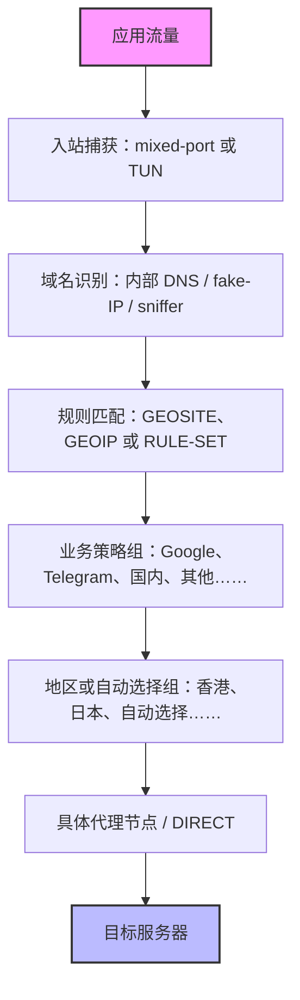

[toc]


## 一、快捷配置

[快捷配置 - 虚空终端 Docs](https://wiki.metacubex.one/example/conf/)“快捷配置”不是单纯的字段清单，而是一套完整的流量处理管线：



- `proxy-providers` 负责“节点从哪里来”。
- `proxy-groups` 负责“在多个节点或策略之间如何选择”。
- `rules` 负责“某条连接交给哪个策略组”。
- DNS、sniffer 和 TUN 负责“怎样捕获流量，以及怎样识别它访问的域名”。
- GeoX 或 `rule-providers` 负责“分类规则数据从哪里来”。

页面给出了 GeoX、RULE-SET/MRS 和 Stash 风格三套配置，它们共用上述架构，主要区别是规则数据的组织方式和策略组的丰富程度。([虚空终端](https://wiki.metacubex.one/example/conf/))

------

## 二、配置文件语法：YAML、锚点与合并

mihomo 使用 YAML。YAML 大小写敏感，通过空格缩进表示层级，不能用 Tab；列表可以写成多行 `- item`，也可以写成 `[a, b, c]`。页面同时使用了展开格式和单行对象格式，这两种形式在语义上相同。([虚空终端](https://wiki.metacubex.one/handbook/syntax/))

例如：

```yaml
health-check:
  enable: true
  url: https://www.gstatic.com/generate_204
  interval: 300
```

等价于：

```yaml
health-check: {enable: true, url: "https://www.gstatic.com/generate_204", interval: 300}
```

### YAML 锚点

页面的 RULE-SET 和 Stash 配置大量使用：

```yaml
p: &p
  type: http
  interval: 3600

proxy-providers:
  provider1:
    <<: *p
    url: ""
```

含义是：

- `&p`：建立名为 `p` 的模板。
- `*p`：引用该模板。
- `<<: *p`：把模板字段合并进当前对象。

因此 `provider1` 最终拥有 `type`、`interval` 和自己的 `url`。mihomo 会忽略自己不认识的顶层辅助键，所以可以用 `p`、`pr`、`rule-anchor` 等键专门存放模板。若当前对象已有同名字段，则当前对象的值优先，不会被锚点覆盖。([虚空终端](https://wiki.metacubex.one/handbook/syntax/))

Stash 风格配置中的两个锚点分别是：

```yaml
pr: &pr {...}   ## 业务策略组模板
p: &p {...}     ## 订阅/provider 模板
```

随后 Google、Apple、Telegram 等组通过 `<<: *pr` 复用候选策略，两个订阅通过 `<<: *p` 复用更新和健康检查设置。([虚空终端](https://wiki.metacubex.one/example/conf/))

------

## 三、节点、代理集合与代理组的区别

这是最容易混淆的三个概念。

### 1. `proxies`：具体的一个出站

页面手工定义了：

```yaml
proxies:
  - name: "直连"
    type: direct
    udp: true
```

这是一个名为“直连”的具体出站。它不是选择器，也不包含其他节点。这样做的主要目的是给内置直连能力一个中文名称，方便在规则和策略组里统一引用。

### 2. `proxy-providers`：一批可更新的节点

```yaml
proxy-providers:
  provider1:
    url: ""
    type: http
    interval: 86400
    health-check:
      enable: true
      url: https://www.gstatic.com/generate_204
      interval: 300
    override:
      additional-prefix: "[provider1]"
```

这里的 provider 可以理解为“订阅源”：

- `type: http`：从远程地址下载节点集合；provider 也支持 `file` 和 `inline`。
- `url`：订阅地址。
- `interval: 86400`：每 86400 秒，即每天更新一次。
- `health-check.interval: 300`：每五分钟检查其中节点。
- `additional-prefix`：给节点名称增加前缀，避免多个订阅存在同名节点。
- 未填写 `path` 时，内核可以根据 URL 生成缓存文件名。([虚空终端](https://wiki.metacubex.one/example/conf/))

provider 自身不能直接表达“Google 走香港、Netflix 走美国”这样的路由意图。它只是节点仓库。

### 3. `proxy-groups`：选择和组织节点的策略层

例如：

```yaml
- name: 默认
  type: select
  proxies:
    - 自动选择
    - 直连
    - 香港
    - 台湾
```

`select` 是手动选择组。它可以包含具体节点，也可以包含其他策略组。因此页面构造了多级策略：

```text
Google
  ├─ 默认
  ├─ 香港
  ├─ 日本
  ├─ 自动选择
  └─ 直连

香港
  ├─ 香港节点 A
  ├─ 香港节点 B
  └─ 香港节点 C
```

规则只需要把 Google 流量交给 `Google` 组，用户随后可以决定它跟随“默认”，固定香港，或者自动测速。策略组可以引用其他策略组，而 provider 只是被策略组导入的节点来源。([虚空终端](https://wiki.metacubex.one/example/conf/))

------

## 四、地区分组、正则筛选和自动选择

页面通过节点名称来判断地区：

```yaml
- name: 香港
  type: select
  include-all: true
  exclude-type: direct
  filter: "(?i)港|hk|hongkong|hong kong"
```

字段含义如下：

- `include-all: true`：引入所有普通出站和所有 provider 中的节点，但不会自动引入其他策略组。
- `exclude-type: direct`：排除 `direct` 类型，防止“直连”被当成香港节点。
- `filter`：只保留名称匹配正则表达式的节点。
- `(?i)`：正则表达式忽略大小写。([虚空终端](https://wiki.metacubex.one/config/proxy-groups/))

“其它地区”使用负向前瞻：

```yaml
filter: "(?i)^(?!.*(?:港|hk|台|tw|日|jp|新|sg|美|us)).*"
```

含义是：保留名称中没有出现已知地区关键字的节点。

这种分类方式依赖机场节点命名，不是根据节点 IP 自动判断。名称写成“Hong Kong 01”可以被识别，但写成“Premium A”就可能落入“其它地区”。页面正则里的连续空分支 `|||||` 没有实际分类价值，整理配置时可以删除。

### `url-test`

```yaml
- name: 自动选择
  type: url-test
  include-all: true
  exclude-type: direct
  tolerance: 10
```

`url-test` 会根据健康检查或延迟测试结果自动选择候选节点。`tolerance: 10` 表示切换容差为 10 毫秒：新节点仅仅快几毫秒时，不必频繁切换，从而减少连接抖动。([虚空终端](https://wiki.metacubex.one/config/proxy-groups/url-test/))

页面的 Stash 版本进一步建立了：

- 香港自动选择
- 台湾自动选择
- 日本自动选择
- 新加坡自动选择
- 美国自动选择

这样既可以手动选择某个地区，也可以在该地区内部自动选择节点。([虚空终端](https://wiki.metacubex.one/example/conf/))

------

## 五、入站：`mixed-port` 与 TUN 并不重复

### `mixed-port: 7890`

混合端口同时支持 HTTP(S) 代理和 SOCKS5。浏览器、下载器或系统代理可以明确连接 `127.0.0.1:7890`。它属于“显式代理”：应用必须知道代理地址。([虚空终端](https://wiki.metacubex.one/config/inbound/port/))

### TUN

```yaml
tun:
  enable: true
  stack: mixed
  dns-hijack:
    - "any:53"
    - "tcp://any:53"
  auto-route: true
  auto-redirect: true
  auto-detect-interface: true
```

TUN 创建虚拟网卡，把没有代理设置的普通应用流量也导入 mihomo：

- `enable`：启用 TUN。
- `stack: mixed`：TCP 使用系统协议栈，UDP 使用 gVisor 用户态协议栈。
- `auto-route`：自动创建路由，让流量进入 TUN。
- `auto-redirect`：自动配置 TCP 重定向，仅支持 Linux，并要求 `auto-route`。
- `auto-detect-interface`：自动判断真实出站网卡。
- `dns-hijack`：把匹配到的 53 端口 UDP/TCP DNS 请求交给 mihomo 内部 DNS。([虚空终端](https://wiki.metacubex.one/config/inbound/tun/))

所以两者服务于不同场景：

- `mixed-port`：给支持代理设置的应用使用。
- TUN：透明捕获整个系统或指定应用的网络流量。

`dns-hijack` 中只写了 53 端口，因此它不会单独拦截应用直接发往 443 的 DoH，或发往其他端口的加密 DNS。

`strict-route` 在示例中没有启用。对特别关注 DNS 泄漏或多网卡路由的环境，可以评估开启；官方文档说明它会实施更严格的路由，并可能影响 VirtualBox 等软件。([虚空终端](https://wiki.metacubex.one/config/inbound/tun/))

------

## 六、DNS 与 fake-IP

页面使用：

```yaml
dns:
  enable: true
  ipv6: true
  enhanced-mode: fake-ip
  fake-ip-filter:
    - "*"
    - "+.lan"
    - "+.local"
    - "+.market.xiaomi.com"
  default-nameserver:
    - tls://223.5.5.5
    - tls://223.6.6.6
  nameserver:
    - https://doh.pub/dns-query
    - https://dns.alidns.com/dns-query
```

### fake-IP 的工作原理

在 fake-IP 模式下，应用查询域名时，mihomo 可以先返回一个合成 IP，并保存“合成 IP ↔ 原始域名”的映射。应用随后连接该合成 IP 时，mihomo 能恢复原域名，再按照域名规则选择出口。

其核心价值是：即便应用在建立连接时只提交了 IP，规则系统仍然知道它原本访问的是哪个域名。`profile.store-fake-ip: true` 会把映射持久化，重启后可以继续使用。([虚空终端](https://wiki.metacubex.one/config/dns/))

`redir-host` 则更接近传统解析：直接向应用返回真实 IP。官方文档列出的 DNS 增强模式为 `fake-ip` 和 `redir-host`。([虚空终端](https://wiki.metacubex.one/config/dns/))

### `default-nameserver` 与 `nameserver`

两者用途不同：

- `default-nameserver`：主要用于解析 DNS 服务器本身的域名。例如要连接 `dns.alidns.com`，首先需要知道它的 IP，因此需要一个引导解析器。该字段要求服务器地址本身以 IP 为基础。
- `nameserver`：负责普通域名查询，是日常使用的上游 DNS。([虚空终端](https://wiki.metacubex.one/config/dns/))

页面的组合相当于：

```text
IP 形式的 DoT 服务器
        ↓ 引导解析
DoH 服务器域名
        ↓
普通网站域名解析
```

### `fake-ip-filter` 的重要细节

这里的：

```yaml
- "*"
```

**并不表示匹配所有域名。** 在 mihomo 的通配符语法中，单独的 `*` 主要匹配没有点号的单段主机名，例如 `localhost`。`+.lan` 则类似域名后缀规则，既匹配 `lan`，也匹配其多级子域名。([虚空终端](https://wiki.metacubex.one/handbook/syntax/))

因此示例大致表示：

- 单段局域网主机名不使用 fake-IP。
- `.lan`、`.local` 等局域网名称不使用 fake-IP。
- 小米市场相关域名使用真实 IP，避免部分设备或服务兼容问题。

### Stash 配置中的 `28.0.0.1/8`

Stash 版本写了：

```yaml
fake-ip-range: 28.0.0.1/8
```

这项值得修改。IANA 显示 `028/8` 是已分配的传统公网地址空间，并不是专门的本地测试网段；而 mihomo 当前 DNS 文档示例使用 `198.18.0.1/16`，IANA 将 `198.18.0.0/15` 登记为网络基准测试用途且不可全球到达。除非特定客户端明确要求 `28/8`，一般更适合使用：

```yaml
fake-ip-range: 198.18.0.1/16
```

([虚空终端](https://wiki.metacubex.one/example/conf/))

------

## 七、域名嗅探 `sniffer`

```yaml
sniffer:
  enable: true
  sniff:
    HTTP:
      ports: [80, 8080-8880]
      override-destination: true
    TLS:
      ports: [443, 8443]
    QUIC:
      ports: [443, 8443]
  skip-domain:
    - "Mijia Cloud"
    - "+.push.apple.com"
```

嗅探器尝试从 HTTP、TLS 和 QUIC 连接的握手元数据中恢复域名，例如 HTTP Host 或 TLS SNI。它解决的是另一类问题：应用没有经过 mihomo DNS，直接连接某个 IP，但连接内容中仍然带有目标域名。([虚空终端](https://wiki.metacubex.one/config/sniff/))

它和 fake-IP 是互补关系：

- fake-IP：在 DNS 查询阶段保存域名。
- sniffer：在连接阶段尝试重新识别域名。
- 两者都无法保证处理所有协议，因此配置中仍然需要 IP 类规则作为后备。

`override-destination` 表示是否使用嗅探得到的域名覆盖原始目标。页面对 HTTP 显式启用；TLS 和 QUIC 会遵循全局设置。([虚空终端](https://wiki.metacubex.one/config/sniff/))

`skip-domain` 用来排除可能因目的地替换而异常的设备或推送服务，例如米家云和 Apple Push。

------

## 八、规则系统：从上到下，首次命中

页面的 GeoX 规则如下：

```yaml
rules:
  - GEOIP,lan,直连,no-resolve
  - GEOSITE,github,Github
  - GEOSITE,twitter,Twitter
  - GEOSITE,youtube,YouTube
  ...
  - GEOSITE,CN,国内
  - GEOSITE,geolocation-!cn,其他
  - GEOIP,google,Google
  ...
  - GEOIP,CN,国内
  - MATCH,其他
```

规则严格按照从上到下匹配，第一次命中后就确定策略。因此：

1. 精确的服务规则应放在宽泛规则前。
2. `GEOSITE,google` 必须放在 `GEOSITE,geolocation-!cn` 前。
3. `MATCH` 匹配所有剩余连接，必须放在最后。([虚空终端](https://wiki.metacubex.one/config/rules/))

### `GEOSITE`

根据域名所属分类匹配，例如：

```yaml
GEOSITE,youtube,YouTube
```

表示属于 YouTube 域名集合的连接交给 `YouTube` 策略组。

### `GEOIP`

根据目标 IP 所属类别或国家匹配，例如：

```yaml
GEOIP,CN,国内
```

表示目标 IP 属于中国大陆地址集合时交给“国内”组。([虚空终端](https://wiki.metacubex.one/config/rules/))

### `no-resolve`

```yaml
GEOIP,lan,直连,no-resolve
```

如果当前连接只有域名，IP 类规则通常可能触发 DNS 解析，以判断解析后的 IP 是否匹配。`no-resolve` 表示不要为了这条规则额外解析域名。

这能减少不必要的 DNS 查询，也避免局域网 IP 规则主动解析每一个域名。若连接本来就是纯 IP，规则仍然可以匹配。([虚空终端](https://wiki.metacubex.one/config/rules/))

### 为什么域名规则通常放在 IP 规则前

域名通常比 IP 更能表达业务归属。同一个 CDN IP 可能服务多个网站，而一个网站的 IP 也可能频繁变化。因此页面先匹配 Google、YouTube、Netflix 等域名集合，随后才用 IP 集合作为补充。

纯 IP 连接、未能识别域名的流量，以及部分协议流量，仍可能落到后面的 GEOIP 或 IP RULE-SET。

------

## 九、GeoX 与 RULE-SET/MRS 的区别

### GeoX 方案

GeoX 配置下载几种整体数据库：

```yaml
geodata-mode: true
geox-url:
  geoip: ...
  geosite: ...
  mmdb: ...
  asn: ...
```

`geodata-mode: true` 表示 GEOIP 使用 DAT 数据模式；`geox-url` 指定 GeoIP、GeoSite、MMDB 和 ASN 数据的下载位置。随后规则直接写：

```yaml
GEOSITE,github,Github
GEOIP,CN,国内
```

它的特点是配置较短，很多分类集中在几份数据库中。([虚空终端](https://wiki.metacubex.one/example/conf/))

### RULE-SET 方案

RULE-SET 先声明独立规则源：

```yaml
rule-providers:
  github_domain:
    type: http
    interval: 86400
    behavior: domain
    format: mrs
    url: ...
```

然后引用：

```yaml
- RULE-SET,github_domain,Github
```

`behavior` 表示规则内容的类型：

- `domain`：域名集合。
- `ipcidr`：IP/CIDR 集合。
- `classical`：完整的经典规则，可包含多种规则类型。

`format` 支持 `yaml`、`text` 和 `mrs`。MRS 当前只支持 `domain` 和 `ipcidr`，不能用于 `classical`；官方文档也提供了 `mihomo convert-ruleset` 转换命令。([虚空终端](https://wiki.metacubex.one/config/rule-providers/))

RULE-SET 的优势在于模块化：

```text
github_domain  独立更新
google_domain  独立更新
cn_ip          独立更新
telegram_ip    独立更新
```

某个集合可以更换来源、更新周期或下载代理，而无需替换整份 GeoSite/GeoIP 数据。

### MRS 版与 text 版

页面的 RULE-SET 标签使用：

```yaml
format: mrs
```

Stash 风格使用：

```yaml
format: text
```

text 规则便于直接打开和人工检查；MRS 需要由现有 YAML/text 规则转换，但更贴近 mihomo 专用规则集的分发方式。两者的 `behavior` 必须与文件实际内容一致，否则会加载失败。([虚空终端](https://wiki.metacubex.one/example/conf/))

GeoX 和 RULE-SET 并非互斥。页面的 Stash 版本就同时使用了 `GEOIP,lan` 和多个 `RULE-SET`。

------

## 十、全局运行字段

### `allow-lan: true`

允许局域网其他设备访问 mihomo 的 HTTP、SOCKS 或 mixed 代理端口。在端口可达且没有防火墙限制时，局域网设备可能连接 `7890`。若确实需要共享，建议配置允许网段、认证或防火墙；若只给本机使用，应关闭。([虚空终端](https://wiki.metacubex.one/config/general/))

### `external-controller`

```yaml
external-controller: 127.0.0.1:9090
```

这是 REST API 和控制面板的后端。绑定 `127.0.0.1` 时仅本机访问；若改成 `0.0.0.0:9090`，应同时设置强密码 `secret` 并限制防火墙，因为 API 能修改策略、更新 provider 和查看连接。([虚空终端](https://wiki.metacubex.one/config/general/))

### `external-ui` 与 `external-ui-url`

```yaml
external-ui: ui
external-ui-url: "...metacubexd...zip"
```

内核会把控制面板静态文件部署到 UI 目录，并通过控制 API 的 `/ui` 路径提供。([虚空终端](https://wiki.metacubex.one/config/general/))

### `profile`

```yaml
profile:
  store-selected: true
  store-fake-ip: true
```

- `store-selected`：保存每个 `select` 策略组的选择，重启后恢复。
- `store-fake-ip`：保存 fake-IP 映射。([虚空终端](https://wiki.metacubex.one/config/general/))

### `unified-delay`

启用时会尝试计算统一意义上的 RTT，减少不同协议握手过程对延迟结果的影响。页面设为 `false`，意味着展示的延迟可能更明显地受到各代理协议连接过程影响。([虚空终端](https://wiki.metacubex.one/config/general/))

### `tcp-concurrent`

```yaml
tcp-concurrent: true
```

DNS 返回多个 IP 时同时尝试建立 TCP 连接，采用第一个成功的连接。对多地址域名和部分不稳定 IPv4/IPv6 网络有帮助，但也会产生更多并发连接尝试。([虚空终端](https://wiki.metacubex.one/config/general/))

### `find-process-mode: strict`

表示由 mihomo 判断何时获取连接对应的进程。进程规则较多的桌面环境适合保留；路由器通常不需要进程识别，官方文档建议此类环境使用 `off`。([虚空终端](https://wiki.metacubex.one/config/general/))

### `global-client-fingerprint: chrome`

快捷配置页面仍然包含这一项，但当前全局配置文档已经把“全局 TLS 指纹”标记为弃用，建议直接在具体代理节点中设置 `client-fingerprint`。这反映出快捷配置页较旧：该页面底部标注日期为 2025 年 7 月 11 日，而部分字段文档已经更新到 2026 年。新配置应逐步移除这一全局字段。([虚空终端](https://wiki.metacubex.one/example/conf/))

------

## 十一、三套示例应该怎样选择

**GeoX 版**适合追求简洁、分类覆盖广、希望少写 `rule-providers` 的用户。规则数据库整体下载，配置文件较短。

**RULE-SET/MRS 版**适合需要独立控制每个分类来源、更新周期和文件格式的用户。它更模块化，但配置更长。

**Stash 风格版**从配置结构看，主要增加了面板图标、地区级自动选择、更多业务组和 YAML 锚点复用，并采用 text 规则集。它不是完全不同的路由模型。使用时应重点修改订阅地址、检查节点名称正则，并把 `28.0.0.1/8` fake-IP 范围替换为更适合的范围。([虚空终端](https://wiki.metacubex.one/example/conf/))

------

## 十二、最关键的实践原则

最终可以把整份配置压缩成四句话：

1. **provider 提供节点，group 组织节点，rule 选择 group。**
2. **DNS/fake-IP/sniffer 的目的，是尽量让规则系统获得真实域名。**
3. **规则从上向下首次命中，具体规则必须在宽泛规则之前，`MATCH` 永远放最后。**
4. **TUN 负责透明捕获，mixed-port 负责显式代理，两者可以同时存在。**

这也是阅读和调试任何 mihomo 配置时最有效的顺序：先看流量怎样进入，再看域名怎样识别，然后看规则命中了什么，最后看策略组实际选中了哪个节点。