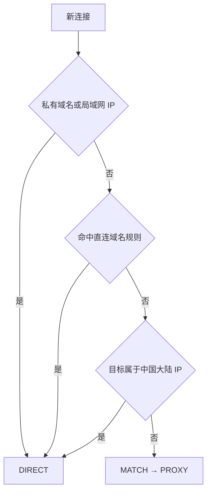

[toc]

## 基于 Loyalsoldier 的分流规则

这是同一套“国内直连、其余代理”思路的另一种落地：规则文件来自 Loyalsoldier/clash-rules，格式是 txt，体积比 `.mrs` 大，但可读性和可裁剪性更好。

| Loyalsoldier 文件  | 内容类型        | `behavior`  |
| ------------------ | --------------- | ----------- |
| `private.txt`      | 私有网络域名    | `domain`    |
| `direct.txt`       | 建议直连的域名  | `domain`    |
| `lancidr.txt`      | 局域网和保留 IP | `ipcidr`    |
| `cncidr.txt`       | 中国大陆 IP     | `ipcidr`    |
| `applications.txt` | 进程规则        | `classical` |

Loyalsoldier 项目的官方配置示例将 `cncidr.txt` 和 `lancidr.txt` 声明为 `behavior: ipcidr`。Mihomo 文档同时要求 `behavior` 必须与规则文件的实际内容相匹配。([GitHub](https://github.com/Loyalsoldier/clash-rules))

------

## Loyalsoldier 规则集配置

下面保留 Loyalsoldier 规则体系，并使用该项目文档提供的 `cdn.jsdelivr.net` 地址。

```yaml
# 规则来源：
# https://github.com/Loyalsoldier/clash-rules

rule-providers:
  # 私有网络专用域名，例如 local、lan、home.arpa
  private_domain:
    type: http
    behavior: domain
    format: yaml
    url: "https://cdn.jsdelivr.net/gh/Loyalsoldier/clash-rules@release/private.txt"
    path: ./ruleset/private-domain.yaml
    interval: 86400

    # 节点和 PROXY 策略组已经可用时建议开启。
    # 如果你的策略组不叫 PROXY，请改成实际名称。
    proxy: PROXY

  # 建议直连的域名集合，主要包括国内域名及其他可直连服务
  direct_domain:
    type: http
    behavior: domain
    format: yaml
    url: "https://cdn.jsdelivr.net/gh/Loyalsoldier/clash-rules@release/direct.txt"
    path: ./ruleset/direct-domain.yaml
    interval: 86400
    proxy: PROXY

  # 局域网、回环、链路本地和其他保留 IP
  lan_ip:
    type: http
    behavior: ipcidr
    format: yaml
    url: "https://cdn.jsdelivr.net/gh/Loyalsoldier/clash-rules@release/lancidr.txt"
    path: ./ruleset/lan-ip.yaml
    interval: 86400
    proxy: PROXY

  # 中国大陆 IPv4 地址段
  cn_ip:
    type: http
    behavior: ipcidr
    format: yaml
    url: "https://cdn.jsdelivr.net/gh/Loyalsoldier/clash-rules@release/cncidr.txt"
    path: ./ruleset/cn-ip.yaml
    interval: 86400
    proxy: PROXY
```

虽然这些远程文件的扩展名是 `.txt`，其内容实际采用带有 `payload:` 的 YAML 规则集格式，因此这里明确写成：

```yaml
format: yaml
```

Mihomo 的 `format` 默认值本来就是 `yaml`，显式写出来可以减少以后更换规则源时的歧义。当前支持的格式包括 `yaml`、`text` 和 `mrs`。([wiki.metacubex.one](https://wiki.metacubex.one/en/config/rule-providers/))

------

## Loyalsoldier 规则配置

假设你的最终代理策略组名称是 `PROXY`：

```yaml
rules:
  # 自定义规则应放在公共规则前面
  # - DOMAIN-SUFFIX,example.cn,DIRECT
  # - DOMAIN-SUFFIX,example.com,PROXY

  # 私有域名与局域网 IP 直连
  - RULE-SET,private_domain,DIRECT
  - RULE-SET,lan_ip,DIRECT,no-resolve

  # 国内及其他建议直连的域名
  - RULE-SET,direct_domain,DIRECT

  # 中国大陆 IP 兜底
  - RULE-SET,cn_ip,DIRECT

  # 其他专项规则放在 MATCH 前
  # - RULE-SET,telegram_ip,PROXY
  # - RULE-SET,proxy_domain,PROXY

  # 未命中的流量默认代理
  - MATCH,PROXY
```

这属于比较可靠的“国内白名单直连”模式：



------

## `no-resolve` 应该怎样设置

### 局域网 IP 建议使用

```yaml
- RULE-SET,lan_ip,DIRECT,no-resolve
```

这里使用 `no-resolve` 是合理的。

因为当目标是普通域名时，没有必要为了判断它是否属于局域网而额外进行一次 DNS 查询。局域网规则主要处理：

- 应用直接连接 `192.168.x.x`
- 应用直接连接 `10.x.x.x`
- 本机回环地址
- 链路本地地址
- IPv6 私有地址

### 中国 IP 建议暂时不使用

```yaml
- RULE-SET,cn_ip,DIRECT
```

这里故意没有添加 `no-resolve`，使 `cn_ip` 可以作为国内域名列表的补充：

```text
国内网站没有被 direct_domain 收录
→ Mihomo 解析目标域名
→ 得到中国大陆 IP
→ cn_ip 命中
→ DIRECT
```

如果改为：

```yaml
- RULE-SET,cn_ip,DIRECT,no-resolve
```

那么它一般只能匹配：

- 应用直接连接 IP
- 已经取得真实目标 IP 的连接
- 某些透明代理场景中已经解析完成的连接

对于未被 `direct_domain` 收录的国内域名，它可能无法完成兜底。

因此：

| 规则     | 推荐写法            | 原因                         |
| -------- | ------------------- | ---------------------------- |
| `lan_ip` | 添加 `no-resolve`   | 避免不必要的 DNS 查询        |
| `cn_ip`  | 不添加 `no-resolve` | 为遗漏的国内域名提供 IP 兜底 |

------

## 是否还需要 `GEOIP,CN,DIRECT`

采用下面这条后：

```yaml
- RULE-SET,cn_ip,DIRECT
```

通常不需要再写：

```yaml
- GEOIP,CN,DIRECT
```

两者目的基本相同，都是判断目标 IP 是否属于中国大陆。

### 推荐二选一

| 方案                    | 优点                                  | 缺点                            |
| ----------------------- | ------------------------------------- | ------------------------------- |
| `RULE-SET,cn_ip,DIRECT` | 数据来源明确，规则提供器可独立更新    | 需要下载 `cncidr.txt`           |
| `GEOIP,CN,DIRECT`       | 配置简单，不需要单独下载 CN IP 规则集 | 依赖本地 GeoIP 数据是否及时更新 |

你的配置既然已经采用 Loyalsoldier 规则体系，建议保留：

```yaml
- RULE-SET,cn_ip,DIRECT
```

并删除：

```yaml
- GEOIP,CN,DIRECT
```

不要同时堆叠两套作用相同的中国 IP 判断规则，除非你明确想将 `GEOIP` 作为冗余兜底。

------

## 更少外部下载的简化方案

如果你的运行设备经常无法下载 GitHub 或 jsDelivr 资源，可以减少 IP 规则提供器数量，只远程加载域名规则：

```yaml
rule-providers:
  private_domain:
    type: http
    behavior: domain
    format: yaml
    url: "https://cdn.jsdelivr.net/gh/Loyalsoldier/clash-rules@release/private.txt"
    path: ./ruleset/private-domain.yaml
    interval: 86400
    proxy: PROXY

  direct_domain:
    type: http
    behavior: domain
    format: yaml
    url: "https://cdn.jsdelivr.net/gh/Loyalsoldier/clash-rules@release/direct.txt"
    path: ./ruleset/direct-domain.yaml
    interval: 86400
    proxy: PROXY
```

规则改为：

```yaml
rules:
  - RULE-SET,private_domain,DIRECT

  # 使用本地 GeoIP 数据处理局域网和中国大陆 IP
  - GEOIP,LAN,DIRECT,no-resolve

  - RULE-SET,direct_domain,DIRECT

  # 不加 no-resolve，使它能够作为国内域名的 IP 兜底
  - GEOIP,CN,DIRECT

  - MATCH,PROXY
```

这个方案的优势是只有两个远程规则文件，冷启动时对 GitHub/CDN 的依赖更少。

前提是你的 Mihomo 客户端或 OpenWrt 管理组件会正常维护 GeoIP 数据。

------

## 下载加速和稳定性建议

### 首选：jsDelivr 官方 CDN 地址

Loyalsoldier 项目当前明确列出了两种地址：

```text
raw.githubusercontent.com
cdn.jsdelivr.net
```

项目说明中提到，无法访问 GitHub Raw 时可以使用 `cdn.jsdelivr.net`，但 CDN 内容可能有约 12 小时延迟。规则项目本身每天构建一次，所以对于普通分流规则，这种延迟通常不会造成明显影响。([GitHub](https://github.com/Loyalsoldier/clash-rules))

因此建议将：

```yaml
url: "https://fastly.jsdelivr.net/gh/..."
```

统一改为项目文档直接提供的：

```yaml
url: "https://cdn.jsdelivr.net/gh/..."
```

`fastly.jsdelivr.net` 也是 jsDelivr 相关入口，但没有必要专门绑定某个后端入口。使用标准的 `cdn.jsdelivr.net` 更符合项目文档，也方便 CDN 自行选择服务路径。

### 节点可用时，让规则更新走代理

Mihomo 的规则提供器支持：

```yaml
proxy: PROXY
```

它表示下载和更新该规则集时使用指定策略，而不是按照普通分流规则决定出口。这个字段是 Mihomo 当前官方支持的配置。([wiki.metacubex.one](https://wiki.metacubex.one/en/config/rule-providers/))

例如：

```yaml
direct_domain:
  type: http
  behavior: domain
  format: yaml
  url: "https://cdn.jsdelivr.net/gh/Loyalsoldier/clash-rules@release/direct.txt"
  path: ./ruleset/direct-domain.yaml
  interval: 86400
  proxy: PROXY
```

注意：

- `PROXY` 必须是现有节点或策略组名称。
- 如果你的策略组叫“节点选择”，应写成 `proxy: 节点选择`。
- 如果首次启动时节点订阅尚未加载，可以暂时删除 `proxy` 字段，让它直接尝试 jsDelivr。
- 规则下载成功后，Mihomo 会通过 `path` 保存本地缓存。后续偶发更新失败时，通常仍可使用已有缓存。

### 使用 GitHub Raw 并强制走代理

节点稳定以后，也可以不用 CDN，直接通过代理访问源站：

```yaml
direct_domain:
  type: http
  behavior: domain
  format: yaml
  url: "https://raw.githubusercontent.com/Loyalsoldier/clash-rules/release/direct.txt"
  path: ./ruleset/direct-domain.yaml
  interval: 86400
  proxy: PROXY
```

这种方式的特点是：

- 不受 jsDelivr 缓存延迟影响
- 直接获取仓库发布分支内容
- 必须保证 `PROXY` 策略启动后可用

对于已经稳定运行的软路由，这是一个不错的选择。

### 不建议默认使用不明第三方镜像

一些公共 GitHub 代理站允许使用类似：

```text
镜像前缀 + GitHub Raw URL
```

但第三方服务可能存在：

- 服务随时停止
- 更新延迟无法确认
- TLS 终止发生在第三方
- 内容被缓存或替换
- 隐私和供应链风险

规则文件可以直接决定你的全部网络流量去向，因此更建议采用：

1. jsDelivr；
2. GitHub Raw 配合 `proxy:`；
3. 自己控制的静态文件服务器或对象存储。

------

## 可复用的 URL 替换方式

同一个文件可以在以下两种方式中选择一种。

### CDN 方式

```yaml
url: "https://cdn.jsdelivr.net/gh/Loyalsoldier/clash-rules@release/cncidr.txt"
```

### GitHub Raw 通过代理下载

```yaml
url: "https://raw.githubusercontent.com/Loyalsoldier/clash-rules/release/cncidr.txt"
proxy: PROXY
```

Mihomo 的一个规则提供器只能配置一个 `url`，不能写成 URL 数组自动依次回退。因此注释多个备用地址只是方便手动切换，并不构成自动容灾。

可以这样保存备用地址：

```yaml
cn_ip:
  type: http
  behavior: ipcidr
  format: yaml

  # 当前使用：jsDelivr
  url: "https://cdn.jsdelivr.net/gh/Loyalsoldier/clash-rules@release/cncidr.txt"

  # 备用：GitHub Raw，需要同时设置 proxy: PROXY
  # url: "https://raw.githubusercontent.com/Loyalsoldier/clash-rules/release/cncidr.txt"

  # 备用 jsDelivr 入口
  # url: "https://fastly.jsdelivr.net/gh/Loyalsoldier/clash-rules@release/cncidr.txt"

  path: ./ruleset/cn-ip.yaml
  interval: 86400
  proxy: PROXY
```

------

## 带 YAML 锚点的精简版本

当规则提供器较多时，可以用 YAML Anchor 减少重复字段：

```yaml
rule-anchor:
  domain: &domain
    type: http
    behavior: domain
    format: yaml
    interval: 86400
    proxy: PROXY

  ip: &ip
    type: http
    behavior: ipcidr
    format: yaml
    interval: 86400
    proxy: PROXY

rule-providers:
  private_domain:
    <<: *domain
    url: "https://cdn.jsdelivr.net/gh/Loyalsoldier/clash-rules@release/private.txt"
    path: ./ruleset/private-domain.yaml

  direct_domain:
    <<: *domain
    url: "https://cdn.jsdelivr.net/gh/Loyalsoldier/clash-rules@release/direct.txt"
    path: ./ruleset/direct-domain.yaml

  lan_ip:
    <<: *ip
    url: "https://cdn.jsdelivr.net/gh/Loyalsoldier/clash-rules@release/lancidr.txt"
    path: ./ruleset/lan-ip.yaml

  cn_ip:
    <<: *ip
    url: "https://cdn.jsdelivr.net/gh/Loyalsoldier/clash-rules@release/cncidr.txt"
    path: ./ruleset/cn-ip.yaml
```

对应规则：

```yaml
rules:
  - RULE-SET,private_domain,DIRECT
  - RULE-SET,lan_ip,DIRECT,no-resolve
  - RULE-SET,direct_domain,DIRECT
  - RULE-SET,cn_ip,DIRECT
  - MATCH,PROXY
```

------

## 修改规则集后要清理旧缓存

换过 `behavior` 或 `format` 后，旧缓存文件的内容可能与新声明不匹配，建议删掉对应文件再启动：

```bash
# 在 Mihomo 的 HomeDir 下执行，具体路径以你的 path 为准
rm -f ./ruleset/cn-ip.yaml ./ruleset/direct-domain.yaml
```

缓存路径必须位于 HomeDir 或 `SAFE_PATHS` 允许的目录内，且不同 rule-provider 不能共用同一个 `path`。([虚空终端](https://wiki.metacubex.one/config/rule-providers/))

## 最终建议采用的版本

```yaml
rule-providers:
  private_domain:
    type: http
    behavior: domain
    format: yaml
    url: "https://cdn.jsdelivr.net/gh/Loyalsoldier/clash-rules@release/private.txt"
    path: ./ruleset/private-domain.yaml
    interval: 86400
    proxy: PROXY

  direct_domain:
    type: http
    behavior: domain
    format: yaml
    url: "https://cdn.jsdelivr.net/gh/Loyalsoldier/clash-rules@release/direct.txt"
    path: ./ruleset/direct-domain.yaml
    interval: 86400
    proxy: PROXY

  lan_ip:
    type: http
    behavior: ipcidr
    format: yaml
    url: "https://cdn.jsdelivr.net/gh/Loyalsoldier/clash-rules@release/lancidr.txt"
    path: ./ruleset/lan-ip.yaml
    interval: 86400
    proxy: PROXY

  cn_ip:
    type: http
    behavior: ipcidr
    format: yaml
    url: "https://cdn.jsdelivr.net/gh/Loyalsoldier/clash-rules@release/cncidr.txt"
    path: ./ruleset/cn-ip.yaml
    interval: 86400
    proxy: PROXY

rules:
  # 自定义覆盖规则(可以根据实际情况调整这部分的位置)
  # - DOMAIN-SUFFIX,example.cn,DIRECT
  # - DOMAIN-SUFFIX,example.com,PROXY

  # 私有网络
  - RULE-SET,private_domain,DIRECT
  - RULE-SET,lan_ip,DIRECT,no-resolve

  # 国内域名和国内 IP
  - RULE-SET,direct_domain,DIRECT
  - RULE-SET,cn_ip,DIRECT

  # 未命中规则的流量默认代理
  - MATCH,PROXY
```
