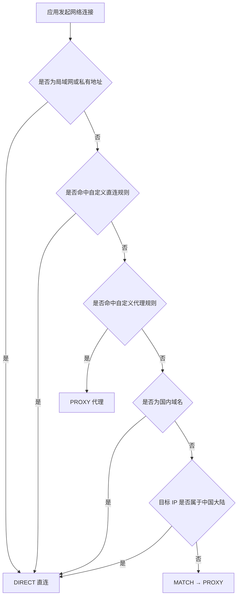

[toc]


## 结论先行

对使用 Mihomo 内核的国内用户，最稳妥、容易维护的分流方案是：

> **局域网与私有地址直连，自定义规则优先，国内域名直连，国内 IP 作为补充判断，其余流量默认走代理。**

本文用 MetaCubeX 的 `.mrs` 规则集落地；如果你更习惯 Loyalsoldier 的 txt 结构，见 [mihomo@分流方案@国内直连白名单@Loyalsoldier](./mihomo@分流方案@国内直连白名单@Loyalsoldier.md)。

这属于“**国内白名单直连，其他默认代理**”的模式。它比“只把已知境外网站代理、其余全部直连”更可靠，因为新出现或规则库尚未收录的境外域名仍会落入代理，而不是意外直连。

推荐使用 Mihomo 原生的 `rule-providers`，加载 MetaCubeX 的 `.mrs` 规则集：

- `private-domain`：局域网、私有域名
- `private-ip`：内网、回环、链路本地等私有地址
- `cn-domain`：国内域名
- `cn-ip`：中国大陆 IP 地址段
- `custom-direct`：你自己的强制直连域名
- `custom-proxy`：你自己的强制代理域名
- 最后一条 `MATCH,PROXY`：所有未命中的流量默认代理

Mihomo 的规则严格按照从上到下的顺序匹配，先命中的规则生效；`RULE-SET` 用于引用 `rule-providers`，而 `MATCH` 是最终兜底规则。([wiki.metacubex.one](https://wiki.metacubex.one/config/rules/?h=rule+set))

------

## 内容大纲

本文将依次说明：

- Mihomo 分流规则的工作机制
- 推荐采用哪一种分流模型
- 域名规则与 IP 规则的区别
- `rule-providers`、`.mrs`、`GEOSITE`、`GEOIP` 的关系
- 一份可直接合并到现有配置的规则模板
- 与规则配套的 DNS 配置
- TUN 模式下如何确保局域网访问正常
- 成熟规则库的选择建议
- 常见错误与排查方法
- 后续扩展流媒体、AI、游戏平台等独立策略的方法

------

## 分流的工作机制

Mihomo 收到一个连接后，会从 `rules` 第一行开始逐条匹配。



规则顺序不是排版习惯，而是实际优先级。例如：

```yaml
rules:
  - DOMAIN-SUFFIX,example.com,DIRECT
  - DOMAIN-SUFFIX,example.com,PROXY
```

第二条永远不会生效，因为第一条已经匹配。

------

## 核心术语

| 术语         | 英文             | 作用                                                   |
| ------------ | ---------------- | ------------------------------------------------------ |
| 直连         | Direct           | 不经过代理节点，直接连接目标服务器                     |
| 代理         | Proxy            | 将流量交给指定节点或策略组                             |
| 规则提供器   | Rule Provider    | 从本地或网络加载可更新的规则集合                       |
| 域名规则集   | Domain Rule Set  | 根据域名判断流量去向                                   |
| IP 规则集    | IP CIDR Rule Set | 根据目标 IP 地址段判断流量去向                         |
| 私有地址     | Private Address  | 局域网、回环、链路本地等不可在公网直接路由的地址       |
| 假 IP        | Fake IP          | Mihomo 为域名分配的虚拟 IP，用于保留域名信息并接管连接 |
| 域名嗅探     | Domain Sniffing  | 从 HTTP、TLS、QUIC 流量中恢复目标域名                  |
| 兜底规则     | Final Rule       | 所有前置规则未命中时使用的最终策略                     |
| `no-resolve` | No Resolve       | 匹配 IP 规则时，不主动把域名解析为 IP                  |
| `MATCH`      | Match All        | 匹配所有剩余流量                                       |
| `GEOSITE`    | GeoSite          | 使用 Geosite 数据库匹配域名类别                        |
| `GEOIP`      | GeoIP            | 使用 GeoIP 数据库匹配 IP 所属国家或类别                |

Mihomo 的 `rule-provider` 支持 `http`、`file` 和 `inline` 三种来源；规则行为支持 `domain`、`ipcidr` 和 `classical`。格式支持 `yaml`、`text` 和 `mrs`，其中 `.mrs` 目前只支持 `domain` 和 `ipcidr` 类型。([wiki.metacubex.one](https://wiki.metacubex.one/en/config/rule-providers/))

------

## 推荐的分流模型

常见方案主要有两种。

| 模型           | 规则逻辑                   | 优点                           | 缺点                             | 推荐程度       |
| -------------- | -------------------------- | ------------------------------ | -------------------------------- | -------------- |
| 国内白名单模式 | 国内直连，其余代理         | 新境外网站默认能访问，行为明确 | 国内小众网站漏收时可能走代理     | 推荐           |
| 境外黑名单模式 | 已知境外网站代理，其余直连 | 国内网站一般不会误走代理       | 新境外域名可能直连失败或产生泄漏 | 不作为默认方案 |

本文采用第一种：

```text
私有网络 → 直连
自定义直连 → 直连
自定义代理 → 代理
国内域名 → 直连
国内 IP → 直连
其余全部 → 代理
```

这套方案只依赖四个主要外部规则集，因此容易理解、排错和维护。

------

## 为什么要同时使用国内域名和国内 IP

只写下面这一条并不理想：

```yaml
- GEOIP,CN,DIRECT
```

原因是 `GEOIP` 判断的是目标 IP，不是域名。遇到域名请求时，为了判断目标 IP 是否属于中国大陆，内核可能需要先进行 DNS 查询。

更合理的顺序是：

```yaml
- RULE-SET,cn-domain,DIRECT
- RULE-SET,cn-ip,DIRECT
```

域名列表可以先快速完成大部分判断；只有域名规则未覆盖、应用直接连接 IP，或者目标域名需要 IP 兜底时，才依赖国内 IP 规则。

### `no-resolve` 应该怎么使用

Mihomo 文档说明，目标 IP 类规则在处理域名连接时可能触发 DNS 解析；添加 `no-resolve` 可以阻止这次主动解析。([wiki.metacubex.one](https://wiki.metacubex.one/en/config/rules/))

因此推荐：

```yaml
- RULE-SET,private-ip,DIRECT,no-resolve
- RULE-SET,cn-ip,DIRECT
```

二者有意采用不同写法：

- `private-ip` 使用 `no-resolve`：没有必要为普通公网域名查询它是不是内网地址。
- `cn-ip` 不使用 `no-resolve`：允许它为未被 `cn-domain` 收录的国内网站提供 IP 级兜底。

如果更看重性能、确定国内域名规则已经足够完整，也可以改为：

```yaml
- RULE-SET,cn-ip,DIRECT,no-resolve
```

这样国内 IP 规则只处理已经具有目标 IP 的连接，不再主动解析域名，但漏收的国内域名可能落入最终代理。

------

## 可直接使用的核心规则方案

下面的内容可以合并进已有配置。

假设你的主代理策略组名称为 `PROXY`。如果现有策略组叫“节点选择”“国外流量”或其他名称，把示例中的 `PROXY` 全部替换掉即可。

### 策略组示例

已经有策略组时，不需要重复添加。

```yaml
proxy-groups:
  - name: PROXY
    type: select
    proxies:
      - AUTO
      - DIRECT
    use:
      - airport

  - name: AUTO
    type: url-test
    use:
      - airport
    url: https://www.gstatic.com/generate_204
    interval: 300
    tolerance: 50
```

对应的订阅提供器可以类似这样配置：

```yaml
proxy-providers:
  airport:
    type: http
    url: "在这里填写你的订阅地址"
    path: ./providers/airport.yaml
    interval: 3600
    health-check:
      enable: true
      url: https://www.gstatic.com/generate_204
      interval: 300
```

------

## 推荐的 `rule-providers`

```yaml
rule-providers:
  # 自定义强制直连域名
  custom-direct:
    type: inline
    behavior: domain
    payload:
      - "+.example.cn"
      - "+.company.internal"
      - "router.example"

  # 自定义强制代理域名
  custom-proxy:
    type: inline
    behavior: domain
    payload:
      - "+.example.com"
      - "+.example.net"

  # 局域网、私有域名
  private-domain:
    type: http
    behavior: domain
    format: mrs
    url: "https://raw.githubusercontent.com/MetaCubeX/meta-rules-dat/meta/geo/geosite/private.mrs"
    path: ./ruleset/private-domain.mrs
    interval: 86400
    proxy: PROXY

  # 中国大陆域名
  cn-domain:
    type: http
    behavior: domain
    format: mrs
    url: "https://raw.githubusercontent.com/MetaCubeX/meta-rules-dat/meta/geo/geosite/cn.mrs"
    path: ./ruleset/cn-domain.mrs
    interval: 86400
    proxy: PROXY

  # 私有、局域网 IP
  private-ip:
    type: http
    behavior: ipcidr
    format: mrs
    url: "https://raw.githubusercontent.com/MetaCubeX/meta-rules-dat/meta/geo/geoip/private.mrs"
    path: ./ruleset/private-ip.mrs
    interval: 86400
    proxy: PROXY

  # 中国大陆 IP
  cn-ip:
    type: http
    behavior: ipcidr
    format: mrs
    url: "https://raw.githubusercontent.com/MetaCubeX/meta-rules-dat/meta/geo/geoip/cn.mrs"
    path: ./ruleset/cn-ip.mrs
    interval: 86400
    proxy: PROXY
```

这里使用 `proxy: PROXY`，表示从 GitHub 更新规则时通过代理策略组下载。Mihomo 官方文档明确支持使用 `proxy` 字段指定规则提供器的下载或更新出口。([wiki.metacubex.one](https://wiki.metacubex.one/en/config/rule-providers/))

MetaCubeX 的 `meta-rules-dat` 项目直接提供 Mihomo 使用的 `domain` 和 `ipcidr` 类型 `.mrs` 文件，其官方示例也采用 `behavior: domain`、`format: mrs` 与 `RULE-SET` 的组合。([GitHub](https://github.com/MetaCubeX/meta-rules-dat))

### 为什么使用 `+.`

在 `behavior: domain` 的规则提供器中：

```yaml
- "+.example.com"
```

表示匹配：

```text
example.com
www.example.com
api.example.com
```

而不是只匹配某一个完整域名。

`domain` 类型规则集使用 Clash 域名通配格式，不应该写成：

```yaml
- DOMAIN-SUFFIX,example.com
```

`DOMAIN-SUFFIX` 这类完整规则语法属于 `classical` 类型。Mihomo 官方文档分别定义了 `domain`、`ipcidr` 和 `classical` 的内容格式。([wiki.metacubex.one](https://wiki.metacubex.one/en/config/rule-providers/content/))

------

## 推荐的 `rules`

```yaml
rules:
  # 局域网与私有地址优先直连
  - RULE-SET,private-domain,DIRECT
  - RULE-SET,private-ip,DIRECT,no-resolve

  # 手工维护的例外规则
  - RULE-SET,custom-direct,DIRECT
  - RULE-SET,custom-proxy,PROXY

  # 可以在这里加入按服务划分的规则
  # - RULE-SET,openai-domain,AI
  # - RULE-SET,youtube-domain,STREAMING

  # 国内域名优先直连
  - RULE-SET,cn-domain,DIRECT

  # 国内 IP 作为兜底
  # 不添加 no-resolve，使未收录的国内域名仍有机会通过 IP 判断直连
  - RULE-SET,cn-ip,DIRECT

  # 所有剩余流量默认走代理
  - MATCH,PROXY
```

这是整套方案最重要的部分。

### 为什么私有网络放在最前面

局域网设备、路由器管理地址、NAS、打印机、家庭自动化设备不应该被发往远程代理节点。

因此：

```yaml
- RULE-SET,private-domain,DIRECT
- RULE-SET,private-ip,DIRECT,no-resolve
```

应该位于公共互联网规则之前。

### 为什么自定义规则必须靠前

规则库永远不可能百分之百准确。可能出现：

- 国内新网站未被收录
- 某个国内网站使用境外 CDN
- 某个境外服务在国内也有域名
- 公司内部域名与公共规则冲突
- 某个网站必须使用特定出口

解决这些问题时，不应该直接修改远程规则文件，而应在本地维护小规模例外列表。

例如某国内网站错误走了代理：

```yaml
custom-direct:
  type: inline
  behavior: domain
  payload:
    - "+.missed-cn-site.com"
```

某域名虽然在国内列表中，但必须代理：

```yaml
custom-proxy:
  type: inline
  behavior: domain
  payload:
    - "+.must-use-proxy.example"
```

由于 `custom-proxy` 位于 `cn-domain` 之前，它可以覆盖国内规则库的判断。

------

## 手工添加 IP 例外

对于少量固定 IP，不需要单独建立规则集，可以直接放在 `rules` 前部：

```yaml
rules:
  # 某个本地设备
  - IP-CIDR,192.168.50.10/32,DIRECT,no-resolve

  # 某个公司内网
  - IP-CIDR,10.20.0.0/16,DIRECT,no-resolve

  # 某个必须代理的公网网段
  - IP-CIDR,203.0.113.0/24,PROXY,no-resolve

  - RULE-SET,private-domain,DIRECT
  - RULE-SET,private-ip,DIRECT,no-resolve
  - RULE-SET,custom-direct,DIRECT
  - RULE-SET,custom-proxy,PROXY
  - RULE-SET,cn-domain,DIRECT
  - RULE-SET,cn-ip,DIRECT
  - MATCH,PROXY
```

常用 CIDR 表示方式：

| 写法              | 含义                                  |
| ----------------- | ------------------------------------- |
| `192.168.1.10/32` | 只匹配一个 IPv4 地址                  |
| `192.168.1.0/24`  | 匹配 `192.168.1.0` 至 `192.168.1.255` |
| `10.0.0.0/8`      | 匹配整个 `10.x.x.x` 私有网络          |
| `2001:db8::/32`   | IPv6 地址段                           |

------

## 与分流规则配套的 DNS 配置

分流不只是 `rules`。DNS 配置错误时，即使规则顺序正确，也可能出现：

- 国内网站解析到异常地址
- 境外域名解析失败
- 局域网域名无法访问
- 规则只看到 IP，看不到域名
- 代理节点域名无法解析
- DNS 查询形成循环依赖

Mihomo 支持 `fake-ip`、`redir-host`、`nameserver-policy`、`proxy-server-nameserver`、`direct-nameserver` 等配置；`nameserver-policy` 的优先级高于普通 `nameserver` 和 `fallback` 查询。([wiki.metacubex.one](https://wiki.metacubex.one/config/dns/?h=ecs))

### 推荐的 Fake IP 配置

```yaml
dns:
  enable: true
  cache-algorithm: arc
  prefer-h3: false

  # 没有稳定 IPv6 环境时建议设为 false
  ipv6: false

  enhanced-mode: fake-ip
  fake-ip-range: 198.18.0.1/16

  # 使用规则模式控制哪些域名返回真实 IP
  fake-ip-filter-mode: rule
  fake-ip-filter:
    - RULE-SET,private-domain,real-ip
    - DOMAIN-SUFFIX,lan,real-ip
    - DOMAIN-SUFFIX,local,real-ip
    - DOMAIN-SUFFIX,home.arpa,real-ip
    - MATCH,fake-ip

  # 用于解析下方 DoH 服务器自身的域名
  default-nameserver:
    - 223.5.5.5
    - 119.29.29.29

  # 专门用于解析代理节点服务器的域名，避免循环依赖
  proxy-server-nameserver:
    - https://dns.alidns.com/dns-query
    - https://doh.pub/dns-query

  # DIRECT 出口优先使用国内 DNS
  direct-nameserver:
    - https://dns.alidns.com/dns-query
    - https://doh.pub/dns-query
  direct-nameserver-follow-policy: true

  # 按域名规则选择 DNS
  nameserver-policy:
    "rule-set:private-domain":
      - system

    "rule-set:cn-domain":
      - https://dns.alidns.com/dns-query
      - https://doh.pub/dns-query

  # 未命中上述策略的域名通过代理查询境外 DNS
  nameserver:
    - "https://1.1.1.1/dns-query#PROXY"
    - "https://8.8.8.8/dns-query#PROXY"
```

Mihomo 的 `fake-ip-filter-mode: rule` 支持与路由规则类似的从上到下匹配逻辑，并支持 `RULE-SET`、`GEOSITE`、`DOMAIN` 类规则以及最终的 `MATCH`。([wiki.metacubex.one](https://wiki.metacubex.one/config/dns/?h=ecs))

### 为什么私有域名需要返回真实 IP

NAS、路由器、打印机和部分智能家居设备常常依赖：

```text
device.local
router.lan
hostname.home.arpa
```

如果这些域名收到 Fake IP，某些应用的局域网发现、证书验证或设备通信可能异常。因此，私有域名通常应采用 `real-ip`。

### `proxy-server-nameserver` 为什么重要

假设节点服务器为：

```text
node.example.com
```

而默认 DNS 又要求通过 `PROXY` 查询，就会产生问题：

```text
需要建立代理连接
→ 必须先解析节点域名
→ 解析节点域名又要求通过代理
→ 代理尚未建立
```

`proxy-server-nameserver` 专门用于解析代理节点域名，可以切断这个循环。官方文档也将其定义为专用于代理节点域名解析的 DNS。([wiki.metacubex.one](https://wiki.metacubex.one/config/dns/?h=ecs))

------

## Fake IP 与 Redir Host 如何选择

| 模式         | 优点                                   | 缺点                                   | 适用场景                           |
| ------------ | -------------------------------------- | -------------------------------------- | ---------------------------------- |
| `fake-ip`    | 更容易保留域名信息，域名分流通常更可靠 | 部分局域网、游戏、设备发现协议需要过滤 | 普通桌面、手机、TUN 客户端         |
| `redir-host` | 返回真实 IP，兼容性直观                | DNS 依赖更强，域名信息可能丢失         | 特殊网络、老旧应用或兼容性优先环境 |

对新手而言，建议先使用：

```yaml
enhanced-mode: fake-ip
```

然后把有问题的局域网域名或应用域名加入 `fake-ip-filter`，而不是一开始就维护庞大的过滤列表。

------

## 域名嗅探是否需要开启

在 TUN、透明代理或应用直接访问 IP 的场景中，Mihomo 可能没有直接获得域名。域名嗅探（Domain Sniffing）可以从 HTTP、TLS 或 QUIC 流量中恢复域名。

```yaml
sniffer:
  enable: true
  force-dns-mapping: true
  parse-pure-ip: true
  override-destination: false

  sniff:
    HTTP:
      ports:
        - 80
        - 8080-8880
      override-destination: true

    TLS:
      ports:
        - 443
        - 8443

    QUIC:
      ports:
        - 443
        - 8443

  skip-domain:
    - "Mijia Cloud"
    - "+.push.apple.com"
```

Mihomo 当前支持对 HTTP、TLS 和 QUIC 进行嗅探，并允许针对域名、来源地址或目标地址设置跳过规则。([wiki.metacubex.one](https://wiki.metacubex.one/en/config/sniff/))

建议从保守配置开始：

```yaml
override-destination: false
```

只有确认某些流量必须用嗅探域名覆盖原目标后，再局部开启 `override-destination`。某些智能家居、局域网设备或特殊客户端对目标覆盖较敏感。

------

## TUN 模式下的局域网访问

仅仅写：

```yaml
- RULE-SET,private-ip,DIRECT,no-resolve
```

表示流量进入 Mihomo 后采用直连出口。

但在 TUN 模式下，有时还希望局域网流量根本不进入 TUN 路由。这时可以使用 `route-exclude-address`。

```yaml
tun:
  enable: true
  stack: mixed
  auto-route: true
  auto-detect-interface: true

  dns-hijack:
    - any:53
    - tcp://any:53

  route-exclude-address:
    - 10.0.0.0/8
    - 172.16.0.0/12
    - 192.168.0.0/16
    - 169.254.0.0/16
    - fc00::/7
    - fe80::/10
```

Mihomo 的 `route-exclude-address` 用于在启用 `auto-route` 时排除指定目标网段。当前文档还提供 `route-exclude-address-set`，但后者主要面向 Linux、nftables、`auto-route` 和 `auto-redirect` 的组合。([wiki.metacubex.one](https://wiki.metacubex.one/en/config/inbound/tun/))

### 不要混淆 `allow-lan`

```yaml
allow-lan: true
```

并不表示“访问局域网时直连”。

它表示：

> 是否允许局域网中的其他设备连接到本机开放的 Mihomo HTTP、SOCKS 或 Mixed 代理端口。

这是入站访问控制，与分流规则是两个概念。Mihomo 官方文档对 `allow-lan` 的定义就是允许其他设备通过本机代理端口访问网络。([wiki.metacubex.one](https://wiki.metacubex.one/en/config/general/))

普通单机用户建议：

```yaml
allow-lan: false
external-controller: 127.0.0.1:9090
```

只有确实需要为手机、电视或其他设备提供代理时，才开启 `allow-lan`，并考虑限制监听地址或设置认证。

------

## `.mrs`、YAML 和 Text 如何选择

| 格式      | 推荐用途                      | 特点                                                 |
| --------- | ----------------------------- | ---------------------------------------------------- |
| `.mrs`    | 大型域名和 IP 规则集          | Mihomo 原生二进制规则格式，适合 `domain` 和 `ipcidr` |
| YAML      | 需要兼容传统 Clash 工具时     | 易读，但大型规则文件解析和体积通常更重               |
| Text      | 简单列表、跨工具处理          | 便于查看和脚本处理                                   |
| Inline    | 少量自定义规则                | 不需要额外文件，最适合个人覆盖规则                   |
| Classical | 端口、进程、域名、IP 混合规则 | 功能最灵活，但不支持 `.mrs`                          |

官方文档目前规定 `.mrs` 只支持 `domain` 与 `ipcidr`，需要混合 `DOMAIN-SUFFIX`、`IP-CIDR`、`DST-PORT`、`PROCESS-NAME` 等规则时，应使用 `classical`。([wiki.metacubex.one](https://wiki.metacubex.one/en/config/rule-providers/))

对于本文方案，推荐组合是：

```text
大型公共规则：MRS
少量个人例外：Inline Domain
进程和端口规则：直接写入 rules 或使用 Classical
```

------

## 成熟规则库怎么选🎈

截至 2026 年 7 月，可重点考虑以下项目。

| 项目                         | 特点                                              | 适合人群                       | 建议                   |
| ---------------------------- | ------------------------------------------------- | ------------------------------ | ---------------------- |
| MetaCubeX/meta-rules-dat     | 与 Mihomo 生态贴合，提供 Geosite、GeoIP 和 `.mrs` | Mihomo 用户                    | 本文首选               |
| Loyalsoldier/clash-rules     | 传统 Clash 规则库，项目成熟，分类清晰             | 需要传统 YAML/Text 规则的用户  | 可作为替代             |
| blackmatrix7/ios_rule_script | 服务分类非常细，覆盖大量应用和平台                | 需要流媒体、游戏平台等细分策略 | 按需选取，不要全部加载 |
| DustinWin/ruleset_geodata    | 提供定制规则集与 Geodata，自动构建                | 喜欢整合型规则体系的用户       | 适合进阶用户           |

MetaCubeX 的规则项目直接提供 Mihomo `meta` 分支和 `.mrs` 文件，并包含 `cn`、`private`、Google、Telegram、Netflix 等域名和 IP 分类。([GitHub](https://github.com/MetaCubeX/meta-rules-dat))

Loyalsoldier 的项目提供适用于 Clash Rule Provider 的域名规则集，并持续生成发布版本。([GitHub](https://github.com/Loyalsoldier/clash-rules))

blackmatrix7 提供大量按网站、应用和服务拆分的 Clash 规则，但其项目也明确说明规则数据大量来源于互联网公开项目，更适合选择性引用，而不是无差别加载全部规则。([GitHub](https://github.com/blackmatrix7/ios_rule_script))

### 不建议混用多个国内全集

例如同时加载：

```text
MetaCubeX CN
Loyalsoldier direct
blackmatrix7 ChinaMax
ACL4SSR ChinaDomain
```

通常没有必要。多个大规则集会产生：

- 大量重复数据
- 更新来源增多
- 误判时难以确认是哪一套规则
- 配置更长
- 调试复杂度上升

更好的做法是：

> 一个主规则源，加两个小型自定义覆盖列表。

------

## 如何扩展独立服务策略

当基础分流稳定后，可以把特定服务交给独立策略组。

例如：

```yaml
proxy-groups:
  - name: AI
    type: select
    proxies:
      - PROXY
      - AUTO
      - DIRECT

  - name: STREAMING
    type: select
    proxies:
      - PROXY
      - AUTO
      - DIRECT
```

增加规则提供器：

```yaml
rule-providers:
  openai-domain:
    type: http
    behavior: domain
    format: mrs
    url: "https://raw.githubusercontent.com/MetaCubeX/meta-rules-dat/meta/geo/geosite/openai.mrs"
    path: ./ruleset/openai-domain.mrs
    interval: 86400
    proxy: PROXY

  youtube-domain:
    type: http
    behavior: domain
    format: mrs
    url: "https://raw.githubusercontent.com/MetaCubeX/meta-rules-dat/meta/geo/geosite/youtube.mrs"
    path: ./ruleset/youtube-domain.mrs
    interval: 86400
    proxy: PROXY
```

将服务规则放在国内规则之前：

```yaml
rules:
  - RULE-SET,private-domain,DIRECT
  - RULE-SET,private-ip,DIRECT,no-resolve

  - RULE-SET,custom-direct,DIRECT
  - RULE-SET,custom-proxy,PROXY

  - RULE-SET,openai-domain,AI
  - RULE-SET,youtube-domain,STREAMING

  - RULE-SET,cn-domain,DIRECT
  - RULE-SET,cn-ip,DIRECT

  - MATCH,PROXY
```

顺序非常重要。如果特定服务规则放在 `cn-domain` 后面，而其部分域名又被国内集合命中，它就无法进入独立策略组。

------

## 广告拦截规则是否应该默认启用

可以加入：

```yaml
- GEOSITE,category-ads-all,REJECT
```

或者加载专门的广告域名规则集。

但不建议新手一开始就启用大型广告规则，因为纯域名级拦截可能造成：

- 页面资源缺失
- 登录或验证码失败
- 应用启动页卡住
- 统计、支付或跳转域名被误伤
- 难以判断问题来自分流、DNS 还是广告规则

MetaCubeX 项目也指出，仅依靠域名进行广告拦截的能力有限。([GitHub](https://github.com/MetaCubeX/meta-rules-dat))

建议先把代理分流调通，再单独引入广告策略，并维护一个 `custom-allow` 白名单。

------

## 推荐的完整规则顺序

对于大多数个人用户，可以固定使用下面的层级：

| 优先级 | 规则类别                       | 策略       |
| ------ | ------------------------------ | ---------- |
| 最高   | 拒绝或安全规则                 | `REJECT`   |
| 很高   | 私有域名与私有 IP              | `DIRECT`   |
| 很高   | 自定义强制直连                 | `DIRECT`   |
| 很高   | 自定义强制代理                 | `PROXY`    |
| 中等   | AI、流媒体、游戏平台等专项规则 | 对应策略组 |
| 中等   | 中国大陆域名                   | `DIRECT`   |
| 较低   | 中国大陆 IP                    | `DIRECT`   |
| 最低   | 未命中流量                     | `PROXY`    |

对应模板：

```yaml
rules:
  # - RULE-SET,reject-domain,REJECT

  - RULE-SET,private-domain,DIRECT
  - RULE-SET,private-ip,DIRECT,no-resolve

  - RULE-SET,custom-direct,DIRECT
  - RULE-SET,custom-proxy,PROXY

  # - RULE-SET,openai-domain,AI
  # - RULE-SET,youtube-domain,STREAMING

  - RULE-SET,cn-domain,DIRECT
  - RULE-SET,cn-ip,DIRECT

  - MATCH,PROXY
```

------

## 常见问题排查

| 现象                 | 可能原因                                                | 处理方法                                     |
| -------------------- | ------------------------------------------------------- | -------------------------------------------- |
| 国内网站走代理       | 域名未被 `cn-domain` 收录                               | 加入 `custom-direct`                         |
| 境外网站意外直连     | `MATCH` 被写成 `DIRECT`，或境外规则后存在大范围直连规则 | 使用 `MATCH,PROXY`                           |
| NAS 或路由器无法访问 | 私有 IP 未直连，或 TUN 路由接管了局域网                 | 检查 `private-ip` 与 `route-exclude-address` |
| `.local` 域名异常    | Fake IP 影响 mDNS 或设备发现                            | 在 `fake-ip-filter` 中设为 `real-ip`         |
| 规则集无法下载       | GitHub Raw 直连失败                                     | 给提供器设置 `proxy: PROXY`                  |
| 节点域名无法解析     | DNS 查询依赖尚未建立的代理                              | 配置 `proxy-server-nameserver`               |
| 所有网站都走代理     | `cn-domain` 没加载成功，或规则名称不一致                | 查看 Rule Provider 状态和日志                |
| 所有网站都直连       | 客户端处于 `direct` 模式，或前面有过宽的直连规则        | 设置 `mode: rule`，检查规则顺序              |
| IP 规则没有命中域名  | 使用了 `no-resolve`，且连接没有真实目标 IP              | 对 `cn-ip` 移除 `no-resolve`                 |
| IPv6 流量行为不一致  | 顶层、DNS、TUN 的 IPv6 配置不一致                       | 同时检查 `ipv6`、`dns.ipv6` 和 TUN IPv6      |
| 某些应用没有域名信息 | 应用直接使用 IP，或 TUN 未恢复域名                      | 开启并调试 `sniffer`                         |
| 更新规则后没有变化   | 客户端缓存或旧 provider 文件未刷新                      | 手动更新规则提供器并重载配置                 |

------

## 验证配置的步骤

### 检查 YAML 语法

YAML 对缩进敏感，只能使用空格，不能使用制表符；相同层级必须对齐。Mihomo 配置中的键名也区分大小写。([wiki.metacubex.one](https://wiki.metacubex.one/en/handbook/syntax/))

使用命令行内核时，可以执行：

```bash
mihomo -t
```

或者在支持指定配置文件的环境中：

```bash
mihomo -t -f config.yaml
```

图形客户端通常也提供“配置检查”“重载配置”或“查看内核日志”功能。

### 测试典型目标

至少测试以下几类：

| 类型         | 测试对象                   | 期望策略                     |
| ------------ | -------------------------- | ---------------------------- |
| 路由器       | 路由器管理地址             | `DIRECT`                     |
| NAS          | NAS 的 IP 和局域网域名     | `DIRECT`                     |
| 国内大型网站 | 常见国内搜索、电商、视频站 | `DIRECT`                     |
| 国内小众网站 | 规则覆盖率测试             | `DIRECT` 或通过 `cn-ip` 兜底 |
| 境外网站     | 普通境外站点               | `PROXY`                      |
| 直接 IP 连接 | 国内和境外各选一个 IP      | 分别 `DIRECT` 与 `PROXY`     |
| UDP 或 QUIC  | 视频或支持 HTTP/3 的站点   | 节点应支持 UDP               |
| IPv6         | IPv6 测试站点              | 与配置预期一致               |

### 查看命中规则

在 Mihomo 面板的连接详情中，重点查看：

```text
目标域名
目标 IP
命中规则
所用策略组
实际节点
DNS 解析结果
```

如果一个国内网站走了代理，先确定它是：

- 没有域名，只显示 IP
- 域名未被国内规则收录
- 提前命中了某个代理规则
- 国内规则集没有下载成功
- DNS 返回了境外 CDN 地址
- 自定义规则写在了 `MATCH` 后面

不要仅凭“网站打不开”判断是规则问题。

------

## 最终推荐配置

只提取最核心部分，可以归纳为：

```yaml
mode: rule

rule-providers:
  custom-direct:
    type: inline
    behavior: domain
    payload:
      - "+.example.cn"

  custom-proxy:
    type: inline
    behavior: domain
    payload:
      - "+.example.com"

  private-domain:
    type: http
    behavior: domain
    format: mrs
    url: "https://raw.githubusercontent.com/MetaCubeX/meta-rules-dat/meta/geo/geosite/private.mrs"
    path: ./ruleset/private-domain.mrs
    interval: 86400
    proxy: PROXY

  cn-domain:
    type: http
    behavior: domain
    format: mrs
    url: "https://raw.githubusercontent.com/MetaCubeX/meta-rules-dat/meta/geo/geosite/cn.mrs"
    path: ./ruleset/cn-domain.mrs
    interval: 86400
    proxy: PROXY

  private-ip:
    type: http
    behavior: ipcidr
    format: mrs
    url: "https://raw.githubusercontent.com/MetaCubeX/meta-rules-dat/meta/geo/geoip/private.mrs"
    path: ./ruleset/private-ip.mrs
    interval: 86400
    proxy: PROXY

  cn-ip:
    type: http
    behavior: ipcidr
    format: mrs
    url: "https://raw.githubusercontent.com/MetaCubeX/meta-rules-dat/meta/geo/geoip/cn.mrs"
    path: ./ruleset/cn-ip.mrs
    interval: 86400
    proxy: PROXY

rules:
  - RULE-SET,private-domain,DIRECT
  - RULE-SET,private-ip,DIRECT,no-resolve

  - RULE-SET,custom-direct,DIRECT
  - RULE-SET,custom-proxy,PROXY

  - RULE-SET,cn-domain,DIRECT
  - RULE-SET,cn-ip,DIRECT

  - MATCH,PROXY
```

这套模板具有几个关键特点：

- 规则数量少，容易理解
- 局域网流量优先直连
- 国内域名优先直连
- 国内 IP 可以为漏收域名兜底
- 自定义规则可以覆盖公共规则库
- 未知流量默认代理
- 公共规则可以自动更新
- 后续容易增加 AI、流媒体或游戏平台策略组

对于新手而言，先把这套基础规则运行稳定，再逐步增加服务分类，比直接复制一份数百个策略组、几十个规则集的“大而全配置”更可靠。
