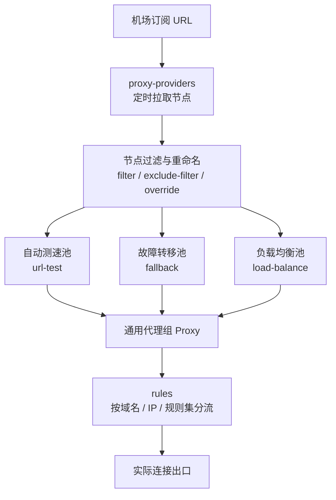
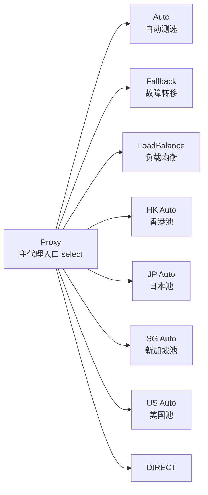
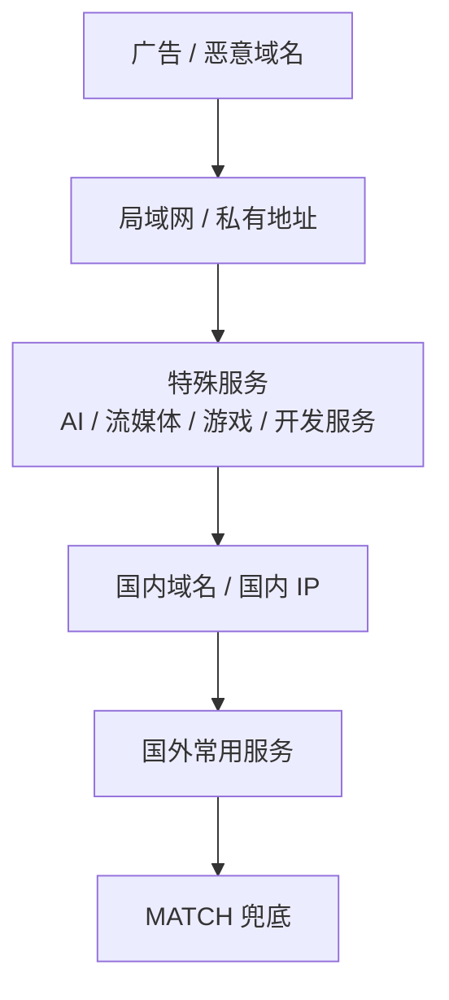

[toc]


订阅负责提供节点，代理组负责把节点组织成池，规则负责决定流量走哪个池，DNS/TUN/嗅探负责让系统流量能被正确识别和接管。

## 推荐总体方案

一个机场订阅，里面包含多个节点。最推荐的做法是：

**把订阅作为[代理集合(`proxy-providers`)](https://wiki.metacubex.one/config/proxy-providers/#_1)[¶](https://wiki.metacubex.one/config/proxy-providers/#_1)  引入，再用多个 [代理组(`proxy-groups`)](https://wiki.metacubex.one/config/proxy-groups/) 做不同用途的代理池。**

不要把订阅里的节点全部手动复制到 `proxies`，否则后续节点变更、过期、重命名、增删都会很难维护。

mihomo 的 `proxy-providers` 支持 `http`、`file`、`inline` 三种类型，远程订阅一般用 `http`；

`proxy-groups` 可以通过 `use` 引用 provider，也可以通过 `proxies` 引用具体节点或其他代理组。官方文档也建议 provider 名称唯一，并避免和策略组重名。([虚空终端](https://wiki.metacubex.one/en/config/proxy-providers/))



## 核心概念速览

| 概念       | 配置段                            | 初学者理解                         | 典型用途                                   |
| ---------- | --------------------------------- | ---------------------------------- | ------------------------------------------ |
| 入站       | `mixed-port`、`socks-port`、`tun` | 程序或系统流量从哪里进入 mihomo    | 浏览器代理、系统代理、TUN 全局接管         |
| 出站节点   | `proxies`                         | 具体代理服务器                     | 手动写单个节点，通常不推荐大量手写         |
| 代理提供者 | `proxy-providers`                 | 一个节点集合，通常来自订阅         | 拉取机场订阅、定时更新、过滤节点           |
| 代理组     | `proxy-groups`                    | 把多个节点或组包装成一个“出口策略” | 手选、测速、故障转移、负载均衡             |
| 规则       | `rules`                           | 判断某个请求该走哪个出口           | 国内直连、国外代理、广告拒绝、服务分流     |
| 规则提供者 | `rule-providers`                  | 可更新的规则集                     | 引入 geosite、广告、流媒体、国内外分流规则 |
| DNS        | `dns`                             | 域名如何解析                       | 避免污染、配合规则、提升分流准确性         |
| 嗅探       | `sniffer`                         | 从连接内容里识别真实域名           | 处理 App 只给 IP、不暴露域名的场景         |
| TUN        | `tun`                             | 虚拟网卡接管系统流量               | 让不支持代理的软件也走 mihomo              |

## 代理池应该怎么设计

代理组中的类型(`type`)有多种

> `url-test` 会按健康检查结果自动选择节点，并支持 `tolerance` 控制切换容忍度；
>
> `fallback` 会在当前节点超时时，按 `proxies` 顺序选择第一个可用节点；
>
> 其中`load-balance` 支持 `round-robin`、`consistent-hashing`、`sticky-sessions` 等策略。([虚空终端](https://wiki.metacubex.one/en/config/proxy-groups/url-test/))

对新手来说，不建议一上来就做“所有节点混在一起的负载均衡”。更稳的设计是：

| 池类型                                                       | 推荐用途                   | 优点                                 | 风险或注意点                                 |
| ------------------------------------------------------------ | -------------------------- | ------------------------------------ | -------------------------------------------- |
| [手动选择](https://wiki.metacubex.one/config/proxy-groups/select/)池 `select` | 主入口、兜底选择           | 可控，排错方便                       | 需要自己切换                                 |
| [自动选择(自动测速)](https://wiki.metacubex.one/config/proxy-groups/url-test/)池 `url-test` | 日常默认代理               | 自动选延迟较低节点                   | 延迟低不等于吞吐高，也不等于解锁能力强       |
| [自动回退(故障转移)](https://wiki.metacubex.one/config/proxy-groups/fallback/)池 `fallback` | 高可用兜底                 | 当前节点超时后按顺序选第一个可用节点 | 节点顺序很重要                               |
| [负载均衡](https://wiki.metacubex.one/config/proxy-groups/load-balance/)池 `load-balance` | 多连接、大量请求场景       | 分散请求压力                         | 不适合所有网站，登录态、风控、流媒体可能异常 |
| 地区池                                                       | 香港、日本、新加坡、美国等 | 适合流媒体、AI、游戏平台分流         | 依赖节点命名是否规范                         |

## 推荐的代理池结构

一个比较实用的结构如下：



这里的核心思想是：

`Proxy` 是你规则里主要引用的出口。
`Auto` 是日常默认。
`Fallback` 是网络不稳时兜底。
地区池用于 Netflix、Disney+、ChatGPT、游戏平台、开发者服务等需要特定地区的场景。
`LoadBalance` 只给确实适合多节点并发的流量使用，不建议作为默认出口。

## 最小可用配置骨架

下面是一个面向新手的可维护模板。

### 少量节点定义内置

```yaml
mixed-port: 7897
allow-lan: true
bind-address: "*"
mode: rule
log-level: info
external-controller: "127.0.0.1:9090"

# 定义节点数组
proxies:
  - type: vless
    name: vless-reality
    server: 192.xx...
    port: 29483
    uuid: 00000000-0000-4000-8000-000000000000
    udp: true
    tls: true
    flow: xtls-rprx-vision
    client-fingerprint: chrome
    skip-cert-verify: false
    packet-encoding: xudp
    reality-opts:
      public-key: YOUR_REALITY_PUBLIC_KEY
      short-id: "eff11fb8450b7d5e"
    network: tcp
    encryption: none
    servername: www.one-piece.com
  - type: vless
    name: vless-grpc-reality
    server: 192.xx....
    port: 18869
    uuid: 00000000-0000-4000-8000-000000000000
    udp: true
    tls: true
    client-fingerprint: chrome
    skip-cert-verify: false
    packet-encoding: xudp
    reality-opts:
      public-key: YOUR_REALITY_PUBLIC_KEY
      short-id: "eff11fb8450b7d5e"
    network: grpc
    grpc-opts:
      grpc-service-name: grpc
    encryption: none
    servername: www.microsoft.com
    
# 定义代理组(手动指定少量节点,名字取自节点定义中的name属性)
proxy-groups:
  - name: PROXY
    type: select
    proxies:
      - DIRECT
      - REJECT
      - vless-reality
      # 其余节点需先在 proxies 中定义再引用；引用未定义的名称会让整份配置加载失败
# 最小可用配置不可或缺的rules部分(否则流量可能都走直连,达不到代理效果)
rules:
  - MATCH,PROXY
```

### 可用性检查和日志排查

配置文件修改好后并导入(或者仅更新配置,请通过编辑文件并保存的方式更新,原来的导入文件发生更改并不会影响到mihomo客户端中最初导入产生的副本).

导入成功后可以重启代理应用,然后选择测试的节点(或分组).

通过客户端(例如curl或浏览器)指定代理(端口),发送请求,并观察mihomo客户端的日志.

### 基于在线订阅

你需要替换订阅 URL，并根据你的节点命名调整 `filter`。

```yaml
mixed-port: 7890
allow-lan: false
mode: rule
log-level: info
ipv6: true

external-controller: 127.0.0.1:9090

# 从代理供应商订阅链接拉取节点(type: http)
proxy-providers:
  airport:
    type: http
    url: "https://example.com/your-subscription-url"
    path: ./providers/airport.yaml
    interval: 86400
    health-check:
      enable: true
      url: https://www.gstatic.com/generate_204
      interval: 300
      timeout: 5000
      lazy: true
      expected-status: 204
    override:
      additional-prefix: "[airport] "

# 建议定义一个type: select,方便在代理客户端中有效选择节点.(否则默认可能只有GLOBAL,默认行为不可控,使用不便.)
proxy-groups:
  - name: Proxy
    type: select
    proxies:
      - Auto
      - Fallback
      - LoadBalance
      - HK Auto
      - JP Auto
      - SG Auto
      - US Auto
      - DIRECT

  - name: Auto
    type: url-test
    use:
      - airport
    url: https://www.gstatic.com/generate_204
    interval: 300
    tolerance: 50
    timeout: 5000
    lazy: true

  - name: Fallback
    type: fallback
    use:
      - airport
    url: https://www.gstatic.com/generate_204
    interval: 300
    timeout: 5000
    lazy: true

  - name: LoadBalance
    type: load-balance
    use:
      - airport
    url: https://www.gstatic.com/generate_204
    interval: 300
    timeout: 5000
    strategy: consistent-hashing
    lazy: true

  - name: HK Auto
    type: url-test
    use:
      - airport
    filter: "(?i)港|hk|hongkong|hong kong"
    url: https://www.gstatic.com/generate_204
    interval: 300
    tolerance: 50
    lazy: true

  - name: JP Auto
    type: url-test
    use:
      - airport
    filter: "(?i)日|jp|japan|tokyo|osaka"
    url: https://www.gstatic.com/generate_204
    interval: 300
    tolerance: 50
    lazy: true

  - name: SG Auto
    type: url-test
    use:
      - airport
    filter: "(?i)新|sg|singapore"
    url: https://www.gstatic.com/generate_204
    interval: 300
    tolerance: 50
    lazy: true

  - name: US Auto
    type: url-test
    use:
      - airport
    filter: "(?i)美|us|usa|united states|america|los angeles|san jose"
    url: https://www.gstatic.com/generate_204
    interval: 300
    tolerance: 50
    lazy: true

rules:
  - DOMAIN-SUFFIX,local,DIRECT
  - IP-CIDR,127.0.0.0/8,DIRECT,no-resolve
  - IP-CIDR,10.0.0.0/8,DIRECT,no-resolve
  - IP-CIDR,172.16.0.0/12,DIRECT,no-resolve
  - IP-CIDR,192.168.0.0/16,DIRECT,no-resolve
  - GEOIP,CN,DIRECT
  - MATCH,Proxy
```

需要注意一个细节：`proxy-groups` 里的 `url` 健康检查字段只检查该组 `proxies` 字段里的节点，不检查通过 `use` 引入的 provider 节点；所以当你用 `use` 引入订阅时，最好同时在 `proxy-providers` 里配置 `health-check`。官方文档明确区分了代理组健康检查和 provider 自身健康检查。([虚空终端](https://wiki.metacubex.one/en/config/proxy-groups/))

## `select`、`url-test`、`fallback`、`load-balance` 怎么选

| 类型           | 行为                           | 推荐场景                       | 配置建议                                      |
| -------------- | ------------------------------ | ------------------------------ | --------------------------------------------- |
| `select`       | 手动选择一个节点或组           | 主入口、临时排错、特殊网站     | 作为最外层入口                                |
| `url-test`     | 定期测试延迟，自动选择较优节点 | 日常网页、开发、聊天、普通代理 | `interval: 300`，`tolerance: 50` 左右         |
| `fallback`     | 当前节点不可用时按顺序切换     | 稳定优先、兜底出口             | 把最稳定节点排前面                            |
| `load-balance` | 多节点分摊请求                 | 下载、爬取、多连接任务         | 优先 `consistent-hashing`，谨慎 `round-robin` |

`load-balance` 不等于“网速一定更快”。如果一个网站根据 IP 识别登录状态，多个请求从不同出口出去，可能触发风控、验证码、登录失效。官方文档说明 `round-robin` 会把请求分散到不同节点，`consistent-hashing` 会让相同目标地址尽量走同一节点，`sticky-sessions` 则基于源地址和目标地址保持会话，缓存 10 分钟。日常使用更推荐 `consistent-hashing`。([虚空终端](https://wiki.metacubex.one/en/config/proxy-groups/load-balance/))

## 规则系统怎么理解

规则的本质是：

```text
匹配条件,目标内容,出口策略
```

例如：

```yaml
- DOMAIN-SUFFIX,google.com,Proxy
- GEOIP,CN,DIRECT
- MATCH,Proxy
```

含义是：

| 规则                             | 含义                              |
| -------------------------------- | --------------------------------- |
| `DOMAIN-SUFFIX,google.com,Proxy` | `google.com` 及其子域名走 `Proxy` |
| `GEOIP,CN,DIRECT`                | 中国大陆 IP 直连                  |
| `MATCH,Proxy`                    | 其他所有未命中的流量走 `Proxy`    |

mihomo 的路由规则按从上到下顺序匹配，越靠上优先级越高；`MATCH` 是兜底规则，通常放最后。官方规则类型包括 `DOMAIN`、`DOMAIN-SUFFIX`、`DOMAIN-KEYWORD`、`GEOSITE`、`IP-CIDR`、`GEOIP`、`RULE-SET`、`MATCH` 等。([虚空终端](https://wiki.metacubex.one/en/config/rules/))

## 推荐规则顺序

新手最容易犯的错误是把规则堆得很多，但顺序混乱。建议按这个顺序：



实际写法可以是：

```yaml
rules:
  # 广告和拦截类规则应靠前
  - DOMAIN-SUFFIX,example-ad.com,REJECT

  # 局域网和私有地址直连
  - DOMAIN-SUFFIX,local,DIRECT
  - IP-CIDR,127.0.0.0/8,DIRECT,no-resolve
  - IP-CIDR,10.0.0.0/8,DIRECT,no-resolve
  - IP-CIDR,172.16.0.0/12,DIRECT,no-resolve
  - IP-CIDR,192.168.0.0/16,DIRECT,no-resolve

  # 特殊服务
  - DOMAIN-SUFFIX,openai.com,US Auto
  - DOMAIN-SUFFIX,chatgpt.com,US Auto
  - DOMAIN-SUFFIX,netflix.com,SG Auto

  # 国内直连
  - GEOIP,CN,DIRECT

  # 兜底
  - MATCH,Proxy
```

`no-resolve` 只适用于目标 IP 相关规则。官方文档说明，当域名开始匹配目标 IP 规则时，mihomo 可能触发 DNS 解析；加上 `no-resolve` 可以跳过该解析，但如果前面的规则已经触发了解析，后续仍可能命中 IP 相关规则。([虚空终端](https://wiki.metacubex.one/en/config/rules/))

## `rule-providers` 适合什么时候用

当规则开始变多时，不建议把几百上千条规则都写进主配置。可以使用 `rule-providers` 引入外部规则集。

`rule-providers` 支持 `http`、`file`、`inline` 类型；`behavior` 有 `domain`、`ipcidr`、`classical`，需要和规则集实际格式对应；`format` 支持 `yaml`、`text`、`mrs`，其中当前 `mrs` 行为只支持 `domain` 和 `ipcidr`。([虚空终端](https://wiki.metacubex.one/en/config/rule-providers/))

示例：

```yaml
rule-providers:
  reject:
    type: http
    behavior: domain
    format: mrs
    url: "https://example.com/reject.mrs"
    path: ./ruleset/reject.mrs
    interval: 86400

  cn:
    type: http
    behavior: domain
    format: mrs
    url: "https://example.com/cn.mrs"
    path: ./ruleset/cn.mrs
    interval: 86400

rules:
  - RULE-SET,reject,REJECT
  - RULE-SET,cn,DIRECT
  - GEOIP,CN,DIRECT
  - MATCH,Proxy
```

新手建议先用少量本地规则加 `GEOIP,CN,DIRECT` 跑通，再逐步引入 `rule-providers`。规则集质量比数量更重要。

## DNS 与代理池的关系

DNS 是 mihomo 配置中最容易被低估的部分。代理池能不能正确工作，很大程度上取决于请求能否被识别为“域名流量”还是“纯 IP 流量”。

常见问题：

| 问题                     | 可能原因                           | 处理方向                                   |
| ------------------------ | ---------------------------------- | ------------------------------------------ |
| 明明写了域名规则但不生效 | 应用直接连接 IP，mihomo 看不到域名 | 开启嗅探或 TUN                             |
| 国内网站走了代理         | 国内域名/IP 规则不完整或顺序靠后   | 国内规则靠前，`GEOIP,CN,DIRECT` 放在兜底前 |
| 国外网站被直连           | 规则顺序错误，提前命中 DIRECT      | 检查规则命中日志                           |
| 流媒体解锁不稳定         | DNS 出口和代理出口地区不一致       | 对流媒体单独指定地区池                     |
| 访问慢                   | DNS 解析慢或频繁切换节点           | 调整测速 URL、`tolerance`、减少过度分流    |

对于初学者，DNS 不必一开始写得很复杂。先保证：

```yaml
dns:
  enable: true
  ipv6: true
  enhanced-mode: fake-ip
  nameserver:
    - https://dns.alidns.com/dns-query
    - https://doh.pub/dns-query
  fallback:
    - https://dns.google/dns-query
    - https://cloudflare-dns.com/dns-query
```

但要注意，不同客户端、系统、TUN 模式和规则集方案对 DNS 配置要求不同。真正排错时，应看 Dashboard 里的连接详情、规则命中、DNS 查询和实际出口。

## 节点过滤与命名最佳实践

订阅节点常见问题是命名混乱，比如：

```text
香港 01
HK-IEPL-02
Hong Kong 03
🇭🇰 x1
```

建议通过 `filter`、`exclude-filter`、`override` 做基础治理。mihomo 的 proxy-provider 示例中包含 `filter`、`exclude-filter`、`exclude-type`、`override.additional-prefix`、`override.proxy-name` 等能力，可用于筛选、排除和改名。([虚空终端](https://wiki.metacubex.one/en/config/proxy-providers/))

常用过滤示例：

```yaml
filter: "(?i)港|hk|hongkong|hong kong"
exclude-filter: "(?i)到期|剩余|官网|流量|套餐|expire|traffic"
exclude-type: "http"
```

建议：

| 做法                     | 原因                             |
| ------------------------ | -------------------------------- |
| 给不同订阅加前缀         | 多机场合并时避免节点重名         |
| 排除“流量/到期/官网”节点 | 这些通常不是代理节点             |
| 地区池使用宽松正则       | 兼容中文、英文、缩写、emoji 命名 |
| 不要过度依赖倍率筛选     | 倍率不代表速度和稳定性           |
| 定期检查空组             | 过滤太严格会导致某个地区池为空   |

## 多机场合并代理池

如果你以后有多个机场，可以这样做：

```yaml
proxy-providers:
  airport-a:
    type: http
    url: "https://example.com/sub-a"
    path: ./providers/airport-a.yaml
    interval: 86400
    health-check:
      enable: true
      url: https://www.gstatic.com/generate_204
      interval: 300
      expected-status: 204
    override:
      additional-prefix: "[A] "

  airport-b:
    type: http
    url: "https://example.com/sub-b"
    path: ./providers/airport-b.yaml
    interval: 86400
    health-check:
      enable: true
      url: https://www.gstatic.com/generate_204
      interval: 300
      expected-status: 204
    override:
      additional-prefix: "[B] "

proxy-groups:
  - name: Auto
    type: url-test
    use:
      - airport-a
      - airport-b
    url: https://www.gstatic.com/generate_204
    interval: 300
    tolerance: 50
    lazy: true
```

这才是真正意义上的“代理池”：多个 provider 输入，多个策略组消费，规则只引用策略组，而不关心底层节点来自哪里。

## 测速 URL 怎么选

常见健康检查 URL：

| URL                                      | 适用场景          | 说明                               |
| ---------------------------------------- | ----------------- | ---------------------------------- |
| `https://www.gstatic.com/generate_204`   | 通用代理可用性    | 常见默认选择                       |
| `https://www.google.com/generate_204`    | Google 可达性     | 部分地区或网络可能差异较大         |
| `https://cp.cloudflare.com/generate_204` | Cloudflare 可达性 | 适合通用连通性测试                 |
| 流媒体网站 URL                           | 流媒体地区池      | 只能代表该服务可达，不代表通用速度 |

建议不要频繁测速。`interval: 300` 通常已经足够。太短会增加本地和节点负担，也可能让订阅节点频繁产生无意义连接。

## 新手常见误区

| 误区                         | 正确理解                                       |
| ---------------------------- | ---------------------------------------------- |
| 节点越多越好                 | 节点越多，管理和测速成本越高；质量比数量重要   |
| `url-test` 一定最快          | 它主要看延迟，不等于下载速度、稳定性和解锁能力 |
| `load-balance` 适合默认代理  | 默认使用可能导致登录态异常、验证码、风控       |
| 规则越多越专业               | 规则越多越难排错，先少后多                     |
| 所有国外流量都走一个池就够了 | AI、流媒体、游戏、开发服务可能需要不同地区     |
| 只改代理组不看 DNS           | DNS 错误会导致规则不命中或出口地区异常         |
| 直接复制网上大配置           | 很多配置和客户端版本、系统环境、规则源强绑定   |

## 推荐学习路径

| 阶段   | 目标                   | 你应该掌握                           |
| ------ | ---------------------- | ------------------------------------ |
| 入门   | 能跑通订阅             | `proxy-providers`、`select`、`MATCH` |
| 稳定   | 自动选择可用节点       | `url-test`、`fallback`、健康检查     |
| 可维护 | 不手动维护节点         | `use`、`filter`、`override`          |
| 分流   | 国内直连、国外代理     | `DOMAIN-SUFFIX`、`GEOIP`、`RULE-SET` |
| 进阶   | 特殊服务分流           | 地区池、流媒体池、AI 池              |
| 排错   | 知道为什么没走预期节点 | Dashboard、连接日志、规则命中、DNS   |
| 高级   | 全系统接管             | TUN、fake-ip、sniffer、进程规则      |

## 实用推荐配置思路

对于大多数新手，我建议从这个结构开始：

| 用途          | 代理组        |
| ------------- | ------------- |
| 默认出口      | `Proxy`       |
| 日常自动选择  | `Auto`        |
| 网络不稳兜底  | `Fallback`    |
| 香港服务      | `HK Auto`     |
| 日本服务      | `JP Auto`     |
| 新加坡服务    | `SG Auto`     |
| 美国服务 / AI | `US Auto`     |
| 多连接任务    | `LoadBalance` |

规则层面先保持简单：

```yaml
rules:
  - DOMAIN-SUFFIX,local,DIRECT
  - IP-CIDR,127.0.0.0/8,DIRECT,no-resolve
  - IP-CIDR,10.0.0.0/8,DIRECT,no-resolve
  - IP-CIDR,172.16.0.0/12,DIRECT,no-resolve
  - IP-CIDR,192.168.0.0/16,DIRECT,no-resolve

  - DOMAIN-SUFFIX,openai.com,US Auto
  - DOMAIN-SUFFIX,chatgpt.com,US Auto

  - GEOIP,CN,DIRECT
  - MATCH,Proxy
```

等稳定后，再逐步加入广告规则、国内域名规则、流媒体规则和开发服务规则。

## 最佳实践清单

| 分类     | 建议                                                         |
| -------- | ------------------------------------------------------------ |
| 订阅管理 | 使用 `proxy-providers`，不要手动复制大量节点                 |
| 健康检查 | provider 和代理组都合理配置；`interval` 不要太短             |
| 代理组   | 外层用 `select`，内层放 `url-test`、`fallback`、地区池       |
| 负载均衡 | 谨慎默认启用，优先 `consistent-hashing`                      |
| 地区分流 | 为 AI、流媒体、游戏平台准备独立地区池                        |
| 规则顺序 | 拦截和特殊规则靠前，`MATCH` 永远最后                         |
| DNS      | 先简单可用，再根据 TUN、fake-ip、规则集逐步优化              |
| 排错     | 看实际命中的规则、出口节点和 DNS 解析结果，不要凭感觉        |
| 安全     | 订阅 URL 视为敏感信息，不要公开粘贴                          |
| 可维护性 | 配置少即是多，能用 provider 和 rule-provider 管理的就不要硬编码 |

## 一句话总结

你要做的“代理池”不是简单把节点塞进一个组，而是建立一套分层结构：

```text
订阅 provider 负责节点来源
代理组负责节点选择策略
规则负责流量分配
DNS / TUN / 嗅探负责提高识别准确性
Dashboard 和日志负责排错
```

最稳的新手方案是：**一个订阅 provider，加一个主 `select`，再配 `Auto`、`Fallback`、几个地区 `url-test` 池，规则先少后多。**

## 附录：从日志反推配置缺陷

配置能加载不代表流量会走代理。下面这条日志是典型症状：

```text
[TCP] 127.0.0.1:52133 --> www.youtube.com:443 match Match using DIRECT
```

`using DIRECT` 说明请求落到了 `MATCH` 兜底并命中直连。按顺序核对：

| 检查项 | 典型症状 | 修法 |
| --- | --- | --- |
| 是否定义了代理组 | 只有 `MATCH,DIRECT`，或压根没有 `proxy-groups` | 增加 `select` 入口组，把 `MATCH` 指向它 |
| 组的 `proxies` 是否引用未定义节点 | 启动时报 `not found` | 名字必须与 `proxies[].name` 完全一致 |
| 规则是否覆盖目标域名 | 只有国内直连规则，其余落 `MATCH` | 补 `RULE-SET` 或 `DOMAIN-SUFFIX`，`MATCH` 放最后 |
| provider 是否加载成功 | 日志出现 `[Provider] ... pull error` | 检查订阅地址与 `proxy: PROXY` 链路 |
| 出口组是否为空 | 组内节点全被 `exclude-filter` 过滤 | 放宽过滤，或改用 `include-all` |

两个常见误判：

- `encryption: none` 在 VLESS 里是合法值，与留空等价，不是握手失败的原因；真正要核对的是 `uuid`、`servername`、`reality-opts.public-key` 与 `short-id` 是否与服务端一致
- 节点服务器域名解析失败会表现为连接超时，而不是“规则不生效”，此时看 `proxy-server-nameserver` 与 DNS 日志，不要先改规则

排错顺序：先确认进程与端口，再看日志里 `using` 指向谁，然后核对规则命中，最后才怀疑节点本身。

