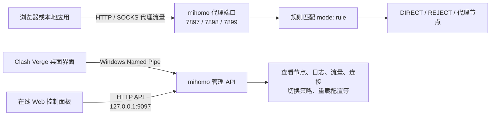
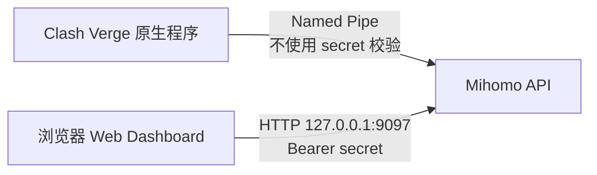

[toc]

## abstract

我在本地使用mihomo做流量路由:
并且使用相关项目提供的web控制界面.(说明下面的配置的理由和用意)

```yaml

# Generated by Clash Verge

mixed-port: 7897
socks-port: 7898
port: 7899
log-level: info
allow-lan: false
ipv6: true
mode: rule
external-controller: 127.0.0.1:9097
external-controller-pipe: \\.\pipe\verge-mihomo
tun:
  enable: false
  stack: gvisor
  auto-route: true
  strict-route: false
  auto-detect-interface: true
  dns-hijack:
  - any:53
secret: '1'

external-controller-cors:
  allow-private-network: true
  allow-origins:
  - tauri://localhost
  - http://tauri.localhost
  - https://yacd.metacubex.one
  - https://metacubex.github.io
  - https://board.zash.run.place
unified-delay: true

```

表示这份文件由 Clash Verge 自动生成。

它通常不是单纯的订阅配置，而是 Clash Verge 将以下内容合并后生成的运行时配置：

- 订阅中的节点和规则
- Clash Verge 的端口设置
- TUN 设置
- 控制器设置
- CORS 白名单
- Clash Verge 自己需要的通信参数

因此，直接修改这份生成文件，修改内容很可能在以下操作后被覆盖：

- 切换订阅
- 更新订阅
- 修改 Clash Verge 设置
- 重启内核
- 重新生成配置

需要长期保留的修改，通常应该通过 Clash Verge 的设置、全局扩展配置或配置合并功能完成，而不是只改生成结果。

| 端口         | HTTP   | SOCKS5 | 主要意义                   |
| ------------ | ------ | ------ | -------------------------- |
| `7897` mixed | 支持   | 支持   | 通用入口                   |
| `7898` socks | 不支持 | 支持   | 兼容只接受 SOCKS 的软件    |
| `7899` port  | 支持   | 不支持 | 兼容只接受 HTTP 代理的软件 |

Clash Verge 同时生成三个端口，主要是为了：

- 兼容不同软件
- 允许用户明确区分 HTTP 与 SOCKS
- 保留传统 Clash 端口使用习惯
- 方便调试不同代理协议

它们不是三层代理，也不会依次经过 `7897 → 7898 → 7899`。它们只是三个并列入口，最终都进入同一个 Mihomo 路由核心。

这份配置可以理解成两套相互独立、但共同服务于 Clash Verge 的接口：

- **代理入口**：`7897`、`7898`、`7899`，负责承接应用程序的网络流量。
- **管理入口**：`9097` 和 Windows **命名管道**，负责让 Clash Verge 或 Web 控制面板读取日志、切换节点、修改配置、查看连接等。

其中 `external-controller-cors` 只影响 **管理入口 `9097`**，不会决定网站流量是否代理。

## 整体工作结构



------

## 代理端口配置

### `mixed-port: 7897`

```yaml
mixed-port: 7897
```

这是混合代理端口，同时识别：

- HTTP 代理协议
- HTTPS 的 HTTP `CONNECT` 代理
- SOCKS5 代理

因此大多数情况下，只配置这个端口就足够了。支持 HTTP 代理的软件和支持 SOCKS5 的软件都可以连接到：

```text
127.0.0.1:7897
```

这里所谓的“HTTPS 代理”通常是指通过 HTTP `CONNECT` 隧道转发 HTTPS 流量，并不是说本地 `7897` 自身运行了一个 HTTPS 网站。Mihomo 官方将 mixed port 定义为同时支持 HTTP(S) 和 SOCKS5 的代理入口。([虚空终端](https://wiki.metacubex.one/en/config/inbound/port/))

常见设置方式：

```text
HTTP 代理：127.0.0.1:7897
SOCKS5 代理：127.0.0.1:7897
```

------

### `socks-port: 7898`

```yaml
socks-port: 7898
```

这是独立的 SOCKS 代理端口，支持 SOCKS4、SOCKS4a 和 SOCKS5。([虚空终端](https://wiki.metacubex.one/en/config/inbound/port/))

适合：

- 浏览器扩展
- Git
- SSH
- 下载工具
- 开发工具
- 明确要求 SOCKS5 的软件

例如：

```text
socks5://127.0.0.1:7898
```

由于 `mixed-port: 7897` 已经支持 SOCKS5，所以 `7898` 在功能上存在一定重复。保留它的主要价值是：

- 兼容只接受纯 SOCKS 端口的软件；
- 将 HTTP 与 SOCKS 客户端分开；
- 便于排查某种代理协议的问题；
- 避免某些软件对 mixed port 识别不正确。

没有这些需求时，只使用 `7897` 也可以。

------

### `port: 7899`

```yaml
port: 7899
```

这是独立的 HTTP 代理端口，包括通过 `CONNECT` 方法代理 HTTPS 网站。([虚空终端](https://wiki.metacubex.one/en/config/inbound/port/))

连接方式：

```text
http://127.0.0.1:7899
```

它适合：

- Windows 系统代理
- 只支持 HTTP Proxy 的旧软件
- 某些企业应用
- 需要将 HTTP 和 SOCKS 入口分开的场景

同样，因为 `7897` 已经可以处理 HTTP 代理，所以它也不是必需项。

三个端口的关系可以概括为：

| 端口   | 协议                        | 主要用途               |
| ------ | --------------------------- | ---------------------- |
| `7897` | HTTP、HTTPS CONNECT、SOCKS5 | 通用入口，通常优先使用 |
| `7898` | SOCKS4、SOCKS4a、SOCKS5     | 独立 SOCKS 入口        |
| `7899` | HTTP、HTTPS CONNECT         | 独立 HTTP 入口         |

这不是“流量依次经过三个端口”，而是三个并列的监听入口。应用连接其中任意一个即可。

------

## 通用字段与 TUN 不在这里展开

`log-level`、`allow-lan`、`ipv6`、`mode` 等通用字段见 [mihomo@典型配置说明](./mihomo@典型配置说明.md)；TUN 的字段、协议栈与常见坑见 [mihomo@入站和listeners](./mihomo@入站和listeners.md)。这份配置里 `tun.enable` 是 `false`，逐字段解释不会影响当前行为。

`unified-delay: true` 只是把面板测速改成统一延迟口径，不改变实际路由，细节见 API 指南里 `/proxies` 的相关说明。

## 管理 API 配置

### `external-controller: 127.0.0.1:9097`

```yaml
external-controller: 127.0.0.1:9097
```

这会启动 Mihomo 的外部控制 API，也就是控制面板连接的 REST API 和 WebSocket 接口。

官方 API 可以用于：

- 获取运行配置；
- 查看代理和策略组；
- 切换节点；
- 读取实时日志；
- 读取上下行流量；
- 查看内存；
- 查看和关闭连接；
- 更新订阅或规则提供器；
- 清理 DNS、Fake IP 缓存；
- 重载配置；
- 重启或升级内核。([虚空终端](https://wiki.metacubex.one/en/api/))

监听地址是：

```text
127.0.0.1:9097
```

其中 `127.0.0.1` 是 IPv4 回环地址，意味着这个 TCP 管理端口**只接受本机连接**。

这是非常重要的安全措施。相比：

```yaml
external-controller: 0.0.0.0:9097
```

当前写法不会直接把管理 API **暴露给整个局域网**。

Web 控制面板一般会连接：

```text
http://127.0.0.1:9097
```

而不是连接代理端口 `7897`。两者完全不是一回事：

| 地址             | 用途              |
| ---------------- | ----------------- |
| `127.0.0.1:7897` | 转发普通网络流量  |
| `127.0.0.1:9097` | 控制和管理 Mihomo |

------

### `external-controller-pipe`

```yaml
external-controller-pipe: \\.\pipe\verge-mihomo
```

这是 Windows 命名管道（Windows Named Pipe）形式的管理 API。

管道名称为：

```text
\\.\pipe\verge-mihomo
```

它主要用于 Clash Verge 桌面程序与 Mihomo 内核之间进行本地进程间通信（Inter-Process Communication，IPC）。

与 TCP API 相比，命名管道的特点是：

- 不占用普通 TCP 端口；
- 不能被浏览器通过 URL 直接访问；
- 适合本地桌面程序和后台服务通信；
- 不会直接暴露到局域网；
- 可以避免一部分本地端口冲突。

Mihomo 官方特别提醒：通过 Windows 命名管道访问 API 时不会校验 `secret`，因此仍需要依靠本机权限和命名管道访问控制保证安全。([虚空终端](https://wiki.metacubex.one/en/config/general/))

所以当前配置实际上提供了两条管理路径：



Clash Verge Rev 的项目代码中确实会生成 `verge-mihomo` 命名管道以及这组 CORS 来源。([GitHub](https://github.com/clash-verge-rev/clash-verge-rev/blob/dev/src-tauri/src/config/clash.rs))

------

### `secret`

```yaml
secret: '1'
```

这是控制 API 的访问密钥。

通过 HTTP API 访问时，一般会发送：

```http
Authorization: Bearer 1
```

Mihomo 官方 API 请求示例也是通过：

```http
Authorization: Bearer ${secret}
```

进行认证。([虚空终端](https://wiki.metacubex.one/en/api/))

但是：

```yaml
secret: '1'
```

安全强度非常低。

虽然当前 API 只监听在 `127.0.0.1`，并没有直接暴露给局域网，但仍存在以下风险：

- 本机恶意程序可以尝试访问；
- 浏览器中被允许的控制面板会访问；
- 浏览器扩展可能观察或干预请求；
- 被允许来源发生 XSS 或供应链攻击时，弱密钥几乎等于没有；
- 用户可能无意中把控制地址开放到 LAN。

建议使用随机密钥，例如：

```yaml
secret: "8caa4c67695e5f7f9a934c97de058772a7fcff655a6aec3ee9f965861e66ab28"
```

PowerShell 可以生成随机密钥：

```powershell
[Convert]::ToHexString(
  [Security.Cryptography.RandomNumberGenerator]::GetBytes(32)
).ToLower()
```

由于文件顶部写着：

```yaml
# Generated by Clash Verge
```

它很可能是运行时生成配置。直接修改文件可能在下次启动或修改设置时被覆盖。更稳妥的方式是通过 Clash Verge 的外部控制设置、配置覆写或合并脚本修改。

还有一个例外：

> `secret` 保护的是 HTTP 控制接口，命名管道接口不校验这个 secret。([虚空终端](https://wiki.metacubex.one/en/config/general/))

------

## 这份配置的总体用意

这份配置明显是为“Windows 本机使用 Clash Verge，加上在线 Web Dashboard”准备的。

其设计逻辑是：

| 目标                         | 对应配置                                 |
| ---------------------------- | ---------------------------------------- |
| 本机软件使用代理             | `7897`、`7898`、`7899`                   |
| 按规则分流                   | `mode: rule`                             |
| 不给局域网设备提供代理       | `allow-lan: false`                       |
| 支持 IPv6                    | `ipv6: true`                             |
| Clash Verge 原生端与内核通信 | `external-controller-pipe`               |
| 浏览器 Dashboard 管理内核    | `external-controller: 127.0.0.1:9097`    |
| API 身份认证                 | `secret`                                 |
| 允许指定控制面板跨源访问     | `external-controller-cors.allow-origins` |
| 允许公网网页访问本机 API     | `allow-private-network: true`            |
| 日后可切换 TUN               | 预先保留 `tun` 参数                      |
| 让延迟结果更可比             | `unified-delay: true`                    |

------

## 安全性评价

整体安全思路是合理的：

- 代理端口不开放给 LAN；
- 管理 API 只监听 `127.0.0.1`；
- CORS 没有使用 `*`；
- 只允许特定桌面和在线控制面板来源；
- API 设置了 secret；
- 桌面端优先使用本地命名管道。

但有两个明显问题。

### Secret 确保密码强度

```yaml
secret: '1'
```

建议替换为随机长密钥。

因为 Mihomo API 不只是“看看节点”，它还可以：

- 切换节点；
- 修改配置；
- 关闭连接；
- 重载内核；
- 获取日志与连接信息；
- 更新资源。([虚空终端](https://wiki.metacubex.one/en/api/))

------

### 在线 Dashboard 属于信任边界

你允许了：

```yaml
https://yacd.metacubex.one
https://metacubex.github.io
https://board.zash.run.place
```

这意味着这些来源中的 JavaScript，在获得 secret 后，可以控制本地 Mihomo API。

正常情况下这是你主动需要的功能。但从安全模型看，需要信任：

- 控制面板部署方；
- 对应域名；
- 页面加载的 JavaScript；
- 第三方 CDN；
- 页面不存在 XSS；
- 浏览器扩展没有窃取 secret。

因此，不使用某个在线面板时，可以从白名单中删除它。

例如只使用 Clash Verge 自带界面，可以缩小为：

```yaml
external-controller-cors:
  allow-private-network: true
  allow-origins:
    - tauri://localhost
    - http://tauri.localhost
```

只使用 Yacd，则保留：

```yaml
external-controller-cors:
  allow-private-network: true
  allow-origins:
    - tauri://localhost
    - http://tauri.localhost
    - https://yacd.metacubex.one
```

这符合最小授权原则。

------

## 推荐的本机配置思路

在你当前“本机使用，不共享给局域网，偶尔使用 Web 控制面板”的前提下，可以保留总体结构：

```yaml
mixed-port: 7897
socks-port: 7898
port: 7899

allow-lan: false
ipv6: true
mode: rule
log-level: info

external-controller: 127.0.0.1:9097
external-controller-pipe: \\.\pipe\verge-mihomo

secret: "使用随机生成的长密钥"

external-controller-cors:
  allow-private-network: true
  allow-origins:
    - tauri://localhost
    - http://tauri.localhost
    - https://yacd.metacubex.one

tun:
  enable: false
  stack: gvisor
  auto-route: true
  strict-route: false
  auto-detect-interface: true
  dns-hijack:
    - any:53

unified-delay: true
```

其中最容易混淆、也最值得记住的一句话是：

> `allow-lan` 决定别的设备能否使用你的代理；
>
> `allow-origins` 决定哪些网页能读取你的管理 API；
>
> `allow-private-network` 解决**公网网页**访问本机 API 时的浏览器私有网络检查；
>
> `secret` 是 API 身份认证。
