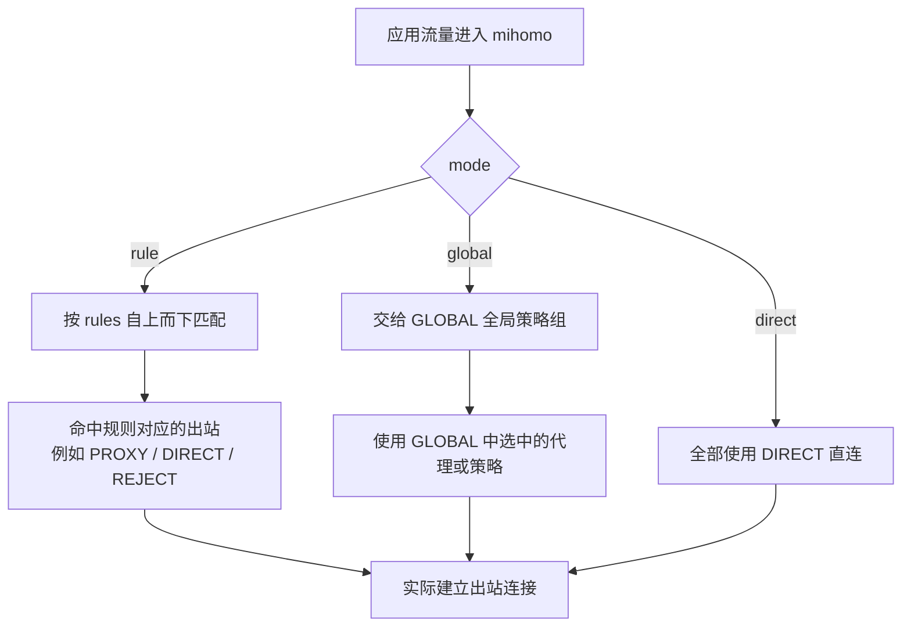

[toc]


**MetaCubeX/mihomo，也就是 Clash.Meta 系内核的配置文件字段 `mode`**。

它是一个**全局运行模式 / 路由模式**字段，用来决定：流量进入 mihomo 后，是按规则分流、全部走代理，还是全部直连。

官方当前文档在“运行模式 / Operation Mode”中列出的可用值只有三个：`rule`、`global`、`direct`，并说明默认值是 `rule`。([MetaCubex](https://wiki.metacubex.one/config/general/))

## `mode` 字段是什么

`mode` 是 mihomo 配置文件顶层字段，常见写法如下：

```yaml
mode: rule
```

它控制的是 **“如何选择出站”**，不是控制 TUN 是否开启，也不是控制 DNS 的 `fake-ip` / `redir-host`。更直观地说：



简单理解：

| `mode`   | 中文含义     | 核心行为                                         | 新手建议                             |
| -------- | ------------ | ------------------------------------------------ | ------------------------------------ |
| `rule`   | 规则模式     | 按 `rules` 中的规则逐条匹配，命中后使用对应策略  | 日常使用首选                         |
| `global` | 全局代理模式 | 不按普通分流规则走，流量统一交给 `GLOBAL` 策略组 | 临时排查、需要全部走代理时使用       |
| `direct` | 全局直连模式 | 不按普通分流规则走，流量统一直连                 | 临时关闭代理效果、排查代理问题时使用 |

## 可用值详解

### `rule`：规则模式，最常用

`rule` 是默认模式，也是绝大多数配置文件应使用的模式。官方文档说明 `rule` 表示规则匹配，且 `mode` 默认就是规则模式。([MetaCubex](https://wiki.metacubex.one/config/general/))

在 `rule` 模式下，mihomo 会按 `rules` 从上到下匹配。官方规则文档明确说明：规则自上而下匹配，越靠上的规则优先级越高。([MetaCubex](https://wiki.metacubex.one/en/config/rules/))

典型配置：

```yaml
mode: rule

proxy-groups:
  - name: PROXY
    type: select
    proxies:
      - 香港节点
      - 日本节点
      - 美国节点
      - DIRECT

rules:
  - DOMAIN-SUFFIX,github.com,PROXY
  - DOMAIN-SUFFIX,google.com,PROXY
  - GEOIP,CN,DIRECT
  - MATCH,PROXY
```

这段配置的含义是：

| 规则                             | 含义                             |
| -------------------------------- | -------------------------------- |
| `DOMAIN-SUFFIX,github.com,PROXY` | GitHub 相关域名走 `PROXY` 策略组 |
| `DOMAIN-SUFFIX,google.com,PROXY` | Google 相关域名走 `PROXY` 策略组 |
| `GEOIP,CN,DIRECT`                | 中国大陆 IP 直连                 |
| `MATCH,PROXY`                    | 前面都没匹配到的流量走 `PROXY`   |

`rule` 模式最适合日常使用，因为它可以做到“国内直连、国外代理、广告拦截、特定服务指定节点、局域网直连”等精细分流。

### `global`：全局代理模式

`global` 表示全局代理。官方文档说明，`global` 需要在 `GLOBAL` 策略组中选择代理或策略。([MetaCubex](https://wiki.metacubex.one/config/general/))

它的重点是：**用户流量不再按普通 `rules` 逐条分流，而是统一交给全局代理选择。**

适合场景：

| 场景                     | 为什么适合                                                   |
| ------------------------ | ------------------------------------------------------------ |
| 临时想让所有网站都走代理 | 不必修改大量规则                                             |
| 排查规则问题             | 如果 `rule` 模式访问失败，而 `global` 模式成功，通常说明问题在规则、DNS 或分流策略 |
| 临时使用某个固定节点     | 在 `GLOBAL` 中选定目标节点即可                               |

需要注意：`global` 不是“自动选择最快节点”的意思。最终用哪个节点，取决于 `GLOBAL` 策略组当前选中的代理或策略。

### `direct`：全局直连模式

`direct` 表示全局直连。官方文档说明 `direct` 是全局直连模式。([MetaCubex](https://wiki.metacubex.one/config/general/))

它的重点是：**所有进入 mihomo 的流量都尽量直接连接目标地址，不走代理节点。**

适合场景：

| 场景                 | 为什么适合                                                   |
| -------------------- | ------------------------------------------------------------ |
| 临时停用代理效果     | 不必关闭 mihomo 进程                                         |
| 排查节点问题         | 如果 `direct` 正常而 `rule/global` 不正常，可能是节点、策略组或规则问题 |
| 局域网或内网环境测试 | 可以避免代理干扰                                             |

但要注意：`direct` 并不等于“mihomo 完全不工作”。如果系统代理、TUN 或透明代理仍然把流量送进 mihomo，那么 mihomo 仍然会接管连接，只是出站选择 `DIRECT`。

## `rule`、`global`、`direct` 的区别

| 对比项                | `rule`                 | `global`                | `direct`             |
| --------------------- | ---------------------- | ----------------------- | -------------------- |
| 是否使用 `rules` 分流 | 使用                   | 通常不按普通规则分流    | 不按普通规则分流     |
| 是否依赖策略组        | 依赖规则中写到的策略组 | 依赖 `GLOBAL` 选择      | 通常不依赖代理策略组 |
| 是否走代理            | 由规则决定             | 通常全部走所选代理/策略 | 不走代理，直接连接   |
| 适合日常使用          | 是                     | 否，偏临时              | 否，偏临时           |
| 适合排查问题          | 适合对比               | 适合排查规则问题        | 适合排查代理节点问题 |

## 不要把这些字段和 `mode` 混淆

mihomo 配置里有很多字段也叫“模式”，但它们不是顶层的 `mode`。

| 字段                      | 示例                             | 作用                                                         | 是否等同于顶层 `mode` |
| ------------------------- | -------------------------------- | ------------------------------------------------------------ | --------------------- |
| `mode`                    | `mode: rule`                     | 全局路由模式                                                 | 是                    |
| `dns.enhanced-mode`       | `enhanced-mode: fake-ip`         | DNS 处理模式，官方可选值是 `fake-ip` / `redir-host`，默认 `redir-host` | 否                    |
| `dns.fake-ip-filter-mode` | `fake-ip-filter-mode: blacklist` | fake-ip 过滤逻辑模式，可选 `blacklist` / `whitelist` / `rule` | 否                    |
| `find-process-mode`       | `find-process-mode: strict`      | 进程匹配模式，可选 `always` / `strict` / `off`               | 否                    |
| `tun.enable`              | `tun: { enable: true }`          | 是否启用 TUN 入站                                            | 否                    |

官方 DNS 文档明确说明 `dns.enhanced-mode` 是 mihomo 的 DNS 处理模式，可选 `fake-ip` / `redir-host`，这和顶层 `mode` 不是一回事。([MetaCubex](https://wiki.metacubex.one/en/config/dns/))

## 关于 `script`：新手最容易踩的坑

你可能在一些旧 Clash、Clash Premium、旧模板或注释中看到：

```yaml
mode: script
```

但以当前 mihomo 官方文档为准，`mode` 的可用值只列出：

```yaml
rule
global
direct
```

官方运行模式文档没有把 `script` 列为当前通用可选值。([MetaCubex](https://wiki.metacubex.one/config/general/))

所以新手应当这样处理：

| 情况                       | 建议                                                         |
| -------------------------- | ------------------------------------------------------------ |
| 新写配置                   | 使用 `mode: rule`                                            |
| 旧订阅里有 `mode: script`  | 优先改成 `mode: rule`                                        |
| 某客户端 UI 显示“脚本模式” | 先确认该客户端和内核是否真的支持，不要把它当作 mihomo 通用配置 |
| 想实现复杂分流             | 优先使用 `rules`、`rule-providers`、`sub-rules`、策略组，而不是依赖旧式 `script` 模式 |

## 推荐写法

日常配置建议固定使用：

```yaml
mode: rule
```

配合清晰的规则结构：

```yaml
rules:
  # 局域网和私有地址优先直连
  - IP-CIDR,192.168.0.0/16,DIRECT,no-resolve
  - IP-CIDR,10.0.0.0/8,DIRECT,no-resolve
  - IP-CIDR,172.16.0.0/12,DIRECT,no-resolve

  # 常见国内流量直连
  - GEOIP,CN,DIRECT

  # 兜底规则
  - MATCH,PROXY
```

更完整的常见结构：

```yaml
mode: rule
log-level: info

proxy-providers:
  provider1:
    type: http
    url: "你的订阅地址"
    interval: 86400
    path: ./proxy_providers/provider1.yaml
    health-check:
      enable: true
      url: https://www.gstatic.com/generate_204
      interval: 300

proxy-groups:
  - name: PROXY
    type: select
    use:
      - provider1
    proxies:
      - DIRECT

  - name: AUTO
    type: url-test
    use:
      - provider1
    url: https://www.gstatic.com/generate_204
    interval: 300

rules:
  - DOMAIN-SUFFIX,github.com,PROXY
  - DOMAIN-SUFFIX,google.com,PROXY
  - GEOIP,CN,DIRECT
  - MATCH,PROXY
```

## 规则模式下的匹配原则

`rule` 模式最重要的原则是：**从上到下，先命中先生效**。官方文档明确说明规则按顺序自上而下匹配，上面的规则优先级更高。([MetaCubex](https://wiki.metacubex.one/en/config/rules/))

因此规则顺序通常这样安排：

| 位置   | 放什么                                                | 原因                             |
| ------ | ----------------------------------------------------- | -------------------------------- |
| 最前面 | 广告拦截、危险域名、局域网、特殊服务                  | 优先级最高，避免被后续规则误匹配 |
| 中间   | 各类服务分流，如 GitHub、YouTube、Telegram、Microsoft | 保持规则清晰                     |
| 后面   | GEOIP、国家地区规则                                   | 作为大范围规则                   |
| 最后   | `MATCH`                                               | 兜底，避免未匹配流量行为不明确   |

错误示例：

```yaml
rules:
  - MATCH,PROXY
  - GEOIP,CN,DIRECT
```

这里 `MATCH` 放在最前面，会导致后面的 `GEOIP,CN,DIRECT` 基本没有机会生效。

正确示例：

```yaml
rules:
  - GEOIP,CN,DIRECT
  - MATCH,PROXY
```

## 常见误区

| 误区                            | 正确认识                                                     |
| ------------------------------- | ------------------------------------------------------------ |
| `mode: global` 会自动选最快节点 | 不一定，最终取决于 `GLOBAL` 当前选中的代理或策略             |
| `mode: direct` 等于关闭 mihomo  | 不等于，流量可能仍经过 mihomo，只是出站直连                  |
| `mode: rule` 一定能智能分流     | 取决于你的 `rules` 是否合理                                  |
| `mode` 可以写成 `fake-ip`       | 不可以，`fake-ip` 是 DNS 的 `enhanced-mode`                  |
| `mode` 可以写成 `tun`           | 不可以，TUN 是入站能力，不是全局路由模式                     |
| `script` 是现代 mihomo 通用模式 | 不建议这样理解，当前官方 `mode` 文档只列 `rule/global/direct` |

## 排查建议

如果访问异常，可以用 `mode` 快速判断问题方向：

| 测试方式                                 | 结果              | 可能原因                                                     |
| ---------------------------------------- | ----------------- | ------------------------------------------------------------ |
| `mode: global` 正常，`mode: rule` 异常   | 规则模式有问题    | 规则顺序、规则集、DNS 分流、策略组名称可能有误               |
| `mode: direct` 正常，`mode: global` 异常 | 代理链路有问题    | 节点不可用、策略组选择错误、订阅失效                         |
| `mode: direct` 也异常                    | 可能不是代理问题  | 本地网络、DNS、系统代理、TUN 路由、目标网站本身异常          |
| 只有 UDP 服务异常                        | 检查节点 UDP 支持 | 官方规则文档提到，如果请求是 UDP 且代理节点不支持 UDP，会继续向下匹配规则。([MetaCubex](https://wiki.metacubex.one/en/config/rules/)) |

## 最佳实践

新手建议记住这几条：

| 建议                                   | 原因                                                    |
| -------------------------------------- | ------------------------------------------------------- |
| 日常固定用 `mode: rule`                | 最符合分流使用场景                                      |
| 不要轻易使用 `global` 长期上网         | 容易让国内、本地、内网流量也走代理，增加延迟和异常      |
| 不要把 `direct` 当作“关闭代理”         | 它只是让 mihomo 选择直连出站                            |
| `MATCH` 永远放最后                     | 防止提前兜底导致后续规则失效                            |
| 策略组名称要和规则中引用的名称完全一致 | 例如规则写 `PROXY`，就必须有名为 `PROXY` 的策略组或出站 |
| 优先使用小写值                         | 官方示例使用 `mode: rule`，写小写兼容性最好             |
| 旧模板中的 `script` 要谨慎             | 当前官方 `mode` 文档不把它列为通用可选值                |

## 总结

`mode` 是 mihomo 的**全局路由决策模式**：

```yaml
mode: rule
```

通常就是最推荐的写法。
`rule` 负责按规则分流，`global` 负责全局走代理选择，`direct` 负责全局直连。新手不要把它和 TUN、DNS 的 `enhanced-mode`、`fake-ip-filter-mode` 或旧模板里的 `script` 混为一谈。

## 关于GLOBAL组

结论先放前面：

| 问题                                                       | 结论                                                         |
| ---------------------------------------------------------- | ------------------------------------------------------------ |
| 不配置 `GLOBAL` 组会怎样                                   | **不会报错，也不等于没有 GLOBAL**。mihomo 有预置 `GLOBAL` 代理组，默认会填充所有代理组和代理节点。 |
| 客户端是否始终能看到 `GLOBAL`                              | **核心层有预置 GLOBAL，但 UI 不保证一定显示**。大多数面板会显示，部分客户端可能隐藏、折叠或另做抽象。 |
| `rule` 模式下手动选 `GLOBAL`，和切到 `global` 模式是否一样 | **通常不一样**。前者仍然遵守规则，只影响命中相关策略组的流量；后者是全局代理模式，绕过日常规则分流，统一使用 `GLOBAL` 当前选择。 |

## `GLOBAL` 不配置会怎么样

mihomo 的 `GLOBAL` 是一个**预置代理组**。官方文档明确写到：`GLOBAL` 默认填充所有代理组和代理节点，并且这个策略组也可以在配置文件中自定义。([MetaCubex](https://wiki.metacubex.one/config/proxy-groups/built-in/))

也就是说，你不写下面这段：

```yaml
proxy-groups:
  - name: GLOBAL
    type: select
    proxies:
      - PROXY
      - DIRECT
```

并不代表 mihomo 没有 `GLOBAL`。核心会自动提供一个预置的 `GLOBAL` 组，**通常会包含你配置里的策略组和代理节点**。

更准确地说：

| 配置情况                | 行为                                                         |
| ----------------------- | ------------------------------------------------------------ |
| 没有手动写 `GLOBAL`     | 使用 mihomo 预置 `GLOBAL`，默认包含所有代理组和代理节点      |
| 手动写了 `GLOBAL`       | 你接管 `GLOBAL` 的内容、顺序和可选项                         |
| `mode: global`          | 需要在 `GLOBAL` 策略组里选择代理或策略                       |
| `GLOBAL` 为空或成员异常 | 可能导致全局模式不可用、回退到兼容策略，或在客户端中表现异常，不建议依赖这种状态 |

普通用户一般可以不配置 `GLOBAL`。但如果你希望客户端面板里的组排序稳定，或者希望全局模式只允许选择某几个策略组，就建议手动定义它。

## 客户端是否始终能看到 `GLOBAL`

从 mihomo 核心角度看，`GLOBAL` 是预置代理组；官方还特别说明，Web 面板以及部分客户端会使用 `GLOBAL` 策略组内的策略组顺序进行排序。([MetaCubex](https://wiki.metacubex.one/config/proxy-groups/built-in/))

但从客户端 UI 角度看，不能说“始终能看到”。

原因是：

| 层面                    | 是否一定有 `GLOBAL`                                          |
| ----------------------- | ------------------------------------------------------------ |
| mihomo 核心             | 通常有，属于预置代理组                                       |
| external-controller API | 一般能返回相关代理组信息                                     |
| Web 面板                | 通常会显示                                                   |
| 第三方客户端            | 不保证，可能隐藏、重命名、折叠，或只提供“全局模式”开关       |
| 自定义配置              | 可以通过代理组字段影响前端展示；例如 `hidden` 会在 API 中返回隐藏状态，需要前端适配。([MetaCubex](https://wiki.metacubex.one/en/config/proxy-groups/)) |

所以最佳理解是：

> `GLOBAL` 是 mihomo 核心概念，不完全等于“你在某个客户端界面里一定看得见的一个按钮”。

## `GLOBAL` 组和 `global` 模式不是一回事

这两个名字很像，但含义不同。

| 名称           | 类型       | 作用                                             |
| -------------- | ---------- | ------------------------------------------------ |
| `GLOBAL`       | 代理组名称 | 一个可选代理 / 策略的策略组                      |
| `mode: global` | 运行模式   | 全局代理模式，所有流量统一交给 `GLOBAL` 当前选择 |
| `mode: rule`   | 运行模式   | 按 `rules` 规则分流                              |

官方全局配置文档说明，`mode` 可用值是 `rule`、`global`、`direct`；其中 `global` 是全局代理，并且需要在 `GLOBAL` 策略组中选择代理或策略。([MetaCubex](https://wiki.metacubex.one/en/config/general/))

## `rule` 模式下手动切到 `GLOBAL`，到底是什么意思

这里有两种常见情况，要分开看。

### 情况一：你只是点开 `GLOBAL` 组，选择了里面的节点

例如你在面板里看到：

```text
GLOBAL
  - PROXY
  - 香港节点
  - 日本节点
  - DIRECT
```

然后你在 `GLOBAL` 里选择了“香港节点”。

如果此时运行模式仍然是：

```yaml
mode: rule
```

那么流量还是会按 `rules` 分流。官方规则文档说明，规则会从上到下匹配，越靠上的规则优先级越高。([MetaCubex](https://wiki.metacubex.one/en/config/rules/))

例如：

```yaml
mode: rule

rules:
  - DOMAIN-SUFFIX,bilibili.com,DIRECT
  - DOMAIN-SUFFIX,google.com,PROXY
  - MATCH,PROXY
```

此时即使你在 `GLOBAL` 里选了“香港节点”：

| 流量           | 结果                                |
| -------------- | ----------------------------------- |
| `bilibili.com` | 仍然命中 `DIRECT`，直连             |
| `google.com`   | 命中 `PROXY`，走 `PROXY` 组当前选择 |
| 其他未匹配流量 | 命中 `MATCH,PROXY`，走 `PROXY`      |

注意：除非规则最终使用到了 `GLOBAL`，否则你在 `GLOBAL` 里选什么，不一定影响这些流量。

### 情况二：你的规则或策略组里引用了 `GLOBAL`

例如：

```yaml
proxy-groups:
  - name: PROXY
    type: select
    proxies:
      - 香港节点
      - 日本节点
      - GLOBAL
      - DIRECT

rules:
  - DOMAIN-SUFFIX,google.com,PROXY
  - GEOIP,CN,DIRECT
  - MATCH,PROXY
```

如果你在 `PROXY` 组里手动选择了 `GLOBAL`，那么：

| 流量                                      | 结果                                   |
| ----------------------------------------- | -------------------------------------- |
| 命中 `GEOIP,CN,DIRECT` 的流量             | 仍然直连                               |
| 命中 `PROXY` 的流量                       | 进入 `PROXY`，再转到 `GLOBAL` 当前选择 |
| 没命中前面规则、落到 `MATCH,PROXY` 的流量 | 进入 `PROXY`，再转到 `GLOBAL` 当前选择 |

这时 `GLOBAL` 只影响“规则最终导向到 `PROXY`，并且 `PROXY` 当前选择了 `GLOBAL`”的那部分流量。它仍然不是全局代理模式。

## 切换到 `mode: global` 的效果

当你把模式切到：

```yaml
mode: global
```

含义就变了。

此时不再按常规 `rules` 做日常分流，而是进入全局代理模式，统一使用 `GLOBAL` 策略组里当前选中的代理或策略。官方文档对 `global` 的描述就是“全局代理，需要在 `GLOBAL` 策略组选择代理/策略”。([MetaCubex](https://wiki.metacubex.one/en/config/general/))

对比一下：

| 操作                                     | 是否还按 `rules` 分流    | 影响范围                           | 典型用途                       |
| ---------------------------------------- | ------------------------ | ---------------------------------- | ------------------------------ |
| `mode: rule`，只是在 `GLOBAL` 组里选节点 | 是                       | 只有最终用到 `GLOBAL` 的流量受影响 | 日常分流下调整全局组备选       |
| `mode: rule`，某个策略组选择 `GLOBAL`    | 是                       | 只影响命中该策略组的流量           | 让某类流量转交给 `GLOBAL`      |
| 切换为 `mode: global`                    | 否，常规规则分流不再主导 | 几乎所有进入 mihomo 的流量         | 临时全局代理、排查规则问题     |
| 切换为 `mode: direct`                    | 否，常规规则分流不再主导 | 几乎所有进入 mihomo 的流量直连     | 临时关闭代理效果、排查节点问题 |

## 用一个例子说明差异

假设配置如下：

```yaml
mode: rule

proxy-groups:
  - name: PROXY
    type: select
    proxies:
      - 香港节点
      - 日本节点
      - GLOBAL
      - DIRECT

rules:
  - DOMAIN-SUFFIX,baidu.com,DIRECT
  - DOMAIN-SUFFIX,google.com,PROXY
  - MATCH,PROXY
```

### 仍然是 `rule` 模式，只是在 `GLOBAL` 里选“香港节点”

如果 `PROXY` 当前选的是“日本节点”，那么：

| 访问目标     | 结果                                |
| ------------ | ----------------------------------- |
| `baidu.com`  | 直连                                |
| `google.com` | 走 `PROXY` 当前选择，也就是日本节点 |
| 其他流量     | 走 `PROXY` 当前选择，也就是日本节点 |

此时你在 `GLOBAL` 里选“香港节点”，不会自动覆盖 `PROXY`。

### 仍然是 `rule` 模式，但在 `PROXY` 里选择 `GLOBAL`

如果 `GLOBAL` 当前选的是“香港节点”，那么：

| 访问目标     | 结果                                                  |
| ------------ | ----------------------------------------------------- |
| `baidu.com`  | 仍然直连                                              |
| `google.com` | 命中 `PROXY`，`PROXY` 又选了 `GLOBAL`，最终走香港节点 |
| 其他流量     | 命中 `MATCH,PROXY`，最终也走香港节点                  |

这仍然不是完全全局代理，因为 `baidu.com` 这样的直连规则还在生效。

### 切换为 `mode: global`

如果 `GLOBAL` 当前选的是“香港节点”，那么：

| 访问目标     | 结果                               |
| ------------ | ---------------------------------- |
| `baidu.com`  | 也走 `GLOBAL` 当前选择，即香港节点 |
| `google.com` | 走 `GLOBAL` 当前选择，即香港节点   |
| 其他流量     | 走 `GLOBAL` 当前选择，即香港节点   |

这才是“全局代理模式”。

## 推荐配置方式

如果你希望客户端中的排序稳定，并且 `global` 模式行为可控，建议显式写出 `GLOBAL`。

例如：

```yaml
proxy-groups:
  - name: PROXY
    type: select
    proxies:
      - AUTO
      - 香港节点
      - 日本节点
      - 美国节点
      - DIRECT

  - name: AUTO
    type: url-test
    proxies:
      - 香港节点
      - 日本节点
      - 美国节点
    url: https://www.gstatic.com/generate_204
    interval: 300

  - name: GLOBAL
    type: select
    proxies:
      - PROXY
      - AUTO
      - 香港节点
      - 日本节点
      - 美国节点
      - DIRECT
```

官方也建议，在自定义 `GLOBAL` 时，完整写出当前配置中的所有策略组，除了 `GLOBAL` 自身。([MetaCubex](https://wiki.metacubex.one/config/proxy-groups/built-in/))

## 最佳实践

| 目标                     | 建议                                                         |
| ------------------------ | ------------------------------------------------------------ |
| 日常使用                 | 使用 `mode: rule`                                            |
| 临时让所有流量走代理     | 切到 `mode: global`，并在 `GLOBAL` 里选目标策略              |
| 临时让所有流量直连       | 切到 `mode: direct`                                          |
| 想让某类流量交给全局选择 | 在对应策略组中引用 `GLOBAL`，但保留 `mode: rule`             |
| 想让客户端组排序更清楚   | 手动定义 `GLOBAL`，并把常用策略组按期望顺序写进去            |
| 不想让 `GLOBAL` 太混乱   | 不要让它默认塞入过多节点，手动只放 `PROXY`、`AUTO`、地区组、`DIRECT` 等核心入口 |

一句话总结：

> `GLOBAL` 是“全局模式要使用的策略组”，而 `mode: global` 是“切换到全局代理运行模式”。在 `rule` 模式下选中或调整 `GLOBAL`，通常只影响最终引用到 `GLOBAL` 的流量；切到 `global` 模式，才是整体流量统一交给 `GLOBAL` 当前选择。