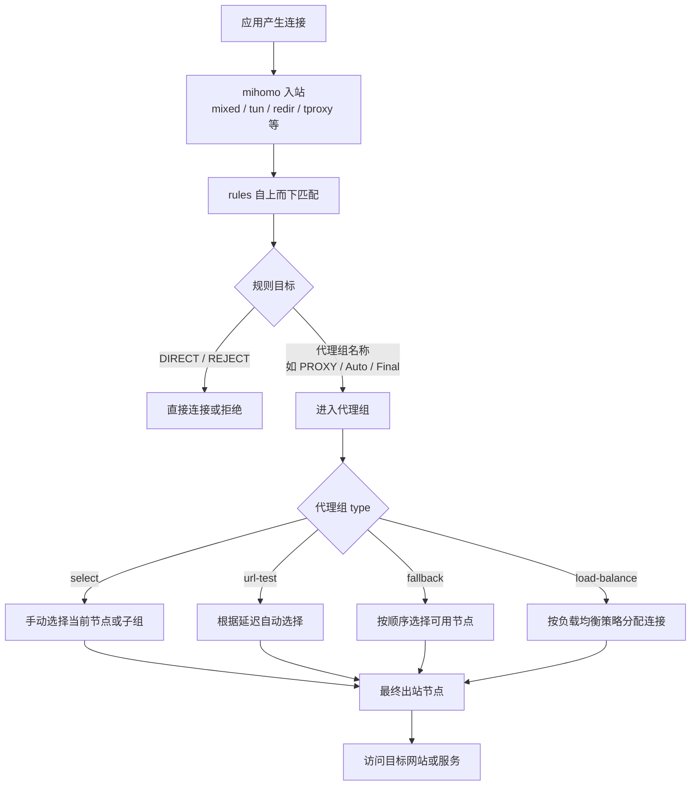
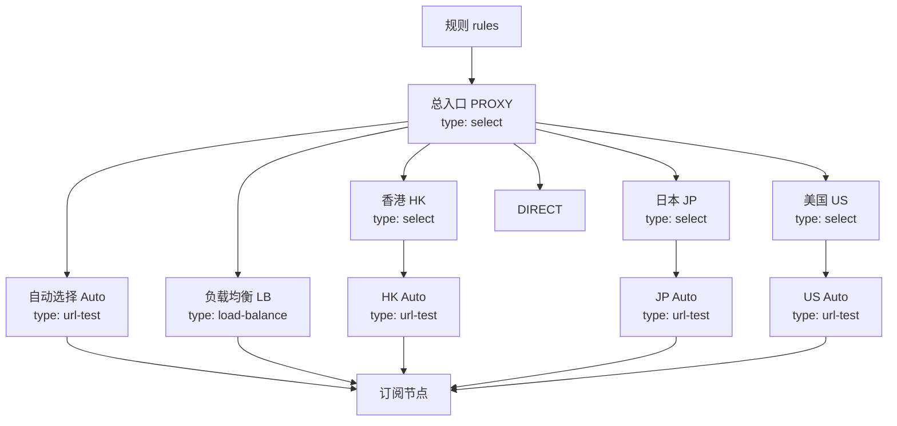

[toc]


## mihomo 代理组是什么

在 mihomo 中，**代理组**(`proxy-groups`)可以理解为“给一批出站节点起一个可被规则引用的名字”。

规则并不一定直接指向某个节点，更多时候是指向一个代理组，例如 `PROXY`、`HK`、`Auto`、`Final`。

当流量**命中规则**(rule)后，mihomo 会把连接交给对应代理组，再由代理组内部的策略决定最终使用哪个节点。

官方文档中，代理组通过 `proxies` 引入**出站代理**或其他**代理组**，通过 `use` 引入 `proxy-providers`(代理集合)；

代理组的定义中,`name` 和 `type` 是必填字段。([虚空终端](https://wiki.metacubex.one/config/proxy-groups/))



路由规则按从上到下的顺序匹配，越靠上的规则优先级越高；`MATCH` 是无条件兜底规则，通常放在最后。官方规则示例也展示了规则目标可以是 `auto`、`PROXY`、`DIRECT`、`REJECT` 等代理组或内置策略。([虚空终端](https://wiki.metacubex.one/en/config/rules/))

## 常见代理组类型对比

| 类型           | 中文习惯叫法 | 决策方式                                                     | 适合场景                               | 优点                       | 注意点                                                       |
| -------------- | ------------ | ------------------------------------------------------------ | -------------------------------------- | -------------------------- | ------------------------------------------------------------ |
| `select`       | 手动选择     | 用户在面板或客户端中手动选一个节点或子组                     | 总入口、地区入口、需要人工控制的策略   | 最直观，适合新手理解和排错 | 不会自动选最快，也不等同于自动故障转移                       |
| `url-test`     | 自动选择     | 定期测试节点延迟，选择延迟表现更好的节点                     | 日常网页、流媒体、需要自动选低延迟节点 | 省心，适合作为“自动节点组” | 延迟低不代表带宽大；频繁切换可能影响登录态                   |
| `fallback`     | 自动回退     | 按列表顺序优先使用前面的可用节点，当前节点不可用时切到后面的节点 | 主备线路、稳定优先                     | 可控性强，优先级明确       | 列表顺序很重要；不是负载均衡                                 |
| `load-balance` | 负载均衡     | 按策略把连接分散到多个节点                                   | 多条同类节点分摊连接、提高整体吞吐     | 能利用多节点资源           | 不适合所有网站；部分服务对频繁变 IP 敏感                     |
| `relay`        | 链式代理     | 旧的链式代理组                                               | 历史配置                               | 旧教程中常见               | 当前内核已移除 `relay`，写了会直接报错；链式代理改用 `dialer-proxy`。([虚空终端](https://wiki.metacubex.one/config/proxy-groups/relay/)) |

`url-test` 的关键字段是 `url`、`interval` 和可选的 `tolerance`，其中 `tolerance` 是节点切换容差，单位是毫秒。([虚空终端](https://wiki.metacubex.one/config/proxy-groups/url-test/)) `fallback` 的核心行为是：当前节点超时时，按 `proxies` 列表顺序选择第一个可用节点。([虚空终端](https://wiki.metacubex.one/en/config/proxy-groups/fallback/)) `load-balance` 则提供 `round-robin`、`consistent-hashing`、`sticky-sessions` 三种策略，后文详细解释。([虚空终端](https://wiki.metacubex.one/config/proxy-groups/load-balance/))

## 常用字段快速理解

| 字段               | 作用                                      | 新手建议                                                     |
| ------------------ | ----------------------------------------- | ------------------------------------------------------------ |
| `name`             | 代理组名称，规则中会引用它                | 名称保持简洁稳定，例如 `PROXY`、`Auto`、`HK`                 |
| `type`             | 代理组类型                                | 常用 `select`、`url-test`、`fallback`、`load-balance`        |
| `proxies`          | 手动列出节点名或其他代理组名              | 适合小配置、固定分组、嵌套组                                 |
| `use`              | 引入 proxy-providers                      | 适合订阅节点较多、需要自动更新的配置                         |
| `url`              | 健康检查地址                              | 常用 `https://www.gstatic.com/generate_204` 或 provider 文档推荐地址 |
| `interval`         | 健康检查间隔，单位秒                      | 常见 300 到 600 秒，不要过短                                 |
| `lazy`             | 懒惰检查，默认 `true`，未选中该组时不测试 | 普通用户建议保持默认                                         |
| `timeout`          | 健康检查超时时间，单位毫秒                | 常见 3000 到 5000                                            |
| `max-failed-times` | 最大失败次数，超过后触发强制健康检查      | 默认 5，一般不用改                                           |
| `disable-udp`      | 禁用该组 UDP                              | 组内节点 UDP 支持不一致时可考虑                              |
| `filter`           | 对 provider 或自动引入节点按名称筛选      | **适合按地区、倍率、协议筛选**                               |
| `exclude-filter`   | 排除匹配名称的节点                        | 适合排除“剩余流量”“官网”“过期”等节点                         |
| `exclude-type`     | 按节点类型排除                            | 组级用 Adapter Type 名（`Shadowsocks`/`Vless`/`Direct`），provider 级才用配置 `type`（`ss`）；竖线分隔，大小写不敏感 |
| `expected-status`  | 健康检查期望 HTTP 状态码                  | 检查地址稳定时可设置，如 `204`                               |
| `hidden` / `icon`  | 面板展示相关                              | 非核心功能，可后置学习                                       |

一个重要细节：代理组级别的 `url` 不只是面板上的测速地址。用 `use` 引入 provider 时，组上的 `url`/`interval` 会向 provider 注册一条**额外的测速任务**（`parser.go` 里的 `addTestUrlToProviders`）；provider 自身的 `health-check` 仍然独立生效，两处 `url` 相同时共用一份结果，provider 已经设了 `interval` 时组上的 `interval` 不会覆盖它。`load-balance` / `url-test` 判断“节点是否可用”用的就是该组 `url` 对应的测速结果，所以别给组填一个不可达的地址。([源码](https://github.com/MetaCubeX/mihomo/blob/Alpha/adapter/outboundgroup/parser.go)) proxy-provider 的健康检查字段包括 `health-check.enable`、`url`、`interval`、`timeout`、`lazy` 和 `expected-status`，其中 `lazy` 默认就是 `true`。([虚空终端](https://wiki.metacubex.one/en/config/proxy-providers/))

## 推荐的代理组分层思路

新手最容易犯的错误是把所有节点、所有规则、所有策略都塞到一个代理组里。更清晰的做法是分层：



这种结构的好处是：`PROXY` 作为总入口负责“给用户选择大方向”，地区组负责“把节点分类”，`url-test` 负责“自动挑低延迟”，`load-balance` 负责“多节点分摊连接”。

规则只需要指向 `PROXY`、`AI`、`Streaming`、`Final` 这类稳定组名，不必频繁改规则。

## `select` 手动选择组

`select` 是最适合新手理解的代理组。它本质上是一个菜单，你可以在客户端或面板里选择当前使用哪个节点、哪个地区组、哪个自动组，甚至选择 `DIRECT`。

```yaml
proxy-groups:
  - name: PROXY
    type: select
    proxies:
      - Auto
      - HK
      - JP
      - US
      - LoadBalance
      - DIRECT
```

适合把 `select` 用作总入口。例如：

```yaml
rules:
  - DOMAIN-SUFFIX,google.com,PROXY
  - DOMAIN-SUFFIX,youtube.com,PROXY
  - MATCH,PROXY
```

这样你只要在面板里切换 `PROXY` 当前选项，就可以让相关规则走不同出口。规则匹配顺序是自上而下，`MATCH` 匹配所有剩余请求，适合作为最后兜底。([虚空终端](https://wiki.metacubex.one/en/config/rules/))

## `url-test` 自动选择组

`url-test` 会对组内节点进行延迟测试，然后选择延迟表现更好的节点。它适合普通网页访问、轻量应用、希望“自动挑一个快节点”的场景。

```yaml
proxy-groups:
  - name: Auto
    type: url-test
    use:
      - provider-main
    url: https://www.gstatic.com/generate_204
    interval: 300
    tolerance: 50
    lazy: true
    timeout: 5000
```

`url-test` 的 `tolerance` 是“切换容差”。简单理解：如果新节点只是快一点点，不一定马上切换；这样可以减少节点来回跳动。官方文档明确 `tolerance` 单位是毫秒。([虚空终端](https://wiki.metacubex.one/config/proxy-groups/url-test/))

适合用 `url-test` 的情况：

| 场景                         | 推荐程度 | 原因                                 |
| ---------------------------- | -------- | ------------------------------------ |
| 日常网页浏览                 | 高       | 延迟体验明显                         |
| API 请求                     | 中高     | 需要稳定低延迟                       |
| 流媒体                       | 中       | 延迟低不代表解锁稳定                 |
| 游戏                         | 视情况   | 低延迟重要，但频繁换出口可能有副作用 |
| 银行、支付、账号风控敏感网站 | 低       | 出口变化可能触发验证                 |

## `fallback` 自动回退组

`fallback` 更像“主线路、备用线路”的队列。它不是为了选最快，而是为了优先使用你排在前面的节点；当前节点不可用时，再切到后面的可用节点。官方说明是：当前节点超时时，会按 `proxies` 顺序选择第一个可用节点。([虚空终端](https://wiki.metacubex.one/en/config/proxy-groups/fallback/))

```yaml
proxy-groups:
  - name: Stable
    type: fallback
    proxies:
      - HK-Primary
      - HK-Backup-1
      - HK-Backup-2
    url: https://www.gstatic.com/generate_204
    interval: 300
    lazy: true
```

适合场景：

| 场景                   | 为什么适合               |
| ---------------------- | ------------------------ |
| 你有一条最稳定的主节点 | 保持优先使用主节点       |
| 家庭路由器长期开机     | 不希望频繁切换出口       |
| 流媒体固定地区解锁     | 优先使用已验证可用的节点 |
| 工作网络               | 稳定性比“最快”更重要     |

## `load-balance` 负载均衡组核心原理

`load-balance` 的目标不是“自动选最快”，而是“把连接分配给组内多个节点”。官方文档列出三种策略：`round-robin`、`consistent-hashing`、`sticky-sessions`。其中 `round-robin` 会把请求分配给组内不同代理节点；`consistent-hashing` 会把相同目标地址的请求分配给同一个代理节点；`sticky-sessions` 会把相同来源地址和目标地址的请求分配给同一个节点，缓存 10 分钟过期。([虚空终端](https://wiki.metacubex.one/config/proxy-groups/load-balance/))

| 策略                 | 分配依据                                    | 优点                               | 风险                              | 推荐场景                               |
| -------------------- | ------------------------------------------- | ---------------------------------- | --------------------------------- | -------------------------------------- |
| `round-robin`        | 轮询分配                                    | 分散最明显，能更积极地利用多个节点 | 同一网站的连接可能来自不同出口 IP | 下载、多连接、大量非登录请求           |
| `consistent-hashing` | 目标地址一致则尽量固定到同一节点            | 同一目标更稳定，减少出口跳动       | 分摊不如轮询均匀                  | 日常浏览、登录网站、综合使用           |
| `sticky-sessions`    | 来源地址 + 目标地址一致则固定，缓存 10 分钟 | 对会话更友好                       | 缓存过期后仍可能变化              | 多设备、局域网共享、需要会话粘性的场景 |

官方还说明：当目标地址是域名时，会使用顶级域名匹配。也就是说，同一站点相关请求更可能被稳定分配到同一节点，而不是每个子域都完全随机。([虚空终端](https://wiki.metacubex.one/config/proxy-groups/load-balance/))

## 创建一个最小可用的 `load-balance`

```yaml
proxy-groups:
  - name: LoadBalance
    type: load-balance
    proxies:
      - HK-01
      - HK-02
      - HK-03
    url: https://www.gstatic.com/generate_204
    interval: 300
    strategy: consistent-hashing
    lazy: true
    timeout: 5000
```

这个配置适合三个同地区、同质量、同用途的节点。新手建议优先用 `consistent-hashing`，因为它比 `round-robin` 更不容易让同一网站频繁看到不同出口。

## 使用 proxy-providers 创建负载均衡组

如果你的节点来自订阅，通常会使用 `proxy-providers`。这时推荐在 provider 中配置健康检查，在代理组中用 `filter` 做节点筛选。

```yaml
proxy-providers:
  provider-main:
    type: http
    url: "你的订阅地址"
    path: ./providers/provider-main.yaml
    interval: 86400
    health-check:
      enable: true
      url: https://www.gstatic.com/generate_204
      interval: 300
      timeout: 5000
      lazy: true
      expected-status: 204

proxy-groups:
  - name: HK-LB
    type: load-balance
    use:
      - provider-main
    filter: "(?i)港|hk|hongkong|hong kong"
    exclude-filter: "(?i)剩余|流量|官网|过期|expire|traffic"
    url: https://www.gstatic.com/generate_204
    interval: 300
    strategy: consistent-hashing
    lazy: true
```

这里有两个关键点：

| 配置                                   | 作用                                             |
| -------------------------------------- | ------------------------------------------------ |
| provider 里的 `health-check`           | 负责订阅节点自身的健康检查                       |
| 代理组里的 `filter` / `exclude-filter` | 从订阅节点中筛出香港节点，并排除无效或说明类节点 |

官方通用字段说明中，`filter` 只作用于引入的代理集合以及自动引入的出站代理，`exclude-filter` 用于排除匹配名称的节点；`include-all-providers` 会引入所有代理集合，并会使普通 `use` 引入失效。([虚空终端](https://wiki.metacubex.one/config/proxy-groups/))

## 三种 `load-balance` 策略怎么选

### 日常上网推荐

```yaml
strategy: consistent-hashing
```

理由：同一目标地址尽量固定到同一节点，兼顾稳定和一定程度的分摊。适合作为默认负载均衡策略。

### 下载或多连接任务

```yaml
strategy: round-robin
```

理由：轮询更积极地把请求分散到不同节点。适合下载器、多线程拉取、镜像站、包管理器等场景。但不建议把登录态敏感的网站全部交给 `round-robin`。

### 局域网多设备共享

```yaml
strategy: sticky-sessions
```

理由：它会基于来源地址和目标地址保持粘性，同一设备访问同一目标时更稳定；官方说明该缓存 10 分钟过期。([虚空终端](https://wiki.metacubex.one/config/proxy-groups/load-balance/))

### 采集：同一 worker 固定出口

采集任务不要把 `round-robin` 当默认：同一站点的连续请求来自不同出口，容易触发风控。按 worker 固定出口有三种做法：

| 做法 | 配置 | 适用 |
| --- | --- | --- |
| 目标粘性 | `strategy: consistent-hashing` | 同一目标站点固定同一出口；同一 worker 访问多个站点时会分别映射到不同节点 |
| 会话粘性 | `strategy: sticky-sessions` | 同一来源地址 + 目标地址固定，缓存 10 分钟；适合短会话 |
| worker 粘性 | `strategy: consistent-hashing` + `hash-key: in-user` | 每个 worker 一个认证用户，跨站点固定同一节点，没有 10 分钟过期 |

worker 粘性示例：

```yaml
listeners:
  - name: crawler-a
    type: mixed
    listen: 127.0.0.1
    port: 17301
    users:
      - username: worker-a
        password: "change-me"
    proxy: US-LB

proxy-groups:
  - name: US-LB
    type: load-balance
    strategy: consistent-hashing
    hash-key: in-user
    proxies:
      - US-1
      - US-2
      - US-3
```

`hash-key: in-user` 只在 `consistent-hashing` / `sticky-sessions` 下有效，且请求必须带 listener 认证；未认证的请求会回退到该策略原本的 key。使用前先跑 `mihomo -t` 验证当前版本支持。

如果每个 worker 只需要一个固定出口，也可以直接给 listener 写 `proxy: US-1`，不必使用负载均衡组；worker 很多时再用 `hash-key` 分摊。

## 经典完整配置示例

下面是一个适合新手改造的结构：总入口手动选择，地区自动选择，香港节点负载均衡，最后由规则引用这些组。

```yaml
proxy-providers:
  main:
    type: http
    url: "你的订阅地址"
    path: ./providers/main.yaml
    interval: 86400
    health-check:
      enable: true
      url: https://www.gstatic.com/generate_204
      interval: 300
      timeout: 5000
      lazy: true
      expected-status: 204

proxy-groups:
  - name: PROXY
    type: select
    proxies:
      - Auto
      - HK
      - JP
      - US
      - HK-LB
      - DIRECT

  - name: Auto
    type: url-test
    use:
      - main
    url: https://www.gstatic.com/generate_204
    interval: 300
    tolerance: 50
    lazy: true

  - name: HK
    type: url-test
    use:
      - main
    filter: "(?i)港|hk|hongkong|hong kong"
    exclude-filter: "(?i)剩余|流量|官网|过期|expire|traffic"
    url: https://www.gstatic.com/generate_204
    interval: 300
    tolerance: 50
    lazy: true

  - name: JP
    type: url-test
    use:
      - main
    filter: "(?i)日|jp|japan|tokyo|osaka"
    exclude-filter: "(?i)剩余|流量|官网|过期|expire|traffic"
    url: https://www.gstatic.com/generate_204
    interval: 300
    tolerance: 50
    lazy: true

  - name: US
    type: url-test
    use:
      - main
    filter: "(?i)美|us|usa|united states|america|los angeles|san jose"
    exclude-filter: "(?i)剩余|流量|官网|过期|expire|traffic"
    url: https://www.gstatic.com/generate_204
    interval: 300
    tolerance: 50
    lazy: true

  - name: HK-LB
    type: load-balance
    use:
      - main
    filter: "(?i)港|hk|hongkong|hong kong"
    exclude-filter: "(?i)剩余|流量|官网|过期|expire|traffic"
    url: https://www.gstatic.com/generate_204
    interval: 300
    strategy: consistent-hashing
    lazy: true
    timeout: 5000

  - name: Final
    type: select
    proxies:
      - PROXY
      - DIRECT

rules:
  - DOMAIN-SUFFIX,google.com,PROXY
  - DOMAIN-SUFFIX,youtube.com,PROXY
  - DOMAIN-SUFFIX,github.com,PROXY
  - GEOIP,CN,DIRECT
  - MATCH,Final
```

## 代理组的选中和使用

代理组“被使用”通常有三种方式。

| 使用方式               | 示例                             | 说明                          |
| ---------------------- | -------------------------------- | ----------------------------- |
| 被规则引用             | `DOMAIN-SUFFIX,github.com,PROXY` | 流量命中规则后交给 `PROXY`    |
| 被其他代理组引用       | `proxies: [HK, JP, Auto]`        | 代理组可以嵌套代理组          |
| 被 `GLOBAL` 或面板操作 | 面板中切换当前组                 | 客户端通过 API 修改当前选中项 |

官方内置 `GLOBAL` 组默认会填充所有代理组和代理节点；同时，部分 Web 面板和客户端会使用 `GLOBAL` 中的代理组顺序进行排序。因此如果你自定义 `GLOBAL`，官方建议完整写出当前配置中的所有策略组，除了 `GLOBAL` 本身。([虚空终端](https://wiki.metacubex.one/config/proxy-groups/built-in/))

示例：

```yaml
proxy-groups:
  - name: GLOBAL
    type: select
    proxies:
      - PROXY
      - Auto
      - HK
      - JP
      - US
      - HK-LB
      - Final
      - DIRECT
```

## 代理组嵌套的常见模式

### 总入口选择不同策略

```yaml
- name: PROXY
  type: select
  proxies:
    - Auto
    - Stable
    - HK-LB
    - DIRECT
```

这个模式适合新手。平时选 `Auto`，某些网站不稳定时切到 `Stable`，需要多连接分摊时切到 `HK-LB`。

### 地区组下面再自动选择

```yaml
- name: HK
  type: select
  proxies:
    - HK-Auto
    - HK-LB
    - HK-01
    - HK-02

- name: HK-Auto
  type: url-test
  use:
    - main
  filter: "(?i)港|hk|hongkong"
  url: https://www.gstatic.com/generate_204
  interval: 300
```

这个模式适合“既想自动，又想保留手动干预”。

### 主备线路

```yaml
- name: Work
  type: fallback
  proxies:
    - Work-Primary
    - Work-Backup
  url: https://www.gstatic.com/generate_204
  interval: 300
```

这个模式适合远程办公、固定服务、低风险切换。

## 负载均衡不等于聚合带宽

很多新手会误解：`load-balance` 不是把多个代理节点“合并成一条更大的单连接隧道”。它更接近“把不同连接分配到不同节点”。因此：

| 误解                                  | 正确理解                                   |
| ------------------------------------- | ------------------------------------------ |
| 单个 TCP 下载一定变快                 | 不一定，单连接通常仍只走一个节点           |
| 多个节点会变成一个出口 IP             | 不会，最终出口仍是某个具体节点             |
| 所有网站都适合负载均衡                | 不适合，账号风控敏感网站可能不喜欢出口变化 |
| `url-test` 和 `load-balance` 作用一样 | 不一样，前者选一个更快节点，后者分配连接   |

## 实用最佳实践

| 场景         | 推荐代理组                         | 建议                                                         |
| ------------ | ---------------------------------- | ------------------------------------------------------------ |
| 新手默认入口 | `select`                           | 建一个 `PROXY` 总入口，里面放 `Auto`、地区组、`DIRECT`       |
| 日常自动使用 | `url-test`                         | `interval: 300`，`tolerance: 50` 起步                        |
| 稳定优先     | `fallback`                         | 把最信任的节点放第一位                                       |
| 多节点分摊   | `load-balance`                     | 默认用 `consistent-hashing`                                  |
| 下载任务     | `load-balance` + `round-robin`     | 只给下载器或特定规则使用                                     |
| 登录敏感网站 | `select` 或 `fallback`             | 尽量固定出口                                                 |
| 多订阅节点   | `proxy-providers` + `filter`       | 不要手写大量节点名                                           |
| 节点名称混乱 | `filter` + `exclude-filter`        | 排除“剩余流量、官网、过期”等无效项                           |
| UDP 不稳定   | `disable-udp: true` 或检查节点 UDP | 官方规则说明中，如果请求为 UDP 而节点不支持 UDP，会继续向下匹配。([虚空终端](https://wiki.metacubex.one/en/config/rules/)) |

## 排错清单

| 现象                            | 常见原因                                            | 处理方式                                                |
| ------------------------------- | --------------------------------------------------- | ------------------------------------------------------- |
| 规则写了但不生效                | 被上方规则提前命中                                  | 检查 `rules` 顺序，把更具体的规则放上面                 |
| 面板里看不到某些组              | 配了 `hidden: true` 或客户端不展示                  | 去掉 `hidden` 或检查客户端支持                          |
| provider 节点没有健康状态       | 只在组里写了 `url`，没给 provider 开 `health-check` | 组级 `url` 会补一条测速任务，但 provider 已设 `interval` 时组上的间隔不生效；建议仍在 `proxy-providers` 配 `health-check.enable: true` |
| `load-balance` 登录网站频繁验证 | 出口 IP 变化                                        | 改用 `consistent-hashing` 或 `fallback`                 |
| `round-robin` 体验不稳定        | 同一服务连接分散到多个出口                          | 改用 `consistent-hashing`                               |
| 某地区组为空                    | `filter` 写得过窄或节点命名不匹配                   | 放宽正则，检查实际节点名                                |
| UDP 服务不可用                  | 节点或组不支持 UDP                                  | 检查节点 `udp` 支持，必要时配置 `disable-udp`           |
| 健康检查结果异常                | 检查 URL 被阻断、状态码不匹配                       | 换检查地址或调整 `expected-status`                      |

## 学习路线建议

先掌握 `select`，理解“规则指向代理组，代理组再选节点”。然后学习 `url-test`，让日常使用自动化。接着学习 `fallback`，处理稳定主备。最后再使用 `load-balance`，并优先从 `consistent-hashing` 开始；只有明确知道自己需要分散大量连接时，再考虑 `round-robin`。对于订阅节点较多的配置，尽早使用 `proxy-providers`、`filter`、`exclude-filter`，不要长期维护手写节点列表。