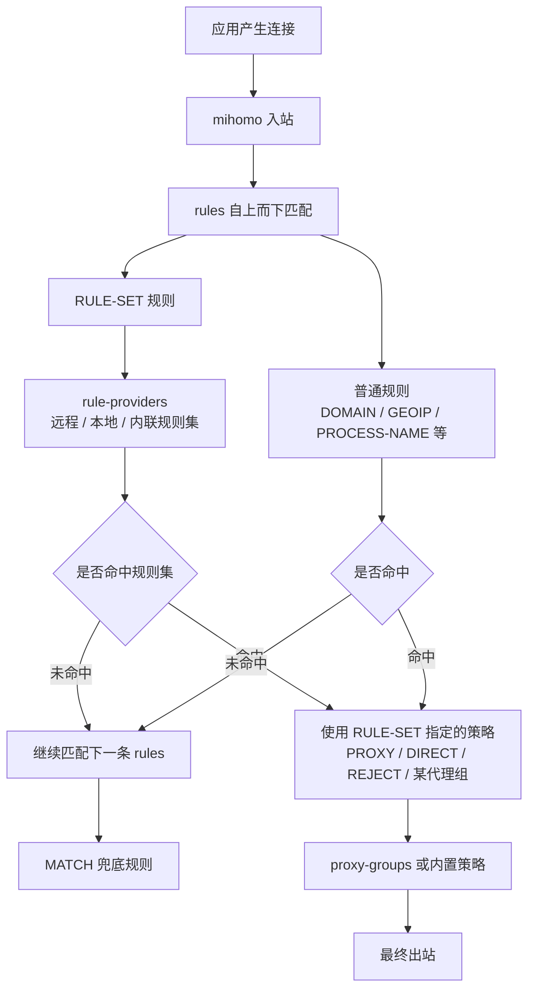
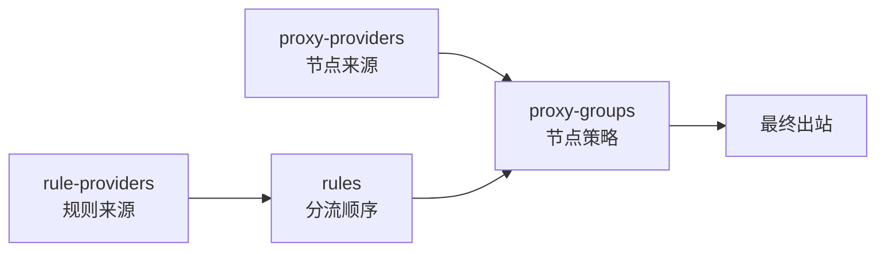

[toc]

## rule-providers

**`rule-providers` 是“规则集合来源”，用于把一大批分流规则从主配置中拆出去；`rules` 通过 `RULE-SET` 引用它。**

前面讲过：

| 配置块            | 解决的问题                       |
| ----------------- | -------------------------------- |
| `proxy-providers` | 节点从哪里来                     |
| `proxy-groups`    | 节点怎么选、怎么调度             |
| `rule-providers`  | 规则从哪里来、怎么更新           |
| `rules`           | 流量按什么顺序匹配、匹配后交给谁 |

在 mihomo 官方文档中，`RULE-SET` 是**路由规则**的一种，用来引用 `rule-providers` 中定义的规则集合；

而普通 `rules` 会按从上到下的顺序匹配，越靠上的规则优先级越高。([虚空终端](https://wiki.metacubex.one/en/config/rules/))

## 它在整体链路中的位置



可以把 `rule-providers` 理解成一个“外置规则库”。主配置里的 `rules` 不再写成几千行，而是写成：

```yaml
rules:
  - RULE-SET,private,DIRECT
  - RULE-SET,ads,REJECT
  - RULE-SET,google,Google
  - RULE-SET,telegram,Telegram
  - RULE-SET,cn,DIRECT
  - MATCH,Final
```

每个 `RULE-SET` 后面的名称，例如 `google`、`telegram`、`cn`，都要在 `rule-providers:` 里定义。

## 和 `rules` 的区别

| 对比项             | `rules`                                   | `rule-providers`                          |
| ------------------ | ----------------------------------------- | ----------------------------------------- |
| 位置               | `rules:`                                  | `rule-providers:`                         |
| 作用               | 决定流量匹配顺序和最终策略                | 提供可复用、可更新的规则集合              |
| 是否直接决定出口   | 是，例如 `DOMAIN-SUFFIX,google.com,PROXY` | 否，需要被 `RULE-SET` 引用                |
| 是否按顺序匹配     | 是，严格自上而下                          | 规则集内部由对应行为类型匹配              |
| 是否适合写大量规则 | 不适合，主配置会很长                      | 适合，大型规则集应放这里                  |
| 是否能自动更新     | `rules` 本身不能                          | `http` 类型 provider 可按 `interval` 更新 |
| 常见用途           | 组织规则优先级                            | 引入广告、国内、国外、AI、流媒体规则集    |

简单说：

```text
rule-providers 负责存规则
rules 负责用规则
```

## 和 `proxy-providers` 的区别

这两个名字很像，但作用完全不同。

| 对比项   | `proxy-providers`            | `rule-providers`                               |
| -------- | ---------------------------- | ---------------------------------------------- |
| 提供什么 | 代理节点                     | 分流规则                                       |
| 被谁引用 | `proxy-groups` 的 `use`      | `rules` 的 `RULE-SET`                          |
| 典型内容 | 节点名称、协议、服务器、端口 | 域名、IP 段、进程名、逻辑规则等                |
| 更新对象 | 订阅节点                     | 规则列表                                       |
| 典型用途 | 从机场订阅导入节点           | 从规则仓库导入广告、Google、Telegram、中国规则 |
| 最终影响 | 有哪些出口节点可选           | 哪些流量走哪个策略                             |

对应关系可以这样记：

```text
proxy-providers -> proxy-groups -> 出口节点
rule-providers  -> rules        -> 分流判断
```

## 基本配置结构

官方 `rule-providers` 支持 `http`、`file`、`inline` 三种类型；`http` 类型必须配置 `url`，`interval` 表示更新时间，单位是秒；`behavior` 可选 `domain`、`ipcidr`、`classical`；`format` 可选 `yaml`、`text`、`mrs`，默认是 `yaml`。([虚空终端](https://wiki.metacubex.one/en/config/rule-providers/))

```yaml
rule-providers:
  google:
    type: http
    behavior: domain
    format: mrs
    url: "https://raw.githubusercontent.com/MetaCubeX/meta-rules-dat/meta/geo/geosite/google.mrs"
    path: ./ruleset/google.mrs
    interval: 86400
    proxy: DIRECT

rules:
  - RULE-SET,google,Google
  - MATCH,Final
```

这个配置的含义是：

| 配置                     | 含义                                              |
| ------------------------ | ------------------------------------------------- |
| `google`                 | 规则集合名称，后面 `RULE-SET,google,...` 会引用它 |
| `type: http`             | 从远程地址下载规则集                              |
| `behavior: domain`       | 这个规则集是域名规则集                            |
| `format: mrs`            | 使用 mihomo 的二进制规则集格式                    |
| `path`                   | 下载后保存到本地的位置                            |
| `interval: 86400`        | 每 86400 秒更新一次，也就是约一天                 |
| `proxy: DIRECT`          | 下载规则集时走直连                                |
| `RULE-SET,google,Google` | 命中 google 规则集后，交给 `Google` 代理组        |

MetaCubeX 的 `meta-rules-dat` 仓库也给出了 `mrs` 规则集的示例，例如 `behavior: domain`、`format: mrs`、`path-in-bundle` 等写法。([GitHub](https://github.com/MetaCubeX/meta-rules-dat))

## `type`：规则集从哪里来

| 类型     | 说明                     | 适合场景                     |
| -------- | ------------------------ | ---------------------------- |
| `http`   | 从远程 URL 下载规则集    | 最常见，适合使用公开规则仓库 |
| `file`   | 从本地文件读取规则集     | 自己维护规则文件，或离线环境 |
| `inline` | 直接在主配置里写规则内容 | 少量自定义规则，测试规则     |

### `http` 示例

```yaml
rule-providers:
  telegram:
    type: http
    behavior: domain
    format: mrs
    url: "https://raw.githubusercontent.com/MetaCubeX/meta-rules-dat/meta/geo/geosite/telegram.mrs"
    path: ./ruleset/telegram.mrs
    interval: 86400
    proxy: PROXY
```

这里的 `proxy: PROXY` 表示下载或更新这个规则集时，通过 `PROXY` 这个代理策略下载。官方文档说明，`proxy` 字段用于指定下载或更新 provider 时使用的代理。([虚空终端](https://wiki.metacubex.one/en/config/rule-providers/))

### `file` 示例

```yaml
rule-providers:
  my-direct:
    type: file
    behavior: classical
    format: yaml
    path: ./ruleset/my-direct.yaml
```

适合自己维护本地规则，例如公司内网、家庭 NAS、私有服务。

### `inline` 示例

```yaml
rule-providers:
  my-ai:
    type: inline
    behavior: classical
    payload:
      - DOMAIN-SUFFIX,openai.com
      - DOMAIN-SUFFIX,chatgpt.com
      - DOMAIN-SUFFIX,anthropic.com

rules:
  - RULE-SET,my-ai,AI
```

`payload` 是 `type: inline` 的必需内容；`http` / `file` 也可以写 `payload`，作为下载或解析失败时的兜底。官方文档目前仍写作“仅 inline 生效”，实际实现已支持。([虚空终端](https://wiki.metacubex.one/en/config/rule-providers/))

## `behavior`：规则集是什么类型

`behavior` 是 `rule-providers` 里最重要的字段之一。它告诉 mihomo：这个规则集内部的内容应该按什么方式解释。官方文档列出的可选值是 `domain`、`ipcidr`、`classical`。([虚空终端](https://wiki.metacubex.one/en/config/rule-providers/))

| `behavior`  | 内容类型     | 典型内容                                                | 适合场景                          |
| ----------- | ------------ | ------------------------------------------------------- | --------------------------------- |
| `domain`    | 域名规则     | `google.com`、`+.google.com`                            | 网站、服务、平台域名分流          |
| `ipcidr`    | IP 段规则    | `8.8.8.0/24`、`1.1.1.1/32`                              | Telegram IP、Cloudflare IP、CN IP |
| `classical` | 经典规则语法 | `DOMAIN-SUFFIX,google.com`、`PROCESS-NAME,Telegram.exe` | 混合规则、复杂条件、进程规则      |

### `domain`

适合纯域名规则集。

```yaml
rule-providers:
  google-domain:
    type: http
    behavior: domain
    format: mrs
    url: "https://raw.githubusercontent.com/MetaCubeX/meta-rules-dat/meta/geo/geosite/google.mrs"
    path: ./ruleset/google-domain.mrs
    interval: 86400
```

对应使用：

```yaml
rules:
  - RULE-SET,google-domain,Google
```

`domain` 规则集通常比 `classical` 更适合大量域名，因为语义更单一，配置也更清晰。

### `ipcidr`

适合纯 IP 段规则集。

```yaml
rule-providers:
  telegram-ip:
    type: http
    behavior: ipcidr
    format: mrs
    url: "https://raw.githubusercontent.com/MetaCubeX/meta-rules-dat/meta/geo/geoip/telegram.mrs"
    path: ./ruleset/telegram-ip.mrs
    interval: 86400
```

对应使用：

```yaml
rules:
  - RULE-SET,telegram-ip,Telegram
```

IP 类规则有一个重要细节：如果当前请求只有域名，mihomo 在匹配目标 IP 类规则时可能需要解析域名；`no-resolve` 可用于跳过这种解析，但它只支持目标 IP 相关规则。官方文档说明，`no-resolve` 会在域名进入目标 IP 规则匹配时跳过 DNS 解析。([虚空终端](https://wiki.metacubex.one/en/config/rules/))

### `classical`

适合混合规则，语法接近普通 `rules`。

```yaml
rule-providers:
  my-classical:
    type: inline
    behavior: classical
    payload:
      - DOMAIN-SUFFIX,example.com
      - DOMAIN-KEYWORD,example
      - IP-CIDR,192.168.1.0/24,no-resolve
      - PROCESS-NAME,Telegram.exe
```

适合写复杂规则，但不建议把所有大型规则集都做成 `classical`。能拆成 `domain` 和 `ipcidr` 的规则，优先拆开，结构更清楚，也更利于维护。

## `format`：规则文件是什么格式

| `format` | 说明                    | 适合                                   |
| -------- | ----------------------- | -------------------------------------- |
| `yaml`   | YAML 格式规则集         | 可读性好，适合自己维护                 |
| `text`   | 纯文本规则集            | 简单列表，适合轻量维护                 |
| `mrs`    | mihomo 规则集二进制格式 | 大型规则集、现代配置、性能和体积更友好 |

官方文档说明，`mrs` 当前只支持 `domain` 和 `ipcidr` 两类 `behavior`，并可通过 `mihomo convert-ruleset domain/ipcidr yaml/text XXX.yaml XXX.mrs` 转换。([虚空终端](https://wiki.metacubex.one/en/config/rule-providers/))

推荐优先级：

| 场景                        | 推荐                                         |
| --------------------------- | -------------------------------------------- |
| 使用 MetaCubeX 官方规则数据 | `format: mrs`                                |
| 自己写少量规则              | `inline` + `classical`                       |
| 自己维护可读规则文件        | `format: yaml`                               |
| 从旧 Clash 规则迁移         | 视原始格式选择 `text` 或 `yaml`              |
| 路由器、手机、资源有限设备  | 优先考虑 `mrs`，并拆分为 `domain` / `ipcidr` |

## 工作流程

`rule-providers` 的实际工作过程可以理解为下面几步：

| 阶段            | mihomo 做什么                                                |
| --------------- | ------------------------------------------------------------ |
| 启动加载        | 读取 `rule-providers` 配置                                   |
| 获取规则        | `http` 下载远程规则，`file` 读取本地规则，`inline` 读取配置内 `payload` |
| 保存缓存        | `http` 下载结果保存到 `path`                                 |
| 解析规则        | 根据 `behavior` 和 `format` 解释规则内容                     |
| 等待引用        | 只有 `rules` 中出现 `RULE-SET,名称,策略` 时才会参与分流      |
| 请求到来        | `rules` 自上而下匹配                                         |
| 命中 `RULE-SET` | 去对应规则集合里查是否匹配                                   |
| 匹配成功        | 使用 `RULE-SET` 后面指定的策略                               |
| 匹配失败        | 跳过这一条，继续匹配后面的规则                               |
| 周期更新        | 到达 `interval` 后更新远程规则集                             |

例如：

```yaml
rules:
  - RULE-SET,ads,REJECT
  - RULE-SET,private,DIRECT
  - RULE-SET,google,Google
  - RULE-SET,telegram,Telegram
  - RULE-SET,cn,DIRECT
  - MATCH,Final
```

含义是：

| 顺序 | 规则       | 说明                                |
| ---- | ---------- | ----------------------------------- |
| 先   | `ads`      | 广告域名优先拦截                    |
| 再   | `private`  | 私有网络、局域网优先直连            |
| 再   | `google`   | Google 相关流量走 Google 策略组     |
| 再   | `telegram` | Telegram 相关流量走 Telegram 策略组 |
| 再   | `cn`       | 国内流量直连                        |
| 最后 | `MATCH`    | 没匹配到的流量走兜底策略            |

## 经典完整示例

下面是一个现代化、清晰、适合新手改造的结构。

```yaml
proxy-groups:
  - name: PROXY
    type: select
    proxies:
      - Auto
      - HK
      - JP
      - US
      - DIRECT

  - name: Google
    type: select
    proxies:
      - PROXY
      - HK
      - JP
      - US
      - DIRECT

  - name: Telegram
    type: select
    proxies:
      - PROXY
      - HK
      - JP
      - US
      - DIRECT

  - name: Final
    type: select
    proxies:
      - PROXY
      - DIRECT

rule-anchor:
  domain: &domain
    type: http
    behavior: domain
    format: mrs
    interval: 86400

  ip: &ip
    type: http
    behavior: ipcidr
    format: mrs
    interval: 86400

rule-providers:
  private-domain:
    <<: *domain
    url: "https://raw.githubusercontent.com/MetaCubeX/meta-rules-dat/meta/geo/geosite/private.mrs"
    path: ./ruleset/private-domain.mrs

  private-ip:
    <<: *ip
    url: "https://raw.githubusercontent.com/MetaCubeX/meta-rules-dat/meta/geo/geoip/private.mrs"
    path: ./ruleset/private-ip.mrs

  google-domain:
    <<: *domain
    url: "https://raw.githubusercontent.com/MetaCubeX/meta-rules-dat/meta/geo/geosite/google.mrs"
    path: ./ruleset/google-domain.mrs

  telegram-domain:
    <<: *domain
    url: "https://raw.githubusercontent.com/MetaCubeX/meta-rules-dat/meta/geo/geosite/telegram.mrs"
    path: ./ruleset/telegram-domain.mrs

  telegram-ip:
    <<: *ip
    url: "https://raw.githubusercontent.com/MetaCubeX/meta-rules-dat/meta/geo/geoip/telegram.mrs"
    path: ./ruleset/telegram-ip.mrs

  cn-domain:
    <<: *domain
    url: "https://raw.githubusercontent.com/MetaCubeX/meta-rules-dat/meta/geo/geosite/cn.mrs"
    path: ./ruleset/cn-domain.mrs

  cn-ip:
    <<: *ip
    url: "https://raw.githubusercontent.com/MetaCubeX/meta-rules-dat/meta/geo/geoip/cn.mrs"
    path: ./ruleset/cn-ip.mrs

rules:
  - RULE-SET,private-domain,DIRECT
  - RULE-SET,private-ip,DIRECT,no-resolve

  - RULE-SET,google-domain,Google

  - RULE-SET,telegram-domain,Telegram
  - RULE-SET,telegram-ip,Telegram

  - RULE-SET,cn-domain,DIRECT
  - RULE-SET,cn-ip,DIRECT

  - MATCH,Final
```

注意这里用了 YAML 锚点 `rule-anchor`，目的是减少重复配置。它不是 mihomo 专属功能，而是 YAML 本身的写法。

## `RULE-SET` 规则怎么写

基本格式：

```yaml
rules:
  - RULE-SET,规则集名称,策略
```

例如：

```yaml
rules:
  - RULE-SET,google-domain,Google
```

表示：如果当前请求命中 `google-domain` 这个规则集合，就交给 `Google` 这个代理组或策略。

也可以加参数，例如：

```yaml
rules:
  - RULE-SET,private-ip,DIRECT,no-resolve
```

这表示：匹配 `private-ip` 规则集，命中后走 `DIRECT`，并且对目标 IP 类规则使用 `no-resolve` 参数。`no-resolve` 的含义不是“这条规则永远不处理 IP”，而是在域名请求走到目标 IP 规则时，不主动解析域名来尝试匹配 IP 规则。([虚空终端](https://wiki.metacubex.one/en/config/rules/))

## `domain`、`ipcidr`、`classical` 如何选择

| 需求                           | 推荐 `behavior`                  | 示例                                  |
| ------------------------------ | -------------------------------- | ------------------------------------- |
| Google、YouTube、Netflix 域名  | `domain`                         | `google-domain`、`youtube-domain`     |
| Telegram、Cloudflare、CN IP 段 | `ipcidr`                         | `telegram-ip`、`cn-ip`                |
| 广告规则，且全是域名           | `domain`                         | `ads-domain`                          |
| 进程名、端口、网络类型混合判断 | `classical`                      | `PROCESS-NAME`、`DST-PORT`、`NETWORK` |
| 逻辑规则，如 `AND` / `OR`      | `classical`                      | `AND,((NETWORK,udp),(DST-PORT,443))`  |
| 大型公开规则集                 | 优先 `domain` / `ipcidr` + `mrs` | MetaCubeX meta-rules-dat              |

## 规则顺序非常重要

`rule-providers` 只是提供规则集，真正决定优先级的是 `rules` 中 `RULE-SET` 的顺序。官方路由规则文档明确说明，规则按从上到下匹配，越上面的规则优先级越高。([虚空终端](https://wiki.metacubex.one/en/config/rules/))

推荐顺序通常是：

```yaml
rules:
  # 私有网络、局域网
  - RULE-SET,private-domain,DIRECT
  - RULE-SET,private-ip,DIRECT,no-resolve

  # 明确拒绝
  - RULE-SET,ads,REJECT

  # 特殊服务
  - RULE-SET,ai,AI
  - RULE-SET,telegram-domain,Telegram
  - RULE-SET,telegram-ip,Telegram
  - RULE-SET,google-domain,Google

  # 国内直连
  - RULE-SET,cn-domain,DIRECT
  - RULE-SET,cn-ip,DIRECT

  # 兜底
  - MATCH,Final
```

常见思路是：**越具体、越需要优先处理的规则越靠前；越宽泛的规则越靠后。**

例如广告拦截通常应该放在普通代理规则前面，否则某些广告域名可能先被 Google、国内或国外规则命中，导致没有进入 `REJECT`。

## 常见坑

| 问题                 | 原因                                               | 解决                                                         |
| -------------------- | -------------------------------------------------- | ------------------------------------------------------------ |
| `RULE-SET` 不生效    | `rules` 中引用的名称和 `rule-providers` 名称不一致 | 检查大小写、连字符、下划线                                   |
| 规则集下载失败       | `url` 不通，或下载需要代理                         | 给 provider 设置合适的 `proxy`                               |
| 配置能启动但匹配异常 | `behavior` 和实际文件格式不匹配                    | 域名规则用 `domain`，IP 段用 `ipcidr`，混合规则用 `classical` |
| `mrs` 规则加载失败   | `mrs` 不支持 `classical`                           | `mrs` 只用于 `domain` / `ipcidr`                             |
| IP 规则没按预期命中  | 加了 `no-resolve` 后域名请求不会解析成 IP 再匹配   | 按需求决定是否使用 `no-resolve`                              |
| 主配置太长           | 把大量规则直接写进 `rules`                         | 改用 `rule-providers`                                        |
| 规则更新太频繁       | `interval` 设置过短                                | 大多数规则集一天更新一次即可                                 |
| 规则顺序混乱         | 宽泛规则放太前                                     | 私有、广告、特殊服务、国内、兜底依次组织                     |

## 最佳实践

| 场景             | 建议                                                         |
| ---------------- | ------------------------------------------------------------ |
| 新手配置         | 先用公开 `mrs` 规则集，不要一开始手写大量规则                |
| 域名规则         | 优先 `behavior: domain`                                      |
| IP 段规则        | 优先 `behavior: ipcidr`                                      |
| 复杂混合规则     | 才使用 `behavior: classical`                                 |
| 大型规则集       | 优先 `format: mrs`                                           |
| 自定义少量规则   | 使用 `type: inline`                                          |
| 自己长期维护规则 | 使用 `type: file` 或托管到 GitHub 后用 `http`                |
| 规则下载不稳定   | 给 `rule-provider` 设置 `proxy`                              |
| 资源有限设备     | 减少大型 `classical` 规则集，优先使用拆分后的 `domain` / `ipcidr` |
| 排错             | 临时把关键规则前移，并观察日志或面板连接详情                 |

## 规则和代理工作流合




对应一句话：

```text
proxy-providers 提供节点
proxy-groups 组织节点
rule-providers 提供规则
rules 使用规则并决定流量交给哪个策略
```

所以，`rule-providers` 不是代理组，也不是节点订阅，而是“规则订阅”或“规则库”。它的核心价值是让你的主配置保持简洁，同时让分流规则可以自动更新、复用和分层维护。

规则集的更新排期（`interval` 的启动判定与失败退避）、`proxy` 失效时的表现、缓存文件位置与手动触发方式，见 [mihomo@订阅和规则集的自动更新@interval与手动触发@状态核验](./mihomo@订阅和规则集的自动更新@interval与手动触发@状态核验.md)。