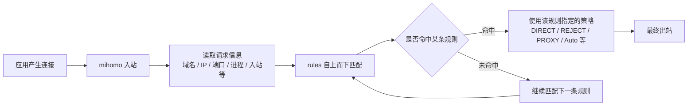

[toc]


## 路由规则rule

在 mihomo 中，**路由规则**写在 `rules:` 下，用来判断“某个连接应该交给哪个策略处理”。

这个策略可以是内置策略，例如 `DIRECT`、`REJECT`，也可以是你在 `proxy-groups` 中定义的代理组，例如 `PROXY`、`Auto`、`Google`、`Final`。

官方示例中，规则可以写成 `DOMAIN,ad.com,REJECT`、`DOMAIN-SUFFIX,google.com,auto`、`GEOIP,CN,DIRECT`、`RULE-SET,providername,proxy`、`MATCH,auto` 等形式。([虚空终端](https://wiki.metacubex.one/config/rules/))



## 规则的基本格式

大多数规则可以理解为：

```yaml
rules:
  - 规则类型,匹配内容,策略(代理组)
```

带附加参数时：

```yaml
rules:
  - 规则类型,匹配内容,策略,附加参数
```

例如：

```yaml
rules:
  - DOMAIN,example.com,DIRECT
  - DOMAIN-SUFFIX,google.com,PROXY
  - IP-CIDR,127.0.0.0/8,DIRECT,no-resolve
  - GEOIP,CN,DIRECT
  - MATCH,Final
```

| 部分     | 含义                           | 示例                                |
| -------- | ------------------------------ | ----------------------------------- |
| 规则类型 | 用什么维度判断连接             | `DOMAIN`、`GEOIP`、`PROCESS-NAME`   |
| 匹配内容 | 要匹配的域名、IP、端口、进程等 | `google.com`、`CN`、`443`           |
| 策略     | 命中后交给谁处理               | `DIRECT`、`REJECT`、`PROXY`、`Auto` |
| 附加参数 | 改变部分规则的匹配行为         | `no-resolve`、`src`                 |

官方文档明确说明，规则按照从上到下的顺序匹配，越靠上的规则优先级越高。([虚空终端](https://wiki.metacubex.one/config/rules/))

## 优先级是理解路由规则的核心

`rules` 不是“全部匹配后再选最合适的”，而是**从上到下，命中即采用**。因此，规则顺序非常重要。([虚空终端](https://wiki.metacubex.one/config/rules/))

例如：

```yaml
rules:
  - DOMAIN-SUFFIX,google.com,DIRECT
  - DOMAIN-SUFFIX,google.com,PROXY
  - MATCH,Final
```

这里 `google.com` 会走 `DIRECT`，因为第一条已经命中，第二条不会再被使用。

更合理的组织思路通常是：

```yaml
rules:
  # 私有网络、局域网优先
  - IP-CIDR,192.168.0.0/16,DIRECT,no-resolve
  - IP-CIDR,10.0.0.0/8,DIRECT,no-resolve

  # 广告或拒绝类规则优先
  - DOMAIN-SUFFIX,ads.example.com,REJECT

  # 特定服务
  - DOMAIN-SUFFIX,openai.com,AI
  - DOMAIN-SUFFIX,google.com,Google

  # 国内直连
  - GEOIP,CN,DIRECT

  # 兜底
  - MATCH,Final
```

## 常见规则类型总览

| 类型大类     | 规则类型                                                     | 匹配对象                    | 常见用途                     |
| ------------ | ------------------------------------------------------------ | --------------------------- | ---------------------------- |
| 域名规则     | `DOMAIN`、`DOMAIN-SUFFIX`、`DOMAIN-KEYWORD`、`DOMAIN-WILDCARD`、`DOMAIN-REGEX`、`GEOSITE` | 目标域名                    | 网站、平台、服务分流         |
| 目标 IP 规则 | `IP-CIDR`、`IP-CIDR6`、`IP-SUFFIX`、`IP-ASN`、`GEOIP`        | 目标 IP                     | 国内外 IP、局域网、ASN 分流  |
| 来源 IP 规则 | `SRC-GEOIP`、`SRC-IP-ASN`、`SRC-IP-CIDR`、`SRC-IP-SUFFIX`    | 来源 IP                     | 局域网多设备、网关分流       |
| 端口规则     | `DST-PORT`、`SRC-PORT`                                       | 目标端口或来源端口          | 按服务端口分流               |
| 入站规则     | `IN-PORT`、`IN-TYPE`、`IN-USER`、`IN-NAME`                   | mihomo 入站信息             | 多入口、多用户、多监听器分流 |
| 进程规则     | `PROCESS-PATH`、`PROCESS-NAME` 及其通配符/正则变体           | 本机进程                    | 按应用分流                   |
| 系统与网络   | `UID`、`NETWORK`、`DSCP`                                     | 用户 ID、TCP/UDP、DSCP 标记 | Linux、UDP、tproxy 特殊场景  |
| 规则集合     | `RULE-SET`                                                   | `rule-providers` 中的规则集 | 引入外部规则集               |
| 逻辑规则     | `AND`、`OR`、`NOT`                                           | 多条件组合                  | 复杂判断                     |
| 子规则       | `SUB-RULE`                                                   | 跳转到子规则                | 复杂规则结构复用             |
| 兜底规则     | `MATCH`                                                      | 所有请求                    | 最后一条兜底                 |

## 域名规则

域名规则是最常用的一类，适合处理网站、平台、服务名。

| 规则              | 含义                      | 示例                                 |
| ----------------- | ------------------------- | ------------------------------------ |
| `DOMAIN`          | 匹配完整域名              | `DOMAIN,www.example.com,PROXY`       |
| `DOMAIN-SUFFIX`   | 匹配域名后缀              | `DOMAIN-SUFFIX,google.com,PROXY`     |
| `DOMAIN-KEYWORD`  | 匹配域名关键字            | `DOMAIN-KEYWORD,google,PROXY`        |
| `DOMAIN-WILDCARD` | 使用通配符匹配域名        | `DOMAIN-WILDCARD,*.google.com,PROXY` |
| `DOMAIN-REGEX`    | 使用正则匹配域名          | `DOMAIN-REGEX,^abc.*com,PROXY`       |
| `GEOSITE`         | 匹配 Geosite 内的域名集合 | `GEOSITE,youtube,PROXY`              |

`DOMAIN-SUFFIX,google.com` 可以匹配 `www.google.com`、`mail.google.com` 和 `google.com`，但不会匹配 `content-google.com`。([虚空终端](https://wiki.metacubex.one/config/rules/))

`DOMAIN-WILDCARD` 只支持 `*` 和 `?`，其中 `*` 表示零个或多个字符，`?` 表示一个字符；文档特别提醒，这里的通配符和配置文件其他地方的 Clash 格式通配符不同。([虚空终端](https://wiki.metacubex.one/config/rules/))

### 使用建议

| 需求                   | 推荐规则                |
| ---------------------- | ----------------------- |
| 精确匹配一个域名       | `DOMAIN`                |
| 匹配一个网站及其子域名 | `DOMAIN-SUFFIX`         |
| 临时粗略匹配关键词     | `DOMAIN-KEYWORD`        |
| 有明确通配模式         | `DOMAIN-WILDCARD`       |
| 非常复杂的域名模式     | `DOMAIN-REGEX`          |
| 使用大型规则库         | `GEOSITE` 或 `RULE-SET` |

新手优先使用 `DOMAIN-SUFFIX`。它直观、稳定，也最常见。

## 目标 IP 规则

目标 IP 规则用于匹配“请求要访问的 IP”。

| 规则        | 含义                           | 示例                                       |
| ----------- | ------------------------------ | ------------------------------------------ |
| `IP-CIDR`   | 匹配 IP 地址范围               | `IP-CIDR,192.168.0.0/16,DIRECT,no-resolve` |
| `IP-CIDR6`  | IPv6 CIDR 规则                 | `IP-CIDR6,2620:0:2d0:200::7/32,PROXY`      |
| `IP-SUFFIX` | 匹配 IP 后缀范围               | `IP-SUFFIX,8.8.8.8/24,PROXY`               |
| `IP-ASN`    | 匹配目标 IP 所属 ASN           | `IP-ASN,13335,DIRECT`                      |
| `GEOIP`     | 匹配目标 IP 所属国家或地区代码 | `GEOIP,CN,DIRECT`                          |

官方文档说明，`IP-CIDR` 和 `IP-CIDR6` 效果相同，`IP-CIDR6` 只是一个别名。([虚空终端](https://wiki.metacubex.one/config/rules/))

常见写法：

```yaml
rules:
  - IP-CIDR,127.0.0.0/8,DIRECT,no-resolve
  - IP-CIDR,10.0.0.0/8,DIRECT,no-resolve
  - IP-CIDR,172.16.0.0/12,DIRECT,no-resolve
  - IP-CIDR,192.168.0.0/16,DIRECT,no-resolve
  - GEOIP,CN,DIRECT
```

## 来源 IP 规则

来源 IP 规则用于匹配“连接来自哪里”。这类规则在网关、软路由、多设备共享环境中很有用。

| 规则            | 含义                     | 示例                                   |
| --------------- | ------------------------ | -------------------------------------- |
| `SRC-GEOIP`     | 匹配来源 IP 所属国家代码 | `SRC-GEOIP,cn,DIRECT`                  |
| `SRC-IP-ASN`    | 匹配来源 IP 所属 ASN     | `SRC-IP-ASN,9808,DIRECT`               |
| `SRC-IP-CIDR`   | 匹配来源 IP 地址范围     | `SRC-IP-CIDR,192.168.1.201/32,DIRECT`  |
| `SRC-IP-SUFFIX` | 匹配来源 IP 后缀范围     | `SRC-IP-SUFFIX,192.168.1.201/8,DIRECT` |

来源 IP 规则适合这种场景：

```yaml
rules:
  # 让某台设备全部直连
  - SRC-IP-CIDR,192.168.1.10/32,DIRECT

  # 让另一台设备全部走代理
  - SRC-IP-CIDR,192.168.1.20/32,PROXY

  - MATCH,Final
```

## 端口规则

端口规则分为目标端口和来源端口。

| 规则       | 含义             | 示例                   |
| ---------- | ---------------- | ---------------------- |
| `DST-PORT` | 匹配请求目标端口 | `DST-PORT,443,PROXY`   |
| `SRC-PORT` | 匹配请求来源端口 | `SRC-PORT,7777,DIRECT` |

官方文档说明，`DST-PORT` 匹配请求目标端口，`SRC-PORT` 匹配请求来源端口，并且端口位置支持端口范围。([虚空终端](https://wiki.metacubex.one/config/rules/))

常见用途：

```yaml
rules:
  - DST-PORT,22,DIRECT
  - DST-PORT,80/443,PROXY
  - MATCH,Final
```

端口规则要谨慎使用，因为很多服务都共享 `443`，仅靠端口通常不能准确区分网站或应用。

## 入站规则

入站规则根据“连接从 mihomo 的哪个入口进来”进行匹配。

| 规则      | 含义           | 示例                       |
| --------- | -------------- | -------------------------- |
| `IN-PORT` | 匹配入站端口   | `IN-PORT,7890,PROXY`       |
| `IN-TYPE` | 匹配入站类型   | `IN-TYPE,SOCKS/HTTP,PROXY` |
| `IN-USER` | 匹配入站用户名 | `IN-USER,mihomo,PROXY`     |
| `IN-NAME` | 匹配入站名称   | `IN-NAME,ss,PROXY`         |

`IN-USER` 支持使用 `/` 分隔多个用户名；`IN-TYPE` 用于匹配入站类型。([虚空终端](https://wiki.metacubex.one/config/rules/))

适合多入口配置，例如：

```yaml
rules:
  # 从 7890 端口进来的流量走常规代理
  - IN-PORT,7890,PROXY

  # 从特殊入站进来的流量走专用代理组
  - IN-NAME,work-in,Work

  - MATCH,Final
```

## 进程规则

进程规则根据本机应用匹配流量，常用于桌面系统和部分移动平台。

| 规则                    | 含义                   | 示例                                      |
| ----------------------- | ---------------------- | ----------------------------------------- |
| `PROCESS-PATH`          | 使用完整进程路径匹配   | `PROCESS-PATH,/usr/bin/wget,PROXY`        |
| `PROCESS-PATH-WILDCARD` | 使用进程路径通配符匹配 | `PROCESS-PATH-WILDCARD,/usr/*/wget,PROXY` |
| `PROCESS-PATH-REGEX`    | 使用进程路径正则匹配   | `PROCESS-PATH-REGEX,.*bin/wget,PROXY`     |
| `PROCESS-NAME`          | 使用进程名匹配         | `PROCESS-NAME,curl,PROXY`                 |
| `PROCESS-NAME-WILDCARD` | 使用进程名通配符匹配   | `PROCESS-NAME-WILDCARD,*telegram*,PROXY`  |
| `PROCESS-NAME-REGEX`    | 使用进程名正则匹配     | `PROCESS-NAME-REGEX,(?i)Telegram,PROXY`   |

官方文档说明，`PROCESS-NAME` 在 Android 平台可以匹配包名，`PROCESS-NAME-WILDCARD` 和 `PROCESS-NAME-REGEX` 在 Android 平台也可以匹配包名。([虚空终端](https://wiki.metacubex.one/config/rules/))

示例：

```yaml
rules:
  - PROCESS-NAME,Telegram.exe,Telegram
  - PROCESS-NAME,chrome.exe,PROXY
  - PROCESS-NAME,curl,DIRECT
  - MATCH,Final
```

进程规则的实用性很强，但可移植性不如域名规则。Windows、macOS、Linux、Android 的进程名和路径可能不同。

## 网络类型、UID、DSCP

| 规则      | 含义                | 适合场景               |
| --------- | ------------------- | ---------------------- |
| `UID`     | 匹配 Linux User ID  | Linux 多用户或服务隔离 |
| `NETWORK` | 匹配 `tcp` 或 `udp` | UDP 特殊处理           |
| `DSCP`    | 匹配 DSCP 标记      | tproxy UDP 入站        |

官方文档说明，`UID` 匹配 Linux User ID，`NETWORK` 匹配 `tcp` 或 `udp`，`DSCP` 匹配 DSCP 标记且仅限 tproxy UDP 入站。([虚空终端](https://wiki.metacubex.one/config/rules/))

示例：

```yaml
rules:
  - NETWORK,udp,DIRECT
  - UID,1001,DIRECT
  - MATCH,Final
```

文档还特别提到：如果请求是 UDP，而代理节点没有 UDP 支持，例如 Shadowsocks 节点没有写 `udp: true`，则会继续向下匹配。([虚空终端](https://wiki.metacubex.one/config/rules/))

## `RULE-SET`：引用规则集合

`RULE-SET` 用于引用 `rule-providers` 中定义的规则集合。官方文档说明，`RULE-SET` 需要配置 `rule-providers`。([虚空终端](https://wiki.metacubex.one/config/rules/))

示例：

```yaml
rule-providers:
  google:
    type: http
    behavior: domain
    format: mrs
    url: "https://example.com/google.mrs"
    path: ./ruleset/google.mrs
    interval: 86400

rules:
  - RULE-SET,google,Google
  - MATCH,Final
```

含义是：如果请求命中 `google` 这个规则集合，就交给 `Google` 策略组处理。

`RULE-SET` 适合大型规则集，例如广告、Google、Telegram、YouTube、国内域名、国内 IP 等。主配置只保留引用关系，具体规则放到 `rule-providers` 管理。

## 逻辑规则：`AND`、`OR`、`NOT`

逻辑规则可以组合多个条件。官方文档给出的格式是：

```yaml
LOGIC_TYPE,((payload1),(payload2)),Proxy
```

其中 `payload1`、`payload2` 是规则类型和对应内容，例如 `DOMAIN,google.com`。文档提醒，逻辑规则需要注意括号的使用。([虚空终端](https://wiki.metacubex.one/config/rules/))

示例：

```yaml
rules:
  # 域名是 baidu.com 且网络类型是 UDP 时直连
  - AND,((DOMAIN,baidu.com),(NETWORK,UDP)),DIRECT

  # 网络类型是 UDP 或域名是 baidu.com 时拒绝
  - OR,((NETWORK,UDP),(DOMAIN,baidu.com)),REJECT

  # 不是 baidu.com 的流量走代理
  - NOT,((DOMAIN,baidu.com)),PROXY
```

逻辑规则适合高级用法。新手不建议一开始大量使用，否则排错难度会明显增加。

## `SUB-RULE`：进入子规则

`SUB-RULE` 用于匹配到子规则，并且同样需要注意括号。官方示例中有 `SUB-RULE,(NETWORK,tcp),sub-rule` 这种写法。([虚空终端](https://wiki.metacubex.one/config/rules/))

可以把它理解成“当满足某个条件时，跳转到另一组规则继续处理”。适合复杂分流配置，例如不同入站、不同设备、不同网络类型使用不同规则树。

普通新手配置可以先不使用 `SUB-RULE`，等规则规模变大后再考虑。

## `MATCH`：兜底规则

`MATCH` 匹配所有请求，不需要条件。([虚空终端](https://wiki.metacubex.one/config/rules/))

通常放在最后：

```yaml
rules:
  - DOMAIN-SUFFIX,google.com,PROXY
  - GEOIP,CN,DIRECT
  - MATCH,Final
```

如果没有 `MATCH`，某些未命中的流量可能无法按你的预期处理。因此实际配置中一般都会保留一条兜底规则。

## 附加参数 `no-resolve`

`no-resolve` 只支持关于目标 IP 的规则。官方说明：当域名请求开始匹配目标 IP 规则时，mihomo 会触发 DNS 解析来检查该域名的目标 IP 是否匹配规则；使用 `no-resolve` 可以跳过这个 DNS 解析。([虚空终端](https://wiki.metacubex.one/config/rules/))

典型写法：

```yaml
rules:
  - IP-CIDR,127.0.0.0/8,DIRECT,no-resolve
  - IP-CIDR,192.168.0.0/16,DIRECT,no-resolve
  - GEOIP,CN,DIRECT
  - MATCH,Final
```

需要注意：如果在更早的匹配过程中已经触发过 DNS 解析，那么即使后面的目标 IP 类规则添加了 `no-resolve`，依然可能匹配到。([虚空终端](https://wiki.metacubex.one/config/rules/))

### 什么时候使用 `no-resolve`

| 场景                                        | 是否建议        |
| ------------------------------------------- | --------------- |
| 私有 IP、局域网 IP 规则                     | 建议            |
| 目标已经是 IP 的规则                        | 建议            |
| 不希望规则匹配阶段触发 DNS                  | 建议            |
| 需要通过解析域名后再判断 IP 国家或 ASN      | 不建议          |
| `GEOIP,CN,DIRECT` 想覆盖域名解析后的国内 IP | 视 DNS 策略而定 |

## 附加参数 `src`

`src` 也只支持关于目标 IP 的规则。官方文档说明，它会把“目标 IP 匹配”转为“来源 IP 匹配”。([虚空终端](https://wiki.metacubex.one/config/rules/))

这类参数相对高级，常见于网关、透明代理、复杂网络环境。普通单机配置一般很少需要。

## 经典新手配置结构

下面是一个相对清晰的模板：

```yaml
proxy-groups:
  - name: PROXY
    type: select
    proxies:
      - Auto
      - DIRECT

  - name: Auto
    type: url-test
    use:
      - main
    url: https://www.gstatic.com/generate_204
    interval: 300

  - name: Final
    type: select
    proxies:
      - PROXY
      - DIRECT

rules:
  # 局域网和本机地址
  - IP-CIDR,127.0.0.0/8,DIRECT,no-resolve
  - IP-CIDR,10.0.0.0/8,DIRECT,no-resolve
  - IP-CIDR,172.16.0.0/12,DIRECT,no-resolve
  - IP-CIDR,192.168.0.0/16,DIRECT,no-resolve

  # 自定义直连
  - DOMAIN-SUFFIX,local,DIRECT
  - DOMAIN-SUFFIX,lan,DIRECT

  # 自定义代理
  - DOMAIN-SUFFIX,google.com,PROXY
  - DOMAIN-SUFFIX,youtube.com,PROXY
  - DOMAIN-SUFFIX,github.com,PROXY

  # 国内 IP 直连
  - GEOIP,CN,DIRECT

  # 兜底
  - MATCH,Final
```

## 使用 `RULE-SET` 的现代配置结构

当规则变多后，建议把大型规则迁移到 `rule-providers`，主配置只保留分流逻辑：

```yaml
rule-providers:
  private:
    type: http
    behavior: ipcidr
    format: mrs
    url: "https://example.com/private.mrs"
    path: ./ruleset/private.mrs
    interval: 86400

  google:
    type: http
    behavior: domain
    format: mrs
    url: "https://example.com/google.mrs"
    path: ./ruleset/google.mrs
    interval: 86400

  cn:
    type: http
    behavior: domain
    format: mrs
    url: "https://example.com/cn.mrs"
    path: ./ruleset/cn.mrs
    interval: 86400

rules:
  - RULE-SET,private,DIRECT,no-resolve
  - RULE-SET,google,Google
  - RULE-SET,cn,DIRECT
  - GEOIP,CN,DIRECT
  - MATCH,Final
```

这种结构更适合长期维护。`rules` 负责表达优先级，`rule-providers` 负责提供大量规则内容。

## 推荐规则顺序

| 顺序 | 类型                   | 原因                                  |
| ---- | ---------------------- | ------------------------------------- |
| 最前 | 私有网络、本机、局域网 | 避免内网流量误走代理                  |
| 靠前 | 广告、拒绝类规则       | 尽早拦截，避免被其他规则命中          |
| 靠前 | 特定服务规则           | 例如 AI、Telegram、Google、流媒体     |
| 中间 | 自定义规则             | 你明确知道要直连或代理的域名          |
| 靠后 | 国内规则               | `GEOSITE,CN`、`GEOIP,CN` 等较宽泛规则 |
| 最后 | `MATCH`                | 兜底所有未命中请求                    |

这样组织的依据是：mihomo 规则按从上到下匹配，顶部规则优先级高于底部规则。([虚空终端](https://wiki.metacubex.one/config/rules/))

## 常见错误和排查

| 现象                        | 可能原因                             | 处理方式                              |
| --------------------------- | ------------------------------------ | ------------------------------------- |
| 规则不生效                  | 被上面的规则提前命中                 | 把更具体的规则放到更上面              |
| `MATCH` 后面的规则无效      | `MATCH` 匹配所有请求                 | `MATCH` 必须放最后                    |
| 国内网站走代理              | 国内规则太靠后，或前面被域名规则命中 | 检查顺序和命中日志                    |
| Google 没走代理             | `DOMAIN` 只匹配完整域名              | 改用 `DOMAIN-SUFFIX,google.com,PROXY` |
| 某些 UDP 连接没按预期走代理 | 节点不支持 UDP 时会继续向下匹配      | 检查节点是否开启 UDP 支持             |
| IP 规则触发了 DNS           | 目标是域名，匹配 IP 规则时可能解析   | 对不需要解析的 IP 规则加 `no-resolve` |
| 进程规则不匹配              | 进程名或路径和系统实际不一致         | 查看系统进程名，优先用简单规则测试    |
| `RULE-SET` 不命中           | provider 名称、格式或 behavior 错误  | 检查 `rule-providers` 配置和日志      |
| 正则规则异常                | 转义或表达式写错                     | 先用简单规则替代，确认逻辑后再改正则  |

## 新手学习路线

先掌握四类规则就足够开始使用：

| 阶段 | 重点                                         |
| ---- | -------------------------------------------- |
| 入门 | `DOMAIN-SUFFIX`、`IP-CIDR`、`GEOIP`、`MATCH` |
| 进阶 | `RULE-SET`、`PROCESS-NAME`、`DST-PORT`       |
| 高级 | `AND`、`OR`、`NOT`、`SUB-RULE`、`src`        |
| 优化 | `no-resolve`、规则顺序、规则集合拆分         |

最推荐的理解方式是：

1. rules 不是“规则数据库”，而是“分流决策流程”
2. 越靠前的规则越先判断
3. 一旦命中，就把连接交给指定策略
4. 最后用 MATCH 兜底

## 简洁总结

`rules` 是 mihomo 分流系统的核心。域名规则解决“哪个网站”，IP 规则解决“哪个地址段”，来源规则解决“哪个设备”，端口规则解决“哪个服务端口”，进程规则解决“哪个应用”，`RULE-SET` 解决“大量规则如何复用和更新”，`MATCH` 负责最终兜底。

实际配置时，优先保证三件事：**规则顺序正确、具体规则靠前、`MATCH` 放最后**。