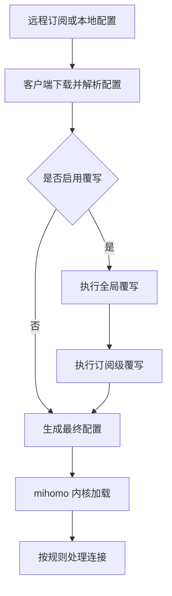

[toc]

## mihomo 客户端的覆写：系统入门与实践指南

这里的“覆写”可以理解为：**不直接修改订阅原文件，而是在客户端加载订阅后，对配置做一层可重复、可维护的二次加工**。

> 这样订阅更新后，你的自定义规则、DNS、代理组、TUN、端口等修改仍然能保留。Mihomo Party/Clash Party 文档明确把覆写定义为“**对订阅配置进行自定义修改，并在更新订阅后依然生效**”的功能，支持全局启用或指定订阅启用，并支持 YAML 与 JavaScript 两类覆写文件(mihomo-party)。

需要先区分一个关键点：**mihomo 内核本身读取的是最终配置文件**;

**“覆写”通常是客户端或订阅管理工具提供的预处理能力**。

例如 Clash Verge Rev 叫“配置文件管理和增强”，提供 Merge 和 Script；Mihomo Party/Clash Party 叫“覆写”；YumeBox 则采用 JSON 覆写并提供 `-start`、`-end`、`-merge`、`-force` 等修饰符。([Clash Verge](https://www.clashverge.dev/))

------

## 覆写解决什么问题

很多新手最常见的问题是：订阅一更新，自己手改的规则、代理组、DNS 全没了。**覆写的价值就是把“机场订阅”与“个人偏好”分离。**

| 问题                         | 直接改订阅配置           | 使用覆写                     |
| ---------------------------- | ------------------------ | ---------------------------- |
| 订阅更新后自定义规则是否保留 | 通常会丢失               | 通常保留                     |
| 是否容易回滚                 | 不容易，可能忘记改了哪里 | 容易，禁用覆写即可           |
| 是否便于多订阅复用           | 不方便                   | 全局覆写可复用               |
| 是否适合复杂逻辑             | YAML 不方便              | JavaScript/脚本更适合        |
| 风险                         | 容易把订阅文件改坏       | 风险集中在覆写文件，便于排查 |

更准确地说，覆写不是“替代订阅”，而是“给订阅套一层个人配置补丁”。

------

## 覆写的工作机制



从流程上看，订阅只是“原始材料”，覆写才是你的“个人加工层”。客户端把两者合成最终配置后，mihomo 内核才开始工作。

------

## 常见客户端中的覆写形态

| 客户端或工具               | 常见名称                               | 主要形式                         | 适合场景                           |
| -------------------------- | -------------------------------------- | -------------------------------- | ---------------------------------- |
| Mihomo Party / Clash Party | 覆写                                   | YAML、JavaScript                 | 修改订阅配置、添加规则、定制代理组 |
| Clash Verge Rev            | 扩展配置 / 扩展脚本，或 Merge / Script | YAML 类扩展配置、JavaScript 脚本 | 桌面端精细化配置、脚本化处理       |
| YumeBox                    | 覆写                                   | JSON 加修饰符                    | Android 端结构化覆写               |
| Sub-Store                  | 覆写 / 脚本处理                        | JavaScript、模板、组合订阅       | 多订阅聚合、节点重命名、规则生成   |

Clash Verge Rev 文档说明其内置 Clash.Meta/mihomo 内核，并支持配置文件增强，也就是 Merge 和 Script；其自定义脚本文档还说明脚本入口是 `main(config)`，脚本接收配置对象并返回修改后的配置对象。([Clash Verge](https://www.clashverge.dev/))

------

## 覆写的核心对象

mihomo 配置很大，但新手学习覆写时优先掌握这些区域就够了。

| 配置区域 | 常见字段                                          | 覆写用途                             |
| -------- | ------------------------------------------------- | ------------------------------------ |
| 基础运行 | `mode`、`log-level`、`mixed-port`、`allow-lan`    | 设置运行模式、日志、端口、局域网访问 |
| DNS      | `dns`、`nameserver`、`fallback`、`fake-ip-filter` | 解决解析、分流、污染、局域网域名问题 |
| 域名嗅探 | `sniffer`                                         | 处理纯 IP、SNI、HTTP Host 还原域名   |
| TUN      | `tun`                                             | 接管不走系统代理的软件流量           |
| 节点     | `proxies`、`proxy-providers`                      | 添加节点或引用远程节点集             |
| 代理组   | `proxy-groups`                                    | 创建手动选择、自动测速、故障转移组   |
| 规则     | `rules`、`rule-providers`                         | 控制哪些网站直连、代理、拒绝         |
| 状态保存 | `profile.store-selected`、`profile.store-fake-ip` | 保存代理组选择与 Fake-IP 映射        |

YumeBox 的覆写字段清单覆盖了全局配置、DNS、Sniffer、入站、TUN、出站与规则等区域，并列出 `rules`、`proxy-groups`、`rule-providers`、`proxy-providers` 等关键字段。([YumeBox](https://yumebox.mintlify.app/override/fields))

------

## YAML、JSON、JavaScript 覆写怎么选

| 形式            | 优点                                           | 缺点                               | 适合新手吗             |
| --------------- | ---------------------------------------------- | ---------------------------------- | ---------------------- |
| YAML 覆写       | 直观，和 mihomo 配置长得一样                   | 数组合并规则可能因客户端不同而不同 | 适合简单字段           |
| JSON 覆写       | 结构明确，可配合修饰符控制追加、合并、强制替换 | 依赖客户端支持                     | 适合移动端和结构化配置 |
| JavaScript 覆写 | 最灵活，可判断订阅名、筛选节点、前插规则       | 写错容易导致配置不可用             | 适合进阶               |

新手建议：**先用 YAML/JSON 做小范围修改；涉及规则前插、节点筛选、按订阅名判断时，再用 JavaScript**。

------

## 覆写中的合并逻辑

不同客户端合并规则不同，但可以先掌握这些通用概念。

| 操作     | 含义               | 典型用途                             |
| -------- | ------------------ | ------------------------------------ |
| 赋值     | 直接设置字段值     | `mode: rule`、`mixed-port: 7890`     |
| 递归合并 | 合并对象内部字段   | 修改 `dns.enable`，保留其他 DNS 字段 |
| 列表前插 | 加到数组开头       | 添加高优先级规则                     |
| 列表后插 | 加到数组末尾       | 添加兜底规则或低优先级规则           |
| 强制替换 | 整个对象或数组替换 | 完全重写 DNS 或代理组                |

YumeBox 文档明确给出 `-start` 表示添加到列表开头，`-end` 表示添加到列表末尾，`-merge` 表示合并键值对，`-force` 表示强制替换整个对象；无修饰符时，简单值直接赋值，对象递归合并。([YumeBox](https://yumebox.mintlify.app/override/fields))

------

## 规则覆写是最常见场景

mihomo 的路由规则按从上到下匹配，越靠前优先级越高；匹配到规则后通常就使用该规则指定的策略。官方路由规则文档明确说明，规则从上到下匹配，顶部规则优先级高于下方规则。([虚空终端](https://wiki.metacubex.one/en/config/rules/))

所以，“我想让某个网站直连/代理/拒绝”这类需求，**通常应该把规则插入到前面**。

### 常见规则类型

| 规则             | 作用             | 示例                                       |
| ---------------- | ---------------- | ------------------------------------------ |
| `DOMAIN`         | 完整域名匹配     | `DOMAIN,www.example.com,DIRECT`            |
| `DOMAIN-SUFFIX`  | 域名后缀匹配     | `DOMAIN-SUFFIX,example.com,DIRECT`         |
| `DOMAIN-KEYWORD` | 域名关键词匹配   | `DOMAIN-KEYWORD,google,PROXY`              |
| `GEOSITE`        | 按域名集合匹配   | `GEOSITE,youtube,PROXY`                    |
| `IP-CIDR`        | 按 IP 段匹配     | `IP-CIDR,192.168.0.0/16,DIRECT,no-resolve` |
| `GEOIP`          | 按 IP 地理库匹配 | `GEOIP,CN,DIRECT`                          |
| `PROCESS-NAME`   | 按进程名匹配     | `PROCESS-NAME,Telegram.exe,PROXY`          |
| `RULE-SET`       | 引用规则集       | `RULE-SET,openai,AI`                       |
| `MATCH`          | 兜底匹配         | `MATCH,PROXY`                              |

mihomo 官方文档列出了 `DOMAIN`、`DOMAIN-SUFFIX`、`GEOSITE`、`IP-CIDR`、`GEOIP`、`PROCESS-NAME`、`RULE-SET`、`MATCH` 等规则类型，并说明 `MATCH` 会匹配所有未被前面规则处理的请求。([虚空终端](https://wiki.metacubex.one/en/config/rules/))

------

## 规则顺序的基本原则

| 顺序   | 推荐放什么                             | 原因               |
| ------ | -------------------------------------- | ------------------ |
| 最前面 | 私有域名、局域网、特殊服务修正规则     | 避免被大规则集误伤 |
| 靠前   | 广告、隐私、特定网站分流               | 需要高优先级       |
| 中间   | 流媒体、AI、开发者服务、游戏平台       | 业务类分流         |
| 靠后   | `GEOSITE,cn,DIRECT`、`GEOIP,CN,DIRECT` | 常规国内直连       |
| 最后   | `MATCH,代理组` 或 `MATCH,DIRECT`       | 兜底               |

Clash Verge Rev 的自定义规则文档也建议将自定义规则放在前置规则，因为规则按从上到下匹配，前置规则能确保自定义配置优先生效。([Clash Verge](https://www.clashverge.dev/guide/rules.html))

------

## 示例：用 JavaScript 前插规则

适合 Clash Verge Rev 的扩展脚本，或者支持 JavaScript 覆写的客户端。

```javascript
function main(config) {
  const prependRules = [
    "DOMAIN-SUFFIX,example.com,DIRECT",
    "DOMAIN-SUFFIX,openai.com,AI",
    "DOMAIN-SUFFIX,github.com,PROXY"
  ];

  config.rules = prependRules.concat(config.rules || []);
  return config;
}
```

这个思路来自 Clash Verge Rev 文档中的脚本模型：脚本通过 `main(config)` 接收配置对象，修改后返回；其示例也使用新规则数组与旧规则数组拼接，实现规则前插。([Clash Verge](https://www.clashverge.dev/guide/script.html))

------

## 示例：用 JSON 修饰符前插规则

适合支持 `rules-start` 这类修饰符的客户端，例如 YumeBox 风格。

```json
{
  "rules-start": [
    "DOMAIN-SUFFIX,example.com,DIRECT",
    "DOMAIN-SUFFIX,openai.com,AI",
    "DOMAIN-SUFFIX,github.com,PROXY"
  ]
}
```

这里的关键不是 JSON 本身，而是 `rules-start` 这个字段名表示“添加到 `rules` 列表开头”。YumeBox 文档示例中也使用了 `rules-start` 和 `hosts-merge` 这类写法。([YumeBox](https://yumebox.mintlify.app/override/fields))

------

## 代理组覆写

代理组决定“命中规则后，最终走哪个节点或节点集合”。

| 代理组类型     | 作用           | 常见用途               |
| -------------- | -------------- | ---------------------- |
| `select`       | 手动选择       | 主策略组、AI、流媒体   |
| `url-test`     | 自动测速选最快 | 自动选择低延迟节点     |
| `fallback`     | 故障转移       | 主节点不可用时自动切换 |
| `load-balance` | 负载均衡       | 多节点分摊连接         |
| `relay`        | 链式代理       | 前置代理、落地代理组合 |

代理组字段中，`name` 和 `type` 是必需的；`proxies` 可引用节点或其他代理组，`use` 可引用代理提供者；健康检查常用 `url`、`interval`、`lazy`、`timeout` 等字段。([虚空终端](https://wiki.metacubex.one/en/config/proxy-groups/))

### 示例：创建一个自动测速组

```yaml
proxy-groups:
  - name: 自动选择
    type: url-test
    include-all: true
    filter: "(香港|HK|日本|JP|新加坡|SG|美国|US)"
    exclude-filter: "(官网|流量|剩余|过期|倍率)"
    url: https://www.gstatic.com/generate_204
    interval: 300
    timeout: 3000
```

`include-all` 可以包含所有出站代理和代理提供者中的节点；`filter` 与 `exclude-filter` 可按关键字或正则筛选节点。mihomo 代理组文档说明，`include-all` 会包含所有出站代理和代理集，`filter` 可筛选满足关键字或正则的节点，`exclude-filter` 可排除匹配节点。([虚空终端](https://wiki.metacubex.one/en/config/proxy-groups/))

------

## DNS 覆写

DNS 是 mihomo 配置中最容易“看似能用，实际分流异常”的部分。新手不建议一开始就照抄复杂 DNS 模板，应该先理解几个概念。

| 字段                      | 作用                   | 新手建议                              |
| ------------------------- | ---------------------- | ------------------------------------- |
| `dns.enable`              | 是否启用 mihomo DNS    | TUN 或 fake-ip 场景通常需要           |
| `enhanced-mode`           | 增强模式，如 `fake-ip` | 桌面 TUN 常见使用 fake-ip             |
| `nameserver`              | 默认 DNS               | 用可靠 DNS，避免过多混杂              |
| `fallback`                | 回退 DNS               | 复杂场景再配置                        |
| `nameserver-policy`       | 指定域名走指定 DNS     | 适合精细分流                          |
| `proxy-server-nameserver` | 专门解析代理节点域名   | 节点域名解析异常时很关键              |
| `respect-rules`           | DNS 连接遵循路由规则   | 要配合 `proxy-server-nameserver` 使用 |

mihomo DNS 文档说明，`proxy-server-nameserver` 专门用于解析代理节点域名；如果留空，会跟随 `nameserver-policy`、`nameserver`、`fallback` 等配置。文档还说明 `respect-rules` 会让 DNS 连接遵循路由规则，但需要配置 `proxy-server-nameserver`，并且不强烈建议与 `prefer-h3` 同时使用。([虚空终端](https://wiki.metacubex.one/en/config/dns/))

### 示例：保守 DNS 覆写

```yaml
dns:
  enable: true
  listen: 0.0.0.0:1053
  ipv6: false
  enhanced-mode: fake-ip
  fake-ip-range: 198.18.0.1/16
  default-nameserver:
    - 223.5.5.5
    - 119.29.29.29
  nameserver:
    - https://dns.alidns.com/dns-query
    - https://doh.pub/dns-query
  proxy-server-nameserver:
    - https://dns.alidns.com/dns-query
    - https://doh.pub/dns-query
  fake-ip-filter:
    - "+.lan"
    - "+.local"
    - "localhost.ptlogin2.qq.com"
```

mihomo 语法文档说明配置文件使用 YAML，YAML 对缩进敏感，不允许使用 Tab；数组可用多行 `-` 形式或单行 JSON 数组形式。([虚空终端](https://wiki.metacubex.one/en/handbook/syntax/))

------

## Fake-IP 与 fake-ip-filter

`fake-ip` 的核心思想是：DNS 查询时不一定返回真实 IP，而是返回一个保留地址段里的“假 IP”，mihomo 再通过映射关系知道这个连接原本访问的是哪个域名。这样做对 TUN、透明代理、域名分流很有帮助。

但某些服务不适合 fake-ip，例如局域网设备、部分登录服务、投屏、游戏、银行客户端、某些 IoT 设备。这时要用 `fake-ip-filter` 排除。

```yaml
dns:
  fake-ip-filter:
    - "+.lan"
    - "+.local"
    - "time.*.com"
    - "ntp.*.com"
    - "localhost.ptlogin2.qq.com"
```

mihomo 的通配符语法里，`+.` 类似域名后缀匹配，可以匹配多级域名并包含根域本身；`.` 可以匹配多级子域但不包含根域；文档也提醒通配符内容建议加引号。([虚空终端](https://wiki.metacubex.one/en/handbook/syntax/))

------

## rule-providers 覆写

当规则很多时，不建议把几百几千条规则直接写进 `rules`，更推荐使用 `rule-providers`。

```yaml
rule-providers:
  openai:
    type: http
    behavior: classical
    format: yaml
    path: ./rules/openai.yaml
    url: https://example.com/openai.yaml
    interval: 86400

rules:
  - RULE-SET,openai,AI
  - MATCH,PROXY
```

`rule-providers` 支持 `http`、`file`、`inline` 类型；`behavior` 可选 `domain`、`ipcidr`、`classical`，需要和规则集文件格式对应；`format` 可选 `yaml`、`text`、`mrs`。([虚空终端](https://wiki.metacubex.one/en/config/rule-providers/))

------

## TUN 覆写

系统代理只能处理“愿意读取系统代理设置”的程序，而 TUN 是通过虚拟网卡接管流量，能覆盖更多应用场景。Clash Verge Rev 文档解释，系统代理依赖应用主动读取代理设置，而 TUN 会创建虚拟网卡，通过系统路由把流量重定向给代理程序，因此可处理不支持系统代理的程序和 UDP 流量。([Clash Verge](https://www.clashverge.dev/guide/term.html))

### 示例：基础 TUN 配置

```yaml
tun:
  enable: true
  stack: mixed
  auto-route: true
  auto-detect-interface: true
  strict-route: false
  dns-hijack:
    - any:53
```

| 字段                    | 说明             | 建议                                 |
| ----------------------- | ---------------- | ------------------------------------ |
| `enable`                | 是否启用 TUN     | 新手先在客户端界面启用，不急着覆写   |
| `stack`                 | TUN 协议栈       | 常见值有 `system`、`gvisor`、`mixed` |
| `auto-route`            | 自动配置路由     | 桌面端常用                           |
| `auto-detect-interface` | 自动检测出口网卡 | 网络切换频繁时有用                   |
| `dns-hijack`            | 劫持 DNS 请求    | TUN 配合 DNS 常用                    |

YumeBox 覆写字段清单列出了 `tun.enable`、`tun.stack`、`tun.auto-route`、`tun.auto-detect-interface`、`tun.strict-route`、`tun.dns-hijack` 等 TUN 相关字段。([YumeBox](https://yumebox.mintlify.app/override/fields))

------

## Sniffer 覆写

Sniffer 可以从连接中嗅探域名，例如从 TLS SNI 或 HTTP Host 中还原目标域名。它常用于 TUN、透明代理、纯 IP 连接场景，帮助 mihomo 使用域名规则分流。

```yaml
sniffer:
  enable: true
  force-dns-mapping: true
  parse-pure-ip: true
  override-destination: true
  sniff:
    HTTP:
      ports: [80, 8080-8880]
    TLS:
      ports: [443, 8443]
    QUIC:
      ports: [443, 8443]
  skip-domain:
    - "+.lan"
    - "+.local"
```

Sniffer 覆写要谨慎。`override-destination` 可能改变连接目标，某些应用可能因此异常；局域网、投屏、游戏、银行、企业内网服务建议加入跳过列表。YumeBox 字段清单列出了 `sniffer.enable`、`force-dns-mapping`、`parse-pure-ip`、`override-destination`、`force-domain`、`skip-domain` 等字段。([YumeBox](https://yumebox.mintlify.app/override/fields))

------

## 完整示例：新手友好的个人覆写思路

这个示例展示“轻量但实用”的覆写结构：保留订阅节点，只增加规则、DNS、状态保存和基础运行参数。

```yaml
mode: rule
log-level: info
mixed-port: 7890
allow-lan: false
ipv6: false
unified-delay: true
tcp-concurrent: true

profile:
  store-selected: true
  store-fake-ip: true

dns:
  enable: true
  listen: 0.0.0.0:1053
  ipv6: false
  enhanced-mode: fake-ip
  fake-ip-range: 198.18.0.1/16
  default-nameserver:
    - 223.5.5.5
    - 119.29.29.29
  nameserver:
    - https://dns.alidns.com/dns-query
    - https://doh.pub/dns-query
  proxy-server-nameserver:
    - https://dns.alidns.com/dns-query
    - https://doh.pub/dns-query
  fake-ip-filter:
    - "+.lan"
    - "+.local"
    - "localhost.ptlogin2.qq.com"

rules:
  - DOMAIN-SUFFIX,example.com,DIRECT
  - DOMAIN-SUFFIX,github.com,PROXY
  - GEOSITE,category-ads-all,REJECT
  - GEOSITE,cn,DIRECT
  - GEOIP,CN,DIRECT,no-resolve
  - MATCH,PROXY
```

注意：这个 YAML 示例假设你的客户端会按你期望的方式合并字段。若你要“把规则插到订阅规则最前面”，更稳妥的做法是使用客户端明确支持的前插机制，例如 `rules-start`，或用 JavaScript `prependRules.concat(config.rules || [])`。

------

## JavaScript 覆写的典型用途

### 按订阅名应用不同规则

```javascript
function main(config, profileName) {
  if (profileName === "工作订阅") {
    const workRules = [
      "DOMAIN-SUFFIX,company.internal,DIRECT",
      "DOMAIN-SUFFIX,gitlab.company.com,DIRECT"
    ];
    config.rules = workRules.concat(config.rules || []);
  }

  return config;
}
```

Clash Verge Rev 文档说明，脚本入口可以是 `main(config, profileName)`，其中 `profileName` 是当前处理的配置文件名；这适合“不同订阅启用不同修改”的场景。([Clash Verge](https://www.clashverge.dev/guide/script.html))

### 删除不想要的节点

```javascript
function main(config) {
  const proxies = config.proxies || [];

  config.proxies = proxies.filter((proxy) => {
    const name = proxy.name || "";
    return !/(官网|流量|剩余|过期|倍率|重置)/.test(name);
  });

  return config;
}
```

### 自动给规则补兜底

```javascript
function main(config) {
  config.rules = config.rules || [];

  const hasMatch = config.rules.some((rule) => rule.startsWith("MATCH,"));
  if (!hasMatch) {
    config.rules.push("MATCH,PROXY");
  }

  return config;
}
```

Clash Verge Rev 的脚本文档说明，其脚本使用 JavaScript，并由 `boa_engine` 执行；支持常见对象、数组、正则、JSON、Math、console 等 API，但不支持网络 IO 和文件 IO。([Clash Verge](https://www.clashverge.dev/guide/script.html))

------

## 最佳实践

### 把覆写拆小

不要把所有东西写进一个巨大文件。推荐按用途拆分：

| 覆写文件   | 内容                            |
| ---------- | ------------------------------- |
| 基础覆写   | 端口、日志、模式、状态保存      |
| DNS 覆写   | DNS、fake-ip、nameserver-policy |
| 规则覆写   | 自定义规则、规则集              |
| 代理组覆写 | 自动选择、流媒体、AI、游戏      |
| TUN 覆写   | TUN、DNS 劫持、路由排除         |
| 实验覆写   | 临时测试配置                    |

这样某个模块出问题时，可以单独禁用。

### 优先使用前置规则处理个人需求

如果你要让某个域名一定直连或一定代理，放在订阅规则之后可能无效，因为前面已有规则可能已经匹配。规则系统的核心是“从上到下，先匹配先执行”。([虚空终端](https://wiki.metacubex.one/en/config/rules/))

### 不要盲目重写 DNS

DNS 配置最容易导致“网页打不开、部分 App 异常、节点解析失败、局域网设备找不到”。新手建议只做必要修改，尤其不要同时堆很多 DoH、fallback、policy、respect-rules、prefer-h3。mihomo 文档特别指出 `respect-rules` 需要配合 `proxy-server-nameserver`，且不强烈建议与 `prefer-h3` 同时使用。([虚空终端](https://wiki.metacubex.one/en/config/dns/))

### 慎用强制替换

`-force` 或整体替换适合“我完全知道这个对象应该长什么样”的场景。新手不建议强制替换 `dns`、`proxy-groups`、`rules` 这类大对象，因为容易把订阅原有结构覆盖掉。

### 保留可观测性

建议保持：

```yaml
log-level: info
```

排错时临时改成：

```yaml
log-level: debug
```

但不要长期 debug，因为日志量大，也可能影响性能。

### 给代理组取稳定名称

规则里引用的是策略名，例如：

```yaml
- DOMAIN-SUFFIX,openai.com,AI
```

那么必须存在名为 `AI` 的代理组或策略。代理组名称改了，规则也要同步改。代理组文档也说明 `name` 是代理组必需字段，特殊字符建议加引号。([虚空终端](https://wiki.metacubex.one/en/config/proxy-groups/))

### 订阅节点名称不稳定时，少写死节点名

机场可能改节点名。与其写：

```yaml
proxies:
  - 香港 01
  - 香港 02
```

不如用：

```yaml
include-all: true
filter: "(香港|HK)"
```

`include-all`、`filter`、`exclude-filter` 能减少节点名变化带来的维护成本。([虚空终端](https://wiki.metacubex.one/en/config/proxy-groups/))

------

## 常见错误与排查

| 现象                  | 可能原因                                  | 排查方法                               |
| --------------------- | ----------------------------------------- | -------------------------------------- |
| 覆写保存后无法启动    | YAML 缩进、冒号、引号错误                 | 用编辑器格式化，检查 Tab               |
| 自定义规则不生效      | 规则放太后，被前面规则命中                | 改为前置规则                           |
| 规则引用的策略不存在  | 代理组名称写错                            | 检查 `proxy-groups.name`               |
| DNS 异常              | fake-ip、fallback、respect-rules 配置冲突 | 先恢复简单 DNS                         |
| 局域网设备打不开      | fake-ip 或 sniffer 误处理                 | 加入 `fake-ip-filter` 或 `skip-domain` |
| TUN 开启后断网        | 路由、DNS 劫持、权限问题                  | 先关闭 TUN，仅用系统代理测试           |
| JavaScript 覆写无效   | 没有 `return config`                      | 检查入口函数                           |
| 订阅更新后规则没了    | 改的是最终配置，不是覆写                  | 把修改迁移到覆写文件                   |
| 部分 UDP 应用不走代理 | 节点或代理组不支持 UDP                    | 检查节点 `udp` 能力和规则              |

YAML 本身对缩进敏感，mihomo 语法文档也明确说明 YAML 不允许 Tab，只允许空格，并通过缩进表达层级关系。([虚空终端](https://wiki.metacubex.one/en/handbook/syntax/))

------

## 新手学习路线

| 阶段 | 目标                | 练习                          |
| ---- | ------------------- | ----------------------------- |
| 入门 | 理解覆写是配置补丁  | 修改 `mode`、`log-level`      |
| 基础 | 学会加前置规则      | 指定一个域名直连              |
| 进阶 | 理解代理组          | 建一个 `AI` 或 `流媒体` 组    |
| 进阶 | 理解 DNS            | 配置 `fake-ip-filter`         |
| 高级 | 使用 rule-providers | 引入外部规则集                |
| 高级 | 使用 JavaScript     | 按订阅名或节点名动态处理      |
| 熟练 | 模块化维护          | 拆分基础、DNS、规则、TUN 覆写 |

------

## 推荐的个人配置策略

对大多数新手，我建议采用这个策略：

| 配置部分   | 建议                             |
| ---------- | -------------------------------- |
| 订阅       | 尽量保持原样，不直接手改         |
| 规则       | 用覆写前插少量个人规则           |
| DNS        | 从简单配置开始，出问题再逐步增强 |
| 代理组     | 先使用订阅自带组，再逐步自建     |
| TUN        | 系统代理稳定后再开               |
| JavaScript | 只在 YAML/JSON 做不到时使用      |
| 备份       | 每次大改前复制一份覆写文件       |

**订阅负责提供节点，覆写负责表达你的使用偏好。**
真正稳定的 mihomo 使用体验，不是靠复制一个巨大配置，而是逐步建立一套自己能理解、能排错、能维护的**覆写层**。