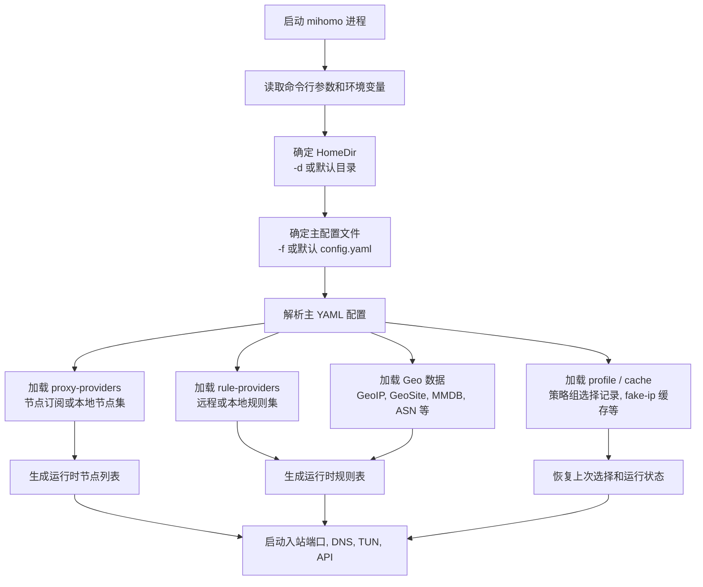
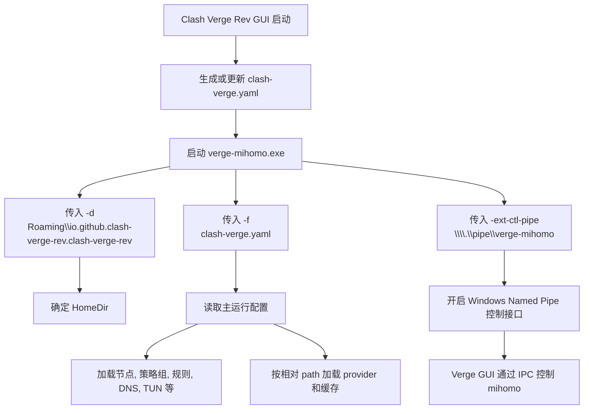

[toc]


## abstract

mihomo运行涉及哪些配置?配置文件有哪些层面?分别配置什么以及配置读取机制和要求.

mihomo 运行时不是只读一个“订阅文件”。它真正涉及的是一整套配置链路：

- 启动参数决定 mihomo 去哪里找配置，
- 主 YAML 决定运行行为，
- **Provider 文件补充节点和规则**，
- Geo / 缓存 / profile 文件提供运行时数据，
- GUI 客户端还可能在启动前生成一个“合并后的运行配置”

```shell

 ps *mihomo*|select Id,Name,ProcessName,Path,CommandLine,StartTime

Id          : 20288
Name        : verge-mihomo
ProcessName : verge-mihomo
Path        : C:\scoop\apps\clash-verge-rev\2.5.1\verge-mihomo.exe
CommandLine : "\\?\C:\scoop\apps\clash-verge-rev\2.5.1\verge-mihomo.exe" -d C:\Users\<user>\AppData\Roamin
              g\io.github.clash-verge-rev.clash-verge-rev -f C:\Users\<user>\AppData\Roaming\io.github.cla
              sh-verge-rev.clash-verge-rev\clash-verge.yaml -ext-ctl-pipe \\.\pipe\verge-mihomo
StartTime   : 2026/7/8 17:16:26
```

这个真实案例里，mihomo 并不是在读默认的 `~/.config/mihomo/config.yaml`，而是在被 Clash Verge Rev 调用(通过`-f`选项更改了读取路径)，读取 Verge 生成的：

```text
C:\Users\<user>\AppData\Roaming\io.github.clash-verge-rev.clash-verge-rev\clash-verge.yaml
```

并且通过 Windows Named Pipe：

```text
\\.\pipe\verge-mihomo
```

让 Verge 图形界面控制 mihomo 内核。这会以合适的选项启动mihomo.

本例的`commandline`逐段看就是：

| 字段                                  | 含义                        | 对你这个案例的解释                                           |
| ------------------------------------- | --------------------------- | ------------------------------------------------------------ |
| `verge-mihomo.exe`                    | mihomo 内核可执行文件       | 它被 Clash Verge Rev 打包并改名为 `verge-mihomo.exe`         |
| `-d ...`                              | 指定 HomeDir / 配置工作目录 | 后续**相对路径、缓存、provider 文件**大多围绕这个目录展开    |
| `-f ...\clash-verge.yaml`             | 指定主配置文件              | 真正被 mihomo 解析的运行配置是这个 YAML                      |
| `-ext-ctl-pipe \\.\pipe\verge-mihomo` | 覆盖外部控制器管道地址      | GUI 通过 Windows Named Pipe 控制 mihomo，而不一定暴露普通 HTTP API |
| `\\?\C:\...`                          | Windows 扩展路径前缀        | 只是 Windows 路径写法，避免传统路径长度等限制，不影响 mihomo 配置逻辑 |

mihomo 源码里确实把 `-d` 定义为配置目录，把 `-f` 定义为配置文件，还支持 `-ext-ctl`、`-ext-ctl-unix`、`-ext-ctl-pipe`、`-secret`、`-t` 等启动参数；这些参数也可以从相应环境变量读取默认值。([GitHub](https://github.com/MetaCubeX/mihomo/blob/Alpha/main.go))

> 在mihomo的图形客户端中可以方便地管理多个"订阅"(包括本地配置文件).
>
> 但是同一时刻只有一个订阅能被选中生效.并且切换订阅时,客户端读取的配置文件(例如`clash-verge.yaml`中的内容会随着订阅切换而发生变化.)
>
> 事实上,如果启用外部控制(使用web方式作为mihomo后台时,后台看到的订阅只有一个(当前正在使用的订阅),客户端添加过的其他订阅是不可见的.)

如果是命令行用户,在没有指定自定义配置文件(工作目录)的情况下,第一次启动也会提示找不到配置文件,会自动创建文件.

```shell
# opcxxu @ OP-XCX in ~/.config [15:33:53] C:130
$ mihomo   
INFO[2026-07-09T15:33:58.197098277+08:00] Can't find config, create a initial config file 
INFO[2026-07-09T15:33:58.197263138+08:00] Start initial configuration in progress      
INFO[2026-07-09T15:33:58.198483323+08:00] Geodata Loader mode: memconservative         
INFO[2026-07-09T15:33:58.198508248+08:00] Geosite Matcher implementation: succinct     
INFO[2026-07-09T15:33:58.199202443+08:00] Initial configuration complete, total time: 1ms 
INFO[2026-07-09T15:33:58.206395430+08:00] Sniffer is closed                            
INFO[2026-07-09T15:33:58.221082114+08:00] Mixed(http+socks) proxy listening at: 127.0.0.1:7890 
INFO[2026-07-09T15:33:58.222147863+08:00] Start initial compatible provider default    
^CWARN[2026-07-09T15:33:59.838648442+08:00] Mihomo shutting down 
```


## 配置读取的大逻辑

mihomo 的读取顺序可以这样理解：



也就是说，`-d` 和 `-f` 不是配置内容本身，但它们决定了“配置从哪里读、相对路径从哪里算”(配置文件的路径不变但是配置文件的内容可能被客户端修改,例如在更换订阅的时候发生变化)。

> 在同一个订阅内切换节点不会引起配置文件内容变化.

## 启动参数层

启动参数是最外层，它在 YAML 之前生效。mihomo 源码显示，`-d` 会设置 HomeDir；如果 `-f` 是相对路径，则会先转成绝对路径；如果没有 `-f`，就会使用 HomeDir 下的默认配置文件。源码还显示，`-config` 可以传入 base64 配置，`-f -` 可以从标准输入读取配置，`-t` 会测试配置并退出。([GitHub](https://github.com/MetaCubeX/mihomo/blob/Alpha/main.go))

常见启动方式对比一下就清楚了：

| 启动方式                                     | HomeDir               | 主配置文件                | 常见场景           |
| -------------------------------------------- | --------------------- | ------------------------- | ------------------ |
| `mihomo`                                     | 默认目录              | 默认 `config.yaml`        | 手工运行           |
| `mihomo -d /etc/mihomo`                      | `/etc/mihomo`         | `/etc/mihomo/config.yaml` | Linux 服务         |
| `mihomo -d D:\mihomo -f D:\mihomo\test.yaml` | `D:\mihomo`           | `D:\mihomo\test.yaml`     | 多配置测试         |
| `mihomo -t -d /etc/mihomo`                   | `/etc/mihomo`         | `/etc/mihomo/config.yaml` | 检查配置           |
| 你的 Verge 案例                              | Verge 的 Roaming 目录 | `clash-verge.yaml`        | GUI 生成并启动内核 |

这里有一个容易混淆的点：**`-d` 不是配置文件，`-f` 才是配置文件。** `-d` 更像“运行根目录”或“工作目录”。

## HomeDir 层

HomeDir 是 mihomo 的配置根目录。默认情况下，源码注释写的是类 Unix 系统用 `$HOME/.config/mihomo`，Windows 用 `%USERPROFILE%/.config/mihomo`；也支持通过 `XDG_CONFIG_HOME` 改变默认配置根目录。([GitHub](https://github.com/MetaCubeX/mihomo/blob/Alpha/constant/path.go))

但你的命令行里明确写了：

```text
-d C:\Users\<user>\AppData\Roaming\io.github.clash-verge-rev.clash-verge-rev
```

所以这次运行时，HomeDir 就是：

```text
C:\Users\<user>\AppData\Roaming\io.github.clash-verge-rev.clash-verge-rev
```

这会影响很多东西。比如 YAML 里如果写：

```yaml
proxy-providers:
  sub1:
    type: http
    path: ./proxy_providers/sub1.yaml
```

这个 `./proxy_providers/sub1.yaml` 实际会落在：

```text
C:\Users\<user>\AppData\Roaming\io.github.clash-verge-rev.clash-verge-rev\proxy_providers\sub1.yaml
```

rule-provider、Geo 文件、UI 文件、缓存文件也是类似逻辑。官方文档也说明，provider 的 `path` 出于安全原因会限制在 HomeDir 内，除非额外设置 `SAFE_PATHS`。([虚空终端](https://wiki.metacubex.one/en/config/proxy-providers/))

## 主配置 YAML 层

主配置就是 `-f` 指向的 YAML。在你这里是：

```text
clash-verge.yaml
```

而不是普通教程里常说的：

```text
config.yaml
```

这个文件通常不是你手写的完整 mihomo 配置，而是 Clash Verge Rev 根据用户界面设置、订阅、规则、覆写脚本、Merge 配置等内容生成出来的“运行态配置”。所以排错时要分清两种文件：

| 文件类型                  | 谁维护               | 作用                                |
| ------------------------- | -------------------- | ----------------------------------- |
| 用户订阅 / Profile        | 用户或机场订阅提供   | 提供原始节点、规则结构              |
| Verge 设置                | GUI 保存             | 控制系统代理、TUN、端口、增强设置等 |
| Merge / Script / Override | 用户或客户端         | 修改、合并、覆盖原始订阅            |
| `clash-verge.yaml`        | Clash Verge Rev 生成 | 最终交给 mihomo 内核读取的运行配置  |
| mihomo 实际内存配置       | mihomo 解析后生成    | 运行时真正使用的配置对象            |

所以你不能只看订阅文件判断 mihomo 实际运行状态。**要看 `CommandLine` 里的 `-f` 指向谁，就检查谁。**

## 主 YAML 里有哪些配置层面

主配置文件可以分成这些层面。

| 层面          | 代表字段                                                     | 主要配置什么                                          |
| ------------- | ------------------------------------------------------------ | ----------------------------------------------------- |
| 基础运行层    | `mode`、`log-level`、`ipv6`、`allow-lan`、`bind-address`     | 控制运行模式、日志、IPv6、局域网访问                  |
| 入站层        | `port`、`socks-port`、`mixed-port`、`redir-port`、`tproxy-port`、`listeners`、`tun` | 流量从哪里进入 mihomo                                 |
| DNS 层        | `dns`、`hosts`                                               | 域名如何解析、是否 fake-ip、节点域名用什么 DNS        |
| 嗅探层        | `sniffer`                                                    | 是否从 TLS / HTTP / QUIC 流量中识别域名               |
| 出站节点层    | `proxies`                                                    | 手写节点，例如 ss、vmess、vless、trojan、hysteria2 等 |
| 节点订阅层    | `proxy-providers`                                            | 从远程订阅或本地文件加载节点                          |
| 策略组层      | `proxy-groups`                                               | 手动选节点、自动测速、故障切换、负载均衡              |
| 规则层        | `rules`                                                      | 判断某个请求走哪个策略组或节点                        |
| 规则集层      | `rule-providers`                                             | 远程或本地规则集，供 `RULE-SET` 引用                  |
| API / 面板层  | `external-controller`、`external-controller-pipe`、`external-ui`、`secret` | 提供控制接口和 Web 面板                               |
| 缓存 / 状态层 | `profile`、`store-selected`、`store-fake-ip`                 | 保存策略组选择、fake-ip 映射等运行状态                |
| Geo 数据层    | `geox-url`、`geo-auto-update`、`geosite-matcher`             | GeoIP、GeoSite、MMDB 等数据来源和更新                 |
| 高级系统层    | `interface-name`、`routing-mark`、`tcp-concurrent`、`keep-alive`、`experimental` | 出口网卡、路由标记、连接优化和实验功能                |

官方通用配置文档把 `allow-lan`、运行模式、日志等级、IPv6、外部控制器、外部 UI、缓存、TCP 并发、出口网卡、Geo 数据等都归在 General configuration 里；其中 `mode` 可选 `rule`、`global`、`direct`，默认是 `rule`。([虚空终端](https://wiki.metacubex.one/en/config/general/))

## 入站配置：流量从哪里进来

最常见的是：

```yaml
mixed-port: 7890
```

它表示在本机开一个混合代理端口，HTTP 和 SOCKS 都可以从这个端口进来。官方示例配置里也把 `port`、`socks-port`、`mixed-port`、`redir-port`、`tproxy-port` 作为不同入站入口示例，其中 `mixed-port` 是 HTTP(S) 和 SOCKS 混合端口。([GitHub](https://raw.githubusercontent.com/MetaCubeX/mihomo/Alpha/docs/config.yaml))

如果 GUI 开了 TUN，配置里还会出现类似：

```yaml
tun:
  enable: true
  stack: mixed
  auto-route: true
  dns-hijack:
    - any:53
```

入站层决定的是“应用流量如何进入 mihomo”。如果你只是浏览器手动代理，`mixed-port` 就够。如果要全局接管系统流量，就会涉及 TUN、路由表、DNS 劫持、防火墙规则。

## DNS 配置：域名如何解析

DNS 是 mihomo 配置里最容易出问题的部分。它不仅影响访问速度，还影响规则匹配。比如域名请求是走 `DOMAIN-SUFFIX` 规则，还是先解析成 IP 再走 `GEOIP`，结果可能完全不同。

常见结构是：

```yaml
dns:
  enable: true
  enhanced-mode: fake-ip
  fake-ip-range: 198.18.0.1/16
  default-nameserver:
    - 223.5.5.5
  nameserver:
    - https://dns.alidns.com/dns-query
  proxy-server-nameserver:
    - https://dns.alidns.com/dns-query
```

这里面有几个关键点。`default-nameserver` 用于解析 DNS 服务器本身的域名，官方要求它必须是 IP，也可以是加密 DNS；`nameserver` 是默认域名解析服务器；`nameserver-policy` 可以给特定域名指定 DNS；`proxy-server-nameserver` 专门用于解析代理节点服务器域名，如果不填就会跟随其他 DNS 配置。([虚空终端](https://wiki.metacubex.one/en/config/dns/))

对你这种 GUI 案例来说，很多“节点全超时”“订阅能更新但节点连不上”“打开某些网站规则不对”的问题，最后都可能落到 DNS 层。

## 出站节点和节点订阅

节点有两种来源，一种是直接写在 `proxies`：

```yaml
proxies:
  - name: "node-a"
    type: ss
    server: example.com
    port: 443
    cipher: chacha20-ietf-poly1305
    password: "password"
```

另一种是写在 `proxy-providers`，让 mihomo 从远程订阅或本地文件加载：

```yaml
proxy-providers:
  provider1:
    type: http
    url: "https://example.com/sub.yaml"
    path: ./proxy_providers/provider1.yaml
    interval: 3600
    proxy: DIRECT
    health-check:
      enable: true
      url: https://www.gstatic.com/generate_204
      interval: 300
```

官方文档说明，`proxy-providers` 支持 `http`、`file`、`inline`，`http` 类型必须配置 URL，`path` 是本地缓存路径，`interval` 是更新时间，`proxy` 表示通过哪个代理下载或更新。([虚空终端](https://wiki.metacubex.one/en/config/proxy-providers/))

在 Clash Verge Rev 里，你导入的订阅通常会被 GUI 转换、合并，最后出现在 `clash-verge.yaml` 里。它可能直接展开成 `proxies`，也可能保留成 `proxy-providers`，取决于客户端处理方式和配置来源。

## 策略组：节点怎么被选择

策略组是 mihomo 里最核心的一层。节点只是“出口”，策略组决定“怎么选出口”。

常见写法：

```yaml
proxy-groups:
  - name: "PROXY"
    type: select
    proxies:
      - "AUTO"
      - "DIRECT"

  - name: "AUTO"
    type: url-test
    use:
      - provider1
    url: https://www.gstatic.com/generate_204
    interval: 300
```

`select` 是手动选择，`url-test` 是自动测速，`fallback` 是故障切换，`load-balance` 是负载均衡。官方文档说明，`proxy-groups` 的 `proxies` 可以引用出站节点或其他策略组，`use` 可以引用 proxy-provider，`url` 和 `interval` 用于健康检查。([虚空终端](https://wiki.metacubex.one/en/config/proxy-groups/))

你在 Verge 里点“选择节点”，本质上通常就是在改某个 `select` 策略组的当前选择。GUI 不一定直接改 YAML 文件，而可能通过 API / IPC 告诉 mihomo：“把这个策略组选到某个节点”。

## 规则和规则集：流量走向怎么判断

规则层负责判断某个请求走哪个策略组。典型写法：

```yaml
rules:
  - DOMAIN-SUFFIX,google.com,PROXY
  - GEOIP,CN,DIRECT
  - MATCH,PROXY
```

官方规则文档明确说，规则按从上到下顺序匹配，上面的优先级高；规则类型包括 `DOMAIN`、`DOMAIN-SUFFIX`、`DOMAIN-KEYWORD`、`GEOSITE`、`IP-CIDR`、`GEOIP`、`PROCESS-NAME`、`RULE-SET`、`MATCH` 等。([虚空终端](https://wiki.metacubex.one/en/config/rules/))

规则集则是把大量规则放到外部文件：

```yaml
rule-providers:
  cn:
    type: http
    behavior: classical
    format: yaml
    path: ./rule_providers/cn.yaml
    url: "https://example.com/cn.yaml"
    interval: 86400

rules:
  - RULE-SET,cn,DIRECT
  - MATCH,PROXY
```

官方 rule-provider 文档说明，`type` 可选 `http`、`file`、`inline`，`behavior` 可选 `domain`、`ipcidr`、`classical`，`format` 可选 `yaml`、`text`、`mrs`。([虚空终端](https://wiki.metacubex.one/en/config/rule-providers/))

这里也有一个新手常见错误：`rules` 里引用了 `RULE-SET,xxx`，但 `rule-providers` 里没有叫 `xxx` 的规则集，或者 `behavior` 与规则内容不匹配，就会导致配置加载失败或规则不生效。

## API / 外部控制器层

mihomo 有 REST API，可以看连接、看流量、切换策略组、更新配置、测速、读取规则等。官方 API 文档列出了 `/logs`、`/traffic`、`/version`、`/configs`、`/proxies`、`/providers/proxies`、`/rules`、`/connections`、`/dns/query` 等接口；请求示例里也说明需要 `Authorization: Bearer ${secret}`。([虚空终端](https://wiki.metacubex.one/en/api/))

但你这个案例特别之处在于，它不是普通的：

```yaml
external-controller: 127.0.0.1:9090
```

而是启动参数里写了：

```text
-ext-ctl-pipe \\.\pipe\verge-mihomo
```

这表示 Clash Verge Rev 让 mihomo 开一个 Windows Named Pipe 控制接口。Clash Verge Rev 的维护者在相关讨论里也解释过，Verge 内部更倾向于通过 IPC 控制 mihomo；如果没有开启 External Controller，传统外部控制器不会暴露；如果用户确实需要对外暴露 API，需要自己在 GUI 中开启 External Controller，并自行承担风险。([GitHub](https://github.com/clash-verge-rev/clash-verge-rev/discussions/6951))

所以如果你按照普通 mihomo 教程去访问：

```text
http://127.0.0.1:9090
```

但发现连不上，不一定是 mihomo 没启动，而是 **Verge 当前可能只开了 pipe 控制接口，没有开普通 TCP 端口 API**。

## profile / cache 层

很多状态不是写死在主 YAML 里的，而是运行时保存的。比如：

```yaml
profile:
  store-selected: true
  store-fake-ip: true
```

`store-selected` 通常用来保存你上次选的策略组节点；`store-fake-ip` 用来持久化 fake-ip 映射。这样你重启客户端后，策略组不一定回到第一个节点，而可能恢复上次选择。

这也是为什么有时你改了订阅或配置，但 GUI 里看起来还保留了之前的选择。它不一定来自订阅本身，也可能来自 profile 存储。

## Geo 数据层

mihomo 规则里经常会出现：

```yaml
rules:
  - GEOSITE,cn,DIRECT
  - GEOIP,CN,DIRECT
```

这类规则依赖 GeoSite / GeoIP / MMDB / ASN 等数据文件。官方示例配置中可以看到 `geox-url`、`geo-auto-update`、`geo-update-interval`、`geosite-matcher` 等 Geo 数据相关字段。([GitHub](https://raw.githubusercontent.com/MetaCubeX/mihomo/Alpha/docs/config.yaml))

如果 Geo 文件缺失、版本旧、下载失败，可能出现 `GEOIP,CN` 不准、`GEOSITE` 规则加载失败、规则匹配异常等问题。

## 结合你的案例看实际读取链路

你这个进程的真实链路应该是：



所以你要排查配置时，优先看这几个地方：

```text
C:\Users\<user>\AppData\Roaming\io.github.clash-verge-rev.clash-verge-rev\clash-verge.yaml
```

这是 mihomo 实际读取的主配置。

再看 HomeDir 下的相关目录，例如可能存在：

```text
C:\Users\<user>\AppData\Roaming\io.github.clash-verge-rev.clash-verge-rev\profiles
C:\Users\<user>\AppData\Roaming\io.github.clash-verge-rev.clash-verge-rev\proxy_providers
C:\Users\<user>\AppData\Roaming\io.github.clash-verge-rev.clash-verge-rev\rule_providers
C:\Users\<user>\AppData\Roaming\io.github.clash-verge-rev.clash-verge-rev\cache
```

具体目录名要以 Clash Verge Rev 实际生成结果为准，但原则不变：**`-d` 指定的目录就是这一轮 mihomo 的运行根目录。**

## 一个具体案例：为什么你改了订阅但运行行为没变

假设你在 Verge 里导入了一个订阅，里面有：

```yaml
proxies:
  - name: "HK-01"
    type: ss
    server: hk.example.com
    port: 443
```

但是 mihomo 真正读取的 `clash-verge.yaml` 里可能已经被 GUI 合并成：

```yaml
proxy-groups:
  - name: "PROXY"
    type: select
    proxies:
      - "AUTO"
      - "HK-01"
      - "DIRECT"

rules:
  - GEOIP,CN,DIRECT
  - MATCH,PROXY
```

如果 `profile.store-selected` 保存了你上次在 `PROXY` 里选的是 `DIRECT`，那么即使订阅里有 `HK-01`，实际流量也可能继续直连。这个时候问题不在节点，而在策略组当前选择。

再比如，如果 `rules` 里是：

```yaml
rules:
  - GEOIP,CN,DIRECT
  - MATCH,PROXY
```

访问国内 IP 就会直连，访问未命中的其他目标才走 `PROXY`。这不是节点失效，而是规则本来如此。

再比如，如果节点服务器 `hk.example.com` 解析失败，而你的 `proxy-server-nameserver` 没配好，那节点会超时。此时你看策略组、规则都正常，但真正问题在 DNS 解析节点域名这一步。

还有一个更前置的坑：如果主配置是脚本生成的（本仓库用 `render_profile.py` 从模板渲染输出目录下的 `*.yaml`，默认在桌面），那改了模板却没重新渲染、或者渲染了却没在 GUI 重新应用，运行态同样不会变。生成链路、指纹校验与验收步骤见 [mihomo@配置模板与生成物@render-profile渲染与校验](./mihomo@配置模板与生成物@render-profile渲染与校验.md)。

## 一个具体案例：为什么 9090 访问不到

很多教程会说：

```yaml
external-controller: 127.0.0.1:9090
secret: "xxx"
```

然后用：

```bash
curl -H "Authorization: Bearer xxx" http://127.0.0.1:9090/version
```

但你这个进程启动时用了：

```text
-ext-ctl-pipe \\.\pipe\verge-mihomo
```

这说明 Verge 给 mihomo 传入的是 pipe 控制地址。Clash Verge Rev 相关讨论里提到，Verge 内部通过 Windows Named Pipe / Unix Socket 这类 IPC 控制 mihomo；传统外部控制器是否暴露取决于 GUI 中 External Controller 是否开启。([GitHub](https://github.com/clash-verge-rev/clash-verge-rev/discussions/6951))

所以 9090 连不上时，正确判断是：

不是“mihomo 没有 API 能力”，而是“当前这次运行没有按普通 TCP API 的方式暴露出来”。

## 一个具体案例：相对路径到底相对谁

假设 `clash-verge.yaml` 里有：

```yaml
rule-providers:
  reject:
    type: http
    behavior: domain
    format: mrs
    path: ./rules/reject.mrs
    url: https://example.com/reject.mrs
    interval: 86400
```

在你的命令下，这个路径不是相对 `verge-mihomo.exe` 所在目录：

```text
C:\scoop\apps\clash-verge-rev\2.5.1\
```

而是相对 HomeDir：

```text
C:\Users\<user>\AppData\Roaming\io.github.clash-verge-rev.clash-verge-rev\
```

所以实际缓存位置更接近：

```text
C:\Users\<user>\AppData\Roaming\io.github.clash-verge-rev.clash-verge-rev\rules\reject.mrs
```

这也是为什么你不应该去 `C:\scoop\apps\clash-verge-rev\2.5.1\` 下面找运行配置。那里主要是程序安装目录，不是运行配置目录。

## 配置要求和常见约束

| 要求                                       | 解释                                                      |
| ------------------------------------------ | --------------------------------------------------------- |
| YAML 语法必须正确                          | 缩进、冒号、列表格式错了会直接解析失败                    |
| 策略组名要能被规则引用                     | `rules` 里写 `PROXY`，就必须有名为 `PROXY` 的策略组或出站 |
| Provider 名称要唯一                        | `proxy-providers`、`rule-providers` 里的名称不要冲突      |
| Provider path 通常要在 HomeDir 内          | 官方出于安全原因限制 provider path，除非配置 `SAFE_PATHS` |
| `RULE-SET` 必须有对应 `rule-providers`     | 否则规则无法正确加载                                      |
| `behavior` 要和规则内容匹配                | `domain`、`ipcidr`、`classical` 不能乱填                  |
| `MATCH` 应放最后                           | 它是无条件兜底规则，放前面会吞掉后续规则                  |
| `proxy-server-nameserver` 对节点域名很关键 | 节点服务器是域名时，解析失败会导致节点全挂                |
| API 暴露要设置 secret                      | 普通 TCP external-controller 暴露到局域网有安全风险       |
| TUN 需要系统权限和路由配合                 | TUN 出问题时可能影响全系统网络                            |

## 你排查时可以按这个顺序看

先看进程命令行，确认 `-d` 和 `-f`：

```powershell
Get-CimInstance Win32_Process |
  Where-Object { $_.Name -like "*mihomo*" } |
  Select-Object ProcessId,Name,ExecutablePath,CommandLine
```

然后检查 `-f` 指向的文件：

```powershell
notepad "C:\Users\<user>\AppData\Roaming\io.github.clash-verge-rev.clash-verge-rev\clash-verge.yaml"
```

重点搜这些字段：

```text
mixed-port
allow-lan
mode
dns:
tun:
proxies:
proxy-providers:
proxy-groups:
rule-providers:
rules:
external-controller
external-controller-pipe
profile:
```

再判断当前问题属于哪一层：打不开网页，先看入站端口和系统代理；节点超时，先看节点和 DNS；规则不对，先看 `rules` 顺序和策略组；GUI 能控制但 curl 9090 不通，先看是不是只开了 `external-controller-pipe`；改订阅不生效，先看 `clash-verge.yaml` 是否真的更新，以及 profile 是否保存了旧选择。

## 回到你的案例的结论

你的运行案例可以总结成这样：

```text
Clash Verge Rev 使用 Scoop 安装在：
C:\scoop\apps\clash-verge-rev\2.5.1\

它启动的 mihomo 内核是：
verge-mihomo.exe

这次运行的 HomeDir 是：
C:\Users\<user>\AppData\Roaming\io.github.clash-verge-rev.clash-verge-rev

这次运行的主配置文件是：
clash-verge.yaml

GUI 控制内核的方式是：
Windows Named Pipe：\\.\pipe\verge-mihomo
```

所以你分析 mihomo 配置时，核心不是去看安装目录，也不是默认找 `%USERPROFILE%\.config\mihomo\config.yaml`，而是看 `CommandLine` 里 `-d` 和 `-f` 给出的路径。**`-d` 决定配置根目录和相对路径归属，`-f` 决定主 YAML 文件，`-ext-ctl-pipe` 说明 Clash Verge Rev 通过 IPC 控制内核。**