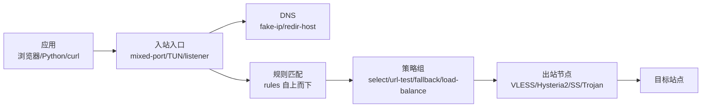

[toc]


## 配置简介

Clash/mihomo类客户端的 YAML 配置，本质上是在回答四个问题：

| 问题             | 配置区块                                               | 作用                                   |
| ---------------- | ------------------------------------------------------ | -------------------------------------- |
| 应用从哪里接入？ | `mixed-port`、`port`、`socks-port`、`tun`、`listeners` | 本机**代理入口**(方式)                 |
| 有哪些可用出口？ | `proxies`、`proxy-providers`                           | 节点、订阅、节点集合                   |
| 怎么选择出口？   | `proxy-groups`                                         | 手动选择、自动测速、故障转移、负载均衡 |
| 哪些流量走哪里？ | `rules`、`rule-providers`、`dns`、`sniffer`            | 分流规则、规则集、DNS、域名嗅探        |

> 所谓的“出口”（Outbound / Egress）**，本质上是指**“流量离开你的设备后，第一站要送往哪里”**。它代表了流量在发往目标网站（如 Google、Bilibili）之前，必须穿过的**第一层网络边界网关。
>
> 物理层面的"出口":
>
> 在现实世界中，流量从你的电脑发出，需要有一个接收端。配置中的一个“出口”（一个具体的 `proxy`），在物理上就对应着**一台特定的远程服务器**。
>
> 逻辑层面的“出口”：策略的集合
>
> 在 `proxy-groups`（策略组）中，“出口”的概念被抽象化了。**一个出口不一定是一台具体的服务器**，它也可以是一个“决定流量去向的盒子里”：
>
> - **直接出海（`DIRECT`）**：这也是一种出口。意思是“不走任何代理服务器，直接用我本机的真实运营商网络（电信/联通/移动）去访问”。
> - **直接丢弃（`REJECT`）**：这也是一种出口。意思是“把这个流量送进黑洞，直接拦截”（常用于广告屏蔽）。
> - **策略嵌套（`Proxy Group`）**：一个策略组本身也可以作为另一个策略组的出口。例如：`【自动测速组】` 作为 `【国外流量组】` 的出口，而 `【国外流量组】` 又是 `【规则分流】` 的出口(初学者暂时跳过此概念)。

Mihomo 使用 YAML 作为配置格式；**YAML 区分大小写**，用缩进表达层级，不能用 Tab 缩进，只能用空格。([MetaCubex](https://wiki.metacubex.one/en/handbook/syntax/))



------

## 软件版本说明(mihomo)

简单来说，**Mihomo**、**Clash.Meta** 和 **MetaCubeX** 三者本质上是**同一个开源项目在不同发展阶段的名称，或者说是同一生态下组织与项目的关系**。

我们可以用一句话来概括它们的关系：

> **MetaCubeX** 是一个开源开发团队（组织），他们开发的核心代理引擎最早叫 **Clash.Meta**，后来由于生态剧变，该引擎正式更名为了 **Mihomo**。
>
> 最早的代理界核心引擎叫 **Clash**（由 Dreamacro 开发）。但在 2023 年底，因为众所周知的原因，原作者删库并停止维护了 Clash 项目。在原版 Clash 还在维护时，**MetaCubeX** 团队觉得原版功能迭代太慢，于是基于原版 Clash 的开源代码进行了二次开发（Fork），做出了一个“加强版”的内核，命名为 **Clash.Meta**。比原版 Clash 支持更多的协议（如 VLESS、Hysteria2、TUIC、WireGuard 等），并且拥有更强的 TUN 模式和路由规则。2023 年底原版 Clash 倒下后，为了避免被原版项目波及、划清界限，同时为了更强调项目的独立性，MetaCubeX 团队在 2024 年正式将 **Clash.Meta 重命名为 Mihomo**

**MetaCubeX（组织/团队）	**

> - **Mihomo（核心引擎/内核）**：这是他们目前**最核心**的项目。它没有图形界面，只是一个在后台处理网络流量的“发动机”（也就是过去的 *Clash.Meta*）。
> - **MetaCubeXD（前端面板）**：他们团队为 Mihomo 开发的官方 Web 网页控制面板（XD 界面）。

当前按照 **Mihomo，也就是 Clash.Meta 后续内核** 的配置方式学习。

原因是它仍在扩展现代协议和配置能力，例如 VLESS、Hysteria2、TUIC、TUN、规则集、DNS 增强、REST API 等；

> 例如,Mihomo 官方文档中的 **VLESS** 示例包含 `flow: xtls-rprx-vision`、`reality-opts`、`client-fingerprint` 等字段，**Hysteria2** 示例包含 `password`、`up/down`、`obfs`、`sni` 等字段。([MetaCubex](https://wiki.metacubex.one/en/config/proxies/vless/))
>

为了安全，下面所有配置都用占位符。

> 你的 `uuid`、`password`、订阅链接都等同于账号密钥，不要公开粘贴，也不要提交到 Git 仓库。

------

## 配置文件骨架

一个实用的 Mihomo 配置通常长这样：

```yaml
mixed-port: 7890
allow-lan: false
mode: rule
log-level: info
ipv6: true

external-controller: 127.0.0.1:9090
secret: "change-me"

profile:
  store-selected: true
  store-fake-ip: true

dns:
  enable: true
  enhanced-mode: fake-ip
  nameserver:
    - https://dns.alidns.com/dns-query
    - https://doh.pub/dns-query
  fallback:
    - tls://1.1.1.1
    - tls://8.8.8.8
  proxy-server-nameserver:
    - https://dns.alidns.com/dns-query
  fake-ip-filter:
    - "*.lan"
    - "*.local"
    - "+.local"

proxy-providers:
  airport:
    type: http
    url: "https://example.com/your-subscription-url"
    path: ./proxy_providers/airport.yaml
    interval: 86400
    proxy: DIRECT
    health-check:
      enable: true
      url: https://www.gstatic.com/generate_204
      interval: 300
      timeout: 5000
      lazy: true
      expected-status: 204

proxy-groups:
  - name: PROXY
    type: select
    use:
      - airport
    proxies:
      - AUTO
      - FALLBACK
      - LOAD-BALANCE
      - DIRECT

  - name: AUTO
    type: url-test
    use:
      - airport
    url: https://www.gstatic.com/generate_204
    interval: 300
    tolerance: 50

  - name: FALLBACK
    type: fallback
    use:
      - airport
    url: https://www.gstatic.com/generate_204
    interval: 300

  - name: LOAD-BALANCE
    type: load-balance
    strategy: round-robin
    use:
      - airport
    url: https://www.gstatic.com/generate_204
    interval: 300

rules:
  - DOMAIN-SUFFIX,local,DIRECT
  - IP-CIDR,127.0.0.0/8,DIRECT,no-resolve
  - IP-CIDR,10.0.0.0/8,DIRECT,no-resolve
  - IP-CIDR,172.16.0.0/12,DIRECT,no-resolve
  - IP-CIDR,192.168.0.0/16,DIRECT,no-resolve
  - GEOSITE,cn,DIRECT
  - GEOIP,CN,DIRECT,no-resolve
  - MATCH,PROXY
```

这份配置适合作为新手模板：本机应用连接 `127.0.0.1:7890`，Mihomo 根据规则决定直连还是走代理；

**代理节点**来自订阅 `proxy-providers.airport`，**策略组**提供手动、自动测速、故障转移、负载均衡几种**入口**。

------

## YAML 写法基础

| 写法             | 推荐         | 说明                                            |
| ---------------- | ------------ | ----------------------------------------------- |
| 缩进             | 是           | 用空格，不用 Tab                                |
| 带特殊字符的名称 | 是           | 节点名、组名含 emoji、空格、冒号时建议加引号    |
| 单行对象         | 谨慎         | `{ name: x, type: vless }` 可读性差，不利于维护 |
| 多行对象         | 推荐         | 新手更容易排错                                  |
| 注释             | 推荐         | 用 `#`，但不要把密钥写进注释                    |
| 布尔值           | 推荐小写     | `true`、`false`                                 |
| 路径             | 推荐相对路径 | `./proxy_providers/xxx.yaml` 更便携             |

Mihomo 文档说明，YAML 中 `key: value` 的冒号后需要空格，数组用 `-` 表示，锚点 `&` 和别名 `*` 可以复用配置片段。([MetaCubex](https://wiki.metacubex.one/en/handbook/syntax/))

------

## 入站入口：应用怎么连到客户端

| 字段          | 典型值         | 用途                           | 新手建议          |
| ------------- | -------------- | ------------------------------ | ----------------- |
| `mixed-port`  | `7890`         | HTTP(S) 与 SOCKS5 共用入口     | 最推荐            |
| `port`        | `7890`         | HTTP/HTTPS 代理入口            | 可不用            |
| `socks-port`  | `7891`         | SOCKS4/4a/5 入口               | 有 SOCKS 需求时用 |
| `redir-port`  | `7892`         | 透明代理 TCP 入口              | 进阶              |
| `tproxy-port` | `7893`         | Linux/Android 透明代理 TCP+UDP | 进阶              |
| `tun`         | `enable: true` | 虚拟网卡，全局接管系统流量     | 进阶但实用        |

`mixed-port` 是特殊混合端口，同时支持 HTTP(S) 和 SOCKS5，任何支持 HTTP 或 SOCKS 代理的程序都可以连接它；`redir-port` 和 `tproxy-port` 属于透明代理入口，平台限制更多，`redir` 只能代理 TCP，`tproxy` 可处理 TCP 和 UDP。([MetaCubex](https://wiki.metacubex.one/en/config/inbound/port/))

新手最稳写法：

```yaml
mixed-port: 7890
allow-lan: false
bind-address: 127.0.0.1
```

`allow-lan` 控制是否允许局域网其他设备连接你的代理端口，`bind-address` 控制监听地址；官方文档说明 `allow-lan` 开启后可让其他设备通过 Clash 代理端口访问网络。([MetaCubex](https://wiki.metacubex.one/en/config/general/))

**最佳实践：**

| 场景                       | 建议                                                    |
| -------------------------- | ------------------------------------------------------- |
| 只给本机 Python、浏览器用  | `allow-lan: false`                                      |
| 给手机、平板、局域网设备用 | `allow-lan: true`，并设置认证                           |
| 在服务器上运行             | 不要把代理端口裸露到公网                                |
| 开启 REST API              | `external-controller` 绑定 `127.0.0.1`，并设置 `secret` |

------

## 运行模式：rule、global、direct

| 模式     | 含义                         | 适合场景         |
| -------- | ---------------------------- | ---------------- |
| `rule`   | 按 `rules` 分流              | 日常使用，最推荐 |
| `global` | 全部流量走 GLOBAL 选择的策略 | 临时全局代理     |
| `direct` | 全部直连                     | 调试、断开代理   |

Mihomo 的运行模式包括 `rule`、`global`、`direct`，默认是 `rule`。([MetaCubex](https://wiki.metacubex.one/en/config/general/))

```yaml
mode: rule
log-level: info
ipv6: true
```

`log-level` 新手建议 `info`；排错时临时改成 `debug`，用完改回去，避免日志太多或暴露访问细节。

------

## 出站节点：proxies

`proxies` 是手写节点列表，每个节点就是一个**远程出口**。

[proxies通用字段 - 虚空终端 Docs](https://wiki.metacubex.one/config/proxies/)

### 常见节点字段

| 字段                 | 含义                     | 示例                   |
| -------------------- | ------------------------ | ---------------------- |
| `name`               | 节点名，**策略组**引用它 | `"US-LA-1"`            |
| `type`               | 协议类型                 | `vless`、`hysteria2`   |
| `server`             | 服务器地址               | `example.com`          |
| `port`               | 服务器端口               | `443`                  |
| `udp`                | 是否启用 UDP             | `true`                 |
| `tls`                | 是否启用 TLS             | `true`                 |
| `servername` / `sni` | TLS SNI                  | `www.example.com`      |
| `skip-cert-verify`   | 跳过证书校验             | 尽量 `false`           |
| `client-fingerprint` | TLS 指纹                 | `chrome`、`edge`、`qq` |

### VLESS 示例

```yaml
proxies:
  - name: "US-LA-VLESS"
    type: vless
    server: node.example.com
    port: 443
    uuid: "00000000-0000-0000-0000-000000000000"
    udp: true
    tls: true
    servername: www.example.com
    flow: xtls-rprx-vision
    client-fingerprint: chrome
    reality-opts:
      public-key: "your-public-key"
      short-id: ""
```

Mihomo 的 VLESS 文档说明，`uuid` 是 VLESS 用户 ID，`flow` 可用 `xtls-rprx-vision`，`network` 未设置或设置为非特定传输时使用 TCP，`reality-opts` 可包含 `public-key` 和 `short-id`。([MetaCubex](https://wiki.metacubex.one/en/config/proxies/vless/))

### Hysteria2 示例

```yaml
proxies:
  - name: "KR-HY2"
    type: hysteria2
    server: node.example.com
    port: 443
    password: "your-password"
    sni: node.example.com
    skip-cert-verify: false
    up: "30 Mbps"
    down: "200 Mbps"
    alpn:
      - h3
```

Hysteria2 的 Mihomo 配置支持 `password`、`up/down`、`sni`、`skip-cert-verify`、`obfs`、`obfs-password`、`ports` 端口跳跃等字段；如果没有单位，`up/down` 默认按 Mbps 处理。([MetaCubex](https://wiki.metacubex.one/en/config/proxies/hysteria2/))

------

## 节点来源：proxies 与 proxy-providers

| 方式                       | 适合场景         | 优点                         | 缺点           |
| -------------------------- | ---------------- | ---------------------------- | -------------- |
| `proxies` 手写             | 少量固定节点     | 简单直观                     | 节点多时难维护 |
| `proxy-providers` 订阅     | 机场订阅、多节点 | 自动更新、可筛选、可健康检查 | 需要理解 `use` |
| `proxy-providers` 本地文件 | 自己维护节点池   | 配置清晰、可分文件           | 文件管理稍复杂 |
| `proxy-providers` inline   | 小规模内嵌       | 单文件可用                   | 可读性一般     |

Mihomo 的 `proxy-providers` 支持 `http`、`file`、`inline`，HTTP 类型需要 `url`，可配置 `path`、`interval`、`proxy`、`health-check`、`filter`、`exclude-filter`、`exclude-type` 等。([MetaCubex](https://wiki.metacubex.one/en/config/proxy-providers/))

### HTTP 订阅方式

```yaml
proxy-providers:
  airport:
    type: http
    url: "https://example.com/subscription"
    path: ./proxy_providers/airport.yaml
    interval: 86400
    proxy: DIRECT
    health-check:
      enable: true
      url: https://www.gstatic.com/generate_204
      interval: 300
      timeout: 5000
      lazy: true
      expected-status: 204
```

### 本地文件方式

```yaml
proxy-providers:
  local:
    type: file
    path: ./proxies/local.yaml
    health-check:
      enable: true
      url: https://www.gstatic.com/generate_204
      interval: 300
```

对应的 `./proxies/local.yaml`：

```yaml
proxies:
  - name: "US-LA-VLESS"
    type: vless
    server: node.example.com
    port: 443
    uuid: "00000000-0000-0000-0000-000000000000"
    udp: true
    tls: true
    servername: www.example.com
    flow: xtls-rprx-vision
    reality-opts:
      public-key: "your-public-key"
      short-id: ""
    client-fingerprint: chrome
```

**最佳实践：**订阅节点多时，用 `proxy-providers`；自己少量节点调试时，用 `proxies`。不要把订阅 URL 写进公开仓库。

------

## 策略组：proxy-groups

`proxy-groups` 是 Clash 类配置的核心。它不是真实节点，而是“选择节点的策略”。

| 策略组类型     | 作用                     | 典型用途                 |
| -------------- | ------------------------ | ------------------------ |
| `select`       | 手动选择                 | 日常主入口               |
| `url-test`     | 测速后选择延迟低的节点   | 自动选低延迟             |
| `fallback`     | 按顺序选择第一个可用节点 | 稳定优先                 |
| `load-balance` | 多节点分配连接           | 代理池、并发出口分散     |
| `relay`        | 链式代理                 | 特殊场景，不建议新手使用 |

Mihomo 的代理组可引用 `proxies` 或 `proxy-providers`，`url` 是健康检查地址，`interval` 是健康检查间隔，`filter` 和 `exclude-filter` 可按关键词或正则筛选节点，`include-all` 可包含所有出站代理和代理集合。([MetaCubex](https://wiki.metacubex.one/en/config/proxy-groups/))

### 手动选择

```yaml
proxy-groups:
  - name: PROXY
    type: select
    use:
      - airport
    proxies:
      - AUTO
      - FALLBACK
      - DIRECT
```

### 自动测速

```yaml
proxy-groups:
  - name: AUTO
    type: url-test
    use:
      - airport
    url: https://www.gstatic.com/generate_204
    interval: 300
    tolerance: 50
```

### 故障转移

```yaml
proxy-groups:
  - name: FALLBACK
    type: fallback
    use:
      - airport
    url: https://www.gstatic.com/generate_204
    interval: 300
```

### 负载均衡

```yaml
proxy-groups:
  - name: LOAD-BALANCE
    type: load-balance
    strategy: round-robin
    use:
      - airport
    url: https://www.gstatic.com/generate_204
    interval: 300
```

`load-balance` 适合“把不同连接分配给不同节点”，但不是单个 HTTP 请求同时走多个节点。一般一个连接最终仍只会选一个出口。Mihomo 文档中 `load-balance` 支持如 `round-robin`、`consistent-hashing` 等策略；前者分散请求，后者把相同目标地址始终交给同一个节点。([MetaCubex](https://wiki.metacubex.one/en/config/proxy-groups/))

------

## 用筛选器做地区分组

机场节点名通常带地区关键词，可以用 `filter` 自动分组。

```yaml
proxy-groups:
  - name: HongKong
    type: url-test
    use:
      - airport
    filter: "(?i)港|hk|hongkong|hong kong"
    url: https://www.gstatic.com/generate_204
    interval: 300

  - name: UnitedStates
    type: url-test
    use:
      - airport
    filter: "(?i)美|us|united states|america|los angeles|la"
    url: https://www.gstatic.com/generate_204
    interval: 300

  - name: Korea
    type: url-test
    use:
      - airport
    filter: "(?i)韩|kr|korea|seoul"
    url: https://www.gstatic.com/generate_204
    interval: 300
```

`filter` 只对被引入的代理集合或 `include-all` 生效，`exclude-filter` 用于排除匹配节点。([MetaCubex](https://wiki.metacubex.one/en/config/proxy-groups/))

------

## 规则：rules

`rules` 决定“什么流量走哪个策略”。Mihomo 规则自上而下匹配，上面的规则优先级更高；如果请求是 UDP，而命中的代理节点不支持 UDP，会继续向下匹配。([MetaCubex](https://wiki.metacubex.one/en/config/rules/))

### 常见规则类型

| 规则             | 作用         | 示例                                       |
| ---------------- | ------------ | ------------------------------------------ |
| `DOMAIN`         | 完整域名     | `DOMAIN,www.example.com,PROXY`             |
| `DOMAIN-SUFFIX`  | 域名后缀     | `DOMAIN-SUFFIX,google.com,PROXY`           |
| `DOMAIN-KEYWORD` | 域名关键词   | `DOMAIN-KEYWORD,google,PROXY`              |
| `GEOSITE`        | 域名集合     | `GEOSITE,cn,DIRECT`                        |
| `IP-CIDR`        | 目标 IP 段   | `IP-CIDR,192.168.0.0/16,DIRECT,no-resolve` |
| `GEOIP`          | 目标 IP 地区 | `GEOIP,CN,DIRECT,no-resolve`               |
| `PROCESS-NAME`   | 进程名       | `PROCESS-NAME,python.exe,PROXY`            |
| `PROCESS-PATH`   | 进程路径     | `PROCESS-PATH,/usr/bin/curl,PROXY`         |
| `DST-PORT`       | 目标端口     | `DST-PORT,22,DIRECT`                       |
| `NETWORK`        | TCP/UDP      | `NETWORK,udp,DIRECT`                       |
| `RULE-SET`       | 引用规则集   | `RULE-SET,telegram,PROXY`                  |
| `MATCH`          | 兜底匹配     | `MATCH,PROXY`                              |

`no-resolve` 只支持目标 IP 类规则，用于避免为了匹配 IP 规则而触发 DNS 解析；如果前面的规则已经触发了解析，后面的 `no-resolve` 不会撤销已发生的解析。([MetaCubex](https://wiki.metacubex.one/en/config/rules/))

### 推荐规则顺序

| 顺序 | 类型                       | 原因                              |
| ---- | -------------------------- | --------------------------------- |
| 最前 | 广告、恶意域名拒绝         | 明确拒绝的流量优先处理            |
| 靠前 | 私有地址、局域网、内网域名 | 避免内网服务被代理                |
| 中间 | 特定服务规则               | 例如 GitHub、Telegram、AI、流媒体 |
| 中后 | 国内域名/IP 直连           | 避免常见国内服务绕远              |
| 最后 | `MATCH`                    | 所有未命中流量的默认出口          |

示例：

```yaml
rules:
  - DOMAIN-SUFFIX,local,DIRECT
  - DOMAIN-SUFFIX,lan,DIRECT
  - IP-CIDR,127.0.0.0/8,DIRECT,no-resolve
  - IP-CIDR,10.0.0.0/8,DIRECT,no-resolve
  - IP-CIDR,172.16.0.0/12,DIRECT,no-resolve
  - IP-CIDR,192.168.0.0/16,DIRECT,no-resolve

  - DOMAIN-SUFFIX,github.com,PROXY
  - DOMAIN-SUFFIX,githubusercontent.com,PROXY
  - DOMAIN-SUFFIX,openai.com,PROXY
  - DOMAIN-SUFFIX,chatgpt.com,PROXY

  - GEOSITE,cn,DIRECT
  - GEOIP,CN,DIRECT,no-resolve

  - MATCH,PROXY
```

------

## 规则集：rule-providers

当规则很多时，不建议把所有规则都塞进 `rules`。更好的方式是用 `rule-providers` 管理远程或本地规则集，再用 `RULE-SET` 引用。

Mihomo 的 `rule-providers` 支持 `http`、`file`、`inline`，`behavior` 有 `domain`、`ipcidr`、`classical`，`format` 支持 `yaml`、`text`、`mrs`；其中 `mrs` 目前只支持 `domain` 和 `ipcidr` 行为。([MetaCubex](https://wiki.metacubex.one/en/config/rule-providers/))

```yaml
rule-providers:
  github:
    type: http
    behavior: domain
    format: mrs
    url: "https://raw.githubusercontent.com/MetaCubeX/meta-rules-dat/meta/geo/geosite/github.mrs"
    path: ./rules/github.mrs
    interval: 86400

  cn_ip:
    type: http
    behavior: ipcidr
    format: mrs
    url: "https://raw.githubusercontent.com/MetaCubeX/meta-rules-dat/meta/geo/geoip/cn.mrs"
    path: ./rules/cn_ip.mrs
    interval: 86400

rules:
  - RULE-SET,github,PROXY
  - RULE-SET,cn_ip,DIRECT,no-resolve
  - MATCH,PROXY
```

### behavior 怎么选

| `behavior`  | 内容类型  | 能写什么                                                  |
| ----------- | --------- | --------------------------------------------------------- |
| `domain`    | 域名规则  | 域名、后缀、域名集合                                      |
| `ipcidr`    | IP 段规则 | CIDR 地址段                                               |
| `classical` | 经典规则  | 几乎完整规则语法，如 `DOMAIN-SUFFIX`、`GEOIP`、`DST-PORT` |

`classical` 灵活但更重；只做域名或 IP 分流时，优先用 `domain` 或 `ipcidr`。

------

## DNS：最容易踩坑的部分

DNS 决定域名如何解析，也影响规则能否准确命中。新手常见问题包括：DNS 泄漏、国内外解析混乱、Fake IP 与局域网设备冲突、代理节点域名被错误代理。

Mihomo DNS 支持 `fake-ip` 和 `redir-host` 等增强模式；`fake-ip-filter` 用于指定哪些域名不返回 Fake IP；`nameserver-policy` 可为特定域名指定解析服务器；`proxy-server-nameserver` 专门用于解析代理节点服务器域名。([MetaCubex](https://wiki.metacubex.one/en/config/dns/))

### DNS 字段解释

| 字段                      | 作用                      | 建议                   |
| ------------------------- | ------------------------- | ---------------------- |
| `dns.enable`              | 是否启用内置 DNS          | TUN/透明代理建议启用   |
| `enhanced-mode`           | `fake-ip` 或 `redir-host` | 新手通常用 `fake-ip`   |
| `nameserver`              | 默认 DNS                  | 选可靠、低延迟 DNS     |
| `fallback`                | 备用 DNS                  | 通常放海外 DoT/DoH     |
| `fallback-filter`         | 过滤污染结果              | 默认逻辑通常够用       |
| `proxy-server-nameserver` | 解析代理节点域名          | 强烈建议单独配置       |
| `fake-ip-filter`          | 不返回 Fake IP 的域名     | LAN、IoT、系统服务加入 |

### 实用 DNS 模板

```yaml
dns:
  enable: true
  listen: 127.0.0.1:1053
  ipv6: true
  enhanced-mode: fake-ip
  fake-ip-range: 198.18.0.1/16

  default-nameserver:
    - 223.5.5.5
    - 119.29.29.29

  nameserver:
    - https://dns.alidns.com/dns-query
    - https://doh.pub/dns-query

  fallback:
    - tls://1.1.1.1
    - tls://8.8.8.8

  proxy-server-nameserver:
    - https://dns.alidns.com/dns-query

  fake-ip-filter:
    - "*.lan"
    - "*.local"
    - "+.local"
    - "+.msftconnecttest.com"
    - "+.msftncsi.com"
    - "localhost.ptlogin2.qq.com"
```

**关键建议：**代理节点的 `server` 如果是域名，不要让这个域名通过代理自身解析形成循环；配置 `proxy-server-nameserver` 能显著减少这类问题。

------

## 域名嗅探：sniffer

有些流量进来时只有 IP，没有域名。`sniffer` 会尝试从 HTTP、TLS、QUIC 握手中还原域名，以便命中域名规则。Mihomo 的 sniffer 支持 HTTP、TLS、QUIC，并可配置 `force-domain`、`skip-domain`、`skip-src-address`、`skip-dst-address` 等。([MetaCubex](https://wiki.metacubex.one/en/config/sniff/))

新手保守配置：

```yaml
sniffer:
  enable: true
  override-destination: false
  sniff:
    HTTP:
      ports: [80, 8080-8880]
    TLS:
      ports: [443, 8443]
    QUIC:
      ports: [443, 8443]
  skip-domain:
    - "Mijia Cloud"
    - "+.lan"
    - "+.local"
```

`override-destination: false` 更保守：嗅探结果主要用于规则判断，不强行改写实际目标。透明代理、TUN、复杂链式代理场景下，盲目开启覆盖目标可能导致难排查的问题。

------

## TUN 模式

TUN 模式通过虚拟网卡接管系统流量，适合不支持系统代理的软件、游戏、命令行工具、Electron 应用等。Mihomo 的 TUN 配置包含 `stack`、`auto-route`、`auto-detect-interface`、`dns-hijack`、`strict-route` 等字段。([MetaCubex](https://wiki.metacubex.one/en/config/inbound/tun/))

```yaml
tun:
  enable: true
  stack: mixed
  auto-route: true
  auto-detect-interface: true
  dns-hijack:
    - any:53
    - tcp://any:53
```

| 场景                     | 建议                               |
| ------------------------ | ---------------------------------- |
| 普通浏览器、Python、curl | 不一定需要 TUN，设置代理即可       |
| 软件不支持代理           | 用 TUN                             |
| 路由器、Linux 网关       | 研究 TProxy/TUN/iptables/nftables  |
| 新手排错                 | 先关闭 TUN，只用 `mixed-port` 测通 |

------

## 面向 Python 或爬虫程序的多出口配置

用于你有权访问的数据抓取时，建议把“代理池”放在客户端层实现，而不是让 Python 直接实现 VLESS/Hysteria2。你可以用多个 `listeners` 或多个 Mihomo 实例暴露不同本地端口，每个端口固定一个策略组。

### 单端口负载均衡

```yaml
mixed-port: 7890

proxy-groups:
  - name: PY_POOL
    type: load-balance
    strategy: round-robin
    use:
      - airport
    url: https://www.gstatic.com/generate_204
    interval: 300

rules:
  - MATCH,PY_POOL
```

Python 只连一个端口：

```python
import requests

proxies = {
    "http": "http://127.0.0.1:7890",
    "https": "http://127.0.0.1:7890",
}

r = requests.get("https://httpbin.org/ip", proxies=proxies, timeout=15)
print(r.text)
```

### 多端口固定出口

更适合并发控制：

```yaml
listeners:
  - name: py-us
    type: mixed
    port: 7901
    listen: 127.0.0.1
    proxy: UnitedStates

  - name: py-kr
    type: mixed
    port: 7902
    listen: 127.0.0.1
    proxy: Korea

proxy-groups:
  - name: UnitedStates
    type: url-test
    use:
      - airport
    filter: "(?i)美|us|united states|la|los angeles"
    url: https://www.gstatic.com/generate_204
    interval: 300

  - name: Korea
    type: url-test
    use:
      - airport
    filter: "(?i)韩|kr|korea|seoul"
    url: https://www.gstatic.com/generate_204
    interval: 300
```

Python 随机选端口：

```python
import random
import requests

LOCAL_PORTS = [7901, 7902]

def fetch(url: str) -> str:
    port = random.choice(LOCAL_PORTS)
    proxies = {
        "http": f"http://127.0.0.1:{port}",
        "https": f"http://127.0.0.1:{port}",
    }
    resp = requests.get(url, proxies=proxies, timeout=20)
    resp.raise_for_status()
    return resp.text

print(fetch("https://httpbin.org/ip"))
```

不要把代理池用于绕过网站明确禁止的访问控制、验证码、登录风控或封禁。稳定抓取更依赖限速、缓存、重试退避、遵守 robots.txt 和服务条款；代理只是网络出口管理工具。

------

## REST API 与 Dashboard

```yaml
external-controller: 127.0.0.1:9090
secret: "change-me"
```

Mihomo 的外部控制器是 REST API，可用于查看代理、切换策略组、查看流量、日志、运行配置等；官方 API 文档也说明请求需要带 `Authorization: Bearer ${secret}`。([MetaCubex](https://wiki.metacubex.one/en/api/))

**安全建议：**

| 项目                  | 建议                            |
| --------------------- | ------------------------------- |
| `external-controller` | 绑定 `127.0.0.1`                |
| `secret`              | 必须设置强随机值                |
| Dashboard             | 不要暴露到公网                  |
| 远程管理              | 用 SSH 隧道或 VPN，不要裸开端口 |

------

## 经典完整模板

下面是一份相对完整、适合学习和改造的模板。

```yaml
mixed-port: 7890
allow-lan: false
bind-address: 127.0.0.1
mode: rule
log-level: info
ipv6: true

external-controller: 127.0.0.1:9090
secret: "change-this-secret"

profile:
  store-selected: true
  store-fake-ip: true

dns:
  enable: true
  listen: 127.0.0.1:1053
  ipv6: true
  enhanced-mode: fake-ip
  fake-ip-range: 198.18.0.1/16

  default-nameserver:
    - 223.5.5.5
    - 119.29.29.29

  nameserver:
    - https://dns.alidns.com/dns-query
    - https://doh.pub/dns-query

  fallback:
    - tls://1.1.1.1
    - tls://8.8.8.8

  proxy-server-nameserver:
    - https://dns.alidns.com/dns-query

  fake-ip-filter:
    - "*.lan"
    - "*.local"
    - "+.local"
    - "+.msftconnecttest.com"
    - "+.msftncsi.com"

sniffer:
  enable: true
  override-destination: false
  sniff:
    HTTP:
      ports: [80, 8080-8880]
    TLS:
      ports: [443, 8443]
    QUIC:
      ports: [443, 8443]
  skip-domain:
    - "+.lan"
    - "+.local"

proxy-providers:
  airport:
    type: http
    url: "https://example.com/your-subscription"
    path: ./proxy_providers/airport.yaml
    interval: 86400
    proxy: DIRECT
    health-check:
      enable: true
      url: https://www.gstatic.com/generate_204
      interval: 300
      timeout: 5000
      lazy: true
      expected-status: 204

proxy-groups:
  - name: PROXY
    type: select
    proxies:
      - AUTO
      - FALLBACK
      - LOAD-BALANCE
      - HongKong
      - UnitedStates
      - Korea
      - DIRECT
    use:
      - airport

  - name: AUTO
    type: url-test
    use:
      - airport
    url: https://www.gstatic.com/generate_204
    interval: 300
    tolerance: 50

  - name: FALLBACK
    type: fallback
    use:
      - airport
    url: https://www.gstatic.com/generate_204
    interval: 300

  - name: LOAD-BALANCE
    type: load-balance
    strategy: round-robin
    use:
      - airport
    url: https://www.gstatic.com/generate_204
    interval: 300

  - name: HongKong
    type: url-test
    use:
      - airport
    filter: "(?i)港|hk|hongkong|hong kong"
    url: https://www.gstatic.com/generate_204
    interval: 300
    tolerance: 50

  - name: UnitedStates
    type: url-test
    use:
      - airport
    filter: "(?i)美|us|united states|america|los angeles|la"
    url: https://www.gstatic.com/generate_204
    interval: 300
    tolerance: 50

  - name: Korea
    type: url-test
    use:
      - airport
    filter: "(?i)韩|kr|korea|seoul|sk"
    url: https://www.gstatic.com/generate_204
    interval: 300
    tolerance: 50

rule-providers:
  github:
    type: http
    behavior: domain
    format: mrs
    url: "https://raw.githubusercontent.com/MetaCubeX/meta-rules-dat/meta/geo/geosite/github.mrs"
    path: ./rules/github.mrs
    interval: 86400

  telegram_ip:
    type: http
    behavior: ipcidr
    format: mrs
    url: "https://raw.githubusercontent.com/MetaCubeX/meta-rules-dat/meta/geo/geoip/telegram.mrs"
    path: ./rules/telegram_ip.mrs
    interval: 86400

rules:
  - DOMAIN-SUFFIX,local,DIRECT
  - DOMAIN-SUFFIX,lan,DIRECT

  - IP-CIDR,127.0.0.0/8,DIRECT,no-resolve
  - IP-CIDR,10.0.0.0/8,DIRECT,no-resolve
  - IP-CIDR,172.16.0.0/12,DIRECT,no-resolve
  - IP-CIDR,192.168.0.0/16,DIRECT,no-resolve

  - RULE-SET,github,PROXY
  - RULE-SET,telegram_ip,PROXY,no-resolve

  - DOMAIN-SUFFIX,openai.com,PROXY
  - DOMAIN-SUFFIX,chatgpt.com,PROXY

  - GEOSITE,cn,DIRECT
  - GEOIP,CN,DIRECT,no-resolve

  - MATCH,PROXY
```

------

## 常见错误与排查

| 现象                 | 可能原因                                     | 排查方法                               |
| -------------------- | -------------------------------------------- | -------------------------------------- |
| 配置无法加载         | YAML 缩进错误、Tab、冒号后没空格             | 用 YAML 校验器检查                     |
| 所有节点不可用       | 订阅过期、节点字段错误、网络阻断             | 看客户端日志、单独测节点               |
| Python 走不了代理    | 端口错、客户端没启动、系统代理不等于程序代理 | 指定 `proxies` 参数                    |
| 规则不生效           | 规则顺序错误、被更前规则命中                 | 把具体规则放前面                       |
| 国内网站走代理       | `GEOSITE,cn` / `GEOIP,CN` 位置不合理         | 调整到特定代理规则之后                 |
| 局域网设备异常       | Fake IP、TUN、sniffer 干扰                   | 加 `fake-ip-filter`、关闭 sniffer 测试 |
| 代理节点域名解析循环 | 节点域名被代理解析                           | 配 `proxy-server-nameserver`           |
| REST API 无法访问    | `external-controller` 未开或 secret 错       | 检查监听地址与 Authorization           |
| UDP 应用异常         | 节点或策略组不支持 UDP                       | 节点加 `udp: true`，或换节点           |

------

## 学习路线

| 阶段       | 目标          | 应掌握内容                                       |
| ---------- | ------------- | ------------------------------------------------ |
| 入门       | 能跑通配置    | `mixed-port`、`proxies`、`proxy-groups`、`rules` |
| 日常可用   | 稳定分流      | `select`、`url-test`、`fallback`、DNS            |
| 多节点管理 | 自动更新订阅  | `proxy-providers`、`filter`、健康检查            |
| 高级分流   | 维护规则集    | `rule-providers`、`GEOSITE`、`GEOIP`、`RULE-SET` |
| 系统级代理 | 全局接管      | `tun`、`dns-hijack`、`sniffer`                   |
| 程序化控制 | Python/自动化 | `external-controller` API、多端口 listeners      |

最实用的学习方式是：先用最小配置跑通，再逐步加 DNS、策略组、规则集、TUN。每次只改一个模块，出问题容易回滚。
