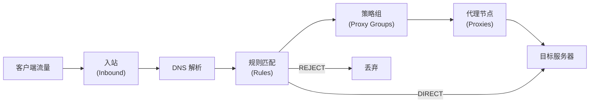
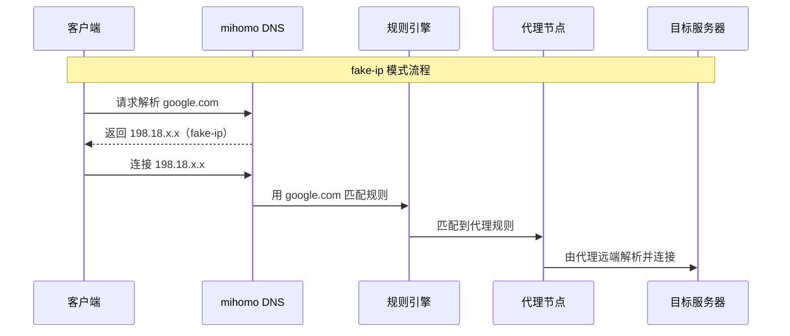
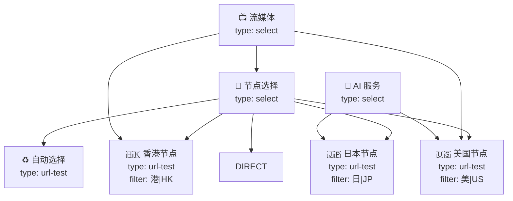

[toc]


## Mihomo 系统性概念指南

### 什么是 Mihomo

Mihomo（formerly Clash Meta）是当前最活跃维护的 Clash 内核分支，由 MetaCubeX 团队开发。 它保留了与现有 Clash 配置语法的完全向后兼容性，同时原生支持 REALITY、Hysteria2、TUIC v5、Shadowsocks 2022 等新协议。 原始 Clash 项目于 2023 年 11 月被其创建者归档，Mihomo 分支继续活跃开发，目前已成为 Clash 兼容代理配置的主要参考实现。

---

### 整体架构

mihomo 的工作流程可以概括为：**流量入站 → DNS 解析 → 规则匹配 → 代理出站**。



---

### 配置文件结构总览

Clash 的配置组成部分主要有：顶层配置（如 `allow-lan`、`mixed-port`、`tproxy-port`）决定了服务器的监听端口和监听方式；`proxies`/`proxy-providers` 定义代理节点；`proxy-groups` 设置策略组；`dns` 控制 DNS 查询方式；`rule-providers` 规则订阅；`rules` 具体分流规则。

| 配置区块 | 作用 | 关键字段 |
|---|---|---|
| **General** | 全局行为控制 | `mixed-port`, `allow-lan`, `mode`, `log-level`, `ipv6` |
| **DNS** | 域名解析策略 | `enhanced-mode`, `nameserver`, `fallback`, `fake-ip-range` |
| **TUN** | 虚拟网卡接管全局流量 | `enable`, `stack`, `auto-route`, `auto-detect-interface` |
| **Proxies** | 定义出站代理节点 | `name`, `type`, `server`, `port` |
| **Proxy Providers** | 远程/本地批量导入节点 | `type`, `url`, `interval`, `health-check` |
| **Proxy Groups** | 节点编组与选择策略 | `type`(select/url-test/fallback/load-balance), `proxies`, `use` |
| **Rule Providers** | 远程/本地规则集 | `behavior`(domain/ipcidr/classical), `format`(yaml/mrs/text) |
| **Rules** | 流量匹配与路由 | `DOMAIN`, `GEOIP`, `IP-CIDR`, `PROCESS-NAME`, `MATCH` |
| **Sniffer** | 流量嗅探还原真实域名 | `enable`, `sniff`, `force-domain` |

---

### 入站（Inbound）

入站是 mihomo 接收客户端流量的方式。不同入站模式的适用场景：

| 入站方式 | 端口配置 | 适用场景 |
|---|---|---|
| **mixed-port** | 单端口同时承载 HTTP + SOCKS5 | 日常桌面代理（**最常用**） |
| **tproxy-port** | 透明代理（仅 Linux） | 旁路由/网关级透明代理 |
| **redir-port** | TCP 重定向（仅 Linux） | 简单透明代理，不支持 UDP |
| **TUN** | 虚拟网卡 | 全平台全局接管（**推荐**） |

#### TUN 模式

TUN 模式可以直接接管所有系统网络流量（包括不支持系统代理的应用，如游戏、开发工具等），使用起来非常简单。

TUN 的协议栈选项：

| 栈类型 | 特点 |
|---|---|
| `system` | 使用系统协议栈，更稳定，资源占用更低 |
| `gvisor` | 用户空间协议栈，安全性与隔离性更高 |
| `mixed` | TCP 用 system，UDP 用 gvisor |
| `mips` | 自研 IP 协议栈，当前默认值（**推荐**） |

基础 TUN 配置示例：

```yaml
tun:
  enable: true
  stack: mixed
  auto-route: true
  auto-detect-interface: true
  dns-hijack:
    - any:53
```

---

### 支持的代理协议

mihomo 支持 VMess、VLESS、Shadowsocks、Trojan、Snell、TUIC、Hysteria 等协议。 mihomo (Clash.Meta) 兼容的出站类型包括：Direct, SS, SSR, VMess, Trojan, HTTP, SOCKS5, Snell, VLESS, WireGuard, Hysteria, Hysteria 2, TUIC, SSH 等。

按传输层协议分类：

| 分类 | 协议 | 特点 |
|---|---|---|
| **TCP 系** | Shadowsocks, VMess, VLESS, Trojan, Snell | 成熟稳定，广泛支持 |
| **QUIC/UDP 系** | Hysteria2, TUIC v5 | 基于 QUIC 的协议在不稳定或高延迟网络中凭借更好的拥塞控制显著优于传统 TCP。 |
| **隧道类** | WireGuard | 内核级加密隧道，性能极高 |

> **选型建议**：如果标准协议被封锁或 IP 被针对，需要高隐蔽性——Trojan 和 VLESS + Reality 是突破高级防火墙的最佳选择。 在高延迟、高丢包环境（如卫星或弱 4G）下，Hysteria 2 和 TUIC v5 能保持较高速度。

---

### DNS 配置

DNS 是 mihomo 最关键也最容易出问题的部分。理解其工作模式至关重要。

#### enhanced-mode 模式对比

| 模式 | 原理 | 优劣 |
|---|---|---|
| `fake-ip` | 返回虚假 IP（默认 `198.18.0.1/16`），真实解析推迟到代理服务器 | **速度快、防污染**，推荐使用 |
| `redir-host` | 本地真实解析后建立映射 | 速度慢，受 DNS 污染影响 |



#### DNS 服务器层级

nameserver 是默认域名解析服务器。 fallback 是备份域名解析服务器，一般使用海外 DNS 以确保可靠结果。 proxy-server-nameserver 仅用于解析代理节点自身的域名。 direct-nameserver 是直连出口的域名解析服务器。

| DNS 字段 | 用途 | 推荐值 |
|---|---|---|
| `nameserver` | 默认解析 | 国内 DoH（如 `https://dns.alidns.com/dns-query`） |
| `fallback` | 备用解析（通常海外 DNS） | `https://dns.google/dns-query` |
| `proxy-server-nameserver` | 解析代理节点域名（**避免鸡蛋问题**） | 国内公共 DNS |
| `direct-nameserver` | 直连流量专用 DNS | 国内 DoH |
| `nameserver-policy` | 按域名指定 DNS | 指定特定域名用特定 DNS |

> **最佳实践**：开启 `respect-rules: true` 可让 DNS 连接遵循路由规则，但如果需要通过代理查询 DNS，应配置 proxy-server-nameserver 以防止循环依赖。

---

### 代理组（Proxy Groups）

代理组是 mihomo 实现灵活分流策略的核心机制，它将多个节点按不同策略编组。

| 策略类型 | 行为 | 典型用途 |
|---|---|---|
| `select` | 手动选择节点 | 主选择组，手动切换地区 |
| `url-test` | 自动选择延迟最低的节点 | 自动优选，日常挂机 |
| `fallback` | 按顺序尝试，故障自动切换 | 保障可用性，高可靠场景 |
| `load-balance` | 将流量分散到多个节点 | 提高带宽/分摊负载 |
| `relay` | 链式代理（A→B→C→目标） | 多跳代理，隐匿链路 |

典型的代理组组织结构：



#### 节点引入方式

- `proxies:` — 直接引用已定义的节点名或其他策略组
- `use:` — 引入 `proxy-providers` 中的节点集合
- `include-all: true` — 引入所有出站代理及代理集合，支持基于延迟的自动选择、故障转移和负载均衡。
- `filter:` — 正则过滤节点名称（如 `"港|HK|Hong Kong"`）

---

### 规则系统（Rules）

规则按从上到下的顺序匹配，列表顶部的规则优先级高于底下的规则。最末尾规则一定是 `MATCH`，当所有规则都不匹配时使用。

每条规则由三部分组成：**规则类型, 匹配内容, 出站策略**

```
DOMAIN-SUFFIX,google.com,🚀 节点选择
IP-CIDR,127.0.0.0/8,DIRECT
MATCH,🚀 节点选择
```

#### 常用规则类型

| 规则类型 | 匹配对象 | 示例 |
|---|---|---|
| `DOMAIN` | 精确域名 | `DOMAIN,google.com,Proxy` |
| `DOMAIN-SUFFIX` | 域名后缀 | `DOMAIN-SUFFIX,github.com,Proxy` |
| `DOMAIN-KEYWORD` | 域名关键词 | `DOMAIN-KEYWORD,google,Proxy` |
| `GEOSITE` | GeoSite 域名集 | `GEOSITE,cn,DIRECT` |
| `IP-CIDR` / `IP-CIDR6` | 目标 IP 段 | `IP-CIDR,192.168.0.0/16,DIRECT` |
| `GEOIP` | GeoIP 地理位置 | `GEOIP,CN,DIRECT` |
| `PROCESS-NAME` | 进程名称 | `PROCESS-NAME,telegram.exe,Proxy` |
| `RULE-SET` | 引用规则集 | `RULE-SET,my-rules,Proxy` |
| `MATCH` | 兜底匹配（必须放最后） | `MATCH,Proxy` |

> 当匹配到目标 IP 类规则时，mihomo 会触发 DNS 解析以检查域名的目标 IP 是否匹配。可以使用 `no-resolve` 选项跳过 DNS 解析。

#### Rule Providers（规则集提供者）

Rule providers 和远程规则集按照你控制的时间表保持更新，无需将大量静态规则粘贴到单个文件中。

| 属性 | 可选值 | 说明 |
|---|---|---|
| `behavior` | `domain` / `ipcidr` / `classical` | 规则集的行为类型 |
| `format` | `yaml` / `text` / `mrs` | 规则集文件格式（`mrs` 为二进制，体积最小） |
| `type` | `http` / `file` / `inline` | 远程下载、本地文件或直接内联 |
| `interval` | 秒数 | 自动更新间隔 |

---

### Sniffer（流量嗅探）

嗅探器从连接的实际数据流中提取真实域名，在 TUN 模式和 fake-ip 模式下尤为重要——因为此时原始域名信息可能丢失。

典型场景：当访问使用 CDN 的域名时，如果没有嗅探，流量可能因为只匹配到 CDN 的 IP 而走错规则。

```yaml
sniffer:
  enable: true
  sniff:
    HTTP:
      ports: [80, 8080-8880]
    TLS:
      ports: [443, 8443]
    QUIC:
      ports: [443, 8443]
  skip-domain:
    - "Mijia Cloud"
    - "+.push.apple.com"
```

---

### 运行模式

| 模式 | `mode` 值 | 行为 |
|---|---|---|
| **规则模式** | `rule` | 按 rules 列表逐条匹配（**推荐**） |
| **全局模式** | `global` | 所有流量交给 GLOBAL 策略组当前所选（节点或策略组） |
| **直连模式** | `direct` | 所有流量直连，不经过代理 |

---

### 外部控制与 Dashboard

External controller 允许使用 RESTful API 控制 mihomo 内核。 官方 Web Dashboard 项目为 metacubexd。

```yaml
external-controller: 0.0.0.0:9090   # API 监听地址
secret: "your-secret"               # API 访问密钥
external-ui: /path/to/ui            # Dashboard 静态资源路径
external-ui-url: "https://github.com/metacubex/metacubexd/archive/refs/heads/gh-pages.zip"
```

---

### 常用 GUI 客户端

| 平台 | 推荐客户端 |
|---|---|
| Windows / macOS / Linux | Mihomo Party（基于 mihomo 核心的现代美观 GUI 客户端）、Clash Verge Rev、FlClash |
| Android | Clash Meta for Android (CMFA)，基于 Mihomo 核心的 Android 客户端 |
| iOS | Stash、Shadowrocket（间接兼容） |

---

### 推荐配置骨架

以下是一份精简但完整的现代化配置骨架，涵盖核心要素：

```yaml
# ===== 全局设置 =====
mixed-port: 7890
allow-lan: true
mode: rule
log-level: info
unified-delay: true
tcp-concurrent: true
find-process-mode: strict

# ===== TUN =====
tun:
  enable: true
  stack: mixed
  auto-route: true
  auto-detect-interface: true
  dns-hijack:
    - any:53

# ===== DNS =====
dns:
  enable: true
  listen: :1053
  enhanced-mode: fake-ip
  fake-ip-range: 198.18.0.1/16
  fake-ip-filter:
    - "+.lan"
    - "+.local"
  nameserver:
    - https://dns.alidns.com/dns-query
    - https://doh.pub/dns-query
  proxy-server-nameserver:
    - https://dns.alidns.com/dns-query
  direct-nameserver:
    - https://dns.alidns.com/dns-query
    - https://doh.pub/dns-query

# ===== Sniffer =====
sniffer:
  enable: true
  sniff:
    HTTP:
      ports: [80, 8080-8880]
    TLS:
      ports: [443, 8443]
    QUIC:
      ports: [443, 8443]

# ===== 代理节点（示例） =====
proxies: []

# ===== 代理提供者 =====
proxy-providers:
  my-airport:
    type: http
    url: "你的订阅地址"
    interval: 86400
    health-check:
      enable: true
      url: "https://cp.cloudflare.com/generate_204"
      interval: 300

# ===== 代理组 =====
proxy-groups:
  - name: "🚀 节点选择"
    type: select
    proxies: ["♻️ 自动选择", "DIRECT"]
    use: ["my-airport"]

  - name: "♻️ 自动选择"
    type: url-test
    use: ["my-airport"]
    url: "https://cp.cloudflare.com/generate_204"
    interval: 300
    tolerance: 50

# ===== 规则提供者 =====
rule-providers:
  cn-domain:
    type: http
    behavior: domain
    format: mrs
    url: "https://raw.githubusercontent.com/MetaCubeX/meta-rules-dat/meta/geo/geosite/cn.mrs"
    interval: 86400

# ===== 规则 =====
rules:
  - GEOSITE,private,DIRECT
  - GEOSITE,cn,DIRECT
  - GEOIP,CN,DIRECT,no-resolve
  - MATCH,🚀 节点选择
```

---

### 最佳实践小结

| 领域 | 建议 |
|---|---|
| **入站** | 桌面端优先使用 TUN（`stack: mips`），服务端用 tproxy |
| **DNS** | 使用 `fake-ip` 模式 + `respect-rules: true`，搭配 `proxy-server-nameserver` 防循环 |
| **规则顺序** | 域名规则在前，IP 规则在后，`MATCH` 兜底放末尾 |
| **规则集格式** | 优先使用 `.mrs` 二进制格式，体积更小、解析更快 |
| **健康检查** | `proxy-providers` 中启用 `health-check`，间隔 300s 为宜 |
| **YAML 规范** | 用空格缩进（不用 Tab），英文符号，注意冒号后的空格 |
| **安全** | `external-controller` 暴露时务必设置 `secret` |