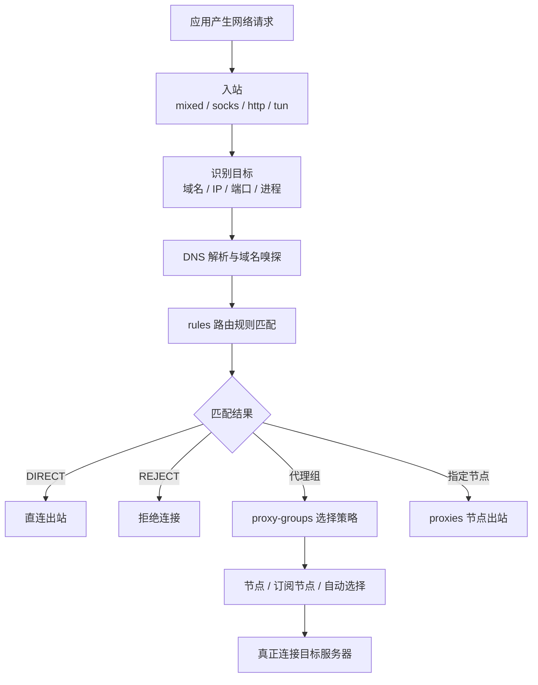
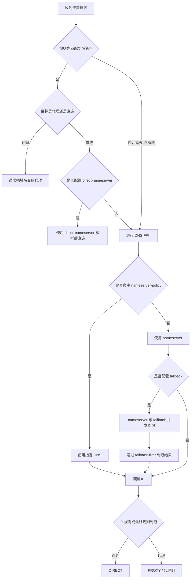

[toc]

## abstract

以 **mihomo 官方配置文档**和**官方快捷配置示例**为主线，目标是让新手先理解“流量怎么进来、怎么判断、怎么出去”，再逐步掌握 `config.yaml` 的主要模块。

mihomo 的配置体系大致可以理解为：**入站接收流量 → DNS/嗅探识别目标 → rules 匹配规则 → proxy-groups 选择策略 → proxies/proxy-providers 发起出站连接**。

官方文档将配置分为全局配置、DNS、域名嗅探、入站、出站代理、代理集合、代理组、路由规则、规则集合等模块。([MetaCubex](https://wiki.metacubex.one/config/))

------

## mihomo 是什么

mihomo 可以理解为一个“**网络流量分流内核**”。它不只是简单地把所有流量都丢给代理，而是根据配置文件中的规则，判断某个连接应该：

| 处理方式       | 含义           | 常见场景                     |
| -------------- | -------------- | ---------------------------- |
| `DIRECT`       | 直连，不走代理 | 国内网站、局域网、内网服务   |
| `REJECT`       | 拒绝连接       | 广告、追踪、恶意域名         |
| `PROXIES`      | 指定节点出站   | 手动指定某个节点             |
| `PROXY_GROUPS` | 交给策略组决定 | 自动选择、故障切换、区域分组 |
| `MATCH`        | 兜底规则       | 前面都没匹配时的最终处理     |

新手最容易误解的一点是：**mihomo 的核心不是“开代理”，而是“按规则分流”**。代理只是**出站方式**之一，规则才决定“哪些流量走哪里”。

------

## 配置文件的整体结构

一个典型 `config.yaml` 通常由这些部分组成：

| 模块     | 作用                                        | 新手理解                              |
| -------- | ------------------------------------------- | ------------------------------------- |
| 全局配置 | 控制运行模式、端口、API、日志、IPv6、缓存等 | mihomo 的总开关                       |
| 入站配置 | 决定流量从哪里进入 mihomo                   | 浏览器、系统代理、TUN、局域网设备     |
| DNS      | 决定域名如何解析                            | 解决“域名变 IP”的问题                 |
| 域名嗅探 | 从连接中还原真实域名                        | 解决只有 IP、没有域名时规则失效的问题 |
| 出站代理 | 定义具体节点                                | 具体的服务器                          |
| 代理集合 | 从订阅或文件批量引入节点                    | 节点仓库                              |
| 代理组   | 把节点组织成策略                            | 手动选、自动选、故障切换、负载均衡    |
| 路由规则 | 判断流量去哪里                              | 分流逻辑                              |
| 规则集合 | 从外部维护规则列表                          | 可更新的规则库                        |

可以用下面的流程理解：



------

## 全局配置：mihomo 的基础行为

全局配置决定 mihomo 怎么运行。

官方文档中，全局配置包含 `allow-lan`、`mode`、`log-level`、`ipv6`、`external-controller`、`profile`、`unified-delay`、`tcp-concurrent`、GEO 文件相关配置等。([MetaCubex](https://wiki.metacubex.one/config/general/))

### 常见字段说明

| 字段                     | 作用                                  | 建议                                     |
| ------------------------ | ------------------------------------- | ---------------------------------------- |
| `mixed-port`             | 同时支持 HTTP 和 SOCKS 的本地代理端口 | 新手最推荐，只用一个端口即可             |
| `allow-lan`              | 是否允许局域网设备连接                | 只在需要给手机、电视、其他电脑共享时开启 |
| `mode`                   | 运行模式：`rule`、`global`、`direct`  | 日常建议 `rule`                          |
| `log-level`              | 日志等级                              | 日常 `info`，排错时 `debug`              |
| `ipv6`                   | 是否接收 IPv6 流量                    | 网络支持 IPv6 可开，否则可关             |
| `external-controller`    | API 控制地址                          | 面板需要它                               |
| `secret`                 | API 密钥                              | 对外暴露时必须设置                       |
| `profile.store-selected` | 保存策略组选择                        | 建议开启                                 |
| `profile.store-fake-ip`  | 保存 fake-ip 映射                     | fake-ip 模式建议开启                     |
| `tcp-concurrent`         | 多 IP 并发连接，取先成功者            | 一般可开启                               |

官方说明中，`mode` 支持 `rule` 规则匹配、`global` 全局代理、`direct` 全局直连，默认是规则模式；

`external-controller` 可通过 RESTful API 控制内核；`profile.store-selected` 用于保存策略组选择，`store-fake-ip` 用于保存 fake-ip 映射。([MetaCubex](https://wiki.metacubex.one/config/general/))

### 新手推荐写法

```yaml
mixed-port: 7890
allow-lan: false
mode: rule
log-level: info
ipv6: false

external-controller: 127.0.0.1:9090
secret: ""

profile:
  store-selected: true
  store-fake-ip: true

tcp-concurrent: true
```

这里的思路是：先保证本机稳定使用，不急着开放局域网。等你确实需要给手机或其他设备使用时，再打开 `allow-lan`，并配合访问控制。

------

## 运行模式：rule、global、direct

| 模式     | 含义                 | 适合场景               |
| -------- | -------------------- | ---------------------- |
| `rule`   | 按规则分流           | 日常使用，最推荐       |
| `global` | 全部走 GLOBAL 策略组 | 临时测试代理是否可用   |
| `direct` | 全部直连             | 排查问题、关闭代理效果 |

新手建议长期使用 `rule`。`global` 不是“更强模式”，只是把流量统一交给全局策略，容易造成国内网站也绕远路。`direct` 则适合检查“是不是代理导致的问题”。

------

## 入站：流量如何进入 mihomo

“入站”就是 mihomo 从哪里接收流量。官方入站配置包括局域网入站、互联网入站、listeners，也支持 HTTP、SOCKS、mixed、redirect、tproxy、tun 等形式；其中 `mixed` 是 HTTP(S) 和 SOCKS 混合代理。([MetaCubex](https://wiki.metacubex.one/config/inbound/))

### 常见入站类型

| 入站方式                | 说明                           | 新手推荐程度               |
| ----------------------- | ------------------------------ | -------------------------- |
| `mixed-port`            | 一个端口同时处理 HTTP 和 SOCKS | 高                         |
| `port`                  | HTTP 代理端口                  | 一般                       |
| `socks-port`            | SOCKS 代理端口                 | 一般                       |
| `tun`                   | 虚拟网卡接管系统流量           | 高，但更复杂               |
| `redir-port` / `tproxy` | 透明代理常见方式               | 偏高级，常用于路由器/Linux |

### mixed-port 与 tun 的区别

| 对比项   | `mixed-port`               | `tun`                              |
| -------- | -------------------------- | ---------------------------------- |
| 使用方式 | 应用或系统手动设置代理端口 | 创建虚拟网卡接管流量               |
| 配置难度 | 低                         | 中等                               |
| 覆盖范围 | 依赖应用是否走系统代理     | 更接近全局接管                     |
| 适合人群 | 新手、桌面端               | 需要全局代理、游戏、非代理感知应用 |
| 常见问题 | 有些软件不走代理           | 路由、DNS、权限更容易出问题        |

新手可以先用 `mixed-port`。等你遇到“某些软件不走系统代理”“游戏或命令行工具不方便设置代理”时，再学习 TUN。

------

## TUN：用虚拟网卡接管流量

TUN 会创建一个虚拟网络接口，让系统流量进入 mihomo。官方 TUN 配置包含 `enable`、`stack`、`auto-route`、`auto-redirect`、`auto-detect-interface`、`dns-hijack`、`strict-route`、`mtu`、接口包含/排除、UID/包名包含排除等选项。([MetaCubex](https://wiki.metacubex.one/config/inbound/tun/))

常见写法如下：

```yaml
tun:
  enable: true
  stack: mixed
  dns-hijack:
    - any:53
    - tcp://any:53
  auto-route: true
  auto-redirect: true
  auto-detect-interface: true
```

### TUN 的关键点

| 字段                    | 作用             | 理解                    |
| ----------------------- | ---------------- | ----------------------- |
| `enable`                | 是否启用 TUN     | 总开关                  |
| `stack`                 | 协议栈           | 常见为 `mixed`          |
| `dns-hijack`            | 劫持 DNS 查询    | 让 DNS 也进入 mihomo    |
| `auto-route`            | 自动配置路由     | 让流量进 TUN            |
| `auto-detect-interface` | 自动检测出口网卡 | 避免手动指定网卡        |
| `strict-route`          | 更严格的路由控制 | 排查 DNS 泄漏时可能用到 |

TUN 的本质是：**不再指望每个应用主动使用代理，而是从网络层把流量接进来**。但它也更依赖系统权限、路由表、DNS 劫持和防火墙环境。

------

## DNS：mihomo 的核心难点

DNS 是新手最容易混乱的部分。它决定“域名如何变成 IP”，也会影响规则匹配、fake-ip、TUN、直连与代理的行为。官方 DNS 配置包含 `enable`、`listen`、`ipv6`、`enhanced-mode`、`fake-ip-range`、`fake-ip-filter`、`nameserver-policy`、`nameserver`、`fallback`、`proxy-server-nameserver`、`direct-nameserver` 等字段。([MetaCubex](https://wiki.metacubex.one/config/dns/))

### DNS 常见字段

| 字段                      | 作用                     | 新手建议                     |
| ------------------------- | ------------------------ | ---------------------------- |
| `enable`                  | 启用 mihomo DNS          | TUN/fake-ip 场景建议开       |
| `listen`                  | DNS 监听地址             | 常见 `0.0.0.0:1053`          |
| `ipv6`                    | 是否解析 IPv6            | 不需要 IPv6 可关             |
| `enhanced-mode`           | 增强模式：常见 `fake-ip` | TUN 场景常用 fake-ip         |
| `fake-ip-range`           | fake-ip 地址池           | 常见 `198.18.0.1/16`         |
| `fake-ip-filter`          | 不使用 fake-ip 的域名    | 局域网、特殊服务要排除       |
| `default-nameserver`      | 解析 DNS 服务器域名用    | 建议填稳定明文 DNS           |
| `nameserver`              | 主要 DNS                 | 国内常用 DoH/DoT             |
| `fallback`                | 备用 DNS                 | 复杂分流场景使用             |
| `nameserver-policy`       | 按域名指定 DNS           | 精细控制                     |
| `proxy-server-nameserver` | 解析代理服务器域名       | 很重要，避免节点域名解析异常 |
| `direct-nameserver`       | 直连时重新解析使用       | 避免直连目标拿到不合适 IP    |

### redir-host 与 fake-ip

| 模式         | 逻辑                                | 优点                     | 缺点                               |
| ------------ | ----------------------------------- | ------------------------ | ---------------------------------- |
| `redir-host` | 返回真实 IP                         | 直观，兼容性好           | 分流和防污染能力相对弱             |
| `fake-ip`    | 返回虚假 IP，再由 mihomo 映射回域名 | 规则匹配更稳定，适合 TUN | 某些局域网、投屏、IoT 服务需要过滤 |

新手如果使用普通系统代理，`redir-host` 和 `fake-ip` 都可能工作；如果使用 TUN，通常更推荐 `fake-ip`，但要维护好 `fake-ip-filter`。

------

## DNS 解析流程

官方 DNS 流程说明中，mihomo 会结合规则、`nameserver-policy`、`nameserver`、`fallback`、`fallback-filter`、`direct-nameserver` 等处理解析；当匹配到代理规则时可以把域名交给代理，而直连场景可能使用 `direct-nameserver` 重新解析。官方还说明 v1.19.10 后，`direct-nameserver` 重新解析同样应用于 UDP 连接，但对于 TUN 入站限于 Fake-IP 模式。([MetaCubex](https://wiki.metacubex.one/config/dns/diagram/))

简化流程如下：



这部分的关键是：**DNS 不只是“解析域名”，它还参与分流判断**。错误的 DNS 配置会导致常见问题：国内网站变慢、国外网站打不开、规则不生效、TUN 下 DNS 泄漏、局域网服务异常等。

------

## 域名嗅探：为什么需要 sniffer

很多连接进入 mihomo 时，目标可能只是一个 IP，而不是域名。这样基于 `DOMAIN-SUFFIX`、`GEOSITE`、`RULE-SET` 的域名规则就可能无法直接匹配。域名嗅探就是尝试从 HTTP、TLS、QUIC 等流量中提取真实域名。官方文档说明 sniffer 支持 HTTP/TLS/QUIC，并提供 `force-dns-mapping`、`parse-pure-ip`、`override-destination`、`force-domain`、`skip-domain`、`skip-src-address`、`skip-dst-address` 等配置。([MetaCubex](https://wiki.metacubex.one/config/sniff/))

### sniffer 常见字段

| 字段                   | 作用                           | 建议                                 |
| ---------------------- | ------------------------------ | ------------------------------------ |
| `enable`               | 是否启用嗅探                   | TUN 场景常用                         |
| `force-dns-mapping`    | 对 redir-host 识别流量强制嗅探 | 需要时开启                           |
| `parse-pure-ip`        | 对没有域名的流量强制嗅探       | 有助于 IP 流量还原域名               |
| `override-destination` | 用嗅探结果作为实际访问目标     | 谨慎开启，可能影响特殊服务           |
| `sniff.HTTP/TLS/QUIC`  | 指定嗅探协议和端口             | 常见 80、443、8443                   |
| `skip-domain`          | 跳过嗅探的域名                 | 对米家、Apple Push、局域网服务很有用 |

示例：

```yaml
sniffer:
  enable: true
  sniff:
    HTTP:
      ports: [80, 8080-8880]
      override-destination: true
    TLS:
      ports: [443, 8443]
    QUIC:
      ports: [443, 8443]
  skip-domain:
    - "Mijia Cloud"
    - "+.push.apple.com"
```

### 使用建议

sniffer 能提高规则命中率，但不是越强越好。智能家居、局域网发现、推送服务、某些游戏或私有协议可能因为嗅探和改写目标产生异常。遇到这类问题，优先把相关域名加入 `skip-domain`。

------

## 出站代理：proxies

`proxies` 是具体节点定义。官方通用字段中，代理节点是数组，常见必填项包括 `name`、`type`、`server`、`port`；还可以配置 `ip-version`、`udp`、`interface-name`、`routing-mark`、`tfo`、`mptcp`、`dialer-proxy`、`smux` 等。([MetaCubex](https://wiki.metacubex.one/config/proxies/))

### 节点通用字段

| 字段             | 作用                        | 注意                                   |
| ---------------- | --------------------------- | -------------------------------------- |
| `name`           | 节点名称                    | 必须唯一                               |
| `type`           | 节点协议类型                | 如 `ss`、`vmess`、`vless`、`trojan` 等 |
| `server`         | 节点服务器地址              | 域名或 IP                              |
| `port`           | 节点端口                    | 必填                                   |
| `udp`            | 是否支持 UDP                | 默认不一定开启，游戏/QUIC 可能需要     |
| `ip-version`     | 出站连接使用 IPv4/IPv6 策略 | 可选 `dual`、`ipv4`、`ipv6` 等         |
| `dialer-proxy`   | 链式代理                    | 高级用法                               |
| `interface-name` | 指定从哪个网卡出站          | 多网卡场景使用                         |

一个直观示例：

```yaml
proxies:
  - name: "直连"
    type: direct
    udp: true
```

真实代理节点通常由订阅提供，不建议新手手写大量节点。更常见的方式是使用 `proxy-providers` 批量引入。

------

## 代理集合：proxy-providers

`proxy-providers` 用来从订阅 URL、文件或内联内容批量引入节点。官方配置项包括 `type`、`url`、`path`、`interval`、`proxy`、`size-limit`、`header`、`health-check`、`override`、`filter`、`exclude-filter`、`exclude-type`、`payload` 等。([MetaCubex](https://wiki.metacubex.one/config/proxy-providers/))

### proxy-providers 的作用

| 能力         | 说明                                 |
| ------------ | ------------------------------------ |
| 自动拉取订阅 | 从 URL 获取节点                      |
| 定时更新     | `interval` 控制更新时间              |
| 健康检查     | 自动测试节点可用性                   |
| 节点重命名   | `override.additional-prefix/suffix`  |
| 过滤节点     | 用 `filter`、`exclude-filter` 筛选   |
| 指定下载代理 | `proxy` 字段可指定用哪个代理更新订阅 |

示例：

```yaml
proxy-providers:
  provider1:
    type: http
    url: "https://example.com/sub.yaml"
    path: ./proxy_providers/provider1.yaml
    interval: 86400
    health-check:
      enable: true
      url: https://www.gstatic.com/generate_204
      interval: 300
      timeout: 5000
    override:
      additional-prefix: "[provider1] "
```

### 最佳实践

| 场景                 | 建议                                    |
| -------------------- | --------------------------------------- |
| 多个订阅节点重名     | 用 `additional-prefix` 给不同订阅加前缀 |
| 节点太多             | 用 `filter` 按地区筛选                  |
| 订阅偶尔更新失败     | 设置合理 `interval`，不要过于频繁       |
| 订阅地址需要代理访问 | 用 `proxy` 指定更新订阅所走的代理       |
| 节点稳定性参差不齐   | 开启 `health-check`                     |

------

## 代理组：proxy-groups

`proxy-groups` 是 mihomo 配置中最重要的“策略层”。路由规则通常不直接指向某个节点，而是指向某个代理组。代理组再决定使用哪个节点。官方代理组通用字段包括 `name`、`type`、`proxies`、`use`、`url`、`interval`、`lazy`、`timeout`、`max-failed-times`、`filter`、`exclude-filter`、`include-all` 等。([MetaCubex](https://wiki.metacubex.one/config/proxy-groups/))

### 常见代理组类型

| 类型           | 含义                     | 适合场景           |
| -------------- | ------------------------ | ------------------ |
| `select`       | 手动选择                 | 默认策略、应用分流 |
| `url-test`     | 自动选择延迟最低节点     | 日常自动选择       |
| `fallback`     | 当前节点失败后切换下一个 | 稳定性优先         |
| `load-balance` | 负载均衡                 | 多连接分散流量     |
| `relay`        | 已移除，改用 `dialer-proxy` | 不要再用        |

### 手动选择组

```yaml
proxy-groups:
  - name: "默认"
    type: select
    proxies:
      - 自动选择
      - 香港
      - 日本
      - 美国
      - DIRECT
```

手动选择组适合放在最上层，作为“总开关”。比如规则全部指向“默认”，你就可以在面板里临时切换。

### 自动选择组

```yaml
proxy-groups:
  - name: "自动选择"
    type: url-test
    use:
      - provider1
    url: https://www.gstatic.com/generate_204
    interval: 300
    tolerance: 50
```

自动选择的核心是：定期访问测试 URL，选择表现较好的节点。注意，代理组上的 `url` 不只作用于 `proxies` 字段：用 `use` 引入 provider 时，它会向 provider 追加一条测速任务（`addTestUrlToProviders`），provider 自身的 `health-check` 独立生效，两处 `url` 相同时共用结果，provider 已设 `interval` 时组上的间隔不覆盖它。([MetaCubex](https://wiki.metacubex.one/config/proxy-groups/))

### 地区分组

```yaml
proxy-groups:
  - name: "香港"
    type: url-test
    use:
      - provider1
    filter: "(?i)港|hk|hongkong|hong kong"
    url: https://www.gstatic.com/generate_204
    interval: 300
```

`filter` 是非常实用的字段，可以按节点名筛选地区。新手维护配置时，不建议把每个节点手动写进组里，而是通过 `use + filter` 自动分组。

------

## 路由规则：rules

`rules` 是分流的核心。官方路由规则支持很多类型，包括 `DOMAIN`、`DOMAIN-SUFFIX`、`DOMAIN-KEYWORD`、`DOMAIN-WILDCARD`、`DOMAIN-REGEX`、`GEOSITE`、`IP-CIDR`、`IP-CIDR6`、`IP-ASN`、`GEOIP`、`SRC-IP-CIDR`、`DST-PORT`、`PROCESS-NAME`、`RULE-SET`、`AND/OR/NOT`、`SUB-RULE`、`MATCH` 等。([MetaCubex](https://wiki.metacubex.one/config/rules/))

### 常见规则类型

| 规则             | 作用               | 示例理解                     |
| ---------------- | ------------------ | ---------------------------- |
| `DOMAIN`         | 精确域名           | 只匹配 `example.com`         |
| `DOMAIN-SUFFIX`  | 域名后缀           | 匹配 `google.com` 及其子域   |
| `DOMAIN-KEYWORD` | 域名关键词         | 域名中含某关键词             |
| `GEOSITE`        | 按 geosite 分类    | 如 `geosite:youtube`         |
| `IP-CIDR`        | IP 段              | 局域网、内网、特定网段       |
| `GEOIP`          | 按 IP 所属国家地区 | 如 `GEOIP,CN,DIRECT`         |
| `PROCESS-NAME`   | 按进程名           | Windows/macOS/Linux 部分场景 |
| `DST-PORT`       | 按目标端口         | 如 22、443                   |
| `RULE-SET`       | 引用规则集合       | 推荐用于大型规则             |
| `MATCH`          | 兜底规则           | 必须放最后                   |

### 规则是从上到下匹配的

这是新手必须记住的原则：**rules 是顺序匹配，命中第一条就停止**。

例如：

```yaml
rules:
  - DOMAIN-SUFFIX,google.com,Google
  - GEOIP,CN,DIRECT
  - MATCH,默认
```

含义是：

1. 如果是 `google.com` 相关域名，交给 `Google` 策略组；
2. 如果目标 IP 属于中国大陆，直连；
3. 其他全部交给 `默认` 策略组。

### `no-resolve` 的意义

`IP-CIDR`、`GEOIP` 这类 IP 规则可能触发 DNS 解析。某些规则后面加 `no-resolve`，意思是：如果当前还没有 IP，就不要为了匹配这条规则去解析域名。

常见写法：

```yaml
rules:
  - IP-CIDR,127.0.0.0/8,DIRECT,no-resolve
  - IP-CIDR,192.168.0.0/16,DIRECT,no-resolve
```

适合局域网、保留地址、内网地址，避免不必要 DNS 查询。

------

## 规则集合：rule-providers

`rule-providers` 用来从外部加载规则列表。官方文档中，provider 类型可选 `http`、`file`、`inline`；`behavior` 可选 `domain`、`ipcidr`、`classical`；`format` 可选 `yaml`、`text`、`mrs`，其中 `mrs` 目前仅支持 `domain` 和 `ipcidr`。([MetaCubex](https://wiki.metacubex.one/config/rule-providers/))

### rule-providers 与 rules 的关系

| 模块             | 作用                                 |
| ---------------- | ------------------------------------ |
| `rule-providers` | 定义规则集合从哪里来                 |
| `rules`          | 用 `RULE-SET` 引用规则集合并指定策略 |

示例：

```yaml
rule-providers:
  google:
    type: http
    path: ./rules/google.yaml
    url: "https://example.com/Google.yaml"
    interval: 86400
    behavior: classical
    format: yaml

rules:
  - RULE-SET,google,Google
  - MATCH,默认
```

### behavior 怎么选

| behavior    | 规则内容类型        | 适合             |
| ----------- | ------------------- | ---------------- |
| `domain`    | 纯域名类规则        | 域名列表         |
| `ipcidr`    | IP 段规则           | IP 列表          |
| `classical` | 经典 Clash 规则格式 | 混合规则，最灵活 |

新手如果不确定规则集格式，通常用 `classical` 更容易理解，但要确保规则集本身确实是 classical 格式。

------

## 一份适合新手理解的最小配置骨架

下面不是完整可直接运行的订阅配置，而是帮助你理解结构的“骨架”。

```yaml
mixed-port: 7890
allow-lan: false
mode: rule
log-level: info
ipv6: false

external-controller: 127.0.0.1:9090

profile:
  store-selected: true
  store-fake-ip: true

dns:
  enable: true
  ipv6: false
  enhanced-mode: fake-ip
  fake-ip-range: 198.18.0.1/16
  fake-ip-filter:
    - "*.lan"
    - "*.local"
    - "+.local"
  default-nameserver:
    - 223.5.5.5
    - 119.29.29.29
  nameserver:
    - https://dns.alidns.com/dns-query
    - https://doh.pub/dns-query

proxy-providers:
  provider1:
    type: http
    url: "你的订阅链接"
    path: ./proxy_providers/provider1.yaml
    interval: 86400
    health-check:
      enable: true
      url: https://www.gstatic.com/generate_204
      interval: 300
    override:
      additional-prefix: "[P1] "

proxy-groups:
  - name: 默认
    type: select
    proxies:
      - 自动选择
      - DIRECT

  - name: 自动选择
    type: url-test
    use:
      - provider1
    url: https://www.gstatic.com/generate_204
    interval: 300

rules:
  - GEOIP,CN,DIRECT
  - MATCH,默认
```

这份结构的重点是：**订阅节点放在 provider，策略放在 group，分流逻辑放在 rules**。

------

## 官方快捷配置示例的思路

官方快捷配置示例中使用了 `proxy-providers` 引入订阅，并配置 `health-check`；全局配置里出现了 `mixed-port`、`ipv6`、`allow-lan`、`tcp-concurrent`、`external-controller`、`external-ui`、`geodata-mode`、`geox-url`、`profile.store-selected`、`profile.store-fake-ip` 等；同时配置了 `sniffer`、`tun`、`dns`、大量 `proxy-groups` 和分流规则。([MetaCubex](https://wiki.metacubex.one/example/conf/))

这个示例体现的是一种“现代配置”思路：

| 设计                   | 目的                                          |
| ---------------------- | --------------------------------------------- |
| 使用 `proxy-providers` | 节点通过订阅自动维护                          |
| 使用地区代理组         | 香港、日本、美国、新加坡等分类选择            |
| 使用业务代理组         | Google、Telegram、YouTube、Netflix 等单独策略 |
| 使用 TUN               | 更完整接管系统流量                            |
| 使用 fake-ip DNS       | 提高 TUN 场景下的域名映射能力                 |
| 使用 sniffer           | 让 IP 流量尽量还原域名                        |
| 使用 GEO 数据          | 支持 `GEOSITE`、`GEOIP` 等规则                |

新手不建议一开始就照搬大型配置，而是先理解每个模块的作用，再逐步加功能。

------

## 推荐的学习顺序

| 阶段     | 学什么                                                       | 目标                     |
| -------- | ------------------------------------------------------------ | ------------------------ |
| 第一阶段 | `mixed-port`、`mode`、`proxies`、`proxy-groups`、`rules`     | 能看懂最基础分流         |
| 第二阶段 | `proxy-providers`、`rule-providers`                          | 能使用订阅和规则集       |
| 第三阶段 | DNS：`fake-ip`、`nameserver`、`fallback`、`direct-nameserver` | 能解决 DNS 类问题        |
| 第四阶段 | TUN、sniffer                                                 | 能处理全局接管和特殊软件 |
| 第五阶段 | 进程规则、端口规则、子规则、链式代理                         | 做高级个性化分流         |

------

## 配置设计的最佳实践

### 规则顺序要从“特殊”到“一般”

推荐顺序：

```yaml
rules:
  - DOMAIN-SUFFIX,example-special.com,特殊策略
  - RULE-SET,private,DIRECT
  - RULE-SET,ads,REJECT
  - RULE-SET,cn,DIRECT
  - GEOIP,CN,DIRECT
  - MATCH,默认
```

不要把 `MATCH` 放在中间。它是兜底规则，放中间会导致后面的规则永远没有机会匹配。

### 策略组不要过度复杂

新手常见问题是建几十个策略组，但自己也不知道哪个规则指向哪个组。推荐先保留：

| 策略组                | 用途                          |
| --------------------- | ----------------------------- |
| `默认`                | 大多数代理流量                |
| `自动选择`            | 自动测速                      |
| `国内`                | 直连                          |
| `漏网之鱼` 或 `MATCH` | 兜底                          |
| 少量应用组            | 如 Telegram、YouTube、Netflix |

### 节点名要避免重复

官方文档明确代理节点名称必须唯一，代理集合中也可以通过 `override.additional-prefix` 添加前缀。多个订阅混用时，最好给每个 provider 加不同前缀，避免节点重名。([MetaCubex](https://wiki.metacubex.one/config/proxies/))

### 健康检查 URL 要稳定

常见测试地址：

```yaml
url: https://www.gstatic.com/generate_204
```

这个地址常用于连通性测试。不要用太慢、太复杂、会跳转的网站做测速 URL，否则测试结果不稳定。

### DNS 不要盲目堆很多服务器

DNS 不是越多越好。过多 DNS 会增加排查难度。新手建议先使用少量稳定 DNS，再根据需要加入 `nameserver-policy`、`fallback`、`direct-nameserver`。

### 局域网服务要加入 fake-ip-filter 或跳过嗅探

比如打印机、NAS、投屏、米家、Apple Push 等，如果出现连接异常，优先检查：

```yaml
fake-ip-filter:
  - "*.lan"
  - "*.local"
  - "+.local"

sniffer:
  skip-domain:
    - "Mijia Cloud"
    - "+.push.apple.com"
```

官方快捷示例中也对 `Mijia Cloud` 和 Apple Push 相关域名做了 sniffer 跳过处理。([MetaCubex](https://wiki.metacubex.one/example/conf/))

------

## 常见问题与排查思路

| 问题             | 可能原因                         | 排查方向                                 |
| ---------------- | -------------------------------- | ---------------------------------------- |
| 国内网站很慢     | 国内流量走了代理                 | 检查 `GEOIP,CN,DIRECT`、规则顺序         |
| 国外网站打不开   | 节点不可用或规则没命中           | 看面板连接记录，检查策略组               |
| 某些软件不走代理 | 软件不使用系统代理               | 尝试 TUN                                 |
| 开 TUN 后没网    | 路由/DNS/权限问题                | 先关 TUN，确认普通代理正常               |
| 局域网设备异常   | fake-ip 或 sniffer 影响          | 加入 `fake-ip-filter` / `skip-domain`    |
| 订阅更新失败     | URL 访问失败或需要代理           | 检查 provider 的 `proxy`、网络、订阅地址 |
| 面板打不开       | `external-controller` 或端口错误 | 检查地址、端口、防火墙                   |
| 规则不生效       | 顺序错误或目标不是域名           | 看连接记录，检查 sniffer 和 DNS          |

------

## 新手最应该记住的核心原理

mihomo 的工作机制可以浓缩成一句话：

**入站负责接流量，DNS 和 sniffer 负责识别目标，rules 负责判断去向，proxy-groups 负责选择策略，proxies/proxy-providers 负责真正出站。**

再进一步说：

| 你看到的问题            | 本质上通常属于                           |
| ----------------------- | ---------------------------------------- |
| “软件有没有进入 mihomo” | 入站 / TUN                               |
| “域名解析对不对”        | DNS                                      |
| “规则有没有命中”        | rules / rule-providers                   |
| “选了哪个节点”          | proxy-groups                             |
| “节点能不能连”          | proxies / proxy-providers / health-check |
| “为什么局域网坏了”      | fake-ip / sniffer / TUN 路由             |

只要按这个链路排查，mihomo 配置就不会显得混乱。

## 请求生命周期：从应用发起到最终出站

下面按四个阶段走一遍，再用四个完整请求验证。阶段示例里的端口与组名来自本文上面的配置骨架，换成你自己的即可。

### 阶段 A：应用发起网络请求

### 情况 1：浏览器设置了系统代理

例如 Chrome 访问：

```text
https://www.google.com/search?q=mihomo
```

浏览器会把请求交给：

```text
127.0.0.1:7890
```

因为配置里有：

```yaml
mixed-port: 7890
```

此时 mihomo 直接从 HTTP CONNECT、SOCKS5 请求、TLS SNI 等信息中看到目标是 `www.google.com:443`。如果是 `mixed` listener，官方示例说明它可以作为 HTTP(S) 与 SOCKS 混合入口。([虚空终端](https://wiki.metacubex.one/en/config/inbound/))

### 情况 2：应用没有设置代理，但 TUN 开启

例如某个游戏、Telegram Desktop、系统更新程序不理会系统代理，它直接发包到外网。此时：

```yaml
tun:
  enable: true
  auto-route: true
  dns-hijack:
    - any:53
```

`auto-route` 会把全局流量路由进 TUN 网卡，`dns-hijack` 会把匹配到的 DNS 连接导入 mihomo 内部 DNS 模块；文档还说明 `strict-route` 可用于更严格地防止泄漏，但可能影响部分应用。([虚空终端](https://wiki.metacubex.one/en/config/inbound/tun/))

------

### 阶段 B：DNS 解析与域名嗅探

这里要分两种路径。

### 路径 1：DNS fake-ip 映射

访问 `www.google.com` 时，应用先问 DNS：

```text
www.google.com A ?
```

mihomo DNS 返回一个 fake IP，例如：

```text
198.18.3.27
```

同时 mihomo 内部记录：

```text
198.18.3.27 -> www.google.com
```

然后应用连接：

```text
198.18.3.27:443
```

mihomo 收到这个连接后，根据 fake-ip 映射还原出：

```text
www.google.com:443
```

这样 rules 仍然可以用 `DOMAIN-SUFFIX,google.com,Google` 命中，而不是只能看到 IP。官方 DNS 解析流程也说明：域名规则命中代理时会把域名发送给代理；IP 规则需要解析域名时，则会进入解析流程。([虚空终端](https://wiki.metacubex.one/en/config/dns/diagram/))

### 路径 2：sniffer 嗅探还原域名

如果应用没有经过 mihomo DNS，或者它直接连接某个真实 IP，比如：

```text
142.250.72.196:443
```

这时 mihomo 可能只能看到 IP。启用：

```yaml
sniffer:
  enable: true
  parse-pure-ip: true
  sniff:
    TLS:
      ports: [443, 8443]
```

后，mihomo 会尝试从 TLS SNI、HTTP Host、QUIC 信息中嗅探真实域名。官方文档说明 sniffer 支持 `HTTP`、`TLS`、`QUIC`，并可配置端口、`override-destination`、强制嗅探和跳过嗅探的域名/地址。([虚空终端](https://wiki.metacubex.one/en/config/sniff/))

简单说：

```text
只有 IP 的连接
  ↓
尝试嗅探 TLS SNI / HTTP Host / QUIC
  ↓
发现 SNI = www.youtube.com
  ↓
按 youtube.com 重新走域名规则
```

------

### 阶段 C：路由规则逐条匹配

rules 的核心是：**从上到下，第一条命中就生效**。官方文档明确说明规则自上而下匹配，越靠上的规则优先级越高；`MATCH` 则匹配所有请求，因此通常放最后做兜底。([虚空终端](https://wiki.metacubex.one/en/config/rules/))

例如这组规则：

```yaml
rules:
  - DOMAIN-SUFFIX,google.com,Google
  - GEOSITE,cn,国内直连
  - GEOIP,CN,国内直连
  - MATCH,默认
```

访问 `www.google.com` 时：

```text
1. DOMAIN-SUFFIX,google.com,Google  ✅ 命中
2. 后面的 GEOSITE / GEOIP / MATCH 不再继续判断
3. 流量交给 Google 策略组
```

访问 `www.baidu.com` 时：

```text
1. DOMAIN-SUFFIX,google.com,Google  ❌ 不命中
2. GEOSITE,cn,国内直连               ✅ 命中
3. 流量交给 国内直连 策略组
```

访问 `unknown-site.example` 时：

```text
1. google 规则不命中
2. cn 规则不命中
3. GEOIP 可能不命中
4. MATCH,默认 ✅ 命中
5. 流量交给 默认 策略组
```

`DOMAIN-SUFFIX,google.com` 会匹配 `google.com`、`www.google.com`、`mail.google.com`，但不会匹配 `content-google.com`；这是文档对 `DOMAIN-SUFFIX` 的说明。([虚空终端](https://wiki.metacubex.one/en/config/rules/))

------

### 阶段 D：命中策略组，不等于立刻选中节点

这点非常关键：rules 右侧写的通常不是节点，而是**策略组名**。

例如：

```yaml
- DOMAIN-SUFFIX,google.com,Google
```

意思不是“直接走某个 HK 节点”，而是：

```text
www.google.com
  ↓
命中 Google 规则
  ↓
进入 Google 策略组
  ↓
Google 策略组再决定用 自动选择 / 故障回退 / 手动选择
```

proxy group 的 `proxies` 字段可以引用具体出站节点，也可以引用其他策略组；`url` 是健康检查测试地址，`interval` 是健康检查间隔。([虚空终端](https://wiki.metacubex.one/en/config/proxy-groups/))

------

### Select / URL-Test / Fallback 三种调度方式

### 7.1 Select：人工选择

```yaml
- name: "手动选择"
  type: select
  proxies:
    - "HK-01"
    - "JP-01"
    - "US-01"
    - "DIRECT"
```

`select` 就是让用户在面板里手动选择当前出口。官方 `Select` 示例也展示了 `type: select` 下列出多个代理或策略组。([虚空终端](https://wiki.metacubex.one/en/config/proxy-groups/select/))

典型使用：

```text
你在 Dashboard 中把 “手动选择” 切到 JP-01
  ↓
所有命中 “手动选择” 的流量都走 JP-01
```

### 7.2 URL-Test：自动测速选择

```yaml
- name: "自动选择"
  type: url-test
  proxies:
    - "HK-01"
    - "JP-01"
    - "US-01"
  url: "https://www.gstatic.com/generate_204"
  interval: 300
  tolerance: 50
```

`url-test` 会访问配置的测试 URL，根据延迟选择节点；`tolerance` 是切换容差，单位是毫秒。官方 `Url-test` 文档展示了 `url`、`interval`、`tolerance` 的用法。([虚空终端](https://wiki.metacubex.one/en/config/proxy-groups/url-test/))

例如测速结果：

| 节点  | 测试延迟 |
| ----- | -------- |
| HK-01 | 62 ms    |
| JP-01 | 89 ms    |
| US-01 | 170 ms   |

那么：

```text
自动选择 → HK-01
```

如果稍后变成：

| 节点  | 测试延迟 |
| ----- | -------- |
| HK-01 | 130 ms   |
| JP-01 | 75 ms    |
| US-01 | 160 ms   |

那么：

```text
自动选择 → JP-01
```

### 7.3 Fallback：故障回退

```yaml
- name: "故障回退"
  type: fallback
  proxies:
    - "HK-01"
    - "JP-01"
    - "US-01"
  url: "https://www.gstatic.com/generate_204"
  interval: 300
```

`fallback` 不是选最低延迟，而是**按顺序选第一个可用节点**；官方文档说明：当前节点超时时，会按 `proxies` 顺序选择第一个可用节点。([虚空终端](https://wiki.metacubex.one/en/config/proxy-groups/fallback/))

例如：

```text
HK-01 可用 → 走 HK-01
HK-01 超时，JP-01 可用 → 走 JP-01
HK-01、JP-01 都不可用，US-01 可用 → 走 US-01
```

------

## 四个完整请求示例

### 示例 1：访问 Google

请求：

```text
Chrome → https://www.google.com
```

流程：

```text
Chrome 发起请求
  ↓
进入 mixed-port:7890 或 TUN
  ↓
mihomo 获得域名 www.google.com
  ↓
rules 自上而下匹配
  ↓
DOMAIN-SUFFIX,google.com,Google 命中
  ↓
进入 Google 策略组
  ↓
Google 策略组选择 自动选择
  ↓
自动选择测速后选中 HK-01
  ↓
mihomo 通过 HK-01 建立出站连接
  ↓
目标服务器 www.google.com
```

最终路径：

```text
Chrome → Mihomo → Google 策略组 → 自动选择 → HK-01 → www.google.com
```

------

### 示例 2：访问百度

请求：

```text
Chrome → https://www.baidu.com
```

流程：

```text
Chrome 发起请求
  ↓
进入 mihomo
  ↓
mihomo 获得域名 www.baidu.com
  ↓
DOMAIN-SUFFIX,google.com 不命中
  ↓
DOMAIN-SUFFIX,youtube.com 不命中
  ↓
GEOSITE,cn,国内直连 命中
  ↓
进入 国内直连 策略组
  ↓
国内直连 默认选择 DIRECT
  ↓
直连访问 www.baidu.com
```

最终路径：

```text
Chrome → Mihomo → 国内直连 → DIRECT → www.baidu.com
```

------

### 示例 3：Telegram 连接 IP

请求可能不是域名，而是 IP：

```text
Telegram → 149.154.167.50:443
```

规则：

```yaml
- IP-CIDR,149.154.160.0/20,Telegram,no-resolve
```

流程：

```text
Telegram 发起到 149.154.167.50:443 的连接
  ↓
TUN 捕获
  ↓
目标 IP 落在 149.154.160.0/20
  ↓
命中 Telegram 策略组
  ↓
Telegram 策略组选择 故障回退
  ↓
故障回退按 HK-01 → JP-01 → US-01 顺序找第一个可用节点
  ↓
通过可用节点出站
```

这里的 `no-resolve` 很重要。文档说明，目标 IP 类规则在域名匹配阶段可能触发 DNS 解析，而 `no-resolve` 可以跳过解析；如果前面已经触发过解析，则仍可能继续匹配带 `no-resolve` 的 IP 规则。([虚空终端](https://wiki.metacubex.one/en/config/rules/))

------

### 示例 4：未知网站走兜底

请求：

```text
App → https://api.some-random-service.com
```

流程：

```text
App 发起请求
  ↓
mihomo 获得域名 api.some-random-service.com
  ↓
google / youtube / telegram / cn / GEOIP 均未命中
  ↓
MATCH,默认 命中
  ↓
进入 默认 策略组
  ↓
默认策略组当前选择 自动选择
  ↓
自动选择选出延迟最低节点
  ↓
出站访问目标服务器
```

最终路径：

```text
App → Mihomo → MATCH → 默认 → 自动选择 → 某个最低延迟节点 → 目标服务器
```

------

## 一句话总结

你的流程图可以理解为：

```text
入站监听解决“流量怎么进来”
DNS / 嗅探解决“目标到底是谁”
rules 解决“这类流量交给哪个策略”
proxy-groups 解决“这个策略具体用哪个节点”
proxies / DIRECT / REJECT 解决“最终怎么出站”
```

最典型的 mihomo 分流思路就是：

```yaml
国内域名 / 国内 IP → DIRECT
Google / YouTube / Telegram → 对应策略组
未知流量 → MATCH → 默认策略组
默认策略组 → 手动 / 自动测速 / 故障回退
```
