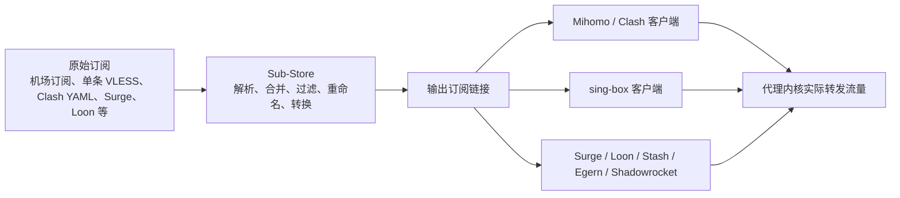
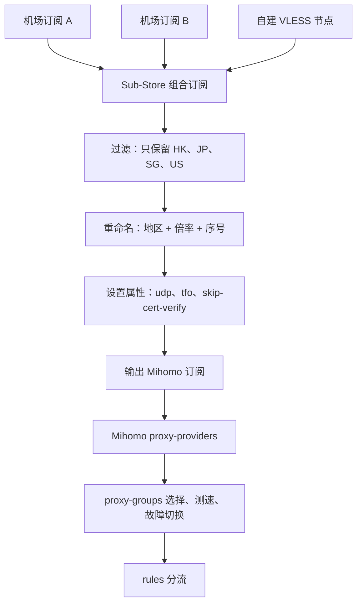
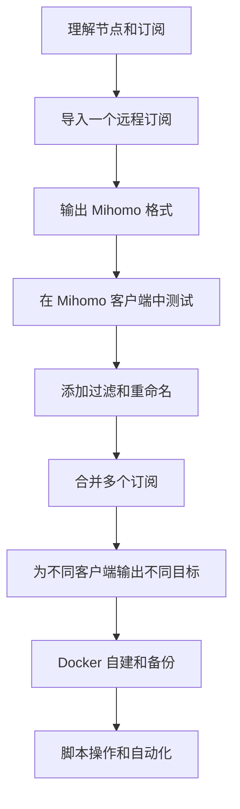

[toc]

## Sub-Store 是什么

**Sub-Store** 可以理解为一个“订阅管理中间层”（Subscription Manager）。它本身不是代理内核，也不是 Clash/Mihomo、Xray、sing-box 这类负责转发流量的程序，而是专门用来 **管理、转换、清洗、合并、重命名、过滤、托管和输出订阅** 的工具。

官方仓库对它的定位是：面向 Quantumult X、Loon、Surge、Stash、Egern、Shadowrocket 等客户端的高级订阅管理器。它的核心功能包括：不同格式之间转换、订阅格式化、把多个订阅合并到一个 URL、托管并修改订阅或文件。([GitHub](https://github.com/sub-store-org/Sub-Store))

换句话说，Sub-Store 解决的是这类问题：

> 我手里有很多机场订阅、单条节点、VLESS 链接、Clash 配置、Surge 配置，但不同客户端需要不同格式；我还想筛选节点、重命名节点、合并订阅、输出 Mihomo 或 sing-box 配置。

### 简单使用

mihomo的一个跨平台客户端(clash party)集成了sub-store.

允许用户直接在本地管理订阅.

------

## 它在代理工具链中的位置



Sub-Store 不负责真正建立代理连接。真正连接远程节点的是：

| 类别       | 代表                                                         |
| ---------- | ------------------------------------------------------------ |
| 代理内核   | Mihomo、Xray-core、sing-box                                  |
| 图形客户端 | Clash Verge Rev、v2rayN、Stash、Shadowrocket、Loon、Surge、Egern |
| 订阅管理层 | Sub-Store                                                    |

Sub-Store 更像“订阅加工厂”：输入一堆原始订阅，经过规则处理后，输出给不同客户端可用的订阅。

------

## 详细大纲

## 基础认知

- Sub-Store 的定位
- 它和 Mihomo、Xray、sing-box 的区别
- 它适合解决哪些订阅管理问题
- 它不适合解决哪些问题

## 核心功能

- 订阅格式转换
- 多订阅合并
- 节点过滤
- 节点重命名
- 节点排序
- 节点属性修改
- 脚本处理
- 订阅托管
- 文件托管
- Gist 同步和备份
- Docker、自建、代理 App 模块等部署方式

## 与 Mihomo 的关系

- 把 VLESS、VMess、Trojan、Hysteria2、TUIC 等节点转换成 Mihomo 节点
- 输出 Clash.Meta/Mihomo 兼容订阅
- 生成 Mihomo 配置文件
- 与 proxy-providers、rule-providers 的配合方式

## 与 sing-box 的关系

- 输出 sing-box 订阅或配置
- 注意 sing-box 和 Mihomo 配置模型不同
- 不要把 Mihomo YAML 直接当 sing-box JSON 使用

## 实用工作流

- 单订阅转换
- 多机场合并
- 节点重命名
- 地区筛选
- 按协议筛选
- 生成 Mihomo 订阅
- 生成 sing-box 订阅
- 自建 Docker 服务
- 安全配置和隐私注意事项

------

## 核心术语

| 术语      | 英文术语                      | 说明                                                 |
| --------- | ----------------------------- | ---------------------------------------------------- |
| 订阅      | Subscription                  | 一个远程链接，通常返回多个代理节点                   |
| 单条节点  | Proxy URI                     | 例如 `vless://...`、`trojan://...`、`ss://...`       |
| 组合订阅  | Collection                    | 把多个订阅源合并成一个输出                           |
| 目标平台  | Target Platform               | 输出给哪个客户端或内核，例如 Mihomo、Surge、sing-box |
| 节点操作  | Proxy Operation               | 对节点进行重命名、排序、设置属性、删除等处理         |
| 脚本操作  | Script Operator               | 用 JavaScript 对节点做更复杂的自定义处理             |
| 托管文件  | Hosted File                   | 由 Sub-Store 输出并托管的配置或文本文件              |
| Gist 同步 | Gist Sync                     | 把 Sub-Store 数据备份到 GitHub Gist，或从 Gist 恢复  |
| CORS      | Cross-Origin Resource Sharing | 浏览器跨源访问控制，影响前端访问后端 API             |
| MitM      | Man-in-the-Middle             | 中间人重写机制，代理 App 模块版会涉及请求重写        |

------

## Sub-Store 支持哪些输入和输出

## 支持的输入格式

官方 README 中列出的输入格式非常广。它支持常见代理 URI，例如 AnyTLS、SOCKS、SS、SSR、VMess、VLESS、Trojan、Hysteria、Hysteria 2、TUIC v5、WireGuard 等，也支持 Clash Proxies YAML、Clash Proxy JSON/JSON5/YAML、QX、Loon、Surge、Mihomo 兼容格式等。([GitHub](https://github.com/sub-store-org/Sub-Store))

| 输入类型                    | 示例                      | 说明                  |
| --------------------------- | ------------------------- | --------------------- |
| 单条 URI                    | `vless://...`             | 常见于节点分享        |
| Clash/Mihomo 节点 YAML      | `- name: ... type: vless` | 可导入已有 Clash 节点 |
| Clash Proxy JSON/JSON5/YAML | 单行或结构化节点          | 用于节点片段转换      |
| Surge 节点                  | Surge Proxy 语法          | 可转换到其他平台      |
| Loon 节点                   | Loon Proxy 语法           | iOS 用户常见          |
| Quantumult X 节点           | QX 语法                   | iOS 用户常见          |
| 远程订阅                    | HTTPS 订阅链接            | 最常见输入形式        |
| 本地节点内容                | 多行节点文本              | 适合手动维护少量节点  |

官方也提醒，不建议用 Shadowrocket 或 NekoBox 导出的 URI 再作为输入，因为这些导出的 URI 可能不是标准 URI；不过项目已经兼容了一些常见的非标准 VMess、VLESS URI。([GitHub](https://github.com/sub-store-org/Sub-Store))

------

## 支持的输出目标

Sub-Store 支持输出到多种目标平台，包括 Plain JSON、Stash、Clash.Meta/Mihomo、Surfboard、Surge、SurgeMac、Loon、Egern、Shadowrocket、Quantumult X、sing-box、V2Ray、V2Ray URI 等。旧版 Clash 目标已经被标记为 deprecated，Mihomo/Clash.Meta 才是现代 Clash 系输出重点。([GitHub](https://github.com/sub-store-org/Sub-Store))

| 输出目标            | 适合场景                                                    |
| ------------------- | ----------------------------------------------------------- |
| Clash.Meta / Mihomo | Clash Verge Rev、FlClash、OpenClash、Clash Meta for Android |
| sing-box            | sing-box 原生客户端或衍生前端                               |
| Surge               | macOS/iOS 高级代理客户端                                    |
| Loon                | iOS 代理客户端                                              |
| Egern               | iOS 代理客户端                                              |
| Shadowrocket        | iOS 常见代理客户端                                          |
| Quantumult X        | QX 用户                                                     |
| V2Ray URI           | 输出为 v2rayN 等工具可导入的 URI                            |
| Plain JSON          | 程序化处理或调试                                            |

------

## Sub-Store 的核心能力

## 格式转换

最基础的用途是：

> 把 A 客户端能识别的订阅，转换成 B 客户端能识别的订阅。

例如：

| 输入         | 输出              |
| ------------ | ----------------- |
| VLESS URI    | Mihomo YAML 节点  |
| Trojan URI   | Surge 节点        |
| Clash 订阅   | sing-box 配置     |
| Loon 节点    | Shadowrocket 节点 |
| 多个机场订阅 | 一个 Mihomo 订阅  |
| 本地节点文本 | Quantumult X 订阅 |

Sub-Store 的 README 把“Conversion among various formats”列为核心功能之一。([GitHub](https://github.com/sub-store-org/Sub-Store))

------

## 订阅合并

你可以把多个订阅源合并成一个输出链接。

典型场景：

| 场景                     | 说明                                               |
| ------------------------ | -------------------------------------------------- |
| 多个机场统一管理         | 把机场 A、机场 B、备用订阅合成一个订阅             |
| 自建节点加机场节点       | 把自建 VLESS 节点和机场订阅合并                    |
| 给不同客户端输出不同格式 | 同一组节点输出 Mihomo、Surge、sing-box             |
| 分用途输出               | 一个输出给日常使用，一个输出给测速，一个输出给手机 |

官方核心功能里明确包含“Collect multiple subscriptions in one URL”。([GitHub](https://github.com/sub-store-org/Sub-Store))

------

## 节点过滤

Sub-Store 支持多种过滤方式，包括：

| 过滤方式     | 用途                                       |
| ------------ | ------------------------------------------ |
| 正则过滤     | 只保留名称匹配某关键词的节点               |
| 正则丢弃     | 删除名称匹配某关键词的节点                 |
| 地区过滤     | 按地区、旗帜、名称识别筛选                 |
| 协议类型过滤 | 只保留 VLESS、Trojan、Hysteria2 等特定协议 |
| 无效节点过滤 | 删除无用或异常节点                         |
| 脚本过滤     | 用 JavaScript 自定义复杂过滤逻辑           |

README 中的 Subscription Formatting 部分列出了 Regex filter、Discard regex filter、Region filter、Type filter、Useless proxies filter、Script filter 等功能。([GitHub](https://github.com/sub-store-org/Sub-Store))

------

## 节点操作

节点操作用于批量修改订阅里的节点。

| 操作           | 作用                                         |
| -------------- | -------------------------------------------- |
| 设置属性       | 批量设置 `udp`、`tfo`、`skip-cert-verify` 等 |
| 添加或移除旗帜 | 给节点名加地区旗帜，或删除旗帜               |
| 排序           | 按节点名称排序                               |
| 正则排序       | 按关键词顺序排序                             |
| 正则重命名     | 批量替换节点名里的文本                       |
| 正则删除       | 删除名称匹配的节点                           |
| 脚本修改       | 使用脚本对节点做复杂修改                     |
| 解析域名到 IP  | 把节点域名解析为 IP 地址                     |

这些能力在 README 的 Proxy Operations 部分有列出。([GitHub](https://github.com/sub-store-org/Sub-Store))

------

## 文件托管和 Mihomo 配置生成

Sub-Store 不只管理“订阅”，也可以托管“文件”。Wiki 的链接参数说明中提到，文件链接 `/api/file/___` 支持运行时覆盖来源配置，并且 `type=mihomoConfig` 可以用于生成 Mihomo 配置文件；当 `mode=proxy` 时，会把来源内容转换为 Mihomo 节点后写入 `proxies`。([GitHub](https://github.com/sub-store-org/Sub-Store/wiki/链接参数说明))

这意味着它可以做两类事情：

| 类型         | 作用                                |
| ------------ | ----------------------------------- |
| 输出节点订阅 | 给 Mihomo 的 `proxy-providers` 使用 |
| 输出完整配置 | 生成一份 Mihomo 配置文件            |

两者区别很重要：

| 输出内容     | 用在 Mihomo 哪里   | 适合场景                               |
| ------------ | ------------------ | -------------------------------------- |
| 纯节点列表   | `proxy-providers`  | 你已有自己的主配置，只想让节点自动更新 |
| 完整配置文件 | 直接作为客户端配置 | 新手快速使用，或多设备统一配置         |

------

## Sub-Store 与 Mihomo 的典型工作流

## 工作流示意图



## Mihomo 中使用 Sub-Store 输出

假设你已经在 Sub-Store 里创建了一个名为 `main` 的订阅，并输出 Mihomo 兼容格式，那么在 Mihomo 主配置中可以这样引用：

```yaml
proxy-providers:
  sub-store-main:
    type: http
    url: "https://your-sub-store.example.com/download/main/ClashMeta"
    path: ./proxy_providers/sub-store-main.yaml
    interval: 3600
    health-check:
      enable: true
      url: https://www.gstatic.com/generate_204
      interval: 300

proxy-groups:
  - name: "PROXY"
    type: select
    use:
      - sub-store-main
    proxies:
      - DIRECT

  - name: "AUTO"
    type: url-test
    use:
      - sub-store-main
    url: https://www.gstatic.com/generate_204
    interval: 300

rules:
  - GEOIP,CN,DIRECT
  - MATCH,PROXY
```

这里的关键思想是：

- Sub-Store 负责“节点源”。
- Mihomo 负责“代理组、规则分流、DNS、TUN、实际连接”。
- 你不需要每次手工改 Mihomo 的 `proxies`，只需要让 Mihomo 定时拉取 Sub-Store 输出。

------

## 把 VLESS 链接转换为 Mihomo 订阅

假设你有一条 VLESS 链接：

```text
vless://11111111-1111-1111-1111-111111111111@example.com:443?type=tcp&security=reality&encryption=none&flow=xtls-rprx-vision&sni=www.example.com&fp=chrome&pbk=PUBLIC_KEY_EXAMPLE&sid=abcd1234#VLESS-REALITY-DEMO
```

用 Sub-Store 的思路，不一定要手写 YAML。你可以：

- 创建一个订阅。
- 把这条 VLESS 链接作为本地节点内容。
- 选择目标平台为 Clash.Meta/Mihomo。
- 输出一个 Mihomo 可拉取的订阅链接。

Wiki 说明，Sub-Store 生成的订阅地址支持传入 `url`、`content`、`ua` 等参数复用已有订阅设置；参数需要 `encodeURIComponent` 编码。([GitHub](https://github.com/sub-store-org/Sub-Store/wiki/链接参数说明))

示意形式如下：

```text
/download/sub/ClashMeta?content=encodeURIComponent编码后的VLESS链接
```

或者使用 `target` 参数的形式：

```text
/download/sub?target=ClashMeta&content=encodeURIComponent编码后的VLESS链接
```

需要注意：Wiki 明确提醒，布尔开关是按“是否传入参数”判断的，传入 `false` 这种非空字符串也会被视为启用；不想启用某参数就不要传这个参数。([GitHub](https://github.com/sub-store-org/Sub-Store/wiki/链接参数说明))

------

## Sub-Store 与 sing-box 的典型关系

Sub-Store 也支持输出 sing-box 目标。README 的 Supported Target Platforms 中包含 sing-box。([GitHub](https://github.com/sub-store-org/Sub-Store))

不过要注意：

| 项目           | Mihomo                     | sing-box                          |
| -------------- | -------------------------- | --------------------------------- |
| 配置格式       | YAML                       | JSON                              |
| 订阅生态       | Clash/Mihomo 风格成熟      | 更偏 sing-box 原生结构            |
| 代理组模型     | `proxy-groups`             | `selector`、`urltest` 等 outbound |
| 规则集模型     | `rule-providers`           | `rule-set`                        |
| Sub-Store 作用 | 输出 Mihomo 兼容节点或配置 | 输出 sing-box 可用配置或节点      |

不要把 Sub-Store 输出的 Mihomo YAML 直接给 sing-box 使用，也不要把 sing-box JSON 直接给 Mihomo 使用。Sub-Store 的价值就在于：用同一批原始节点，按目标平台重新生成对应格式。

------

## 部署方式

Sub-Store 常见部署方式包括：

| 部署方式        | 适合人群                         | 特点                                                     |
| --------------- | -------------------------------- | -------------------------------------------------------- |
| 代理 App 模块版 | Surge、Loon、Stash、Egern 等用户 | 依赖代理 App 的 rewrite/MitM 能力                        |
| Docker 版       | 服务器、NAS、VPS、软路由用户     | 适合长期运行，自托管                                     |
| Android 版      | Android 用户                     | 有 Magisk、KernelSU、APatch 模块、SubCase、Termux 等路线 |
| Node 本地开发版 | 开发者                           | 用于调试和二次开发                                       |

Wiki 的安装页列出了代理 App 版、Android 版、Docker 版、Termux 版等安装方向，并提醒最新环境变量应以 Docker Hub 页面为准。([GitHub](https://github.com/sub-store-org/Sub-Store/wiki))

------

## Docker 版基础部署思路

Docker Hub 页面给出了官方 Docker 使用说明，并展示了 `xream/sub-store` 镜像的快速启动示例。示例中使用了数据目录挂载、前端端口、后端路径前缀、定时同步任务等环境变量。([Docker Hub](https://hub.docker.com/r/xream/sub-store))

一个适合新手理解的 Docker Compose 示例：

```yaml
services:
  sub-store:
    image: xream/sub-store:latest
    container_name: sub-store
    restart: always
    ports:
      - "127.0.0.1:3001:3001"
    volumes:
      - ./sub-store-data:/opt/app/data
    environment:
      SUB_STORE_FRONTEND_BACKEND_PATH: "/your-secret-path/"
      SUB_STORE_BACKEND_SYNC_CRON: "55 23 * * *"
```

几个关键点：

| 配置                              | 说明                                    |
| --------------------------------- | --------------------------------------- |
| `127.0.0.1:3001:3001`             | 只监听本机，避免直接暴露到公网          |
| `./sub-store-data:/opt/app/data`  | 持久化数据                              |
| `SUB_STORE_FRONTEND_BACKEND_PATH` | 给后端 API 增加路径前缀，降低被扫描风险 |
| `SUB_STORE_BACKEND_SYNC_CRON`     | 定时将订阅或文件上传到私有 Gist         |

Docker Hub 文档也说明，从后端版本 `2.14.376` 开始，应使用 `SUB_STORE_BACKEND_SYNC_CRON`，旧的 `SUB_STORE_BACKEND_CRON` 被弃用，Docker 版旧变量 `SUB_STORE_CRON` 后续也不再支持。([Docker Hub](https://hub.docker.com/r/xream/sub-store))

------

## 安全注意事项

## sub.store 域名风险

这是使用 Sub-Store 必须注意的一点。

官方 Wiki 和 README 都特别说明：`sub.store` 只是模块脚本重写 MitM 使用的域名，并不是项目方持有的公网域名。如果请求没有进入 rewrite，数据可能会发往公网 `sub.store` 服务，存在数据泄露风险；官方前端是 Sub-Store 的 Vercel 前端，而不是 `sub.store`。([GitHub](https://github.com/sub-store-org/Sub-Store/wiki))

官方给出的缓解思路之一是把 `sub.store` 映射到本地地址，例如：

```text
[Host]
sub.store = 127.0.0.1
```

README 也提到，Sub-Store 支持配置浏览器 CORS allowlist；Node/server 部署使用 `SUB_STORE_CORS_ALLOWED_ORIGINS`，默认是 `*` 以保持兼容，但只有在接受任意网站读取本地后端 API 响应的风险时才应设为 `*`。([GitHub](https://github.com/sub-store-org/Sub-Store))

## 后端不要裸露公网

Docker Hub 文档明确提醒，`SUB_STORE_BACKEND_API_HOST` 是内部裸后端，应该永远不要暴露；后端默认端口是 `3000`，前端默认端口是 `3001`。([Docker Hub](https://hub.docker.com/r/xream/sub-store))

推荐做法：

| 项目       | 建议                                      |
| ---------- | ----------------------------------------- |
| 监听地址   | 优先监听 `127.0.0.1`                      |
| 公网访问   | 通过反向代理加 HTTPS、认证、访问控制      |
| 后端 API   | 不要直接暴露裸 API                        |
| 后端路径   | 使用随机路径前缀                          |
| 订阅链接   | 不要公开发布                              |
| Gist Token | 使用最小权限，泄露后及时吊销              |
| CORS       | 不懂就不要设为任意来源                    |
| 日志       | 不要把含 token 的完整订阅链接发到公开场合 |

------

## Gist 同步、备份和恢复

Sub-Store 支持把数据同步到私有 Gist，也支持备份和恢复。Docker Hub 文档提到：

- `SUB_STORE_BACKEND_SYNC_CRON` 用于定时将订阅或文件上传到私有 Gist。
- `SUB_STORE_BACKEND_UPLOAD_CRON` 和 `SUB_STORE_BACKEND_DOWNLOAD_CRON` 可用于定时备份和恢复全部数据。
- GitHub 会扫描明文 Gist 中的 GitHub Token；如果使用明文备份，Sub-Store 不会备份设置中的 GitHub Token；默认使用 Base64 编码。([Docker Hub](https://hub.docker.com/r/xream/sub-store))

新手建议：

| 场景         | 建议                              |
| ------------ | --------------------------------- |
| 单设备使用   | 本地数据目录持久化即可            |
| 多设备同步   | 使用 Gist 同步                    |
| 自建服务迁移 | 先备份，再迁移数据目录            |
| Token 失效   | 删除旧 Token，重新创建并更新      |
| 公开分享配置 | 不要包含订阅 URL、Token、后端地址 |

------

## 链接参数机制

Sub-Store 的下载链接不只是固定输出，也支持运行时参数。

Wiki 说明，生成的订阅地址支持传入：

| 参数                    | 作用                                       |
| ----------------------- | ------------------------------------------ |
| `target`                | 指定输出目标，例如 Surge、Mihomo、sing-box |
| `url`                   | 指定远程订阅链接                           |
| `content`               | 指定本地节点或订阅内容                     |
| `ua`                    | 指定请求时使用的 User-Agent                |
| `proxy`                 | 指定拉取订阅时使用的代理、节点或策略       |
| `mergeSources`          | 控制本地和远程订阅合并顺序                 |
| `ignoreFailedRemoteSub` | 控制远程订阅失败时的处理方式               |
| `prettyYaml`            | 输出更易读的块状 YAML                      |
| `noCache`               | 不使用远程链接来源缓存                     |
| `$options`              | 给脚本传入参数                             |

这些参数需要 `encodeURIComponent` 编码，尤其是 `url`、`content`、`ua` 这类可能包含特殊字符的值。([GitHub](https://github.com/sub-store-org/Sub-Store/wiki/链接参数说明))

------

## 典型用例

## 用例：多机场合并成一个 Mihomo 订阅

适合人群：有多个机场订阅，希望在 Clash Verge Rev、FlClash、OpenClash 中统一使用。

流程：

- 在 Sub-Store 中添加机场 A。
- 添加机场 B。
- 创建组合订阅。
- 对节点做地区过滤。
- 对节点名统一重命名。
- 输出目标选择 Clash.Meta/Mihomo。
- 在 Mihomo 的 `proxy-providers` 中引用该输出链接。

优点：

| 优点       | 说明                           |
| ---------- | ------------------------------ |
| 统一入口   | Mihomo 只需要拉取一个订阅      |
| 节点名规范 | 不同机场命名风格可以统一       |
| 易于筛选   | 可以只保留需要的地区           |
| 易于迁移   | 换客户端时重新输出目标格式即可 |

------

## 用例：把自建 VLESS 和机场订阅合并

适合人群：有自建节点，又有商业订阅。

流程：

- 把自建 `vless://` 链接作为本地节点内容。
- 把机场订阅作为远程订阅。
- 合并成本地优先或远程优先。
- 设置统一命名，例如 `自建-香港-01`、`机场-日本-01`。
- 输出给 Mihomo 或 sing-box。

注意：

| 项目          | 建议                                    |
| ------------- | --------------------------------------- |
| 自建节点      | 保留清晰前缀，例如 `Self` 或 `Home`     |
| 机场节点      | 保留倍率、地区、流媒体标签              |
| VLESS REALITY | 不要丢失 `sni`、`fp`、`pbk`、`sid`      |
| 输出平台      | Mihomo 和 sing-box 要分别生成，不要混用 |

------

## 用例：为不同客户端生成不同订阅

同一批原始节点，可以输出给多个客户端：

| 客户端           | 输出目标          |
| ---------------- | ----------------- |
| Clash Verge Rev  | Clash.Meta/Mihomo |
| sing-box Android | sing-box          |
| Surge            | Surge             |
| Loon             | Loon              |
| Shadowrocket     | Shadowrocket      |
| Quantumult X     | QX                |

这就是 Sub-Store 的核心价值之一：**输入统一，输出适配不同客户端**。

------

## 用例：节点重命名

很多机场节点名可能是这样的：

```text
HK 01 | x2 | Netflix
香港-IEPL-中转-03
🇯🇵 JP Tokyo 05
美国-原生-ChatGPT-倍率3
```

你可以用 Sub-Store 做统一整理：

| 原始命名                  | 目标命名             |
| ------------------------- | -------------------- |
| `HK 01                    | x2                   |
| `香港-IEPL-中转-03`       | `香港 03 IEPL`       |
| `🇯🇵 JP Tokyo 05`          | `日本 05 Tokyo`      |
| `美国-原生-ChatGPT-倍率3` | `美国 01 ChatGPT x3` |

这样在 Mihomo 的代理组里会更清楚。

------

## 用例：只保留特定协议

如果某个客户端不支持某些协议，或者你只想使用稳定协议，可以按类型过滤。

例如：

| 目标            | 可保留                                       |
| --------------- | -------------------------------------------- |
| 老客户端        | SS、Trojan、VMess                            |
| Mihomo 新客户端 | VLESS、Hysteria2、TUIC、Trojan、SS           |
| sing-box        | VLESS、Trojan、Hysteria2、TUIC、WireGuard 等 |
| Surge           | 取决于 Surge 支持情况和 Sub-Store 输出目标   |

Sub-Store 支持 Type filter，也可以通过脚本做更复杂的协议筛选。([GitHub](https://github.com/sub-store-org/Sub-Store))

------

## 推荐实践

## 对新手

| 建议                    | 原因                           |
| ----------------------- | ------------------------------ |
| 先用一个订阅测试        | 降低排错复杂度                 |
| 先输出 Mihomo           | Mihomo/Clash 生态最容易验证    |
| 不要一开始写脚本        | 先用内置过滤、重命名、排序     |
| 节点名保持简单          | 避免 YAML、URL、客户端显示问题 |
| 不要公开 Sub-Store 链接 | 订阅链接可能泄露节点和服务信息 |
| 不要裸露后端 API        | 后端可能包含敏感数据           |
| 定期备份                | 避免迁移或升级时丢配置         |

## 对进阶用户

| 建议                         | 原因                           |
| ---------------------------- | ------------------------------ |
| 用 Docker 自建               | 稳定、可迁移、易备份           |
| 用反代加认证                 | 降低公网风险                   |
| 用 Gist 同步                 | 多设备和灾备方便               |
| 为不同设备建立不同输出       | 手机、电脑、路由器需求不同     |
| 使用脚本参数 `$options`      | 提高复用性                     |
| 对远程订阅设置失败策略       | 避免某个订阅挂掉导致整体不可用 |
| 对重型脚本启用缓存或定时处理 | 避免客户端拉取订阅超时         |

Docker Hub 文档提到 `SUB_STORE_PRODUCE_CRON` 可用于后台定时处理订阅，适合脚本缓存场景，避免 Surge 等 App 拉取订阅时超时。([Docker Hub](https://hub.docker.com/r/xream/sub-store))

------

## 常见误区

| 误区                            | 正确理解                                                     |
| ------------------------------- | ------------------------------------------------------------ |
| Sub-Store 是代理客户端          | 不是，它主要管理和转换订阅                                   |
| Sub-Store 能让节点变快          | 不能直接加速，只能筛选、整理、输出                           |
| Mihomo 配置能直接给 sing-box 用 | 不能，两者配置格式不同                                       |
| `vless://` 转成 Mihomo 一定能用 | 不一定，要看字段是否完整、客户端是否支持                     |
| Docker 暴露公网没关系           | 很危险，订阅和后端 API 都可能含敏感数据                      |
| `sub.store` 是官方公网域名      | 不是，官方明确说它只是模块脚本重写 MitM 使用的域名           |
| `false` 参数就是关闭            | Sub-Store 某些布尔参数按是否传入判断，传 `false` 也可能视为启用 |
| 订阅转换可以无损                | 不一定，不同客户端支持的协议和字段有差异                     |

------

## 和其他工具的区别

| 工具            | 定位         | 与 Sub-Store 的关系                                  |
| --------------- | ------------ | ---------------------------------------------------- |
| Mihomo          | 代理内核     | 消费 Sub-Store 输出的节点或配置                      |
| Xray            | 代理内核     | 可作为节点协议生态来源                               |
| sing-box        | 代理内核     | 消费 Sub-Store 输出的 sing-box 配置                  |
| v2rayN          | 图形客户端   | 可导入 V2Ray URI 或调用 Xray/sing-box                |
| Clash Verge Rev | Mihomo 前端  | 通常拉取 Sub-Store 输出的 Mihomo 订阅                |
| subconverter    | 订阅转换器   | 更偏传统订阅转换，Sub-Store 更偏可视化管理和二次处理 |
| Sub-Store       | 订阅管理平台 | 负责转换、合并、过滤、托管、输出                     |

------

## 适合谁使用

| 用户类型                           | 是否适合                                 |
| ---------------------------------- | ---------------------------------------- |
| 只有一个订阅，直接导入 Clash 就够  | 不一定需要                               |
| 有多个订阅，经常切换客户端         | 很适合                                   |
| 想统一输出 Mihomo、Surge、sing-box | 很适合                                   |
| 想批量重命名和过滤节点             | 很适合                                   |
| 想自建订阅管理服务                 | 很适合                                   |
| 完全不懂代理格式的新手             | 可以用，但建议先理解节点、订阅、目标平台 |
| 只想让网络变快                     | 不适合，它不是加速器                     |

------

## 最小学习路线



------

## 简洁总结

Sub-Store 的核心价值是：**把混乱的代理订阅整理成可控、可复用、可输出到多平台的订阅系统**。

在你前面讨论的 VLESS、Mihomo、sing-box、Xray 语境里，它最实用的定位是：

- 用来把 `vless://`、Trojan、SS、Hysteria2、TUIC 等节点转换为 Mihomo 或 sing-box 可用格式。
- 用来把多个机场和自建节点合并成一个订阅。
- 用来统一节点命名、过滤地区、筛选协议、设置节点属性。
- 用来给不同客户端输出不同格式。
- 用来托管 Mihomo 配置或节点订阅。
- 用来自建一个长期可维护的订阅管理后台。

对于新手，推荐先把它当成 **Mihomo 订阅整理器** 来学；等理解节点、代理组、规则和客户端格式差异后，再进一步使用脚本、Gist 同步、Docker 自建和多平台输出。