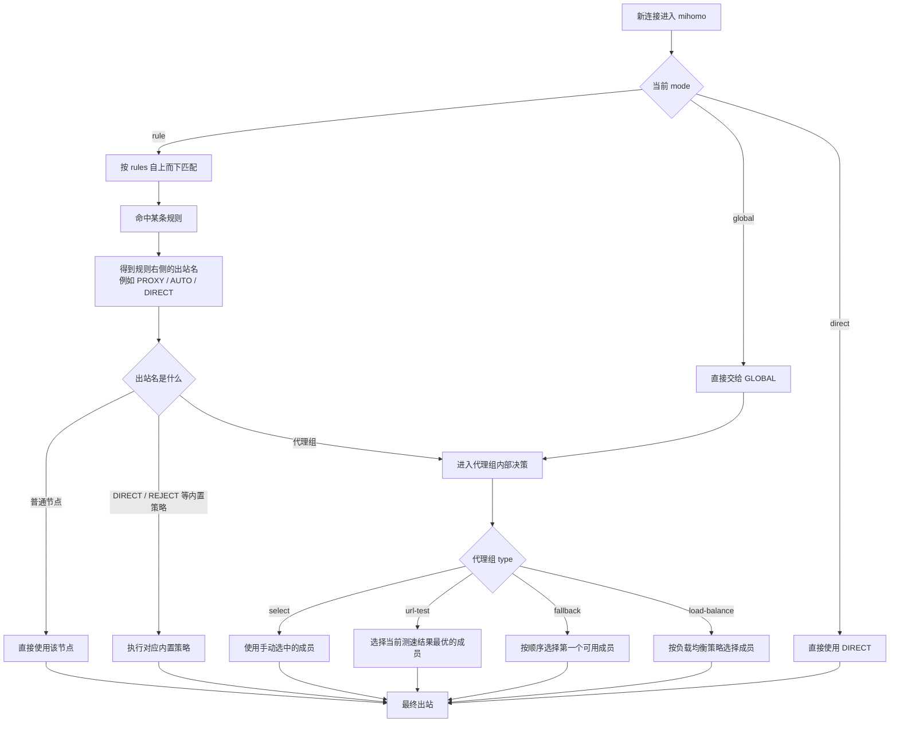
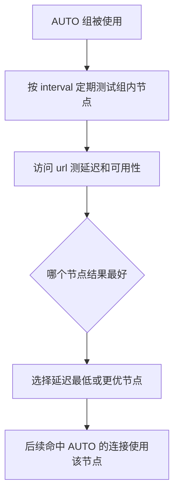
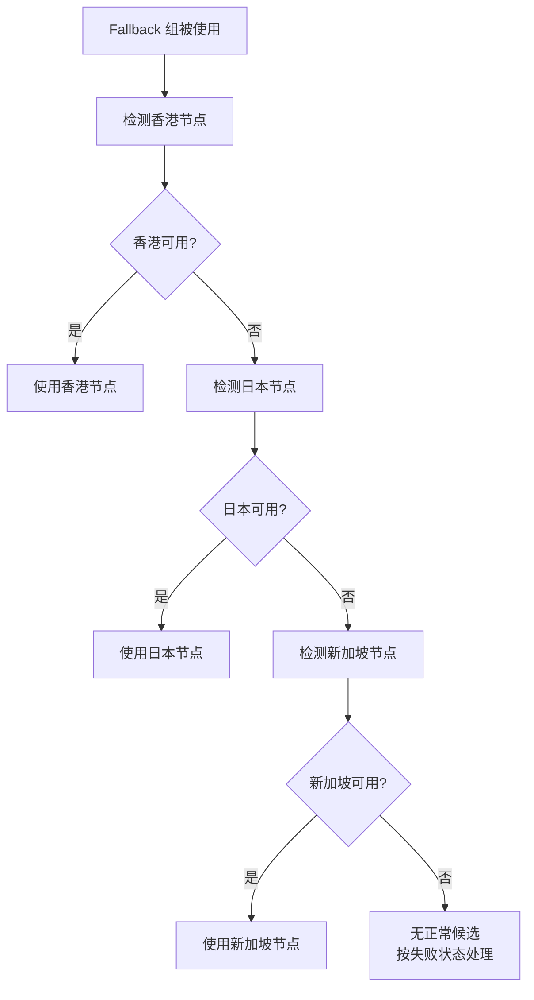
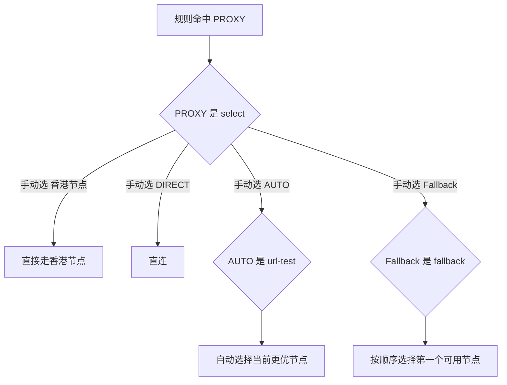

[toc]

## abstract

既然节点可以手动选择,那么和代理组(规则)下代理节点到底是怎么决定的(尤其是在自动选择组(url-test)和fallback组)?

关键要分清两个层级：

> **规则决定“把流量交给哪个出站/策略组”；策略组决定“这个策略组内部最终用哪个节点”。**

也就是说，`rules` 不会直接替 `url-test`、`fallback` 里的节点做最终选择。

规则只负责把连接导向某个名字，比如 `PROXY`、`AUTO`、`Fallback`、`DIRECT`。如果这个名字是代理组，mihomo 再根据代理组类型继续决策。



官方代理组通用字段说明里，`proxies` 可以引用普通出站代理，也可以引用其他代理组；`use` 可以引用代理提供者。这意味着代理组内部可以继续套代理组，形成多层决策。([虚空终端](https://wiki.metacubex.one/en/config/proxy-groups/))

## 第一阶段：规则只决定“去哪个策略组”

例如：

```yaml
mode: rule

proxy-groups:
  - name: PROXY
    type: select
    proxies:
      - AUTO
      - Fallback
      - 香港节点
      - 日本节点
      - DIRECT

  - name: AUTO
    type: url-test
    proxies:
      - 香港节点
      - 日本节点
      - 新加坡节点
    url: https://www.gstatic.com/generate_204
    interval: 300

  - name: Fallback
    type: fallback
    proxies:
      - 香港节点
      - 日本节点
      - 新加坡节点
    url: https://www.gstatic.com/generate_204
    interval: 300

rules:
  - DOMAIN-SUFFIX,google.com,PROXY
  - DOMAIN-SUFFIX,github.com,AUTO
  - DOMAIN-SUFFIX,telegram.org,Fallback
  - GEOIP,CN,DIRECT
  - MATCH,PROXY
```

这时：

| 访问目标       | 规则命中                              | 第一阶段结果       |
| -------------- | ------------------------------------- | ------------------ |
| `google.com`   | `DOMAIN-SUFFIX,google.com,PROXY`      | 交给 `PROXY` 组    |
| `github.com`   | `DOMAIN-SUFFIX,github.com,AUTO`       | 交给 `AUTO` 组     |
| `telegram.org` | `DOMAIN-SUFFIX,telegram.org,Fallback` | 交给 `Fallback` 组 |
| 国内 IP        | `GEOIP,CN,DIRECT`                     | 直接直连           |
| 其他流量       | `MATCH,PROXY`                         | 交给 `PROXY` 组    |

规则到这里就结束了。后面到底是香港、日本、新加坡，由被命中的策略组类型决定。

## 第二阶段：策略组内部如何决定节点

### `select`：手动选择组

`select` 是最容易理解的类型。官方示例中，`type: select` 的组里可以列出 `ss`、`vmess`、`auto` 等成员。([虚空终端](https://wiki.metacubex.one/en/config/proxy-groups/select/))

```yaml
proxy-groups:
  - name: PROXY
    type: select
    proxies:
      - AUTO
      - Fallback
      - 香港节点
      - 日本节点
      - DIRECT
```

`select` 的逻辑是：

| 当前选择        | 最终行为                                                     |
| --------------- | ------------------------------------------------------------ |
| 选中 `香港节点` | 命中 `PROXY` 的流量直接走香港节点                            |
| 选中 `日本节点` | 命中 `PROXY` 的流量直接走日本节点                            |
| 选中 `DIRECT`   | 命中 `PROXY` 的流量直连                                      |
| 选中 `AUTO`     | 命中 `PROXY` 的流量继续进入 `AUTO` 组，由 `url-test` 决定    |
| 选中 `Fallback` | 命中 `PROXY` 的流量继续进入 `Fallback` 组，由 `fallback` 决定 |

所以 `select` 不一定只能选“具体节点”，也可以选“另一个策略组”。

这就是很多配置会这样写的原因：

```yaml
- name: PROXY
  type: select
  proxies:
    - AUTO
    - Fallback
    - 香港节点
    - 日本节点
    - DIRECT
```

它的意思是：
**日常入口是 `PROXY`，用户可以手动决定这个入口到底使用自动选择、故障回退、指定节点，还是直连。**

### `url-test`：自动选择延迟较低的节点

`url-test` 会对组内节点访问指定 `url` 做健康检查 / 延迟测试，并根据结果选择节点。官方 `url-test` 示例包含 `url`、`interval` 和 `tolerance` 字段；其中 `url` 是健康检查测试地址，`interval` 是测试间隔，`tolerance` 是切换容差，单位毫秒。([虚空终端](https://wiki.metacubex.one/en/config/proxy-groups/url-test/))

典型配置：

```yaml
proxy-groups:
  - name: AUTO
    type: url-test
    proxies:
      - 香港节点
      - 日本节点
      - 新加坡节点
    url: https://www.gstatic.com/generate_204
    interval: 300
    tolerance: 50
```

可以理解为：



`url-test` 的核心不是“用户点哪个节点”，而是“mihomo 根据测速结果自动选”。不过图形客户端可能仍然展示它当前选中的节点和各节点延迟。

`tolerance` 很重要。它可以避免节点在延迟差距很小时频繁切换。例如：

| 节点       | 延迟   |
| ---------- | ------ |
| 香港节点   | 80 ms  |
| 日本节点   | 100 ms |
| 新加坡节点 | 120 ms |

如果 `tolerance: 50`，香港和日本之间只差 20 ms，未必值得立即切换。这样可以减少“今天选香港，几分钟后选日本，再过几分钟又切回香港”的抖动。

注意 `lazy`：代理组通用字段里 `lazy` 默认是 `true`，含义是如果当前代理组没有被选中，就不进行测试。([虚空终端](https://wiki.metacubex.one/en/config/proxy-groups/))

这会导致一个常见现象：

| 现象                                | 原因                                     |
| ----------------------------------- | ---------------------------------------- |
| 刚启动时 `AUTO` 里没有延迟          | `AUTO` 还没有被实际使用，且 `lazy: true` |
| 点击测速后才有结果                  | 客户端主动调用测速 API                   |
| 把 `PROXY` 选成 `AUTO` 后才开始更新 | `AUTO` 进入被使用状态                    |

### `fallback`：按顺序选择第一个可用节点

`fallback` 和 `url-test` 最大区别是：**它不是选延迟最低，而是按你写的顺序选第一个可用节点**。官方文档说明，当前节点超时时，会按 `proxies` 顺序选择第一个可用节点。([虚空终端](https://wiki.metacubex.one/en/config/proxy-groups/fallback/))

典型配置：

```yaml
proxy-groups:
  - name: Fallback
    type: fallback
    proxies:
      - 香港节点
      - 日本节点
      - 新加坡节点
    url: https://www.gstatic.com/generate_204
    interval: 300
```

它的逻辑可以理解为：



所以顺序非常重要。

例如：

```yaml
proxies:
  - 香港节点
  - 日本节点
  - 新加坡节点
```

意思是：

| 优先级 | 节点       |
| ------ | ---------- |
| 最高   | 香港节点   |
| 第二   | 日本节点   |
| 第三   | 新加坡节点 |

哪怕日本节点延迟比香港低，只要香港可用，`fallback` 通常仍优先香港。它追求的是“主备稳定”，不是“最低延迟”。

## `url-test` 和 `fallback` 的关键区别

| 对比项       | `url-test`                             | `fallback`                         |
| ------------ | -------------------------------------- | ---------------------------------- |
| 核心目标     | 自动选更快节点                         | 主节点故障时切备用节点             |
| 决策依据     | 延迟 / 健康检查结果                    | 可用性 + 配置顺序                  |
| 是否重视顺序 | 相对不重要                             | 非常重要                           |
| 适合场景     | 同地区多节点自动择优                   | 主节点优先，备用节点兜底           |
| 常见问题     | 频繁跳节点                             | 主节点只要没超时就不切             |
| 关键字段     | `url`、`interval`、`tolerance`、`lazy` | `url`、`interval`、`timeout`、顺序 |

一句话：

> `url-test` 是“谁快用谁”；`fallback` 是“第一个能用的优先用，坏了才往后退”。

## 手动选择和自动选择如何叠加

重点来了：**手动选择通常发生在 `select` 组；自动选择发生在 `url-test` / `fallback` 组内部。**

例如：

```yaml
proxy-groups:
  - name: PROXY
    type: select
    proxies:
      - AUTO
      - Fallback
      - 香港节点
      - 日本节点
      - DIRECT

  - name: AUTO
    type: url-test
    proxies:
      - 香港节点
      - 日本节点
      - 新加坡节点
    url: https://www.gstatic.com/generate_204
    interval: 300

  - name: Fallback
    type: fallback
    proxies:
      - 香港节点
      - 日本节点
      - 新加坡节点
    url: https://www.gstatic.com/generate_204
    interval: 300
```

如果规则命中 `PROXY`：

| `PROXY` 当前手动选择 | 下一步                                |
| -------------------- | ------------------------------------- |
| `香港节点`           | 直接走香港节点                        |
| `日本节点`           | 直接走日本节点                        |
| `DIRECT`             | 直接直连                              |
| `AUTO`               | 进入 `AUTO`，由 `url-test` 自动选     |
| `Fallback`           | 进入 `Fallback`，由 `fallback` 自动选 |

所以“手动选择”和“自动选择”不是互相排斥，而是可以嵌套：



## 一个完整例子

配置：

```yaml
proxy-groups:
  - name: PROXY
    type: select
    proxies:
      - AUTO
      - Fallback
      - 香港节点
      - 日本节点
      - DIRECT

  - name: AUTO
    type: url-test
    proxies:
      - 香港节点
      - 日本节点
      - 新加坡节点
    url: https://www.gstatic.com/generate_204
    interval: 300
    tolerance: 50

  - name: Fallback
    type: fallback
    proxies:
      - 香港节点
      - 日本节点
      - 新加坡节点
    url: https://www.gstatic.com/generate_204
    interval: 300

rules:
  - DOMAIN-SUFFIX,google.com,PROXY
  - DOMAIN-SUFFIX,github.com,AUTO
  - DOMAIN-SUFFIX,telegram.org,Fallback
  - GEOIP,CN,DIRECT
  - MATCH,PROXY
```

假设节点状态如下：

| 节点       | 延迟   | 是否可用 |
| ---------- | ------ | -------- |
| 香港节点   | 120 ms | 可用     |
| 日本节点   | 80 ms  | 可用     |
| 新加坡节点 | 200 ms | 可用     |

结果：

| 访问目标       | 命中规则   | 策略组决策                      | 最终结果 |
| -------------- | ---------- | ------------------------------- | -------- |
| `google.com`   | `PROXY`    | 看 `PROXY` 手动选了什么         | 不固定   |
| `github.com`   | `AUTO`     | `url-test` 选延迟更低的日本节点 | 日本节点 |
| `telegram.org` | `Fallback` | 香港节点排第一且可用            | 香港节点 |
| 国内网站       | `DIRECT`   | 不进代理组                      | 直连     |
| 其他网站       | `PROXY`    | 看 `PROXY` 手动选了什么         | 不固定   |

如果 `PROXY` 当前手动选的是 `AUTO`，那么 `google.com` 和 `MATCH` 兜底流量也会走 `AUTO` 自动选择。

如果 `PROXY` 当前手动选的是 `Fallback`，那么这些流量就会走主备回退逻辑。

## `use`、`include-all`、`filter` 对节点池的影响

代理组里的候选节点来自几个来源：

```yaml
proxy-groups:
  - name: 香港自动
    type: url-test
    use:
      - provider1
    filter: "(?i)港|hk|hongkong|hong kong"
    exclude-filter: "游戏|倍率"
    url: https://www.gstatic.com/generate_204
    interval: 300
```

官方通用字段说明：

| 字段                    | 作用                                     |
| ----------------------- | ---------------------------------------- |
| `proxies`               | 引用普通出站代理或其他代理组             |
| `use`                   | 引用 proxy-provider 代理集               |
| `include-all`           | 包含所有出站代理和代理集，但不包含代理组 |
| `include-all-proxies`   | 包含所有普通出站代理                     |
| `include-all-providers` | 包含所有代理集                           |
| `filter`                | 对包含进来的节点做关键词或正则过滤       |
| `exclude-filter`        | 排除匹配的节点                           |
| `exclude-type`          | 按节点类型排除                           |

这些字段会决定 `url-test` 或 `fallback` 的“候选池”。候选池确定之后，`url-test` 再测速择优，`fallback` 再按顺序回退。([虚空终端](https://wiki.metacubex.one/en/config/proxy-groups/))

一个容易忽略的点：官方文档说明 `url` 健康检查只检查代理组 `proxies` 字段里的代理，不检查通过 `use` 引入的 provider 代理。这个细节在实际配置中要结合客户端和内核版本验证，尤其是大量使用 provider 的订阅配置。([虚空终端](https://wiki.metacubex.one/en/config/proxy-groups/))

## 用户手动选择会不会覆盖 `url-test` / `fallback`

一般来说：

| 组类型         | 是否适合手动选择具体节点 | 手动操作的真实含义       |
| -------------- | ------------------------ | ------------------------ |
| `select`       | 是                       | 用户指定当前成员         |
| `url-test`     | 不主要靠手动             | 内核根据测速自动选择     |
| `fallback`     | 不主要靠手动             | 内核根据可用性和顺序选择 |
| `load-balance` | 不主要靠手动             | 内核按负载均衡策略分配   |

图形客户端可能允许你“点开” `url-test` 或 `fallback` 组，但核心语义仍然是自动策略组。更推荐的结构是：

```yaml
- name: PROXY
  type: select
  proxies:
    - AUTO
    - Fallback
    - 香港节点
    - 日本节点
    - DIRECT
```

也就是：

| 想要的行为   | 在 `PROXY` 里选 |
| ------------ | --------------- |
| 手动固定节点 | 选具体节点      |
| 自动低延迟   | 选 `AUTO`       |
| 主备故障回退 | 选 `Fallback`   |
| 临时直连     | 选 `DIRECT`     |

## 旧连接和新连接的区别

切换节点后，通常影响的是**后续新建连接**。已经建立的 TCP 连接不一定会立即迁移到新节点。

例如你已经打开了一个长连接：

```text
浏览器 -> mihomo -> 日本节点 -> 目标网站
```

然后你把 `PROXY` 从日本切到香港。通常新开的连接会走香港，但旧连接可能仍保持在日本，直到断开或被手动关闭。

这也是图形客户端里“连接”页面有用的原因：你可以看到已有连接走的是哪个节点，必要时断开旧连接。

## 推荐配置思路

### 新手推荐结构

```yaml
proxy-groups:
  - name: PROXY
    type: select
    proxies:
      - AUTO
      - Fallback
      - 香港节点
      - 日本节点
      - 新加坡节点
      - DIRECT

  - name: AUTO
    type: url-test
    proxies:
      - 香港节点
      - 日本节点
      - 新加坡节点
    url: https://www.gstatic.com/generate_204
    interval: 300
    tolerance: 50

  - name: Fallback
    type: fallback
    proxies:
      - 香港节点
      - 日本节点
      - 新加坡节点
    url: https://www.gstatic.com/generate_204
    interval: 300

rules:
  - GEOIP,CN,DIRECT
  - MATCH,PROXY
```

这个结构的好处是：

| 优点       | 说明                      |
| ---------- | ------------------------- |
| 入口简单   | 大部分规则只写 `PROXY`    |
| 可手动控制 | `PROXY` 是 `select`       |
| 可自动选择 | `PROXY` 可以选 `AUTO`     |
| 可故障回退 | `PROXY` 可以选 `Fallback` |
| 可临时直连 | `PROXY` 可以选 `DIRECT`   |

### 稳定性优先

用 `fallback`：

```yaml
- name: Stable
  type: fallback
  proxies:
    - 主力香港节点
    - 备用日本节点
    - 备用新加坡节点
  url: https://www.gstatic.com/generate_204
  interval: 300
```

适合“我希望优先用香港，香港坏了才切日本”。

### 速度优先

用 `url-test`：

```yaml
- name: Fast
  type: url-test
  proxies:
    - 香港节点
    - 日本节点
    - 新加坡节点
  url: https://www.gstatic.com/generate_204
  interval: 300
  tolerance: 50
```

适合“我不关心地区，只想自动用当前延迟较低的节点”。

### 手动优先

用 `select`：

```yaml
- name: Manual
  type: select
  proxies:
    - 香港节点
    - 日本节点
    - 新加坡节点
    - DIRECT
```

适合“我想自己决定走哪个节点”。

## 常见误区

| 误区                                   | 正确认识                                                     |
| -------------------------------------- | ------------------------------------------------------------ |
| 规则会直接选择 `url-test` 里的最快节点 | 规则只选择 `url-test` 这个组，组内部再决定节点               |
| `fallback` 会选择延迟最低的节点        | 不会，它主要按顺序选择第一个可用节点                         |
| `url-test` 一定永远用最低延迟节点      | 还受测试周期、容差、失败状态、lazy 等影响                    |
| 手动切了 `GLOBAL`，所有规则就都走它    | 不一定，除非当前是 `mode: global`，或规则/策略组最终引用到 `GLOBAL` |
| 切换节点会立即迁移所有连接             | 通常只影响新连接，旧连接可能继续保持                         |
| `AUTO` 里节点越多越好                  | 不一定，太多节点会增加测速成本，也可能让选择更不稳定         |
| `fallback` 的节点顺序无所谓            | 非常有关系，顺序就是优先级                                   |

## 最核心的一句话

在 mihomo 里，完整决策是：

```text
mode -> rules -> 策略组名称 -> 策略组 type -> 最终节点
```

`select` 是“用户选哪个用哪个”；
`url-test` 是“自动测速，倾向使用更优节点”；
`fallback` 是“按顺序优先使用第一个可用节点”；
规则本身只负责把流量送到这些策略组，不负责替策略组内部选节点。