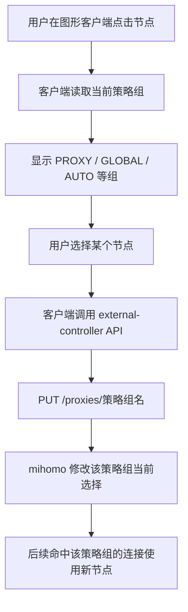
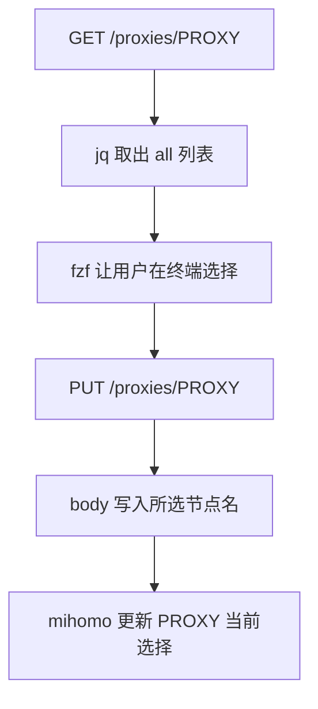

[toc]

## abstract

在具有图形解码的mihomo客户端中可以点击选择节点.

如果是命令行版本如何做?这是怎么实现的?

**命令行版 mihomo 不能在终端里“点击节点”，但可以通过外部控制 API 选择节点**。图形客户端本质上也是这么做的：读取 mihomo 的代理组信息，然后向 mihomo 的 REST API 发送请求，修改某个 `select` 策略组当前选中的节点。

## 核心机制

mihomo 有一个 `external-controller`，也就是外部控制 API。官方文档说明它允许通过 RESTful API 控制 mihomo 内核，并可配置监听地址和 `secret`。([虚空终端](https://wiki.metacubex.one/en/config/general/))

例如配置：

```yaml
external-controller: 127.0.0.1:9090
secret: "your-secret"
```

启动 mihomo 后，就可以用 HTTP 请求操作它。

图形客户端大致流程是：



## 命令行如何查看代理组

先查看所有代理和策略组：

```bash
curl -H "Authorization: Bearer your-secret" \
  http://127.0.0.1:9090/proxies
```

官方 API 文档中 `/proxies` 用于获取代理信息，`/proxies/{proxies_name}` 用于获取指定代理信息。([虚空终端](https://wiki.metacubex.one/en/api/))

如果没有设置 `secret`，可以省略 `Authorization`：

```bash
curl http://127.0.0.1:9090/proxies
```

查看某个组，例如 `PROXY`：

```bash
curl -H "Authorization: Bearer your-secret" \
  http://127.0.0.1:9090/proxies/PROXY
```

如果组名包含空格、斜杠、中文等字符，需要 URL 编码。比如组名是 `🚀 节点选择`，建议用 `jq` 或 Python 编码后再请求。

## 命令行如何切换节点

官方 API 文档说明，选择指定代理使用：

```text
PUT /proxies/proxies_name
Data: {"name":"Japan"}
```

也就是对某个策略组发 `PUT` 请求，body 里写要选中的节点名。([虚空终端](https://wiki.metacubex.one/en/api/))

例如把 `PROXY` 组切到 `香港节点`：

```bash
curl -X PUT \
  -H "Authorization: Bearer your-secret" \
  -H "Content-Type: application/json" \
  -d '{"name":"香港节点"}' \
  http://127.0.0.1:9090/proxies/PROXY
```

把 `GLOBAL` 组切到 `PROXY`：

```bash
curl -X PUT \
  -H "Authorization: Bearer your-secret" \
  -H "Content-Type: application/json" \
  -d '{"name":"PROXY"}' \
  http://127.0.0.1:9090/proxies/GLOBAL
```

把 `PROXY` 组切到直连：

```bash
curl -X PUT \
  -H "Authorization: Bearer your-secret" \
  -H "Content-Type: application/json" \
  -d '{"name":"DIRECT"}' \
  http://127.0.0.1:9090/proxies/PROXY
```

注意：这里的 `PROXY` 是**策略组名**，`香港节点` / `DIRECT` 是这个策略组里的**候选项名称**。

## 如何切换运行模式

切换节点和切换 `mode` 是两回事。

选择节点：

```bash
PUT /proxies/PROXY
{"name":"香港节点"}
```

切换运行模式，例如从 `rule` 切到 `global`，通常用 `/configs` 的 `PATCH`。官方 API 文档说明 `/configs` 支持 `PATCH` 更新基础配置。([虚空终端](https://wiki.metacubex.one/en/api/))

切到全局代理模式：

```bash
curl -X PATCH \
  -H "Authorization: Bearer your-secret" \
  -H "Content-Type: application/json" \
  -d '{"mode":"global"}' \
  http://127.0.0.1:9090/configs
```

切回规则模式：

```bash
curl -X PATCH \
  -H "Authorization: Bearer your-secret" \
  -H "Content-Type: application/json" \
  -d '{"mode":"rule"}' \
  http://127.0.0.1:9090/configs
```

切到全局直连：

```bash
curl -X PATCH \
  -H "Authorization: Bearer your-secret" \
  -H "Content-Type: application/json" \
  -d '{"mode":"direct"}' \
  http://127.0.0.1:9090/configs
```

## 图形客户端具体怎么实现

以常见面板为例，它通常做这些事：

| 步骤             | API                                               | 作用                                      |
| ---------------- | ------------------------------------------------- | ----------------------------------------- |
| 读取当前配置     | `GET /configs`                                    | 知道当前是 `rule`、`global` 还是 `direct` |
| 读取代理组和节点 | `GET /proxies`                                    | 获取所有策略组、节点、当前选择、延迟等    |
| 点击切换节点     | `PUT /proxies/{组名}`                             | 修改某个 `select` 组当前选中项            |
| 测速             | `GET /proxies/{节点名}/delay?url=...&timeout=...` | 测某个节点延迟                            |
| 切换模式         | `PATCH /configs`                                  | 修改 `mode`                               |
| 观察连接         | `GET /connections` 或 WebSocket                   | 显示当前连接走了哪个节点                  |

官方 API 文档列出了 `/configs`、`/proxies`、`/proxies/{name}/delay`、`/connections` 等接口；这些就是图形客户端实现“节点选择、测速、连接查看、模式切换”的基础。([虚空终端](https://wiki.metacubex.one/en/api/))

## 命令行里做一个简单交互选择

如果你想接近图形客户端的体验，可以用 `curl + jq + fzf`。

安装依赖：

```bash
# macOS
brew install jq fzf

# Debian / Ubuntu
sudo apt install jq fzf
```

示例：从 `PROXY` 组里选择节点并切换：

```bash
#!/usr/bin/env bash

API="http://127.0.0.1:9090"
SECRET="your-secret"
GROUP="PROXY"

AUTH_HEADER="Authorization: Bearer ${SECRET}"

node="$(
  curl -s -H "$AUTH_HEADER" "$API/proxies/$GROUP" \
  | jq -r '.all[]' \
  | fzf --prompt="Select node for ${GROUP}: "
)"

[ -z "$node" ] && exit 0

curl -s -X PUT \
  -H "$AUTH_HEADER" \
  -H "Content-Type: application/json" \
  -d "$(jq -n --arg name "$node" '{name:$name}')" \
  "$API/proxies/$GROUP"

echo "Switched $GROUP to $node"
```

这个脚本的逻辑就是：



## 容易踩坑的地方

| 问题                              | 原因                                         | 解决                                                |
| --------------------------------- | -------------------------------------------- | --------------------------------------------------- |
| `PUT` 后没效果                    | 你切的组没有被规则使用                       | 检查 `rules` 最终命中的是哪个策略组                 |
| 切了 `GLOBAL`，但访问仍走别的节点 | 当前还是 `mode: rule`，规则没有导向 `GLOBAL` | 要么切换实际被规则使用的组，要么切到 `mode: global` |
| 返回 401                          | 配置了 `secret`，但请求没带 token            | 加 `Authorization: Bearer xxx`                      |
| 返回 404                          | 组名写错或没有 URL 编码                      | 先 `GET /proxies` 确认真实名称                      |
| 返回 400                          | 目标节点不在该组候选项里                     | 只能选择该组 `.all` 列表中的名称                    |
| 修改后旧连接还在原节点            | 已建立连接通常不会自动迁移                   | 关闭相关连接，或调用 `/connections` 删除连接        |

## 关键理解

命令行版 mihomo 本身是“内核”，不是完整 GUI 客户端。
所谓点击节点，本质是：

```http
PUT /proxies/策略组名
Content-Type: application/json

{"name":"目标节点名"}
```

图形客户端只是把这个过程包装成了按钮、列表、测速和连接面板。命令行下用 `curl`、`jq`、`fzf` 就能实现同样的核心功能。

## 总结

Mihomo External Controller（REST API）中查看和选中代理节点，核心逻辑可以概括为：

1. 查询组信息
2. 查看当前选择(now)
3. 查看可选项(all)
4. 切换到目标项(name)

### 查看所有代理组

获取当前配置中的所有组和节点：

```bash
curl \
  -H "Authorization: Bearer $secret" \
  http://127.0.0.1:9090/proxies
```

返回示例：

```json
{
  "proxies": {
    "GLOBAL": {},
    "PROXY": {},
    "故障转移": {},
    "负载均衡": {},
    "🇭🇰香港节点": {}
      ....
  }
}
```

其中：

| 名称         | 类型                |
| ------------ | ------------------- |
| PROXY        | 选择组              |
| 故障转移     | URL-Test/Fallback组 |
| 负载均衡     | Load-Balance组      |
| 🇭🇰香港节点   | 选择组              |
| 某个具体节点 | 节点                |

------

### 查看指定组

例如查看 `PROXY`：

```bash
curl \
  -H "Authorization: Bearer $secret" \
  http://127.0.0.1:9090/proxies/PROXY
```

返回：

```json
{
  "name":"PROXY",
  "type":"Selector",
  "now":"香港节点",
  "all":[
    "DIRECT",
    "故障转移",
    "负载均衡",
    "香港节点"
  ]
}
```

重要字段：

| 字段 | 含义       |
| ---- | ---------- |
| name | 当前组名   |
| type | 组类型     |
| now  | 当前选中项 |
| all  | 可选项列表 |

------

### 查看当前选中了什么

直接看：

```json
"now":"香港节点"
```

即可。

也可以用 jq：

```bash
curl -s \
  -H "Authorization: Bearer $secret" \
  http://127.0.0.1:9090/proxies/PROXY \
| jq -r '.now'
```

输出：

```text
香港节点
```

------

### 查看可切换目标

```bash
curl -s \
  -H "Authorization: Bearer $secret" \
  http://127.0.0.1:9090/proxies/PROXY \
| jq '.all'
```

输出：

```json
[
  "DIRECT",
  "故障转移",
  "负载均衡",
  "香港节点"
]
```

只有这里面的项目才能切换。

------

### 选中指定分组

例如切换到：

```text
故障转移
```

执行：

```bash
curl -X PUT \
  -H "Authorization: Bearer $secret" \
  -H "Content-Type: application/json" \
  -d '{"name":"故障转移"}' \
  http://127.0.0.1:9090/proxies/PROXY
```

效果等同于：

```text
PROXY
└── 故障转移 ← 被选中
```

------

### 选中负载均衡组

```bash
curl -X PUT \
  -H "Authorization: Bearer $secret" \
  -H "Content-Type: application/json" \
  -d '{"name":"负载均衡"}' \
  http://127.0.0.1:9090/proxies/PROXY
```

------

### 选中具体节点

假设：

```text
PROXY
└── 🇭🇰香港节点
      ├── HK-01
      ├── HK-02
      └── HK-03
```

先查看：

```bash
curl \
  -H "Authorization: Bearer $secret" \
  http://127.0.0.1:9090/proxies/🇭🇰香港节点
```

返回：

```json
{
  "all":[
    "HK-01",
    "HK-02",
    "HK-03"
  ]
}
```

然后切换：

```bash
curl -X PUT \
  -H "Authorization: Bearer $secret" \
  -H "Content-Type: application/json" \
  -d '{"name":"HK-02"}' \
  http://127.0.0.1:9090/proxies/🇭🇰香港节点
```

效果：

```text
PROXY
└── 🇭🇰香港节点
      └── HK-02 ← 被选中
```

------

### URL 编码问题

当组名包含：

```text
空格
中文
Emoji
/
#
?
&
```

建议进行 URL 编码。

例如：

```text
🚀 节点选择
```

编码后：

```text
%F0%9F%9A%80%20%E8%8A%82%E7%82%B9%E9%80%89%E6%8B%A9
```

请求：

```bash
curl \
  -H "Authorization: Bearer $secret" \
  "http://127.0.0.1:9090/proxies/%F0%9F%9A%80%20%E8%8A%82%E7%82%B9%E9%80%89%E6%8B%A9"
```

Python 编码：

```bash
python -c "import urllib.parse; print(urllib.parse.quote('🚀 节点选择'))"
```

------

### 常用脚本流程

查看当前选择：

```bash
curl -s \
  -H "Authorization: Bearer $secret" \
  http://127.0.0.1:9090/proxies/PROXY \
| jq -r '.now'
```

查看所有可选项：

```bash
curl -s \
  -H "Authorization: Bearer $secret" \
  http://127.0.0.1:9090/proxies/PROXY \
| jq -r '.all[]'
```

切换到目标：

```bash
curl -X PUT \
  -H "Authorization: Bearer $secret" \
  -H "Content-Type: application/json" \
  -d '{"name":"目标名称"}' \
  http://127.0.0.1:9090/proxies/PROXY
```

可记忆为：

```text
GET  /proxies            → 查看所有组
GET  /proxies/{组名}      → 查看组详情
PUT  /proxies/{组名}      → 切换选择
```

这是 Mihomo External Controller 最常用、最核心的代理组控制接口。

