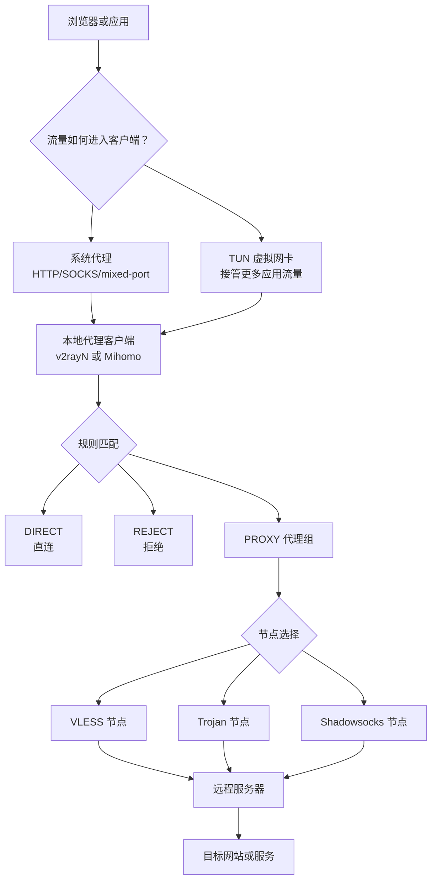
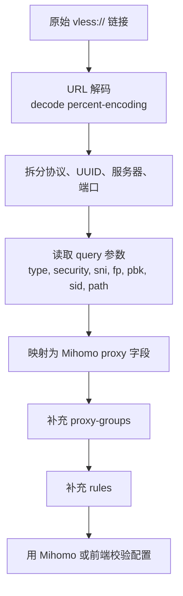
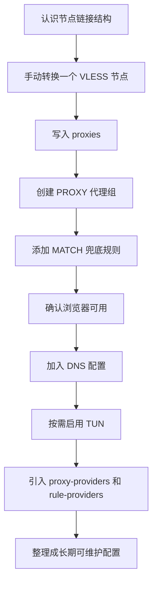

[toc]


## 适用范围和前提

本文把 **v2rayN** 和 **Mihomo/Clash** 当作两类典型客户端来讲：

| 类别            | 代表软件                                           | 核心定位                     | 常见配置形态                                | 适合新手理解成                         |
| --------------- | -------------------------------------------------- | ---------------------------- | ------------------------------------------- | -------------------------------------- |
| v2rayN 类       | v2rayN、v2rayNG 等                                 | 图形化节点管理器和内核运行器 | 单条分享链接、订阅链接、GUI 路由规则        | “把节点导入进来，点选使用”             |
| Clash/Mihomo 类 | Mihomo、Clash Verge Rev、Clash Meta for Android 等 | 规则代理内核加图形前端       | YAML 配置文件、订阅、proxy-providers、rules | “用配置文件描述节点、分组、规则和 DNS” |

- 更现代的 Clash 语境通常应优先理解为 **Mihomo**(由于历史原因,该内核的客户端经常和clash相关)，也就是 Clash.Meta 系列内核的延续形态。Mihomo 官方配置文档明确包含 `Proxies`、`Proxy-Providers`、`Proxy-Groups`、`Route Rules`、`Rule-Providers`、`DNS`、`TUN` 等模块，并且有 VLESS、VMess、Trojan、Hysteria2、TUIC、WireGuard 等代理类型页面。([虚空终端](https://wiki.metacubex.one/en/config/)) 

- v2rayN 官方仓库则说明它是 Windows、Linux、macOS 的 GUI 客户端，支持 **Xray、sing-box** 等内核。([GitHub](https://github.com/2dust/v2rayn))

下面内容只讨论通用网络代理配置、格式转换和排错方法。

------

## 大纲

- 看懂一条 `vless://` 分享链接里每个字段的含义。
- 区分 **节点（proxy node）**、**订阅（subscription）**、**代理组（proxy group）**、**规则（rules）**、**入站入口（inbound）**。
- 理解 v2rayN 类软件和 Mihomo/Clash 类软件的配置思路差异。
- 手动把常见 VLESS TLS、VLESS REALITY、VLESS WebSocket、VLESS gRPC 链接转换为 Mihomo YAML。
- 知道哪些链接不能机械转换，哪些字段容易填错。
- 能按最佳实践组织一份适合新手使用的 Mihomo 配置。

------

## 核心术语

| 中文术语  | 英文术语                               | 简要解释                                                     |
| --------- | -------------------------------------- | ------------------------------------------------------------ |
| 节点      | Proxy node, outbound(出站)             | 一个可连接的远程代理服务器条目，例如 VLESS、VMess、Trojan、Shadowsocks |
| 入站      | Inbound                                | 本机接收应用流量的入口，例如 HTTP 端口、SOCKS 端口、mixed-port、TUN |
| 出站      | Outbound                               | 客户端把流量发往哪里，可能是某个节点、DIRECT 或 REJECT       |
| 订阅      | Subscription                           | 一个远程链接，定期拉取多个节点或完整配置                     |
| 代理组    | Proxy group                            | 对多个节点进行选择、测速、故障切换或负载均衡的逻辑组         |
| 规则      | Rule, routing rule                     | 按域名、IP、进程、端口、地理库等条件决定走哪个出站           |
| 直连      | DIRECT                                 | 不经过代理，直接访问目标                                     |
| 拒绝      | REJECT                                 | 阻断连接，常用于广告、恶意域名或不希望访问的流量             |
| TUN 模式  | TUN mode                               | 创建虚拟网卡，让不支持系统代理的应用也能被接管               |
| SNI       | Server Name Indication                 | TLS 握手里声明的目标域名，常对应 `servername` 或 `sni`       |
| ALPN      | Application-Layer Protocol Negotiation | TLS 中协商应用层协议，例如 `h2`、`http/1.1`、`h3`            |
| UUID      | Universally Unique Identifier          | VLESS、VMess 常用的用户标识                                  |
| REALITY   | REALITY transport security             | Xray 生态中常见的 TLS 类伪装/认证方案，Mihomo 通过 `reality-opts` 配置 |
| uTLS 指纹 | uTLS fingerprint, client fingerprint   | 模拟浏览器 TLS 指纹，例如 `chrome`、`firefox`、`safari`      |
| Fake-IP   | Fake IP DNS mode                       | DNS 返回虚拟 IP，再由代理内核反查域名，常用于规则分流        |

------

## 两类软件的配置思路差异

## v2rayN 的思路

v2rayN 更偏向 **图形界面管理节点**。你通常不直接写完整 JSON，而是：

- 复制一条 `vless://`、`vmess://`、`trojan://` 链接。
- 在 v2rayN 中通过“从剪贴板导入”或“手动添加服务器”导入。
- 选择当前活动节点。
- 配置系统代理、路由模式、绕过局域网、TUN 或虚拟网卡能力。
- v2rayN 再调用 Xray、sing-box 等内核运行。

v2rayN 的官方介绍是“GUI client for Windows, Linux and macOS”，并说明支持 Xray、sing-box 等内核，因此它本质上更像“可视化配置管理层”。([GitHub](https://github.com/2dust/v2rayn))

## Mihomo/Clash 的思路

Mihomo 更偏向 **声明式 YAML 配置**。你把所有内容写进一个 YAML 文件：

- `mixed-port`：本地 HTTP 和 SOCKS 混合代理端口。
- `tun`：是否启用 TUN 虚拟网卡。
- `dns`：DNS 解析策略。
- `proxies`：手写节点列表。
- `proxy-providers`：远程订阅节点源。
- `proxy-groups`：节点选择、自动测速、故障转移。
- `rules`：按域名、IP、进程、端口等分流。

Mihomo 文档把这些模块放在同一套配置体系里，包括 DNS、TUN、Proxies、Proxy-Providers、Proxy-Groups、Route Rules 和 Rule-Providers。([虚空终端](https://wiki.metacubex.one/en/config/))

------

## 工作机制示意图



新手最容易混淆的是：**节点只描述“能连到哪台代理服务器”，规则才描述“什么流量走哪个节点”。**

------

## 代理节点的基本模型

一个节点一般由这些信息组成：

| 字段        | 在分享链接中常见位置     | 在 Mihomo YAML 中常见字段         | 说明                           |
| ----------- | ------------------------ | --------------------------------- | ------------------------------ |
| 节点名称    | `#` 后面的片段           | `name`                            | 只是显示名，不影响协议本身     |
| 协议类型    | scheme，例如 `vless://`  | `type: vless`                     | 决定如何解释后续字段           |
| 服务器地址  | `@` 后、冒号前           | `server`                          | 域名、IPv4 或 IPv6             |
| 端口        | 冒号后                   | `port`                            | 远程服务监听端口               |
| 用户 ID     | `vless://` 后、`@` 前    | `uuid`                            | VLESS 用户标识                 |
| 传输层      | `type=tcp/ws/grpc/xhttp` | `network`                         | TCP、WebSocket、gRPC、XHTTP 等 |
| TLS/REALITY | `security=tls/reality`   | `tls`, `reality-opts`             | 决定外层安全层                 |
| SNI         | `sni=...`                | `servername`                      | TLS/REALITY 场景常见           |
| 指纹        | `fp=chrome`              | `client-fingerprint`              | uTLS 客户端指纹                |
| 公钥        | `pbk=...`                | `reality-opts.public-key`         | REALITY 必需字段之一           |
| 短 ID       | `sid=...`                | `reality-opts.short-id`           | REALITY 服务端允许的 short id  |
| 路径        | `path=...`               | `ws-opts.path`, `xhttp-opts.path` | WebSocket、XHTTP 等传输常用    |
| Host 头     | `host=...`               | `ws-opts.headers.Host`            | WebSocket 常见                 |
| gRPC 服务名 | `serviceName=...`        | `grpc-opts.grpc-service-name`     | gRPC 常见                      |

Mihomo 的 VLESS 文档示例包含 `type: vless`、`server`、`port`、`uuid`、`flow`、`packet-encoding`、`tls`、`servername`、`client-fingerprint`、`reality-opts`、`network` 等字段，并说明 `uuid` 是 VLESS 用户 ID，`flow` 当前可用值包括 `xtls-rprx-vision`，`packet-encoding` 可用 `packetaddr` 或 `xudp`。([虚空终端](https://wiki.metacubex.one/en/config/proxies/vless/))

------

## VLESS 的关键概念

## VLESS 不是“完整 VPN 协议”

VLESS 是 Xray/V2Ray 生态中的代理协议。Xray 文档称 VLESS 是轻量、无状态的传输协议，使用 UUID 作为认证方式，并且不像 VMess 那样依赖系统时间。([xtls.github.io](https://xtls.github.io/en/config/outbounds/vless.html))

一个完整可用的 VLESS 节点通常还需要：

- 外层安全层：TLS、REALITY，或新的 VLESS Encryption。
- 传输层：TCP、WebSocket、gRPC、XHTTP、HTTP/2 等。
- 路由和 DNS 策略：决定哪些流量使用它。
- 客户端支持：不同内核支持的字段并不完全一致。

Xray 文档明确提醒：VLESS 除非用于可信私有地址、可信链路，或启用 VLESS Encryption，否则应配合外层传输安全层使用。([xtls.github.io](https://xtls.github.io/en/config/outbounds/vless.html)) 对新手来说，看到 `security=none` 的公网 VLESS 链接要格外谨慎，不要默认认为它是安全配置。

## VLESS 常见组合

| 组合                             | 链接特征                       | Mihomo 关键字段                                              | 新手理解                         |
| -------------------------------- | ------------------------------ | ------------------------------------------------------------ | -------------------------------- |
| VLESS over TCP plus TLS          | `type=tcp`, `security=tls`     | `network: tcp`, `tls: true`, `servername`                    | 最基础的 TLS 包裹 TCP            |
| VLESS over TCP plus REALITY      | `type=tcp`, `security=reality` | `network: tcp`, `tls: true`, `reality-opts`, `client-fingerprint` | 现代常见组合                     |
| VLESS over WebSocket plus TLS    | `type=ws`, `security=tls`      | `network: ws`, `ws-opts.path`, `headers.Host`                | 常用于 CDN 或反代场景            |
| VLESS over gRPC plus TLS/REALITY | `type=grpc`                    | `network: grpc`, `grpc-opts.grpc-service-name`               | 多路复用风格，常见于反代         |
| VLESS over XHTTP                 | `type=xhttp`                   | `network: xhttp`, `xhttp-opts`                               | 新一些的 HTTP 类传输，字段更复杂 |

Mihomo 文档说明 VLESS 的 `network` 支持 `ws`、`http`、`h2`、`grpc`、`xhttp`；未设置或其他值时按 TCP 使用。([虚空终端](https://wiki.metacubex.one/en/config/proxies/vless/))

------

## v2rayN 节点使用实例

## 单条 VLESS 链接导入

示例链接：

```text
vless://11111111-1111-1111-1111-111111111111@example.com:443?type=tcp&security=reality&encryption=none&flow=xtls-rprx-vision&sni=www.microsoft.com&fp=chrome&pbk=PUBLIC_KEY_EXAMPLE&sid=abcd1234#VLESS-REALITY-DEMO
```

在 v2rayN 中通常这样用：

- 复制这条链接。
- 使用“从剪贴板导入分享链接”。
- 导入后检查节点名称、地址、端口、UUID、传输方式、安全层、SNI、REALITY public key、short id。
- 选择该节点为活动服务器。
- 开启系统代理或 TUN。
- 使用测速或测试真连接确认可用。

这里 v2rayN 帮你做了两件事：

- 把 URL 参数解析成 Xray 或 sing-box 能理解的内部配置。
- 帮你管理本机代理入口、路由规则和节点切换。

## v2rayN 的典型使用场景

| 场景             | 推荐操作                | 注意点                                             |
| ---------------- | ----------------------- | -------------------------------------------------- |
| 只有一两个节点   | 手动导入链接            | 检查时间、DNS、证书、SNI 是否正确                  |
| 有机场订阅       | 添加订阅地址并定期更新  | 注意订阅类型是 v2rayN 格式、Clash 格式还是通用格式 |
| 需要国内外分流   | 使用路由规则集          | 规则顺序会影响结果                                 |
| 某些应用不走代理 | 开启 TUN 或设置应用代理 | TUN 可能需要管理员权限                             |
| 节点很多         | 使用分组、测速、排序    | 不要频繁测速，避免误判或触发服务端限制             |

------

## Mihomo/Clash 配置结构实例

下面是一份最小但实用的 Mihomo 配置骨架。它把“入口、DNS、节点、代理组、规则”放在一起。

```yaml
mixed-port: 7890
allow-lan: false
mode: rule
log-level: info
ipv6: false

external-controller: 127.0.0.1:9090

dns:
  enable: true
  listen: 127.0.0.1:1053
  enhanced-mode: fake-ip
  fake-ip-range: 198.18.0.1/16
  nameserver:
    - https://1.1.1.1/dns-query
    - https://8.8.8.8/dns-query

proxies:
  - name: "VLESS-REALITY-DEMO"
    type: vless
    server: example.com
    port: 443
    uuid: "11111111-1111-1111-1111-111111111111"
    network: tcp
    tls: true
    udp: true
    flow: xtls-rprx-vision
    servername: www.microsoft.com
    client-fingerprint: chrome
    packet-encoding: xudp
    reality-opts:
      public-key: "PUBLIC_KEY_EXAMPLE"
      short-id: "abcd1234"
    encryption: ""

proxy-groups:
  - name: "PROXY"
    type: select
    proxies:
      - "VLESS-REALITY-DEMO"
      - DIRECT

  - name: "AUTO"
    type: url-test
    proxies:
      - "VLESS-REALITY-DEMO"
    url: "https://www.gstatic.com/generate_204"
    interval: 300

rules:
  - DOMAIN-SUFFIX,example.org,DIRECT
  - DOMAIN-SUFFIX,google.com,PROXY
  - GEOIP,CN,DIRECT
  - MATCH,PROXY
```

Mihomo 的规则按从上到下匹配，越靠上的规则优先级越高，`MATCH` 是无条件兜底规则，通常放在最后。([虚空终端](https://wiki.metacubex.one/en/config/rules/))

------

## vless 链接如何转换为 Mihomo 配置

## 转换总流程



转换本质不是“加密转换”，而是 **把一种描述格式翻译成另一种描述格式**：

- VLESS 链接是 URL 形式，适合复制分享单个节点。
- Mihomo YAML 是结构化配置，适合表达完整客户端行为。
- 同一个节点从 URL 变成 YAML 后，协议参数必须一致。
- YAML 还需要额外配置代理组和规则，否则节点未必会被使用。

------

## VLESS URL 的基本结构

```text
vless://<uuid>@<server>:<port>?<query>#<name>
```

示例：

```text
vless://11111111-1111-1111-1111-111111111111@example.com:443?type=tcp&security=reality&encryption=none&flow=xtls-rprx-vision&sni=www.microsoft.com&fp=chrome&pbk=PUBLIC_KEY_EXAMPLE&sid=abcd1234#VLESS-REALITY-DEMO
```

拆开后：

| 部分       | 示例值                                 | 含义                                 |
| ---------- | -------------------------------------- | ------------------------------------ |
| scheme     | `vless`                                | 协议类型                             |
| uuid       | `11111111-1111-1111-1111-111111111111` | VLESS 用户 ID                        |
| server     | `example.com`                          | 远程服务器地址                       |
| port       | `443`                                  | 远程端口                             |
| type       | `tcp`                                  | 传输方式                             |
| security   | `reality`                              | 安全层类型                           |
| encryption | `none`                                 | VLESS URI 中的加密声明，常见旧式字段 |
| flow       | `xtls-rprx-vision`                     | XTLS Vision 流控                     |
| sni        | `www.microsoft.com`                    | TLS/REALITY SNI                      |
| fp         | `chrome`                               | 客户端 TLS 指纹                      |
| pbk        | `PUBLIC_KEY_EXAMPLE`                   | REALITY public key                   |
| sid        | `abcd1234`                             | REALITY short id                     |
| fragment   | `VLESS-REALITY-DEMO`                   | 节点显示名                           |

------

## 字段映射表

| VLESS 链接字段          | Mihomo 字段                                 | 转换规则                                                |
| ----------------------- | ------------------------------------------- | ------------------------------------------------------- |
| `vless://`              | `type: vless`                               | 协议类型固定为 VLESS                                    |
| UUID                    | `uuid`                                      | 原样填入                                                |
| host                    | `server`                                    | 原样填入，IPv6 注意保留地址含义但 YAML 中通常不写方括号 |
| port                    | `port`                                      | 转成数字                                                |
| `#name`                 | `name`                                      | URL 解码后作为节点名                                    |
| `type=tcp`              | `network: tcp`                              | TCP 传输                                                |
| `type=ws`               | `network: ws`                               | 还要写 `ws-opts`                                        |
| `type=grpc`             | `network: grpc`                             | 还要写 `grpc-opts`                                      |
| `type=xhttp`            | `network: xhttp`                            | 还要写 `xhttp-opts`                                     |
| `security=tls`          | `tls: true`                                 | 普通 TLS                                                |
| `security=reality`      | `tls: true` 加 `reality-opts`               | REALITY 在 Mihomo 中仍配合 `tls: true`                  |
| `security=none`         | `tls: false` 或省略                         | 仅限可信链路或明确知道安全含义                          |
| `sni=...`               | `servername`                                | Mihomo VLESS 中通常用 `servername`                      |
| `fp=chrome`             | `client-fingerprint: chrome`                | 常见值有 chrome、firefox、safari、edge、random 等       |
| `pbk=...`               | `reality-opts.public-key`                   | REALITY 公钥                                            |
| `sid=...`               | `reality-opts.short-id`                     | REALITY 短 ID                                           |
| `flow=xtls-rprx-vision` | `flow: xtls-rprx-vision`                    | 常见于 VLESS Vision                                     |
| `path=...`              | `ws-opts.path` 或 `xhttp-opts.path`         | 按 `type` 判断                                          |
| `host=...`              | `ws-opts.headers.Host` 或 `xhttp-opts.host` | WebSocket 和 XHTTP 写法不同                             |
| `serviceName=...`       | `grpc-opts.grpc-service-name`               | gRPC 服务名                                             |
| `alpn=h2,http/1.1`      | `alpn`                                      | 转成 YAML 列表                                          |

Mihomo TLS 配置文档说明 `client-fingerprint` 适用于 VMess、VLESS、Trojan、AnyTLS；`reality-opts.public-key` 是服务端 private key 对应的 public key，`reality-opts.short-id` 是服务端 short IDs 之一。([GitHub](https://github.com/MetaCubeX/Meta-Docs/blob/main/docs/config/proxies/tls.en.md)) 同时，Mihomo 的全局 TLS 指纹配置已被标记为废弃，建议直接在代理节点里设置 `client-fingerprint`。([虚空终端](https://wiki.metacubex.one/en/config/general/))

------

## 实例：VLESS REALITY Vision 转 Mihomo

原始链接：

```text
vless://11111111-1111-1111-1111-111111111111@example.com:443?type=tcp&security=reality&encryption=none&flow=xtls-rprx-vision&sni=www.microsoft.com&fp=chrome&pbk=PUBLIC_KEY_EXAMPLE&sid=abcd1234#VLESS-REALITY-DEMO
```

转换后的 `proxies` 条目：

```yaml
proxies:
  - name: "VLESS-REALITY-DEMO"
    type: vless
    server: example.com
    port: 443
    uuid: "11111111-1111-1111-1111-111111111111"
    network: tcp
    tls: true
    udp: true
    flow: xtls-rprx-vision
    servername: www.microsoft.com
    client-fingerprint: chrome
    packet-encoding: xudp
    reality-opts:
      public-key: "PUBLIC_KEY_EXAMPLE"
      short-id: "abcd1234"
    encryption: ""
```

说明：

- `security=reality` 对应 `tls: true` 加 `reality-opts`。
- `sni` 对应 `servername`。
- `fp` 对应 `client-fingerprint`。
- `pbk` 对应 `public-key`。
- `sid` 对应 `short-id`。
- `flow=xtls-rprx-vision` 原样映射。
- `encryption=none` 不要误解为新的 VLESS Encryption 字符串；普通 REALITY/Vision 节点通常留空或省略 Mihomo 的 `encryption` 字段，示例中写 `encryption: ""` 是为了强调未启用新的 VLESS Encryption。

Mihomo 官方 VLESS 示例也展示了 VLESS REALITY Vision 的核心字段：`tls: true`、`flow: xtls-rprx-vision`、`servername`、`reality-opts.public-key`、`reality-opts.short-id`、`client-fingerprint`。([GitHub](https://raw.githubusercontent.com/MetaCubeX/mihomo/refs/heads/Meta/docs/config.yaml))

------

## 实例：VLESS TLS WebSocket 转 Mihomo

原始链接：

```text
vless://22222222-2222-2222-2222-222222222222@cdn.example.com:443?type=ws&security=tls&encryption=none&sni=cdn.example.com&host=cdn.example.com&path=%2Fproxy#VLESS-WS-TLS
```

注意 `path=%2Fproxy` URL 解码后是 `/proxy`。

转换后的节点：

```yaml
proxies:
  - name: "VLESS-WS-TLS"
    type: vless
    server: cdn.example.com
    port: 443
    uuid: "22222222-2222-2222-2222-222222222222"
    network: ws
    tls: true
    udp: true
    servername: cdn.example.com
    client-fingerprint: chrome
    ws-opts:
      path: "/proxy"
      headers:
        Host: cdn.example.com
```

说明：

- `type=ws` 对应 `network: ws`。
- `path` 对应 `ws-opts.path`。
- `host` 通常对应 WebSocket 的 HTTP `Host` 请求头。
- `security=tls` 对应 `tls: true`。
- 如果链接里没有 `fp`，可以按服务端要求补 `client-fingerprint: chrome`；若服务端并不要求，也可以不写。

------

## 实例：VLESS gRPC REALITY 转 Mihomo

原始链接：

```text
vless://33333333-3333-3333-3333-333333333333@grpc.example.com:443?type=grpc&security=reality&encryption=none&sni=www.example.org&fp=chrome&pbk=PUBLIC_KEY_EXAMPLE&sid=0123456789abcdef&serviceName=mygrpc#VLESS-GRPC-REALITY
```

转换后的节点：

```yaml
proxies:
  - name: "VLESS-GRPC-REALITY"
    type: vless
    server: grpc.example.com
    port: 443
    uuid: "33333333-3333-3333-3333-333333333333"
    network: grpc
    tls: true
    udp: true
    servername: www.example.org
    client-fingerprint: chrome
    reality-opts:
      public-key: "PUBLIC_KEY_EXAMPLE"
      short-id: "0123456789abcdef"
    grpc-opts:
      grpc-service-name: "mygrpc"
    encryption: ""
```

说明：

- `type=grpc` 对应 `network: grpc`。
- `serviceName` 对应 `grpc-opts.grpc-service-name`。
- REALITY 仍然需要 `reality-opts`。
- gRPC 服务名要和服务端一致，大小写和路径含义都不要随意改。

------

## 实例：完整 Mihomo 配置，含订阅和代理组

如果你的服务商提供的是 Clash/Mihomo 订阅，而不是单条 VLESS 链接，可以优先使用 `proxy-providers`。Mihomo 的 proxy-provider 示例包含 `type: http`、`url`、`path`、`interval`、`health-check` 等字段；健康检查支持 `enable`、`url`、`interval`、`timeout`、`lazy`、`expected-status` 等配置。([虚空终端](https://wiki.metacubex.one/en/config/proxy-providers/))

```yaml
mixed-port: 7890
allow-lan: false
mode: rule
log-level: info

proxy-providers:
  provider-main:
    type: http
    url: "https://example.com/subscription.yaml"
    path: ./proxy_providers/provider-main.yaml
    interval: 3600
    health-check:
      enable: true
      url: https://www.gstatic.com/generate_204
      interval: 300
      timeout: 5000
      lazy: true
      expected-status: 204

proxy-groups:
  - name: "PROXY"
    type: select
    use:
      - provider-main
    proxies:
      - DIRECT

  - name: "AUTO"
    type: url-test
    use:
      - provider-main
    url: https://www.gstatic.com/generate_204
    interval: 300
    tolerance: 50

rules:
  - DOMAIN-SUFFIX,example.org,DIRECT
  - GEOIP,CN,DIRECT
  - MATCH,PROXY
```

Mihomo 的 proxy-group 支持 `proxies` 引用本地节点或其他代理组，也支持 `use` 引用 proxy-provider；`url` 和 `interval` 可用于健康检查或测速。([虚空终端](https://wiki.metacubex.one/en/config/proxy-groups/))

------

## 规则系统的核心原理

Mihomo 的规则是“自上而下，首次命中”。官方文档明确说明规则从上到下匹配，顶部规则优先级高于下面规则。([虚空终端](https://wiki.metacubex.one/en/config/rules/))

常见规则类型：

| 规则类型         | 示例                                       | 适合场景           |
| ---------------- | ------------------------------------------ | ------------------ |
| `DOMAIN`         | `DOMAIN,example.com,DIRECT`                | 精确匹配单个域名   |
| `DOMAIN-SUFFIX`  | `DOMAIN-SUFFIX,google.com,PROXY`           | 匹配主域和子域     |
| `DOMAIN-KEYWORD` | `DOMAIN-KEYWORD,google,PROXY`              | 按关键词粗匹配     |
| `GEOSITE`        | `GEOSITE,youtube,PROXY`                    | 使用域名规则库     |
| `IP-CIDR`        | `IP-CIDR,192.168.0.0/16,DIRECT,no-resolve` | 匹配 IP 段         |
| `GEOIP`          | `GEOIP,CN,DIRECT`                          | 按 IP 国家或地区库 |
| `PROCESS-NAME`   | `PROCESS-NAME,chrome.exe,PROXY`            | 按进程名分流       |
| `DST-PORT`       | `DST-PORT,22,DIRECT`                       | 按目标端口分流     |
| `NETWORK`        | `NETWORK,udp,PROXY`                        | 按 TCP 或 UDP      |
| `RULE-SET`       | `RULE-SET,proxy-domain,PROXY`              | 引用外部规则集     |
| `MATCH`          | `MATCH,PROXY`                              | 兜底规则           |

推荐新手采用“少而清晰”的规则顺序：

```yaml
rules:
  - DOMAIN-SUFFIX,lan,DIRECT
  - DOMAIN-SUFFIX,local,DIRECT
  - IP-CIDR,127.0.0.0/8,DIRECT,no-resolve
  - IP-CIDR,192.168.0.0/16,DIRECT,no-resolve
  - GEOIP,CN,DIRECT
  - MATCH,PROXY
```

再逐步增加广告拦截、流媒体、AI 服务、游戏平台等专用规则。

------

## DNS 与 Fake-IP 的作用

DNS 配置决定“域名如何解析”和“规则能否准确按域名分流”。

Mihomo DNS 文档说明 `enhanced-mode` 可选 `fake-ip` 或 `redir-host`，默认是 `redir-host`；`fake-ip-filter` 用于指定不返回 fake-ip 的域名。([虚空终端](https://wiki.metacubex.one/en/config/dns/))

新手可以这样理解：

| DNS 模式     | 优点                            | 风险或注意点                                                |
| ------------ | ------------------------------- | ----------------------------------------------------------- |
| `redir-host` | 更直观，兼容性好                | 某些复杂分流场景不如 fake-ip 精准                           |
| `fake-ip`    | 分流更稳定，适合 TUN 和规则代理 | 少数局域网、游戏、银行、智能设备可能需要加入 fake-ip-filter |

基础示例：

```yaml
dns:
  enable: true
  listen: 127.0.0.1:1053
  enhanced-mode: fake-ip
  fake-ip-range: 198.18.0.1/16
  fake-ip-filter:
    - "*.lan"
    - "*.local"
    - "localhost"
  nameserver:
    - https://1.1.1.1/dns-query
    - https://8.8.8.8/dns-query
```

------

## TUN 模式的作用

系统代理只能接管“愿意使用系统代理”的应用。TUN 模式通过虚拟网卡接管更多流量，例如游戏客户端、命令行工具、某些 Electron 应用、没有代理设置的软件。

Mihomo TUN 文档说明 `auto-route` 可以自动设置全局路由，把全局流量导入 TUN 网卡；`dns-hijack` 可将匹配连接导入内部 DNS 模块；`strict-route` 在启用 `auto-route` 时执行严格路由，在 Windows 上会添加防火墙规则以阻止常见多宿主 DNS 泄露，但也可能影响 VirtualBox 等应用。([虚空终端](https://wiki.metacubex.one/en/config/inbound/tun/))

基础示例：

```yaml
tun:
  enable: true
  stack: system
  auto-route: true
  auto-detect-interface: true
  strict-route: true
  dns-hijack:
    - any:53
    - tcp://any:53
```

新手建议：

- 桌面系统先用 `mixed-port` 和系统代理，确认节点可用后再启用 TUN。
- 开 TUN 后如果局域网打印机、NAS、虚拟机异常，优先检查局域网直连规则和 `strict-route`。
- Android、Windows、macOS、Linux 的 TUN 行为细节不同，不要照搬所有高级字段。

------

## 常见错误和排查方法

| 问题                     | 常见原因                                                  | 排查建议                                    |
| ------------------------ | --------------------------------------------------------- | ------------------------------------------- |
| 配置导入失败             | YAML 缩进错误、冒号后缺空格、字符串含特殊字符             | 用 YAML 校验器检查，节点名和 SNI 建议加引号 |
| 节点显示但无法连接       | UUID、端口、SNI、public key、short id 错误                | 对照原始链接逐项核对                        |
| REALITY 节点握手失败     | `servername`、`client-fingerprint`、`reality-opts` 不匹配 | 重点检查 `sni`、`fp`、`pbk`、`sid`          |
| WebSocket 节点失败       | path 或 Host 不一致                                       | URL 解码 `%2F`，检查 `ws-opts.headers.Host` |
| gRPC 节点失败            | serviceName 错误                                          | 检查 `grpc-opts.grpc-service-name`          |
| 浏览器能走，其他应用不走 | 只开了系统代理                                            | 尝试 TUN，或给应用单独设置代理              |
| 国内网站也走代理         | 规则顺序不合理                                            | 把局域网、国内 IP 或域名规则放在 `MATCH` 前 |
| UDP 应用不可用           | 节点或代理组禁用 UDP                                      | 检查节点 `udp: true`，不要在组里禁用 UDP    |
| DNS 泄露或解析异常       | DNS 未接管、TUN 未劫持 DNS、系统多网卡                    | 检查 `dns`、`dns-hijack`、`strict-route`    |
| 订阅更新后节点名变了     | provider 每次返回名称不同                                 | 使用固定前缀、筛选规则或手动代理组          |

------

## 哪些 VLESS 链接不能直接转换

不是所有 `vless://` 都能无损转成 Mihomo 配置。

| 情况                          | 原因                                                         | 建议                                 |
| ----------------------------- | ------------------------------------------------------------ | ------------------------------------ |
| 使用 Mihomo 不支持的传输层    | Mihomo VLESS 文档列出的常见 network 是 `ws`、`http`、`h2`、`grpc`、`xhttp`，其他值可能无法按预期使用 | 换客户端内核，或改服务端传输         |
| 服务端依赖特殊 Xray 字段      | 分享链接可能包含 Mihomo 没有对应项的扩展字段                 | 查 Mihomo 当前文档或内核 release     |
| 订阅链接不是单节点链接        | 订阅可能返回 base64、YAML、JSON、mixed 格式                  | 先确认订阅格式                       |
| `security=none` 公网裸连      | VLESS 通常应配合外层传输安全层或 VLESS Encryption            | 优先使用 TLS、REALITY 或可信私有链路 |
| 字段名来自不同客户端          | 不同客户端可能用 `sni`、`serverName`、`peer`、`host` 等不同命名 | 按含义映射，不要只按名字机械替换     |
| 加密字段是新 VLESS Encryption | 这不是普通 `encryption=none`，需要双端支持并严格匹配         | 新手不建议手写高级加密字符串         |

------

## 最佳实践

## 新手配置原则

- 先跑通单节点，再加入订阅、规则集和 TUN。
- 节点名尽量只用中英文、数字、短横线，避免奇怪符号。
- `MATCH` 永远放在规则末尾。
- REALITY 节点优先检查 `servername`、`client-fingerprint`、`public-key`、`short-id`。
- WebSocket 节点优先检查 `path` 和 `Host`。
- gRPC 节点优先检查 `grpc-service-name`。
- 不要随意开启 `skip-cert-verify: true`。它会绕过证书校验，只有在自签证书、测试环境或你明确知道风险时才考虑。
- 不要把所有高级选项都复制进去。配置越复杂，排错越困难。
- 订阅优先放到 `proxy-providers`，手写节点优先放到 `proxies`。
- 长期使用时，把规则、节点、订阅分层管理，不要把一切写成一大坨。

## 推荐学习路径



------

## 快速转换模板

把下面模板中的占位符替换为你的真实字段即可：

```yaml
proxies:
  - name: "节点名称"
    type: vless
    server: 服务器地址
    port: 443
    uuid: "你的 UUID"
    network: tcp
    tls: true
    udp: true
    servername: SNI域名
    client-fingerprint: chrome
    flow: xtls-rprx-vision
    packet-encoding: xudp
    reality-opts:
      public-key: "REALITY 公钥"
      short-id: "REALITY short id"
    encryption: ""

proxy-groups:
  - name: "PROXY"
    type: select
    proxies:
      - "节点名称"
      - DIRECT

rules:
  - GEOIP,CN,DIRECT
  - MATCH,PROXY
```

------

## 一句话总结

v2rayN 类软件更像“节点链接导入器和图形化内核管理器”，Mihomo/Clash 类软件更像“用 YAML 精确描述代理系统的规则引擎”。`vless://` 转 Mihomo 的核心，就是把 URL 中的 UUID、服务器、端口、传输层、安全层、SNI、指纹、REALITY 参数、路径等字段，逐一映射成 `proxies` 中的 VLESS 节点，再通过 `proxy-groups` 和 `rules` 让这个节点真正参与分流。