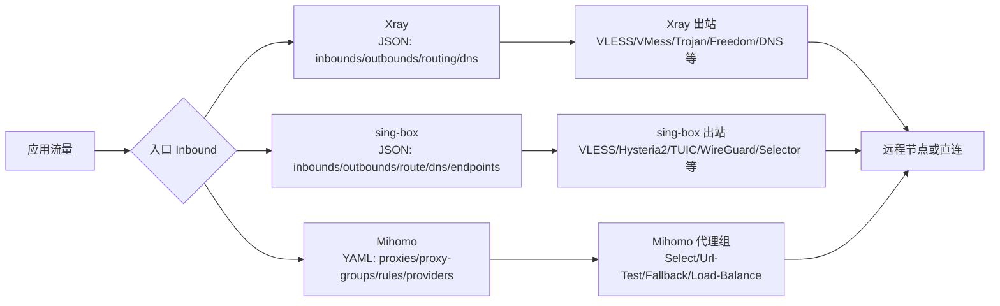
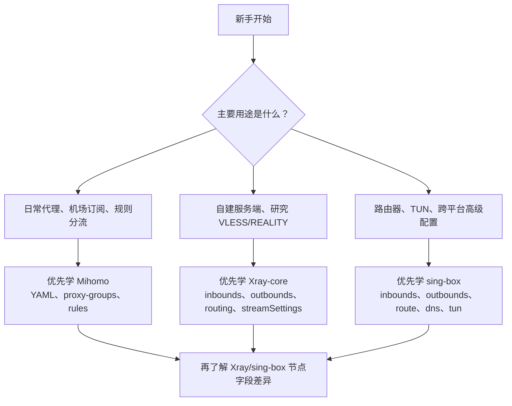

[toc]

## abstract

- **Xray** 更像“VLESS/REALITY/XTLS 体系的原生核心”，适合精细控制代理协议和自建服务端；
- **sing-box** 更像“现代通用代理平台”，配置模型统一、协议广、跨平台和 TUN 能力强；
- **Mihomo** 更像“Clash 规则代理生态的现代核心”，最适合订阅、代理组、规则分流、图形前端和日常客户端使用。

------

## 总览对比

| 维度         | Xray-core                                    | sing-box                                                     | Mihomo                                                       |
| ------------ | -------------------------------------------- | ------------------------------------------------------------ | ------------------------------------------------------------ |
| 核心定位     | XTLS/Xray 生态核心                           | 通用代理平台                                                 | Clash.Meta 系规则代理核心                                    |
| 配置格式     | JSON/JSONC 风格                              | JSON                                                         | YAML                                                         |
| 典型用户     | 自建节点、精调协议、服务端部署               | 高级客户端、服务端、路由器、移动端                           | 桌面/移动代理客户端、订阅分流用户                            |
| 代表能力     | VLESS、XTLS Vision、REALITY、XHTTP           | VLESS、VMess、Trojan、Shadowsocks、Hysteria2、TUIC、WireGuard/Tailscale endpoint、Tor、SSH 等 | VLESS、VMess、Trojan、Shadowsocks、Hysteria2、TUIC、WireGuard、Tailscale、OpenVPN、MASQUE 等 |
| 规则系统     | `routing.rules`                              | `route.rules` 加 rule-set                                    | `rules` 加 rule-providers                                    |
| 代理组       | 有 balancer，但不是 Clash 风格               | `selector`、`urltest` 等 outbound                            | `select`、`url-test`、`fallback`、`load-balance`、`relay`    |
| 订阅生态     | 通常依赖前端或转换器                         | 支持但生态更偏技术用户                                       | 最强，Clash/Mihomo 订阅生态成熟                              |
| DNS 能力     | 内置 DNS，服务于路由、出站解析、透明代理劫持 | DNS 模块非常细，可配多种 DNS server、规则和 FakeIP           | Clash 风格 DNS，Fake-IP、nameserver-policy、proxy-server-nameserver 等 |
| TUN 能力     | 已有 TUN inbound，平台自动配置能力较新       | TUN 能力强，尤其 Linux/Android/路由器场景                    | 客户端日常使用方便，前端支持普遍                             |
| 新手友好度   | 中等偏难                                     | 偏难                                                         | 相对最友好                                                   |
| 配置可维护性 | 强但字段多                                   | 强但变动较快，需要跟版本                                     | 订阅加规则维护最方便                                         |

Xray 官方文档强调其原创协议包括 VLESS、XTLS、XUDP、XHTTP、REALITY，并说明其路由和 DNS 系统支持按域名、IP、端口、协议、进程、用户等维度进行细粒度调度。([xtls.github.io](https://xtls.github.io/en/)) sing-box 官方文档说明它使用 JSON 配置，主要结构包括 `dns`、`inbounds`、`outbounds`、`route`、`endpoints`、`services` 等模块。([Sing Box](https://sing-box.sagernet.org/configuration/)) Mihomo 文档则围绕 Clash 风格的 proxies、proxy-providers、proxy-groups、rules、rule-providers、DNS、TUN 等模块组织。([虚空终端](https://wiki.metacubex.one/en/config/))

------

## 三者的核心定位

## Xray-core

Xray-core 的强项在于 **VLESS、REALITY、XTLS Vision、XHTTP 等 Xray/XTLS 原生能力**。如果你自建服务端，尤其是使用 VLESS REALITY Vision、XHTTP、复杂 fallback、透明代理、精细路由，Xray 往往是最“原生”的选择。Xray 文档明确说明 VLESS 是无状态轻量传输协议，认证方式为 UUID，不像 VMess 那样依赖系统时间；同时也提醒 VLESS 通常必须配合外层传输安全层，除非链路可信或启用 VLESS Encryption。([xtls.github.io](https://xtls.github.io/en/config/inbounds/vless.html))

可以把 Xray 理解成：

- 更接近协议原生实现。
- 更适合服务端和高级客户端。
- 更适合研究 VLESS、REALITY、XTLS、XHTTP 这些 Xray 生态功能。
- 配置自由度高，但新手排错成本也更高。

------

## sing-box

sing-box 的设计更像 **统一代理平台**。它不是只围绕 VLESS/VMess，而是把多种协议、TUN、DNS、路由、rule-set、endpoint、API 等能力整合进一套 JSON 配置。官方 outbound 文档列出支持 direct、block、SOCKS、HTTP、Shadowsocks、VMess、Trojan、WireGuard、Hysteria、VLESS、ShadowTLS、TUIC、Hysteria2、AnyTLS、Snell、Tor、SSH、selector、urltest 等类型。([Sing Box](https://sing-box.sagernet.org/configuration/outbound/))

可以把 sing-box 理解成：

- 协议覆盖广。
- 配置模型统一。
- TUN、DNS、路由能力强。
- 跨平台前端生态活跃。
- 版本演进较快，需要关注废弃字段和迁移文档。

一个重要的现代化注意点是：sing-box 已经逐步弃用并移除了传统 GeoIP/Geosite 依赖，官方废弃文档说明 GeoIP 和 Geosite 在 1.8.0 被弃用，并在 1.12.0 移除，推荐使用 rule-set 替代。([Sing Box](https://sing-box.sagernet.org/deprecated/)) 所以新手不要照搬老 sing-box 配置里的 `geoip`、`geosite` 写法。

------

## Mihomo

Mihomo 是 Clash.Meta 系内核的现代延续，更强调 **客户端使用体验、订阅、代理组、规则分流和图形前端生态**。它保留 Clash 风格 YAML 配置，同时扩展了大量现代协议。Mihomo 配置索引中列出的代理类型包括 Shadowsocks、VMess、VLESS、Trojan、AnyTLS、Hysteria、Hysteria2、TUIC、WireGuard、Tailscale、SSH、MASQUE、OpenVPN 等。([虚空终端](https://wiki.metacubex.one/en/config/))

可以把 Mihomo 理解成：

- 日常客户端最顺手。
- 订阅、代理组、规则集生态最好。
- YAML 配置对普通用户更直观。
- 与 Clash Verge Rev、FlClash、Clash Meta for Android、OpenClash 等前端适配度高。
- 不一定是所有 Xray 协议细节的“原生上游”，但实用性很强。

------

## 架构模型对比



区别的本质不只是“支持哪些协议”，而是 **配置思想不同**：

| 内核     | 配置思想                                        | 新手理解                                   |
| -------- | ----------------------------------------------- | ------------------------------------------ |
| Xray     | 入口、出站、路由、DNS、策略高度模块化           | “我要精确描述每个连接怎么进来、怎么出去”   |
| sing-box | 所有功能统一成 JSON 对象，路由和 DNS 都可规则化 | “我要用一套现代 JSON 配置管理整个代理系统” |
| Mihomo   | 节点加代理组加规则，围绕 Clash 订阅生态         | “我要方便地选节点、测速、分流和订阅更新”   |

------

## 协议支持对比

| 协议或能力   | Xray-core         | sing-box                                        | Mihomo               | 说明                                                     |
| ------------ | ----------------- | ----------------------------------------------- | -------------------- | -------------------------------------------------------- |
| VLESS        | 强                | 支持                                            | 支持                 | Xray 是 VLESS/REALITY 原生生态重点                       |
| VMess        | 支持              | 支持                                            | 支持                 | 老生态常见，但新部署通常更倾向 VLESS/Trojan/Hysteria2 等 |
| Trojan       | 支持              | 支持                                            | 支持                 | 三者都常见                                               |
| Shadowsocks  | 支持              | 支持                                            | 支持                 | 基础代理协议                                             |
| REALITY      | 强                | 支持                                            | 支持                 | Xray 原生性最好，Mihomo/sing-box 用作客户端也常见        |
| XTLS Vision  | 强                | 支持 VLESS flow                                 | 支持 VLESS flow      | 字段和行为细节要看各自文档                               |
| XHTTP        | 强                | 视版本和传输支持                                | 支持情况需看当前文档 | 高级用法不建议新手盲目迁移                               |
| Hysteria2    | 支持              | 强                                              | 支持                 | sing-box 对 Hysteria2、TUIC 等现代协议支持较完整         |
| TUIC         | 不作为主力        | 支持                                            | 支持                 | 常见于现代 UDP/QUIC 类代理                               |
| WireGuard    | 支持              | endpoint 体系更现代                             | 支持                 | sing-box 已将旧 WireGuard outbound 迁移为 endpoint 思路  |
| Tailscale    | 非主打            | endpoint 支持                                   | 支持                 | 适合内网组网类场景                                       |
| Clash 代理组 | 非原生 Clash 风格 | 有 selector/urltest，但不是完整 Clash YAML 生态 | 强                   | Mihomo 优势明显                                          |

sing-box 的 VLESS outbound 文档列出 `server`、`server_port`、`uuid`、`flow`、`network`、`tls`、`packet_encoding`、`multiplex`、`transport` 等字段，并说明 `flow` 可用 `xtls-rprx-vision`。([Sing Box](https://sing-box.sagernet.org/configuration/outbound/vless/)) Mihomo 的 VLESS 文档也列出 `uuid`、`flow: xtls-rprx-vision`、`packet-encoding`、`encryption`、`reality-opts`、`client-fingerprint` 等字段。([虚空终端](https://wiki.metacubex.one/en/config/proxies/vless/))

------

## 配置格式对比

## Xray 示例风格

Xray 常见配置是 JSON/JSONC：

```jsonc
{
  "inbounds": [
    {
      "tag": "socks-in",
      "protocol": "socks",
      "listen": "127.0.0.1",
      "port": 10808
    }
  ],
  "outbounds": [
    {
      "tag": "proxy",
      "protocol": "vless",
      "settings": {
        "vnext": []
      },
      "streamSettings": {}
    },
    {
      "tag": "direct",
      "protocol": "freedom"
    }
  ],
  "routing": {
    "rules": []
  }
}
```

Xray 的 `routing` 模块通过规则把入站流量送到不同 outbound；官方文档说明 `routing` 可通过不同规则把流量发往不同出站，常用于国内外分流，并提供 `domainStrategy`、`rules`、`balancers` 等配置。([xtls.github.io](https://xtls.github.io/en/config/routing.html))

------

## sing-box 示例风格

sing-box 使用 JSON：

```json
{
  "log": {
    "level": "info"
  },
  "inbounds": [
    {
      "type": "mixed",
      "tag": "mixed-in",
      "listen": "127.0.0.1",
      "listen_port": 7890
    }
  ],
  "outbounds": [
    {
      "type": "selector",
      "tag": "select",
      "outbounds": ["proxy", "direct"]
    },
    {
      "type": "direct",
      "tag": "direct"
    }
  ],
  "route": {
    "rules": [],
    "final": "select"
  }
}
```

sing-box 官方文档中，`selector` outbound 用于在多个 outbound tag 中选择，且目前只能通过 Clash API 控制；`urltest` outbound 则用于对多个出站进行延迟测试，默认测试 URL 可用 `https://www.gstatic.com/generate_204`。 ([Sing Box](https://sing-box.sagernet.org/configuration/outbound/selector/))

------

## Mihomo 示例风格

Mihomo 使用 YAML：

```yaml
mixed-port: 7890
mode: rule
log-level: info

proxies:
  - name: "proxy"
    type: vless
    server: example.com
    port: 443
    uuid: "00000000-0000-0000-0000-000000000000"
    network: tcp
    tls: true
    servername: example.com
    client-fingerprint: chrome

proxy-groups:
  - name: "PROXY"
    type: select
    proxies:
      - "proxy"
      - DIRECT

rules:
  - GEOIP,CN,DIRECT
  - MATCH,PROXY
```

Mihomo 的规则系统支持 `PROCESS-NAME`、`UID`、`NETWORK`、`RULE-SET`、逻辑规则 `AND/OR/NOT` 和 `MATCH` 等；其中 `MATCH` 是无条件匹配，通常作为兜底规则放在末尾。([虚空终端](https://wiki.metacubex.one/en/config/rules/))

------

## 规则分流能力对比

| 能力       | Xray-core                | sing-box         | Mihomo                                |
| ---------- | ------------------------ | ---------------- | ------------------------------------- |
| 域名规则   | 支持                     | 支持             | 支持                                  |
| IP CIDR    | 支持                     | 支持             | 支持                                  |
| 进程分流   | 支持                     | 支持             | 支持，桌面和 Android 前端常用         |
| 端口分流   | 支持                     | 支持             | 支持                                  |
| 协议嗅探   | 支持                     | 支持             | 支持                                  |
| 规则集下载 | 不是 Clash provider 风格 | rule-set 体系    | rule-providers 体系成熟               |
| 代理组选择 | balancer                 | selector/urltest | select/url-test/fallback/load-balance |
| 新手可读性 | 中等                     | 中等偏难         | 较好                                  |

Xray 更像“按 tag 把流量路由到出站”；sing-box 更像“以 route rules 和 rule-set 为中心组织流量”；Mihomo 更像“规则命中一个代理组，再由代理组选择节点”。

------

## DNS 能力对比

| 维度             | Xray-core                       | sing-box                 | Mihomo                             |
| ---------------- | ------------------------------- | ------------------------ | ---------------------------------- |
| 内置 DNS         | 有                              | 有                       | 有                                 |
| DNS 与路由联动   | 有                              | 很强                     | 强                                 |
| Fake-IP          | 支持相关能力，但配置思路偏 Xray | 有专门 FakeIP DNS server | Clash 风格 fake-ip 常用            |
| 按域名选择 DNS   | 支持                            | 支持 DNS rule            | `nameserver-policy` 常用           |
| 代理节点域名解析 | 通过 DNS 和出站策略组合         | 通过 dial/dns 配置组合   | `proxy-server-nameserver` 专门处理 |
| 新手难度         | 中等偏高                        | 高                       | 中等                               |

Xray 文档说明其内置 DNS 主要用于三个场景：路由阶段解析域名以匹配 IP 规则、为出站连接解析目标地址、以及 TUN/透明代理场景中的 DNS 劫持。([xtls.github.io](https://xtls.github.io/en/config/dns.html)) Mihomo DNS 文档则提供 `nameserver-policy`、`proxy-server-nameserver`、`proxy-server-nameserver-policy` 等字段，其中 `proxy-server-nameserver` 专门用于解析代理节点自身的域名。([虚空终端](https://wiki.metacubex.one/en/config/dns/))

对新手的实际建议：

| 场景                     | 推荐                                                         |
| ------------------------ | ------------------------------------------------------------ |
| 普通 Clash/Mihomo 客户端 | 优先使用 Mihomo DNS，配合 `fake-ip` 或 `redir-host`          |
| 路由器透明代理           | sing-box 或 Mihomo 都常见，重点是 DNS 劫持和回环避免         |
| Xray 自建服务端          | DNS 先保持简单，只在需要分流、透明代理、特殊解析时配置       |
| 节点域名解析异常         | Mihomo 检查 `proxy-server-nameserver`，sing-box 检查 DNS server detour/dial，Xray 检查 DNS 和出站域名策略 |

------

## TUN 和透明代理对比

| 维度       | Xray-core                      | sing-box                   | Mihomo                    |
| ---------- | ------------------------------ | -------------------------- | ------------------------- |
| TUN 支持   | 有 TUN inbound                 | 很强，文档细致             | 很适合客户端前端使用      |
| 自动路由   | 部分平台支持                   | 强，尤其 Linux、Android 等 | 前端通常封装好            |
| DNS 劫持   | 可通过 DNS outbound 和路由组合 | 与 TUN、DNS 模块结合紧密   | 配置相对直观              |
| 路由器场景 | 可用但配置偏工程化             | 很适合                     | OpenClash/mihomo 生态成熟 |
| 新手体验   | 较难                           | 中等偏难                   | 前端友好                  |

Xray TUN 文档说明，如果未配置 `autoSystemRoutingTable`，仍需手动添加系统路由；并提醒要注意流量回环问题，建议通过 `autoOutboundsInterface` 或出站接口绑定避免 Xray 自身流量重新进入 TUN。([xtls.github.io](https://xtls.github.io/en/config/inbounds/tun.html)) sing-box TUN 文档说明 `auto_route` 会把默认路由设置到 TUN，并提醒需要设置 `route.auto_detect_interface`、`route.default_interface` 或 outbound 绑定接口来避免流量回环；在 Linux 上还推荐使用 `auto_redirect` 以获得更好的路由和性能。([Sing Box](https://sing-box.sagernet.org/configuration/inbound/tun/))

------

## 代理组和订阅生态对比

## Mihomo 最强

Mihomo 的优势在于：

- `proxy-providers` 管理订阅节点。
- `rule-providers` 管理规则集。
- `proxy-groups` 管理选择、测速、故障切换、负载均衡。
- 前端 UI 普遍围绕 Clash API 和代理组设计。
- 机场订阅、规则模板、订阅转换工具主要围绕 Clash/Mihomo 格式。

Mihomo 的 proxy-provider 支持 `http`、`file`、`inline`，并支持更新间隔、下载代理、大小限制等配置。([虚空终端](https://wiki.metacubex.one/en/config/proxy-providers/)) rule-provider 也支持 `http`、`file`、`inline`，并通过 `behavior: domain/ipcidr/classical` 区分规则类型。([虚空终端](https://wiki.metacubex.one/en/config/rule-providers/))

## sing-box 次之，但更工程化

sing-box 也有 `selector`、`urltest` 等能力，但它不是原生 Clash YAML 订阅模型，而是用 JSON 出站对象来组织。优点是结构统一，缺点是对普通订阅用户不如 Mihomo 直观。

## Xray 更偏协议和路由，不偏订阅 UI

Xray 也能做复杂路由和平衡，但日常“订阅、节点选择、测速、前端 UI”通常不是 Xray-core 本体的重点，而是由 v2rayN、NekoRay、NekoBox、Hiddify 等前端或转换器承担。

------

## 三者在 v2rayN、Clash 客户端中的关系

| 客户端或前端                        | 常见内核          | 说明                                    |
| ----------------------------------- | ----------------- | --------------------------------------- |
| v2rayN                              | Xray、sing-box 等 | v2rayN 是 GUI 管理器，可调用不同内核    |
| NekoRay/NekoBox                     | sing-box、Xray 等 | 更偏技术用户，多内核适配                |
| Clash Verge Rev                     | Mihomo            | 典型 Mihomo 桌面前端                    |
| Clash Meta for Android              | Mihomo            | Android 上的 Mihomo/Clash.Meta 生态前端 |
| OpenClash                           | Clash/Mihomo      | OpenWrt 上常见，订阅和规则生态成熟      |
| sing-box for Android/iOS 派生客户端 | sing-box          | 更贴近 sing-box 原生模型                |

核心区别是：**v2rayN 是“管理器”，Xray/sing-box 是“可被调用的内核”；Clash Verge Rev 这类前端通常围绕 Mihomo 内核和 Clash API 设计。**

------

## 配置迁移时最容易踩坑的地方

| 迁移方向             | 常见坑                                          | 解释                                                         |
| -------------------- | ----------------------------------------------- | ------------------------------------------------------------ |
| Xray 到 Mihomo       | 字段名不同                                      | Xray 用 `streamSettings`、`settings.vnext` 等，Mihomo 用 `network`、`tls`、`reality-opts` |
| Xray 到 sing-box     | JSON 结构不同                                   | 两者都是 JSON，但对象模型不是一回事                          |
| sing-box 到 Mihomo   | rule-set 和 rule-provider 不等价                | sing-box 的 rule-set 不是 Mihomo 的 rule-providers           |
| Mihomo 到 sing-box   | 代理组语义不同                                  | Mihomo 的 `proxy-groups` 不能直接复制为 sing-box outbounds   |
| 老 sing-box 配置升级 | GeoIP/Geosite 失效                              | sing-box 已弃用并移除老 GeoIP/Geosite，应用 rule-set 替代    |
| VLESS REALITY 迁移   | SNI、fingerprint、public key、short id 名称不同 | 各内核字段名不同，但语义必须一致                             |
| TUN 迁移             | 自动路由和 DNS 劫持行为不同                     | 每个内核对系统路由、接口绑定、DNS 劫持的实现细节不同         |

------

## 选择建议

| 你的需求                                                   | 优先选择                                        | 原因                                                 |
| ---------------------------------------------------------- | ----------------------------------------------- | ---------------------------------------------------- |
| 我要自建 VLESS REALITY Vision 服务端                       | Xray-core                                       | 原生支持最强，文档围绕 VLESS/REALITY/XTLS 展开       |
| 我要一个日常桌面代理客户端                                 | Mihomo                                          | 订阅、代理组、规则、前端生态最方便                   |
| 我要在路由器或 Linux 上做透明代理                          | sing-box 或 Mihomo                              | sing-box 工程化强，Mihomo 订阅生态好                 |
| 我要 Android/iOS 上统一代理                                | sing-box 或 Mihomo                              | 看具体前端，sing-box 原生模型强，Mihomo 规则组体验好 |
| 我要使用机场 Clash 订阅                                    | Mihomo                                          | 格式匹配度最高                                       |
| 我要使用多种现代协议，如 Hysteria2、TUIC、AnyTLS、Tor、SSH | sing-box                                        | 协议覆盖广，结构统一                                 |
| 我要研究 Xray 协议细节                                     | Xray-core                                       | 最贴近 Xray/XTLS 原生语义                            |
| 我不想写复杂配置，只想导入节点                             | v2rayN 加 Xray/sing-box，或 Clash 前端加 Mihomo | 前端屏蔽了大量配置细节                               |

------

## 新手推荐路线



------

## 实用最佳实践

## 使用 Xray-core 时

- 优先从最小配置开始，不要一上来堆 fallback、sniffing、DNS、TUN、API。
- VLESS 公网部署应配合 TLS、REALITY 或明确的 VLESS Encryption，不要把 `security: none` 当作默认安全方案。
- REALITY/Vision 场景重点核对 `serverName`、`publicKey`、`shortId`、`fingerprint`、`flow`。
- 透明代理和 TUN 场景重点防止流量回环。
- 服务端和客户端配置要成对理解，不能只看客户端分享链接。

## 使用 sing-box 时

- 先确认当前版本，再看对应版本文档。
- 不要照搬老配置中的 GeoIP/Geosite，现代配置应迁移到 rule-set。
- 尽量用 `sing-box check` 检查配置，官方文档也列出 `sing-box check`、`sing-box format`、`sing-box merge` 等命令。([Sing Box](https://sing-box.sagernet.org/configuration/))
- TUN 场景一定处理好默认路由、接口识别和 DNS 劫持。
- `selector`、`urltest`、`route.final` 的关系要先搞清楚，再做复杂分流。

## 使用 Mihomo 时

- 优先使用 `proxy-providers` 管理订阅，用 `proxy-groups` 组织节点，用 `rule-providers` 管理规则。
- `MATCH` 放最后，局域网和直连规则放前面。
- 节点名尽量稳定，否则规则组引用容易失效。
- `proxy-server-nameserver` 很重要，它专门影响代理节点域名本身如何解析。
- `url-test` 不要设置过短间隔，频繁测速会影响体验，也可能被服务端限制。

------

## 最简选型结论

| 结论                             | 推荐                                                   |
| -------------------------------- | ------------------------------------------------------ |
| 学习代理规则和日常使用           | 先学 Mihomo                                            |
| 学习 VLESS、REALITY、服务端      | 再学 Xray                                              |
| 学习跨平台透明代理、复杂 DNS/TUN | 再学 sing-box                                          |
| 想少踩坑                         | 不要在三个内核之间直接复制配置，必须按字段语义重新映射 |
| 想长期维护                       | 节点、代理组、规则、DNS、TUN 分层管理                  |

**最适合新手的顺序**：先用 Mihomo 理解“节点、代理组、规则、DNS”；再用 Xray 理解“协议和服务端”；最后用 sing-box 理解“统一代理平台、TUN、rule-set 和跨平台工程化配置”。